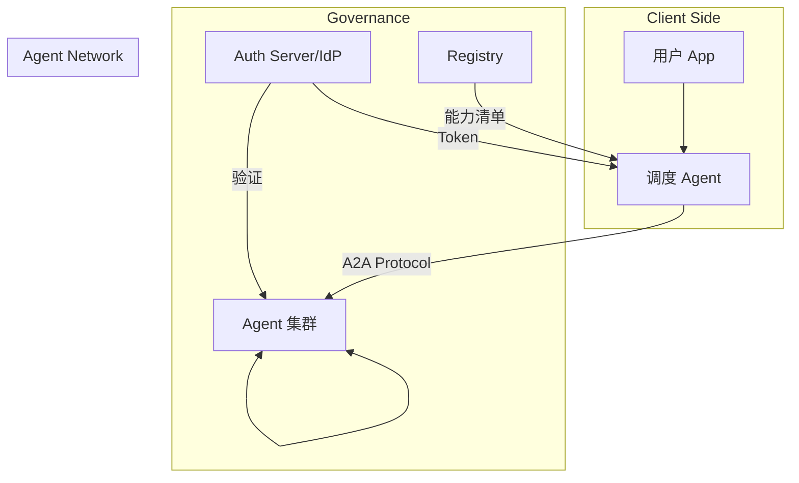

# Agent2Agent (A2A) 协议技术白皮书

## 1. 概述 (Overview)

**Agent2Agent (A2A)** 是一套由 Google 贡献给 Linux 基金会的开源标准协议，旨在为 AI 智能体定义通用的“外交语言”，实现跨框架、跨模型、跨公司的互操作性（Interoperability）。

它定义了 AI Agent 之间**相互发现、建立信任、协商任务以及交付结果**的标准流程。

**核心定位**：
*   **不是框架**：不绑定 LangChain, CrewAI 等任何实现。
*   **不是模型**：不绑定 GPT-4, Claude 3.5 等任何底层模型。
*   **是协议**：类似于 HTTP，定义通信格式和行为准则。

---

## 2. 核心概念 (Core Concepts)

### 2.1 关键实体定义
| 实体 | 定义 | 核心作用 |
| :--- | :--- | :--- |
| **代理卡片 (Agent Card)** | 公共元数据文件 (`/.well-known/agent-card.json`) | Agent 的“数字名片”，声明能力、接口 URL 和认证要求。 |
| **A2A 服务器 (Server)** | 实现 A2A 接口并暴露端点的 Agent 服务 | 服务提供方，管理任务执行与状态机。 |
| **A2A 客户端 (Client)** | 消费 A2A 服务的应用或另一个 Agent | 请求发起方，负责发现、认证与指令发送。 |
| **任务 (Task)** | 工作的中心单位 | 代表具体目标，拥有唯一 ID 及状态流转 (SUBMITTED $\rightarrow$ COMPLETED)。 |
| **消息 (Message)** | 通信轮次 (Turn) | 包含角色 (User/Agent) 和多个内容部件 (Parts)。 |
| **部件 (Part)** | 最小内容单位 | 分为 `TextPart` (文本), `FilePart` (文件), `DataPart` (结构化数据)。 |
| **工件 (Artifact)** | 任务产出物 | Agent 生成的最终或中间结果。 |

### 2.2 数据结构概览
- **Agent Card**: 关键字段包括 `name`, `supportedInterfaces`, `capabilities`, `security_schemes`, `skills`。
- **Task**: 关键字段包括 `id`, `contextId`, `status` (state, message), `artifacts`。
- **Message**: 关键字段包括 `messageId`, `taskId`, `role`, `parts` (text/data)。

---

## 3. 部署架构 (Deployment Architecture)

### 3.1 企业级拓扑

### 3.2 关键部署模式
- **Hub-and-Spoke (中心辐射型)**：由中心 Orchestrator 强管控分发，Agent 仅与中心通信。
- **Mesh (网状协作型)**：Agent 间直接通过 A2A 协议对等调用，适用于高度自主协作。

---

## 4. 安全与授权 (Security & Authorization)

A2A 采用 **“Server 声明 $\rightarrow$ Client 适配”** 的声明式安全模型。

### 4.1 认证机制
- **声明方式**：在 `Agent Card` 的 `security_schemes` 中定义。
- **常见方案**：
    - **API Key**: 简单、适用于私有/快速集成。
    - **OAuth2/OIDC**: 企业级、支持委托身份与权限细粒度控制。
    - **mTLS**: 传输层双向认证，适用于极高安全场景。

### 4.2 特色功能：认证中断 (Auth Interruption)
当 Agent 在执行过程中需要更高权限时，可返回 `TASK_STATE_AUTH_REQUIRED` 状态。Client 捕捉后引导用户授权，携带新凭证后任务恢复执行。

### 4.3 真实性保障
- **HTTPS**: 强制传输加密。
- **名片签名**: 基于 **RFC 7515 JWS** 确保 Agent Card 未被篡改。

---

## 5. 架构分析 (STAR Framework)

- **S (Situation)**: AI Agent 生态碎片化，厂商孤岛严重，缺乏统一通信标准。
- **T (Task)**: 构建框架无关、厂商中立的标准，实现互操作性、能力不透明性与自主协作。
- **A (Action)**: 通过 `AgentCard` 解耦能力发现 $\rightarrow$ 引入 `Task` 状态机管理生命周期 $\rightarrow$ 基于 `JSON-RPC/SSE/Protobuf` 构建技术栈。
- **R (Result)**: 实现了 **发现 $\rightarrow$ 认证 $\rightarrow$ 协商 $\rightarrow$ 执行 $\rightarrow$ 交付** 的闭环对等协作体系。

---

## 6. 技术架构与逻辑流 (Technical Architecture)

### 6.1 逻辑架构
**发现层** (Agent Card) $\rightarrow$ **安全层** (Auth Handshake) $\rightarrow$ **执行层** (Task State Machine) $\rightarrow$ **交付层** (Artifacts)。

### 6.2 任务状态流转
`SUBMITTED` $\rightarrow$ `WORKING` $\rightleftharpoons$ (`INPUT_REQUIRED` / `AUTH_REQUIRED`) $\rightarrow$ (`COMPLETED` / `FAILED` / `REJECTED`)。

### 6.3 协作序列
`发现名片` $\rightarrow$ `身份认证` $\rightarrow$ `发送消息 (创建 Task)` $\rightarrow$ `SSE 异步更新` $\rightarrow$ `获取最终 Artifacts`。

---

## 7. 技术细节 (Detailed Specification)

### 7.1 技术栈
- **传输**: `HTTPS`
- **调用**: `JSON-RPC 2.0`
- **实时**: `SSE` (Server-Sent Events)
- **定义**: `Protobuf` (强类型约束)

### 7.2 核心工作流
1. **发现**: 通过 Well-known URI, 策展注册表或直接配置获取 Agent Card。
2. **认证**: 根据声明的 `security_schemes` 建立信任通道。
3. **执行**: 基于 `SendMessage` 发起任务，通过 `context_id` 维持会话，通过 `task_id` 追踪单元。

---

## 8. 关键数据模型 (Data Models)

- **Task**: 核心调度单位。强调 **不可变性** (终结状态后不可修改) 和 **LRO** (长时运行) 可追踪性。
- **Message**: 多部分结构。支持 `text`, `data`, `raw`, `url`。支持 `reference_task_ids` 实现精细化修改 (Refinement)。
- **Artifact**: 最终交付物。支持 **增量更新 (Append)** 和多模态 `mime_type`。

---

## 9. 可扩展性 (Extensibility)

### 9.1 协议绑定 (Protocol Bindings)
改变传输层而不改变逻辑。支持 `JSON-RPC`, `gRPC` 等，允许自定义（如 `WebSockets` 降低延迟）。

### 9.2 协议扩展 (Extensions)
在不破坏核心协议前提下增加功能。通过 `A2A-Extensions` HTTP Header 进行协商激活。
- **类型**: 数据扩展 (GDPR)、方法扩展 (新 RPC)、状态扩展 (子状态)。

---

## 10. 实操示例 (Interaction Example)

**场景：图片生成 $\rightarrow$ 颜色修改 (Refinement)**
1. **请求**: `SendMessage` $\rightarrow$ "生成帆船图片"。
2. **响应**: 返回 `Task (COMPLETED)` $\rightarrow$ `Artifact (sailboat.png)`。
3. **修改**: `SendMessage` (携带 `contextId` + `referenceTaskIds`) $\rightarrow$ "改为红色"。
4. **结果**: 返回新 `Task` $\rightarrow$ 新 `Artifact` (同名，不同 ID)。

---

## 11. 常见问题 (FAQ)

- **vs MCP**: MCP 是 `模型 $\rightarrow$ 工具` (能力增强)，A2A 是 `智能体 $\leftrightarrow$ 智能体` (实体协作)。
- **大文件**: 严禁 Base64，必须使用 `Part.url` 指向预签名 URL。
- **拒绝请求**: 使用 `TASK_STATE_REJECTED` 并提供理由。
- **上下文管理**: 建议服务端实现 TTL (如 24h) 自动清理。

---

## 12. 实现指南 (Implementation Guide)

### 12.1 服务器端 (Server)
- **持久化**: Task 状态必须持久化以支持 LRO。
- **健壮性**: SSE 需处理断线重连，能力声明需精准。
- **隔离**: 严格实现 `tenant` 路由，确保上下文绝对隔离。

### 12.2 客户端 (Client)
- **链路**: 实现 `Well-known` $\rightarrow$ `Registry` $\rightarrow$ `Config` 的自动化发现。
- **管理**: 实现 Token 自动刷新与 Artifact 版本历史追踪。
- **降级**: 不支持 streaming 时自动回退至定时轮询。

### 12.3 避坑指南
- **重复创建**: 使用 `idempotency_key` 去重。
- **上下文丢失**: 强制所有请求携带 `context_id`。
- **死锁**: 为 `INPUT_REQUIRED` 设置超时。
