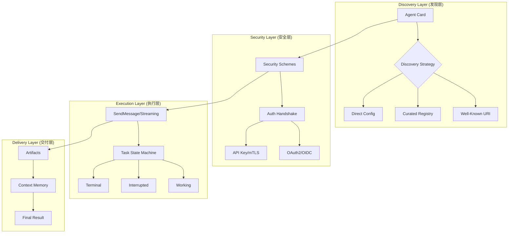
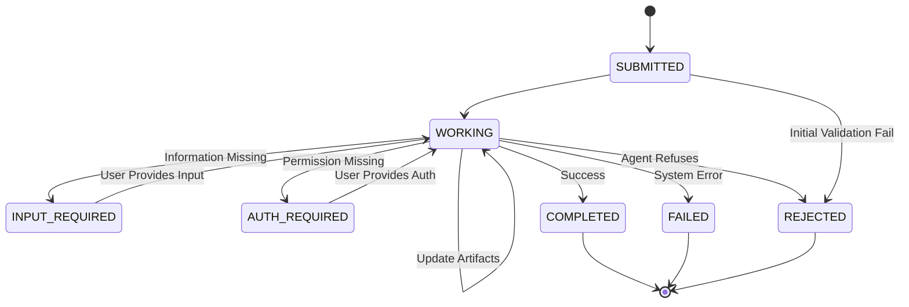
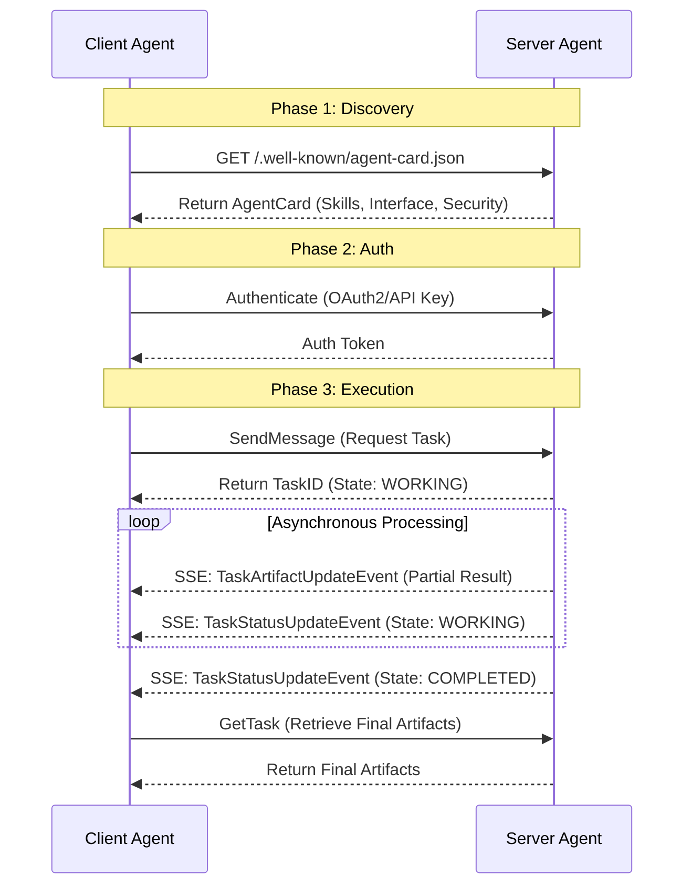

# Agent2Agent (A2A) 协议技术白皮书

## 1. 概述 (Overview)

### 1.1 什么是 A2A？
**Agent2Agent (A2A)** 是一套由 Google 贡献给 Linux 基金会的开源标准协议。它旨在为 AI 智能体（AI Agents）定义一套通用的“外交语言”，使得来自不同框架、不同公司、基于不同模型构建的智能体能够实现互操作性（Interoperability）。

简单来说，A2A 定义了 AI Agent 之间如何**相互发现、建立信任、协商任务以及交付结果**的标准流程。

### 1.2 A2A 的核心定位
*   **不是框架**：它不关心你使用 LangChain, CrewAI 还是 AutoGPT。
*   **不是模型**：它不关心你底层使用的是 GPT-4, Claude 3.5 还是 Llama 3。
*   **是协议**：它类似于互联网的 HTTP 协议，定义了通信的格式和行为准则。

---

## 2. 核心概念定义 (Core Concepts)

在深入技术架构前，需要理解 A2A 协议定义的六大核心实体：

### 2.1 代理卡片 (Agent Card)
**定义**：一个公共元数据文件（通常位于 `/.well-known/agent-card.json`），它是 Agent 的“数字名片”。
- **作用**：描述代理的能力、支持的技能、端点 URL 和认证要求。
- **JSON 示例**：
```json
{
  "name": "Weather Agent",
  "description": "提供全球实时天气查询与预报服务",
  "version": "1.0.0",
  "supportedInterfaces": [
    {
      "url": "https://weather.example.com/a2a/v1",
      "protocolBinding": "JSONRPC",
      "protocolVersion": "1.0"
    }
  ],
  "capabilities": {
    "streaming": true,
    "push_notifications": false
  },
  "security_schemes": {
    "api_key": {
      "api_key_security_scheme": {
        "location": "header",
        "name": "X-API-KEY"
      }
    }
  },
  "skills": [
    {
      "id": "get_weather",
      "name": "查询天气",
      "description": "根据城市名称提供当前天气状况",
      "tags": ["weather", "real-time"],
      "examples": ["查询北京今天的天气"]
    }
  ]
}
```


### 2.2 A2A 服务器 (A2A Server)
**定义**：实现了 A2A 协议接口并暴露 HTTP 端点的智能体服务。
- **作用**：作为服务提供方，接收请求、管理任务执行、维护状态机并交付结果。

### 2.3 A2A 客户端 (A2A Client)
**定义**：消费 A2A 服务的应用程序或另一个智能体。
- **作用**：作为请求发起方，负责发现服务器、执行认证并发送指令。

### 2.4 任务 (Task)
**定义**：A2A 中工作的中心单位，代表一个需要执行的具体目标。
- **特性**：拥有唯一 ID，经历从 `SUBMITTED` 到 `COMPLETED` 的状态流转。
- **JSON 示例**：
```json
{
  "id": "task-12345",
  "contextId": "ctx-abc-789",
  "status": {
    "state": "TASK_STATE_WORKING",
    "message": {
      "role": "ROLE_AGENT",
      "parts": [{ "text": "正在检索航班信息，请稍候..." }]
    },
    "timestamp": "2026-10-17T10:00:00Z"
  },
  "artifacts": [],
  "metadata": {
    "priority": "high",
    "category": "travel"
  }
}
```

### 2.5 消息 (Message)
**定义**：客户端与代理之间的一次通信轮次（Turn）。
- **结构**：包含发送者角色（User/Agent）和多个内容部件（Parts）。
- **JSON 示例**：
```json
{
  "messageId": "msg-user-001",
  "contextId": "ctx-abc-789",
  "taskId": "task-12345",
  "role": "ROLE_USER",
  "parts": [
    {
      "text": "我想预订一张去东京的机票",
      "mediaType": "text/plain"
    },
    {
      "data": { "date": "2026-12-01", "class": "business" },
      "mediaType": "application/json"
    }
  ],
  "metadata": {
    "client_version": "1.2.0"
  }
}
```

### 2.6 部件 (Part) 与 工件 (Artifact)
- **部件 (Part)**：消息或工件中的最小内容单位。
    - `TextPart`: 纯文本（如指令）。
    - `FilePart`: 文件数据（如图片、PDF）。
    - `DataPart`: 结构化 JSON 数据。
- **工件 (Artifact)**：代理在任务期间生成的最终或中间输出。
- **JSON 示例 (Artifact)**：
```json
{
  "artifactId": "art-ticket-v1",
  "name": "flight_itinerary.pdf",
  "description": "预订成功的机票行程单",
  "parts": [
    {
      "filename": "itinerary.pdf",
      "mediaType": "application/pdf",
      "raw": "base64_encoded_pdf_content..."
    }
  ],
  "metadata": {
    "page_count": 1,
    "generated_by": "booking-agent-v1"
  }
}
```
务是“生成报告”，最终生成的 `report.pdf` 就是一个 Artifact。

---

## 3. 架构抽象分析 (STAR Framework)

### 3.1 背景与挑战 (Situation)
在 AI Agent 的生态演进中，出现了严重的“协议碎片化”现象。不同厂商的智能体被隔离在各自的生态孤岛（Silos）中，缺乏统一的通信标准。现有的集成方式多为点对点（Point-to-Point）的定制开发，且多数协议将 Agent 简单地视为“工具（Tool）”，忽略了 Agent 自身的自主规划和状态管理能力。

### 3.2 核心目标 (Task)
构建一个框架无关、厂商中立的通用通信标准，实现以下目标：
- **互操作性 (Interoperability)**：允许不同框架的 Agent 无缝协作。
- **不透明性 (Opacity)**：在不泄露内部 Prompt 和私有逻辑的前提下声明能力。
- **自主协作**：支持 Agent 之间的双向协商、异步执行和状态跟踪。

### 3.3 实施方案 (Action)
- **能力解耦**：通过 `AgentCard` 定义一套标准的能力清单，实现“能力发现”与“物理连接”的分离。
- **状态机建模**：引入 `Task` 概念，将交互从简单的请求-响应升级为状态驱动的生命周期管理，支持 `INPUT_REQUIRED` 等中断状态。
- **标准技术栈**：基于 `JSON-RPC 2.0` 处理指令，`SSE` 处理异步流，`Protobuf` 确保强类型约束。

### 3.4 最终结果 (Result)
形成了一套标准化的 Agent 协作体系，使得 Agent 可以作为对等实体 (Peers) 存在。通过该协议，Agent 能够自主地完成：**发现 $\rightarrow$ 认证 $\rightarrow$ 协商 $\rightarrow$ 执行 $\rightarrow$ 交付** 的闭环。

---

## 4. 技术架构与逻辑流 (Technical Architecture)

### 4.1 逻辑架构图


### 4.2 任务状态流转图


### 4.3 协作交互序列图


---

## 5. 技术细节深入 (Detailed Specification)

### 5.1 技术栈
为了确保最大程度的兼容性和低门 threshold，A2A 基于成熟的 Web 标准构建：

| 维度 | 采用技术 | 说明 |
| :--- | :--- | :--- |
| **传输协议** | `HTTPS` | 确保安全、标准且可穿透防火墙 |
| **调用规范** | `JSON-RPC 2.0` | 轻量级、无状态的远程过程调用 |
| **实时通信** | `SSE (Server-Sent Events)` | 用于支持长任务的流式进度更新 |
| **接口定义** | `Protobuf` | 在 `a2a.proto` 中定义强类型约束，支持多语言生成 |
| **序列化** | `JSON` | 通用数据交换格式 |

### 5.2 核心工作流 (Protocol Flow)

#### 第一阶段：发现 (Discovery) $\rightarrow$ Agent Card
当 Agent A 想要与 Agent B 协作时，首先获取 Agent B 的 **Agent Card (智能体名片)**。
*   **获取策略**：
    *   **标准周知 URI (Well-Known URI)**：访问 `https://{domain}/.well-known/agent-card.json` (RFC 8615)，适用于公共 Agent。
    *   **策展注册表 (Curated Registries)**：通过中央目录服务根据 `skills` 或 `tags` 检索，适用于企业级市场。
    *   **直接配置 (Direct Configuration)**：通过配置文件或环境变量直接指定 URL，适用于私有部署。
*   **名片内容**：
    *   `Identity`: 包含 `name`, `description` 和 `provider`。
    *   `Interfaces`: 通信地址 `url` 和协议绑定（如 `JSONRPC`）。
    *   `Capabilities`: 是否支持 `streaming` 或 `pushNotifications`。
    *   `Skills`: 详细的能力定义，包含 `id`, `description`, `input/output_modes` 及 `examples`。
*   **安全增强**：支持**扩展名片 (`GetExtendedAgentCard`)**，仅在通过身份认证后提供更详细的私有能力定义。

#### 第二阶段：认证 (Authentication)
Client 根据名片中的 `security_schemes`（如 OAuth2, OIDC, API Key, mTLS）获取凭证，建立加密的信任通道。

#### 第三阶段：交互 (Interaction) $\rightarrow$ Task-Based Communication
A2A 将所有交互抽象为 **Task (任务)**。
1.  **提交任务**：发送 `SendMessage` (同步) 或 `SendStreamingMessage` (异步流式)。
2.  **任务执行**：任务状态经历 `SUBMITTED` $\rightarrow$ `WORKING` $\rightarrow$ `COMPLETED/FAILED/REJECTED`。
    *   **中断状态**：支持 `INPUT_REQUIRED` (请求补全信息) 和 `AUTH_REQUIRED` (请求授权)。
3.  **状态跟踪**：通过 `task_id` 订阅进度，实时接收 `TaskArtifactUpdateEvent`。
4.  **交付产出**：最终结果以 `Artifact (产出物)` 形式交付。

---

## 6. 关键数据模型 (Data Models)

### 6.1 Task (任务)
任务是 A2A 的核心调度单位。
*   **层级关系**：`Context` $\supset$ `Tasks`。`context_id` 跨任务维持会话记忆，`task_id` 标识具体工作单元。
*   **不可变性 (Immutability)**：一旦进入终结状态（Completed/Failed 等），Task 及其关联的 Artifacts 变为不可变快照。任何修改请求必须在同一 `context_id` 下发起新 Task。
*   **状态管理**：确保长时运行操作（LRO）的可追踪性。

### 6.2 Message (消息)
采用多部分（Multi-part）结构，支持复杂内容的传输。
*   **Role**: 标识发送方为 `USER` 或 `AGENT`。
*   **Parts (Union Type)**:
    *   `text`: 自然语言指令。
    *   `data`: 结构化 JSON 数据 (`google.protobuf.Value`)。
    *   `raw`: 二进制字节流 (Base64 编码)。
    *   `url`: 外部资源链接。
*   **引用机制**：支持 `reference_task_ids`，允许新消息引用之前的任务结果进行精细化修改。

### 6.3 Artifact (产出物)
任务的最终交付结果。
*   **增量更新**：支持 `append` 模式，允许 Agent 在 `WORKING` 状态下分块推送结果。
*   **多模态**：通过 `mime_type` 定义内容类型（如 `application/json`, `image/png`）。
*   **版本追踪**：客户端负责维护同一 `artifact-name` 的版本历史。

---

## 7. 可扩展性与自定义 (Extensibility)

### 7.1 协议绑定 (Protocol Bindings)
A2A 允许通过 **Custom Protocol Bindings** 改变传输层（Transport Layer），而无需更改核心逻辑。
- **标准绑定**：`JSON-RPC`, `gRPC`, `HTTP+JSON`。
- **自定义绑定**：例如通过 `WebSockets` 实现极低延迟的双向通信，或通过 `MQTT` 适配 IoT 设备。
- **约束**：自定义绑定必须支持所有核心操作且保证数据模型等价。

### 7.2 协议扩展 (Extensions)
Extensions 用于在不破坏核心协议的前提下，增加新数据、新方法或新状态。
- **数据扩展**：在 `AgentCard` 中增加特定领域信息（如 GDPR 合规性）。
- **方法扩展 (Extended Skills)**：通过定义新的 RPC 方法扩展 Agent 的能力。
- **状态扩展**：利用 `metadata` 在 `WORKING` 状态下定义子状态（如 `generating-image`）。
- **激活机制**：客户端在 HTTP Header 中发送 `A2A-Extensions` 列表，Server 响应确认已激活的扩展。

---

## 8. 实操交互示例 (Interaction Example)

### 场景：生成图片 $\rightarrow$ 修改颜色 (Refinement)

**1. 发起请求 (创建 Task)**
`Client` $\rightarrow$ `Agent`:
```json
{
  "jsonrpc": "2.0",
  "id": "req-001",
  "method": "SendMessage",
  "params": {
    "message": {
      "role": "user",
      "parts": [{ "text": "生成一张海洋上帆船的图片" }],
      "messageId": "msg-user-001"
    }
  }
}
```

**2. 返回结果 (Task Completed)**
`Agent` $\rightarrow$ `Client`:
```json
{
  "jsonrpc": "2.0",
  "id": "req-001",
  "result": {
    "task": {
      "id": "task-boat-123",
      "contextId": "ctx-abc-789",
      "status": { "state": "TASK_STATE_COMPLETED" },
      "artifacts": [
        {
          "artifactId": "art-boat-v1",
          "name": "sailboat.png",
          "parts": [{ "mediaType": "image/png", "raw": "base64_data..." }]
        }
      ]
    }
  }
}
```

**3. 精细化修改请求 (Reference Previous Task)**
`Client` $\rightarrow$ `Agent` (携带 `contextId` 和 `referenceTaskIds`):
```json
{
  "jsonrpc": "2.0",
  "id": "req-002",
  "method": "SendMessage",
  "params": {
    "message": {
      "role": "user",
      "contextId": "ctx-abc-789",
      "referenceTaskIds": ["task-boat-123"],
      "parts": [{ "text": "请把帆船改成红色的" }],
      "messageId": "msg-user-002"
    }
  }
}
```

**4. 返回修改后的结果 (New Task, Same Context)**
`Agent` $\rightarrow$ `Client`:
```json
{
  "jsonrpc": "2.0",
  "id": "req-002",
  "result": {
    "task": {
      "id": "task-boat-red-456",
      "contextId": "ctx-abc-789",
      "status": { "state": "TASK_STATE_COMPLETED" },
      "artifacts": [
        {
          "artifactId": "art-boat-v2",
          "name": "sailboat.png",
          "parts": [{ "mediaType": "image/png", "raw": "base64_red_data..." }]
        }
      ]
    }
  }
}
```

---

## 9. 总结：A2A vs 其他协议

| 特性 | MCP (Model Context Protocol) | A2A (Agent2Agent) |
| :--- | :--- | :--- |
| **核心目标** | 连接模型 $\leftrightarrow$ 数据/工具 | 连接智能体 $\leftrightarrow$ 智能体 |
| **角色关系** | 主从关系 (Model $\rightarrow$ Tool) | 对等关系 (Peer $\rightarrow$ Peer) |
| **交互复杂度** | 简单调用 $\rightarrow$ 返回结果 | 协商 $\rightarrow$ 任务创建 $\rightarrow$ 状态跟踪 $\rightarrow$ 交付 |
| **透明度** | 通常需要定义明确的工具 Schema | 保持内部实现不透明 (Opaque) |
| **适用场景** | 给 LLM 增加一个数据库查询能力 | 让“财务 Agent”与“法务 Agent”协作审计 |
