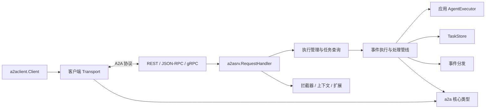
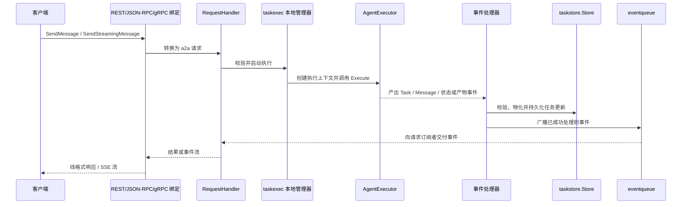
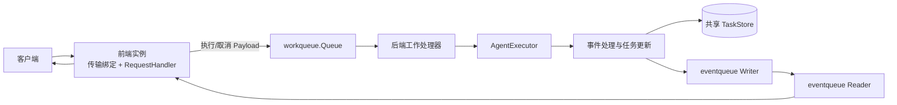

# A2A Go SDK 架构说明

本文描述 SDK 的主要模块、依赖边界和请求执行路径。它面向阅读代码、实现自定义 Agent 或扩展后端的开发者；具体并发语义以 [并发模型](CONCURRENCY_MODEL.md) 和当前实现为准。

## 已实现能力

| 能力域 | 当前实现 |
| --- | --- |
| 协议模型 | A2A v1.0 核心类型与 JSON 编码；另有独立的 v0.3 兼容实现。消息和产物支持文本、原始字节、URL、结构化数据等 Part。 |
| 传输绑定 | 服务端支持 HTTP+JSON REST、HTTP JSON-RPC 和 gRPC；REST/JSON-RPC 流通过 SSE，gRPC 使用服务端流。兼容绑定位于对应的版本包中。 |
| 客户端 | Agent Card 解析、接口/协议版本兼容选择、请求拦截器和可注册传输；默认注册 JSON-RPC 与 REST，gRPC 由调用方显式注册。 |
| 任务运行 | 创建和延续任务、读取/列出/取消任务、订阅任务事件、流式消息、历史、状态更新和产物增量更新。 |
| 服务发现 | 静态或动态公开 Agent Card、认证客户端可用的扩展卡片，以及签名/验证工具。签名校验由调用方配置为可选能力。 |
| 可扩展运行时 | Agent 执行器、调用拦截器、执行上下文拦截器、扩展协商、并发限制、任务存储、事件队列和工作队列接口。 |
| 通知与部署 | 可选推送通知；默认单进程内存实现，以及依赖外部共享存储/队列的实验性集群模式。 |
| 横切能力 | 请求用户上下文、租户传播、日志上下文和结构化错误详情。认证身份验证、凭据获取、租户隔离及具体后端由应用或部署方提供。 |

该 SDK 提供的是 A2A 协议客户端/服务端构件，不是 Agent 模型运行时，也不内置生产级数据库、消息代理、身份提供方或授权策略。

## 设计边界

SDK 的核心边界是协议领域模型与传输绑定分离：`a2a` 定义客户端、服务端共同使用的协议类型；传输层将 REST、JSON-RPC 或 gRPC 的线格式转换为这些类型；服务端通过 `AgentExecutor` 接入应用逻辑，并负责任务状态、持久化和事件分发。

## 模块地图

| 模块 | 职责与边界 |
| --- | --- |
| [`a2a`](../../a2a/) | 协议领域模型、常量、请求/响应、任务、消息、事件、Agent Card 及构造函数。与传输和具体 Agent 实现无关。 |
| [`a2aevent`](../../a2aevent/) | 将消息、状态和产物更新应用到任务状态，提供事件更新及终态判断等工具。 |
| [`a2asrv`](../../a2asrv/) | 服务端核心。`RequestHandler` 处理协议操作，`AgentExecutor` 连接应用逻辑；提供拦截器、认证上下文、Agent Card、推送、任务存储、事件队列和工作队列等扩展接口。 |
| [`a2aclient`](../../a2aclient/) | 协议无关客户端、拦截器和传输工厂；可从 Agent Card 或已知接口创建客户端，并按兼容版本及偏好选择传输。 |
| [`a2agrpc`](../../a2agrpc/) | gRPC 服务端/客户端绑定。实现协议类型与生成的 Protobuf 类型之间的转换，并委托给服务端 `RequestHandler`。 |
| [`a2apb`](../../a2apb/) | A2A v1.0 的生成 Protobuf 类型；`v1/pbconv` 提供与 Go 核心模型之间的转换。 |
| [`a2acompat/a2av0`](../../a2acompat/a2av0/) | A2A v0.3 兼容实现及迁移辅助，不应与当前 v1.0 核心模型混为一层。 |
| [`a2acrypto`](../../a2acrypto/) | Agent Card 的 JWS 签名和验证工具。 |
| [`a2aext`](../../a2aext/) | A2A 扩展激活、元数据及上下文传播辅助工具。 |
| [`log`](../../log/) 与 [`errordetails`](../../errordetails/) | 结构化日志上下文，以及可跨协议编码的类型化错误详情。 |
| [`internal`](../../internal/) | 非公开实现细节，包括执行协调、任务更新、事件管道、JSON-RPC/REST/SSE 辅助实现和测试工具；应用不应依赖这些内部包。 |
| [`e2e`](../../e2e/) 与 [`examples`](../../examples/) | 跨模块行为验证和可运行参考实现。 |

服务端可替换的持久化/分发接口位于 `a2asrv` 下，而不是 `internal`：`taskstore.Store` 管理任务状态，`eventqueue.Manager` 分发已处理事件，`workqueue.Queue` 在集群模式下分派执行工作。默认单进程模式使用内存任务存储和内存事件队列。

## 核心概念

- **Agent Card / AgentInterface**：Agent Card 是发现和协商入口，描述 Agent 的能力、技能、安全要求和一个或多个协议接口。客户端解析卡片后选择自己能使用的接口；公开卡片与面向认证客户端的扩展卡片是不同的服务路径。
- **Message / Part**：Message 表达用户或 Agent 的一轮消息，由有序 Part 组成；Part 可承载文本、字节、URL 或结构化数据。Metadata 和扩展 URI 为协议扩展留出空间。
- **Task / Context**：Task 是有状态的工作单元，拥有 `TaskID`、状态、历史和产物；`ContextID` 将多个相关 Task 关联起来，不等同于某个 Task ID。
- **TaskState**：生命周期由状态事件推进。Completed、Canceled、Failed、Rejected 是终态；InputRequired 表示当前执行暂停并等待用户输入，不是终态。
- **Artifact**：Agent 产出的文件或其他资源，由一个或多个 Part 组成。Artifact 更新事件可以追加内容，适合增量流式输出。
- **Event**：SDK 在执行管线中传递的统一事件类型，包括 Task、Message、状态更新和产物更新。Agent 通过事件报告进展，服务端据此更新任务并向订阅者分发。
- **AgentExecutor / ExecutorContext**：应用实现 `Execute` 和 `Cancel`，返回事件序列。`ExecutorContext` 提供触发消息、Task/Context 标识、已有任务、用户、租户和服务参数。已发出的事件及其引用数据不得再被修改。
- **CallContext / ServiceParams**：每个服务端调用携带协议版本、服务参数、租户、用户和已激活扩展等信息。传输将请求元数据放入上下文，拦截器和执行器再读取所需信息。
- **Store / Queue**：TaskStore 保存可查询的任务状态并以版本号执行乐观并发控制；EventQueue 承担事件订阅/广播；WorkQueue 仅在集群模式中负责跨实例派发工作。

核心定义见 [`a2a/core.go`](../../a2a/core.go)、[`a2asrv/agentexec.go`](../../a2asrv/agentexec.go) 和 [`a2asrv/exectx.go`](../../a2asrv/exectx.go)。

## 服务端请求路径

### 单进程模式

`a2asrv.NewHandler` 创建协议无关处理器。传输绑定（如 `NewRESTHandler`、`NewJSONRPCHandler`、`a2agrpc/v1.NewHandler`）只负责把协议调用映射到 `RequestHandler`，不承载 Agent 业务逻辑。`a2asrv.InterceptedHandler` 包装请求处理器，负责调用拦截器、请求上下文、扩展和协议版本检查等横切行为。服务端拦截器的 Before 按注册顺序执行，After 按相反顺序执行。

执行过程中，Agent 通过 `AgentExecutor.Execute` 返回事件序列，而不是直接写 HTTP/gRPC 响应。SDK 将事件经内部管道交给处理器：先应用任务更新并写入任务存储，再将成功处理的事件广播给订阅者；已配置时还可触发推送通知。非流式调用返回最终 Message 或 Task，流式调用和任务订阅逐项交付事件。正常完成、等待用户输入或终态事件会结束当前执行，精确取消和清理行为见 [并发模型](CONCURRENCY_MODEL.md)。

传输层决定线上流的表示：REST 和 JSON-RPC 通过 SSE 传输事件，gRPC 通过 server-streaming RPC 传输事件；这不会改变 AgentExecutor 使用的核心事件类型。

`a2aevent` 描述事件如何改变 Task：用户 Message 进入历史，Artifact 更新可追加或替换产物，状态事件更新任务状态。TaskStore 的版本号用于乐观并发控制，避免并发执行/取消覆盖彼此的状态。

### 集群模式

通过 `WithClusterMode` 注入共享 `TaskStore`、事件队列和工作队列后，前端负责接收请求、提交工作并订阅事件；工作队列处理器在任一后端实例执行 Agent。单进程与集群模式复用相同的 Agent、事件处理和任务更新逻辑，差别主要在执行调度和跨进程事件传输。跨节点运行要求这些接口背后的实现具备相应的共享/分发能力；SDK 不内置特定数据库或消息代理。

集群模式是可选能力。参考实现见 [`examples/clustermode`](../../examples/clustermode/)：任务状态、工作负载和事件队列由 MySQL 示例适配器提供。工作队列可自行采用拉取或推送式实现；长任务可借助队列心跳延长消息租约。

部署侧必须保证 TaskStore 的共享状态和并发版本语义、EventQueue 的跨实例读写，以及 WorkQueue 的确认/重试等语义满足所选实现要求。仅注入接口并不会自动让内存实现具备跨进程能力。

## 客户端连接路径

客户端可直接使用已知 `AgentInterface`，也可先由 `a2aclient/agentcard` 的 Resolver 获取 `AgentCard`，再由 `Factory` 根据接口声明和配置偏好选择兼容的传输和协议版本；连接建立失败时可继续尝试其他兼容接口。Resolver 支持自定义 HTTP 客户端/解析器，并可选用 `a2acrypto.Verifier` 校验卡片签名。服务端可用静态或动态卡片处理器公开 Agent Card，也可包装 Producer 为卡片签名。

默认 Factory 注册 JSON-RPC 和 REST；gRPC 通过 `a2agrpc/v1.WithGRPCTransport` 显式注册。客户端拦截器适合处理调用级的观测、认证等逻辑。内置 `AuthInterceptor` 可根据 Agent Card 安全要求从应用提供的 CredentialsService 取凭据并放入请求参数，但不负责获取或刷新凭据。服务端可通过传输适配器/拦截器设置调用用户身份，认证和授权策略仍由应用决定。

## 安全、扩展与租户边界

- **认证集成**：服务端 `CallContext.User` 可由认证中间件或拦截器填充；客户端凭据存储和附加通过 `CredentialsService`/`AuthInterceptor` 接入。SDK 没有绑定具体身份提供方。
- **Agent Card 信任**：卡片签名由 `a2acrypto` 生成/验证；客户端 Resolver 只有在设置 Verifier 后才会校验签名。调用 `Factory.CreateFromCard` 时应确保卡片来源可信，或先经 Resolver 验证。
- **扩展协商**：客户端可声明想使用的扩展；服务端检查调用所请求的扩展，并记录执行期间激活的扩展供传输层返回。`a2aext` 提供客户端激活器等工具，不替应用实现扩展逻辑。
- **多租户**：租户值可进入请求/执行上下文并跨工作队列编码传播。REST 提供按 URL 模板提取租户的 Handler；具体租户鉴权、数据隔离和存储键设计由应用与后端实现承担。
- **推送通知**：启用后，客户端可为任务管理推送配置，服务端在任务更新时调用配置的 Sender。发送端和配置存储可替换，具体投递可靠性由其实现决定。
- **拦截器与执行上下文**：调用拦截器处理请求/响应边界；`ExecutorContextInterceptor` 在创建执行器上下文时补充 Agent 所需数据，例如加载消息引用的相关任务。二者所处阶段不同，不应混为一类中间件。

## 扩展点

- **Agent 行为**：实现 `a2asrv.AgentExecutor`，将应用的增量输出转换成 A2A 事件；无需绑定网络协议。
- **服务端绑定**：直接实现 `a2asrv.RequestHandler`，或复用默认 `a2asrv.NewHandler` 后包装 REST、JSON-RPC 或 gRPC 传输。
- **存储与调度**：实现 `a2asrv/taskstore`、`a2asrv/eventqueue` 和 `a2asrv/workqueue` 接口。单进程自定义存储与集群部署的共享存储需求不同。
- **请求横切逻辑**：使用服务端 `CallInterceptor`、客户端 `CallInterceptor`、上下文编解码、推送通知和并发限制等公开接口。
- **协议与扩展**：新增传输时适配 `a2aclient.Transport`/`TransportFactory` 和服务器请求处理器；协议扩展通过 `a2aext` 与调用上下文交互。

实现新 TaskStore 时必须保留完整可读任务状态，并按 `PrevVersion` 检查更新冲突；实现集群 WorkQueue/EventQueue 时还需处理跨实例传递、确认/重试和订阅语义。具体接口约束见 [`a2asrv/taskstore/api.go`](../../a2asrv/taskstore/api.go)、[`a2asrv/workqueue/queue.go`](../../a2asrv/workqueue/queue.go) 和 [`a2asrv/eventqueue/queue.go`](../../a2asrv/eventqueue/queue.go)。

## 示例和深入阅读

- [`examples/helloworld`](../../examples/helloworld/) 演示同一个简单 Agent 分别接入 REST、JSON-RPC、gRPC，以及客户端通过 Agent Card 发现服务。
- [`examples/clustermode`](../../examples/clustermode/) 演示外部任务存储、队列和多实例执行。
- [`examples/observability`](../../examples/observability/) 展示观测相关接入方式。
- [并发模型](CONCURRENCY_MODEL.md) 细化执行管线、取消、事件队列、工作队列及 OCC 的并发语义。
- [开发者速览](OVERVIEW.md) 提供简版概念和目录索引。
