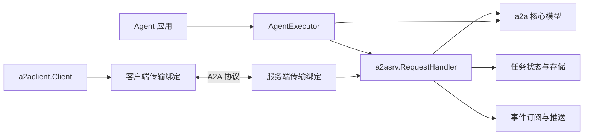
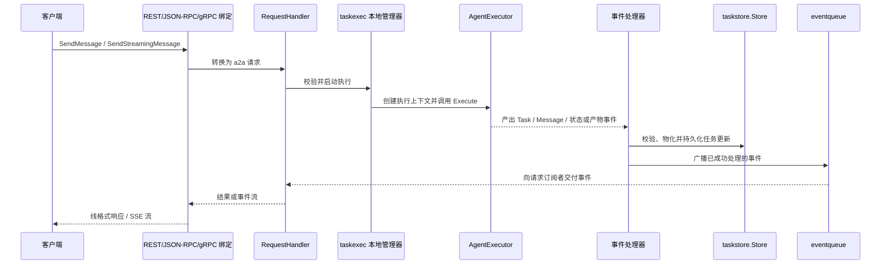
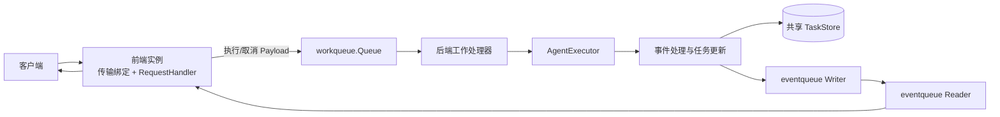

# A2A Go SDK 架构说明

本文描述 SDK 的主要模块、依赖边界和请求执行路径。它面向阅读代码、实现自定义 Agent 或扩展后端的开发者；具体并发语义以 [并发模型](CONCURRENCY_MODEL.md) 和当前实现为准。

## 设计边界

SDK 的核心边界是协议领域模型与传输绑定分离：`a2a` 定义客户端、服务端共同使用的协议类型；传输层将 REST、JSON-RPC 或 gRPC 的线格式转换为这些类型；服务端通过 `AgentExecutor` 接入应用逻辑，并负责任务状态、持久化和事件分发。

## 模块地图

| 模块 | 职责与边界 |
| --- | --- |
| [`a2a`](../../a2a/) | 协议领域模型、常量、请求/响应、任务、消息、事件、Agent Card 及构造函数。与传输和具体 Agent 实现无关。 |
| [`a2aevent`](../../a2aevent/) | 将消息、状态和产物更新应用到任务状态，提供事件更新及终态判断等工具。 |
| [`a2asrv`](../../a2asrv/) | 服务端核心。`RequestHandler` 处理协议操作，`AgentExecutor` 连接应用逻辑；提供拦截器、认证上下文、Agent Card、推送、任务存储、事件队列和工作队列等扩展接口。 |
| [`a2aclient`](../../a2aclient/) | 协议无关客户端、拦截器和传输工厂；可从 Agent Card 或已知接口创建客户端，并按兼容版本及偏好选择传输。 |
| [`a2agrpc`](../../a2agrpc/) | gRPC 服务端/客户端绑定。实现协议类型与生成的 Protobuf 类型之间的转换，并委托给服务端 `RequestHandler`。 |
| [`a2apb`](../../a2apb/) | A2A v1.0 的生成 Protobuf 类型；`v1/pbconv` 提供与 Go 核心模型之间的转换。 |
| [`a2acompat/a2av0`](../../a2acompat/a2av0/) | A2A v0.3 兼容实现及迁移辅助，不应与当前 v1.0 核心模型混为一层。 |
| [`a2acrypto`](../../a2acrypto/) | Agent Card 的 JWS 签名和验证工具。 |
| [`a2aext`](../../a2aext/) | A2A 扩展激活、元数据及上下文传播辅助工具。 |
| [`log`](../../log/) 与 [`errordetails`](../../errordetails/) | 结构化日志上下文，以及可跨协议编码的类型化错误详情。 |
| [`internal`](../../internal/) | 非公开实现细节，包括执行协调、任务更新、事件管道、JSON-RPC/REST/SSE 辅助实现和测试工具；应用不应依赖这些内部包。 |
| [`e2e`](../../e2e/) 与 [`examples`](../../examples/) | 跨模块行为验证和可运行参考实现。 |

服务端可替换的持久化/分发接口位于 `a2asrv` 下，而不是 `internal`：`taskstore.Store` 管理任务状态，`eventqueue.Manager` 分发已处理事件，`workqueue.Queue` 在集群模式下分派执行工作。默认单进程模式使用内存任务存储和内存事件队列。

## 服务端请求路径

### 单进程模式

`a2asrv.NewHandler` 创建协议无关处理器。传输绑定（如 `NewRESTHandler`、`NewJSONRPCHandler`、`a2agrpc.NewHandler`）只负责把协议调用映射到 `RequestHandler`，不承载 Agent 业务逻辑。处理器外围的 `InterceptedHandler` 负责调用拦截器、请求上下文、扩展和协议版本检查等横切行为。

执行过程中，Agent 通过 `AgentExecutor.Execute` 返回事件序列，而不是直接写 HTTP/gRPC 响应。SDK 将事件经内部管道交给处理器：先应用任务更新并写入任务存储，再将成功处理的事件广播给订阅者；已配置时还可触发推送通知。非流式调用返回最终 Message 或 Task，流式调用和任务订阅逐项交付事件。正常完成、等待用户输入或终态事件会结束当前执行，精确取消和清理行为见 [并发模型](CONCURRENCY_MODEL.md)。

`a2aevent` 描述事件如何改变 Task：用户 Message 进入历史，Artifact 更新可追加或替换产物，状态事件更新任务状态。TaskStore 的版本号用于乐观并发控制，避免并发执行/取消覆盖彼此的状态。

### 集群模式

通过 `WithClusterMode` 注入共享 `TaskStore`、事件队列和工作队列后，前端负责接收请求、提交工作并订阅事件；工作队列处理器在任一后端实例执行 Agent。单进程与集群模式复用相同的 Agent、事件处理和任务更新逻辑，差别主要在执行调度和跨进程事件传输。跨节点运行要求这些接口背后的实现具备相应的共享/分发能力；SDK 不内置特定数据库或消息代理。

集群模式是可选能力。参考实现见 [`examples/clustermode`](../../examples/clustermode/)：任务状态、工作负载和事件队列由 MySQL 示例适配器提供。工作队列可自行采用拉取或推送式实现；长任务可借助队列心跳延长消息租约。

## 客户端连接路径

客户端可直接使用已知 `AgentInterface`，也可先由 `a2aclient/agentcard` 的 Resolver 获取 `AgentCard`，再由 `Factory` 根据接口声明选择兼容的传输和协议版本。Resolver 支持自定义 HTTP 客户端/解析器，并可选用 `a2acrypto.Verifier` 校验卡片签名。

默认 Factory 注册 JSON-RPC 和 REST；gRPC 通过 `a2agrpc.WithGRPCTransport` 显式注册。客户端拦截器适合处理调用级的观测、认证等逻辑；凭据来源由应用负责，SDK 根据 Agent Card 安全要求附加凭据。

## 扩展点

- **Agent 行为**：实现 `a2asrv.AgentExecutor`，将应用的增量输出转换成 A2A 事件；无需绑定网络协议。
- **服务端绑定**：直接实现 `a2asrv.RequestHandler`，或复用默认 `a2asrv.NewHandler` 后包装 REST、JSON-RPC 或 gRPC 传输。
- **存储与调度**：实现 `a2asrv/taskstore`、`a2asrv/eventqueue` 和 `a2asrv/workqueue` 接口。单进程自定义存储与集群部署的共享存储需求不同。
- **请求横切逻辑**：使用服务端 `CallInterceptor`、客户端 `CallInterceptor`、上下文编解码、推送通知和并发限制等公开接口。
- **协议与扩展**：新增传输时适配 `a2aclient.Transport`/`TransportFactory` 和服务器请求处理器；协议扩展通过 `a2aext` 与调用上下文交互。

## 示例和深入阅读

- [`examples/helloworld`](../../examples/helloworld/) 演示同一个简单 Agent 分别接入 REST、JSON-RPC、gRPC，以及客户端通过 Agent Card 发现服务。
- [`examples/clustermode`](../../examples/clustermode/) 演示外部任务存储、队列和多实例执行。
- [`examples/observability`](../../examples/observability/) 展示观测相关接入方式。
- [并发模型](CONCURRENCY_MODEL.md) 细化执行管线、取消、事件队列、工作队列及 OCC 的并发语义。
- [开发者速览](OVERVIEW.md) 提供简版概念和目录索引。
