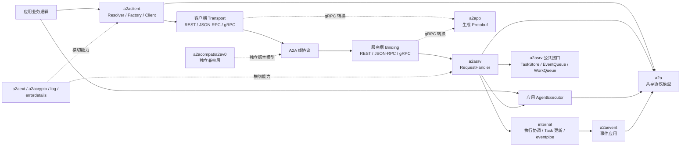
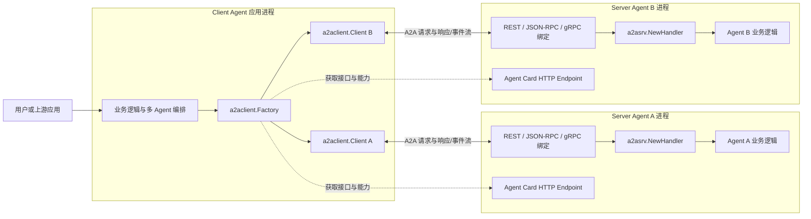
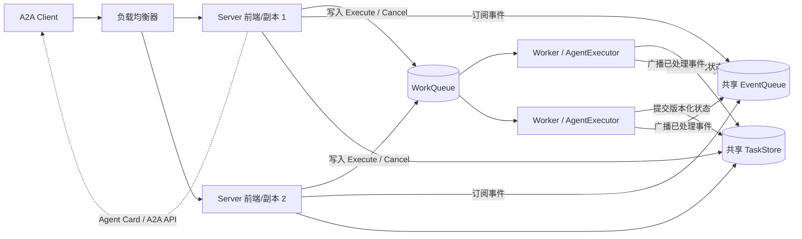
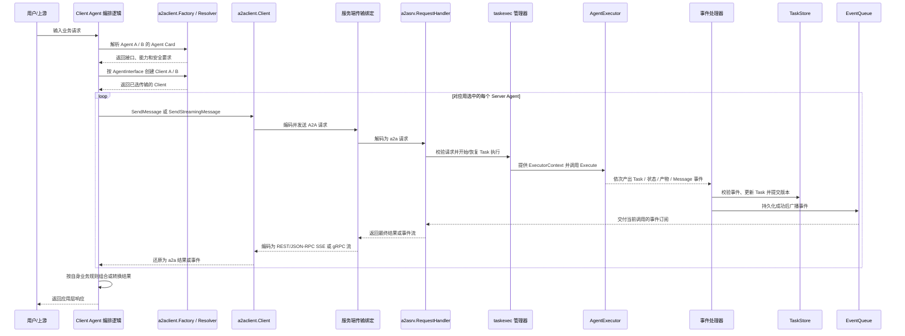
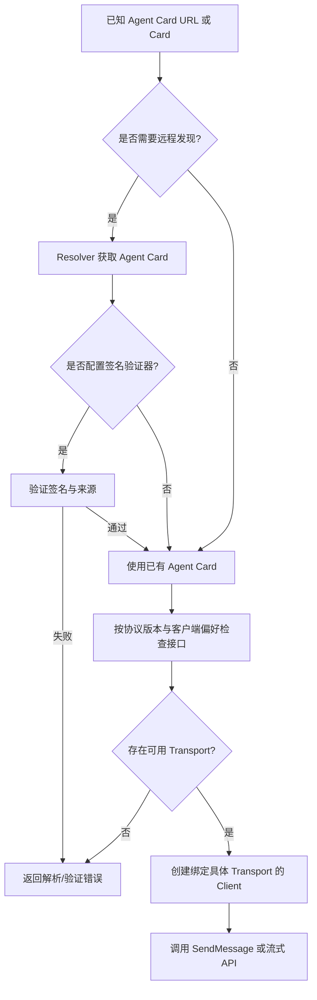
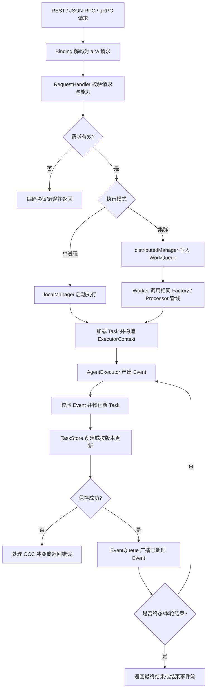
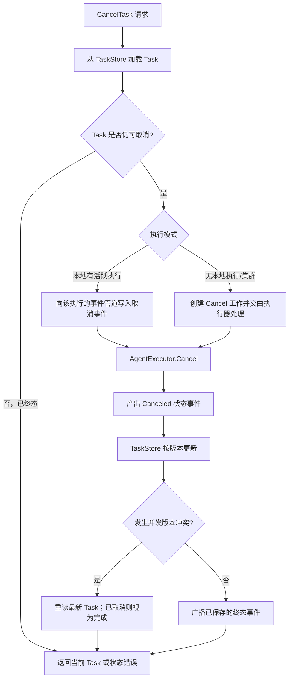
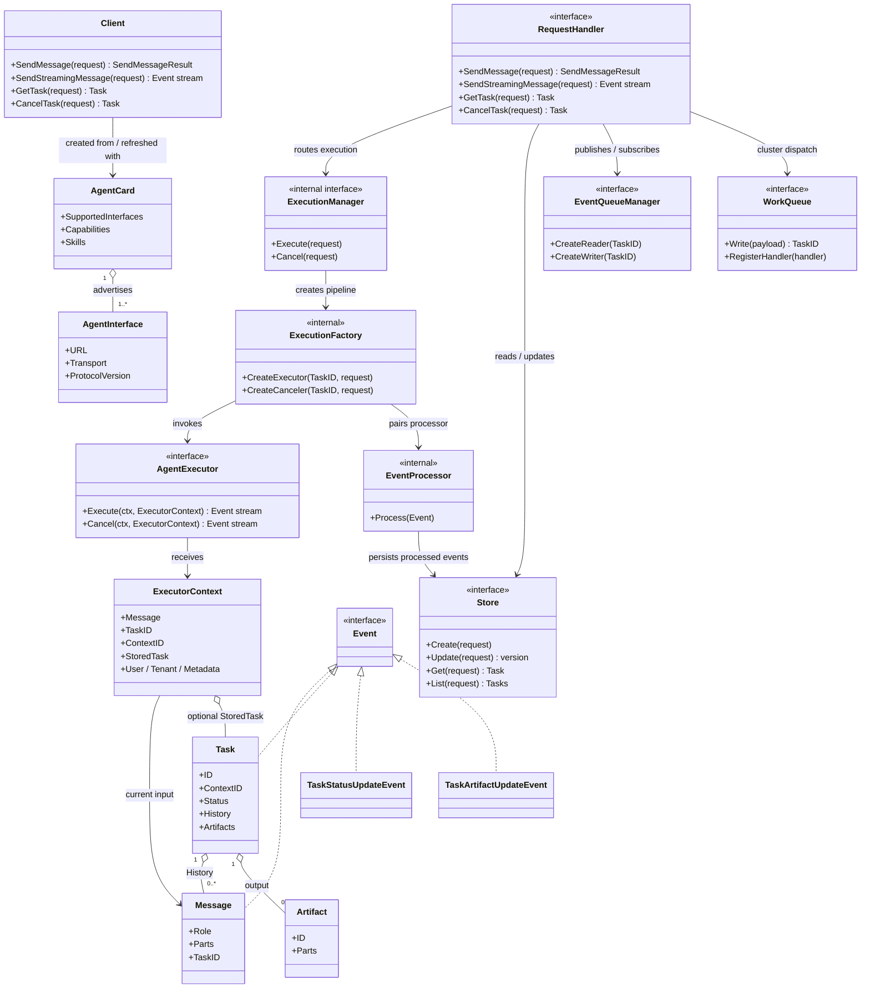

RPC 的 `id`、Message 的 `messageId` 和 TaskID 是三种不同标识，不能互相替代。

例如，客户端发送的 JSON-RPC 请求体如下。`params.message.parts` 是内容数组；这里的单个对象 `{"text":...}` 会变成一个 Text Part：

```json
{
    "jsonrpc": "2.0",
    "id": "rpc-1",
    "method": "SendMessage",
    "params": {
        "message": {
            "messageId": "msg-100",
            "role": "ROLE_USER",
            "parts": [{"text": "生成一份关于 A2A 的报告"}]
        }
    }
}
```
# A2A Go SDK 架构说明

本文面向第一次接触 A2A Go SDK 的 Go 开发者，依次说明它解决什么问题、代码如何分层、请求如何执行，以及如何部署和扩展。

先建立三个概念：Client Agent 是发起调用的应用，Server Agent 是接收请求并运行 Agent 的应用；Message 是一条对话输入/输出，Task 是需要保存、查询、续跑或取消的工作单元。SDK 提供两端协议能力与服务端任务执行管线，不提供模型运行时或业务数据库。

建议按本文顺序阅读：先跑通示例，再看模块和部署边界，最后沿请求流程理解事件、存储和并发处理。

## 使用示例

下面是一个完整的 JSON-RPC 服务端和客户端。创建一个 Go 模块，在模块根目录初始化依赖，并把两段程序分别放入 `cmd/server/main.go` 与 `cmd/client/main.go`：

```bash
go mod init example.com/hello-agent
go get github.com/a2aproject/a2a-go/v2@latest
```

### 服务端

```go
package main

import (
    "context"
    "iter"
    "log"
    "net"
    "net/http"

    "github.com/a2aproject/a2a-go/v2/a2a"
    "github.com/a2aproject/a2a-go/v2/a2asrv"
)

func main() {
    const listenAddress = ":9001"
    const invokeURL = "http://127.0.0.1:9001/invoke"

    agentCard := &a2a.AgentCard{
        Name:        "Hello Agent",
        Description: "Replies with a greeting",
        SupportedInterfaces: []*a2a.AgentInterface{
            a2a.NewAgentInterface(invokeURL, a2a.TransportProtocolJSONRPC),
        },
        DefaultInputModes:  []string{"text"},
        DefaultOutputModes: []string{"text"},
        Capabilities:       a2a.AgentCapabilities{Streaming: true},
    }

    executor := a2asrv.AgentExecutorFunc(func(
        ctx context.Context,
        execCtx *a2asrv.ExecutorContext,
    ) iter.Seq2[a2a.Event, error] {
        return func(yield func(a2a.Event, error) bool) {
            event := a2a.NewMessage(
                a2a.MessageRoleAgent,
                a2a.NewTextPart("Hello, world!"),
            )
            yield(event, nil)
        }
    })

    requestHandler := a2asrv.NewHandler(executor)
    mux := http.NewServeMux()
    mux.Handle("/invoke", a2asrv.NewJSONRPCHandler(requestHandler))
    mux.Handle(
        a2asrv.WellKnownAgentCardPath,
        a2asrv.NewStaticAgentCardHandler(agentCard),
    )

    listener, err := net.Listen("tcp", listenAddress)
    if err != nil {
        log.Fatalf("listen: %v", err)
    }
    log.Printf("A2A server listening on %s", listenAddress)
    if err := http.Serve(listener, mux); err != nil {
        log.Printf("server stopped: %v", err)
    }
}
```

### 客户端

这个示例监听本机 HTTP，没有配置认证或 TLS，只应用于本地学习；部署到网络环境时应由应用配置认证、授权、TLS 和访问控制。

```go
package main

import (
    "context"
    "log"

    "github.com/a2aproject/a2a-go/v2/a2a"
    "github.com/a2aproject/a2a-go/v2/a2aclient"
    "github.com/a2aproject/a2a-go/v2/a2aclient/agentcard"
)

func main() {
    ctx := context.Background()

    card, err := agentcard.DefaultResolver.Resolve(ctx, "http://127.0.0.1:9001")
    if err != nil {
        log.Fatalf("resolve agent card: %v", err)
    }

    client, err := a2aclient.NewFromCard(ctx, card)
    if err != nil {
        log.Fatalf("create A2A client: %v", err)
    }

    message := a2a.NewMessage(
        a2a.MessageRoleUser,
        a2a.NewTextPart("Hello, agent"),
    )
    result, err := client.SendMessage(ctx, &a2a.SendMessageRequest{Message: message})
    if err != nil {
        log.Fatalf("send message: %v", err)
    }
    log.Printf("agent replied: %+v", result)
}
```

### 运行与调用过程

打开两个终端并保持服务端运行。先在终端一启动服务端，再在终端二启动客户端：

```bash
go run ./cmd/server
```

```bash
go run ./cmd/client
```

服务端的 Agent Card 是发现信息，声明名称、能力和可调用接口；它不包含 Agent 的执行逻辑。`AgentExecutorFunc` 将业务逻辑接入服务端，本例直接产出 Agent `Message`，因此请求返回消息而不创建持久化 Task。`NewHandler` 提供协议无关的请求处理；JSON-RPC Handler 负责网络协议转换。

客户端先由 Resolver 从服务地址获取 Well-Known Agent Card，再由 `NewFromCard` 根据卡片接口选择已注册的传输。`NewMessage` 创建用户消息，`SendMessage` 发送请求并返回 Agent Message。默认 Client 已注册 JSON-RPC 与 REST；如果卡片没有可用接口或连接失败，创建 Client 时会返回错误。

### 改为有状态任务

需要保存进度、查询结果或继续执行时，执行器应产出 Task 事件。下面片段放在 `AgentExecutorFunc` 返回的 `func(yield ...)` 中：新任务先产出 Submitted Task；已有任务从 `StoredTask` 读取只读快照。随后状态事件推进任务，Artifact 事件累积结果，Completed 结束执行。

```go
if execCtx.StoredTask == nil {
    if !yield(a2a.NewSubmittedTask(execCtx, execCtx.Message), nil) {
        return
    }
}
if !yield(a2a.NewStatusUpdateEvent(execCtx, a2a.TaskStateWorking, nil), nil) {
    return
}
if !yield(a2a.NewArtifactEvent(execCtx, a2a.NewTextPart("result")), nil) {
    return
}
if !yield(a2a.NewStatusUpdateEvent(execCtx, a2a.TaskStateCompleted, nil), nil) {
    return
}
```

`NewSubmittedTask` 使用执行上下文中的 TaskID、ContextID 构造首个 Task，并把初始用户 Message 放入 History；只有执行上下文中的 ID 为空时，构造函数才会生成缺省 ID。Working 表示任务开始处理；Artifact 保存 Agent 输出，不会被误记为新的对话消息；Completed 是终态。每次 `yield` 都把事件交给服务端处理，服务端更新并保存 Task 后才向订阅者广播。若调用方停止接收事件，`yield` 返回 `false`，执行器应立即停止产出。
若调用方停止接收事件，`yield` 返回 `false`，执行器应立即停止产出。

## 已实现能力

| 能力域 | 当前实现 |
| --- | --- |
| 协议模型 | A2A v1.0 核心类型与 JSON 编码；另有独立的 v0.3 兼容实现。消息和产物支持文本、原始字节、URL、结构化数据等 Part。 |
| 传输绑定 | 服务端支持 HTTP+JSON REST、HTTP JSON-RPC 和 gRPC；REST/JSON-RPC 流通过 SSE，gRPC 使用服务端流。兼容绑定位于对应的版本包中。 |
| 客户端 | Agent Card 解析、接口/协议版本兼容选择、请求拦截器和可注册传输；默认注册 JSON-RPC 与 REST，gRPC 由调用方显式注册。 |
| 任务运行 | 创建和延续任务、读取/列出/取消任务、订阅任务事件、流式消息、历史、状态更新和产物增量更新。 |
| 服务发现 | 静态或动态公开 Agent Card、认证客户端可用的扩展卡片，以及签名/验证工具。签名校验由调用方配置为可选能力。 |
| 可扩展运行时 | Agent 执行器、调用拦截器、执行上下文拦截器、扩展协商、并发限制、任务存储、事件队列和工作队列接口。 |
| 通知与部署 | 可选推送通知；默认单进程内存实现，以及依赖外部共享存储/队列的实验性集群模式。 |
| 横切能力 | 请求用户上下文、租户传播、日志上下文和结构化错误详情。认证身份验证、凭据获取、租户隔离及具体后端由应用或部署方提供。 |

该 SDK 提供的是 A2A 协议客户端/服务端构件，不是 Agent 模型运行时，也不内置生产级数据库、消息代理、身份提供方或授权策略。

## 核心对象速览

| 对象 | 初学者可以这样理解 |
| --- | --- |
| Agent Card | 服务目录项：告诉 Client 去哪里调用、支持什么协议和能力，不包含 Agent 的实现。 |
| Message | 一条对话内容，由一个或多个 Part 组成；最简单的请求/响应可以只有 Message。 |
| Task | 有状态工作记录：保存状态、历史和产物，可查询、继续、取消；不是每条 Message 都必须属于 Task。 |
| Event | 执行期间发生的一次变化；Message、Task、状态更新和 Artifact 更新都能作为 Event 被流式传递。 |
| AgentExecutor | 应用提供的业务适配器：接收执行上下文，调用模型/工具，并把结果转换成 Event。 |

最小调用链是：Client 发现 Agent Card 并发送 Message；服务端把请求交给 AgentExecutor；Agent 可以直接返回 Message，也可以通过 Task/Event 表达可持久化的长任务。传输层只负责把这些对象编码到 REST、JSON-RPC 或 gRPC。

## 项目结构与架构图

### 目录职责

项目按协议模型、客户端、服务端、传输绑定和内部执行机制拆分。应用通常只依赖 `a2a`、`a2aclient`、`a2asrv` 及所需的传输包；`internal` 是 SDK 私有实现，不属于应用扩展 API。

| 路径 | 主要职责 | 应用是否直接依赖 |
| --- | --- | --- |
| `a2a/` | 协议领域模型、事件、请求/响应、Agent Card 和构造函数；客户端与服务端共享的类型层。 | 是 |
| `a2aclient/` | 协议无关客户端、Agent Card Resolver、Factory、Transport 接口和调用拦截器。 | 是 |
| `a2asrv/` | RequestHandler、AgentExecutor、服务端中间件，以及公开的 TaskStore、EventQueue、WorkQueue 等替换接口。 | 是 |
| `a2agrpc/` 与 `a2apb/` | gRPC 客户端/服务端绑定、生成的 Protobuf 类型及模型转换。 | 需要 gRPC 时依赖 |
| `a2acompat/a2av0/` | 独立的 A2A v0.3 兼容模型和传输，不与 v1.0 核心类型混用。 | 迁移或兼容时依赖 |
| `a2aevent/`、`a2aext/`、`a2acrypto/` | 事件应用、扩展协商/传播、Agent Card 签名与验证工具。 | 按需依赖 |
| `internal/` | 执行协调、事件管道、Task 更新及传输辅助实现。由 SDK 内部调用，应用不应导入。 | 否 |
| `examples/` 与 `e2e/` | 可运行集成示例与跨模块行为验证。 | 阅读/运行参考 |

### 模块依赖与调用边界

图中实线表示主要调用/依赖方向；A2A 核心模型贯穿客户端和服务端。线上协议到核心模型的转换由绑定层负责，Agent 业务逻辑不直接依赖网络传输。



图中各块表示的职责：`a2aclient` 负责发现 Agent Card 并调用协议无关的 Client；Transport 将核心请求编码成线上协议。服务端 Binding 完成反向转换，`RequestHandler` 调用执行协调和后端接口。应用只实现 `AgentExecutor`；`internal` 承担生产者/消费者协调、事件校验与 Task 更新。`a2apb` 是 gRPC 的线类型，v0.3 兼容模型与 v1.0 核心模型隔离；扩展、签名、日志和错误详情属于横切能力。

### 架构总览

记住三层就能读懂大部分代码：`a2a` 是客户端和服务端共用的数据模型；传输绑定负责把 REST、JSON-RPC、gRPC 转换成这些模型；`a2asrv` 负责任务执行与状态，应用通过 `AgentExecutor` 提供 Agent 行为。存储和队列是可替换接口，不与某一种数据库或网络协议绑定。

## 部署视图：一个 Client Agent，多个 Server Agent

`a2a-go` 的 client/server 不是必须单独运行的守护进程，而是嵌入应用进程的 Go SDK。Client Agent 在自己的进程里使用 `a2aclient.Factory` 和一个或多个 `a2aclient.Client`；每个 Server Agent 在自己的服务进程里使用 `a2asrv.NewHandler`、AgentExecutor 和一种或多种服务端传输绑定。双方通过 Agent Card 声明的 A2A 接口直接通信。



这里的“一对多”是应用拓扑，不是 SDK 内置的服务端路由器：Client Agent 根据业务逻辑决定调用哪个 Server Agent、调用顺序，以及是否并行调用；A2A-Go 提供发现、连接、协议转换和请求 API，不会自动把一次请求广播到所有 Server Agent，也不会自动聚合多个结果。Server Agent A 与 B 各自执行和保存自己的 Task；如需共享业务状态，必须由应用显式传递信息或另行设计共享后端。

每个 Server Agent 可单进程运行，也可独立启用 `a2asrv` 集群模式，由前端实例接收 A2A 请求、工作实例执行 Agent，并共享其 TaskStore/EventQueue/WorkQueue。客户端仍连接该 Server Agent 对外公布的 A2A 接口，不需要感知其内部部署形态。

### 集群部署视图

下图表示逻辑职责，不要求前端与 Worker 必须是不同二进制或不同进程。示例集群把它们部署为多个相同服务副本；`WithClusterMode` 将工作分派给 WorkQueue，且三个后端都必须具备跨实例语义。



节点职责：负载均衡器只负责将外部请求送到 Server 副本；前端负责协议接入、创建订阅并提交工作，不一定与 Worker 分进程。WorkQueue 保存待执行的 Execute/Cancel 工作，Worker 调用 Agent 并产出事件。TaskStore 保存版本化任务快照；EventQueue 将已保存事件送回前端订阅者。客户端只访问 Server 的公开 A2A 地址，不直接连接这些内部后端。

每个 Server 副本都可以用同一段初始化代码连接共享后端。三个对象必须由部署方提供具备跨进程语义的实现；仅把内存实现放进配置并不能形成集群。

```go
clusterConfig := a2asrv.ClusterConfig{
    TaskStore:    sharedTaskStore,
    QueueManager: sharedEventQueue,
    WorkQueue:    sharedWorkQueue,
}
requestHandler := a2asrv.NewHandler(
    executor,
    a2asrv.WithClusterMode(clusterConfig),
)
```

`WithClusterMode` 切换到分布式执行管理器，前端将工作投递给 WorkQueue，注册在队列上的 Worker 消费任务。代码中前端与 Worker 可以是同一个服务进程的两个职责；若要单独部署 Worker，应用仍需按队列 API 启动处理端并共享相同的后端。

## 请求数据流：发现、调用、事件返回

下面展示 Client Agent 依次调用两个独立 Server Agent 的典型路径。实际应用可只调用其中一个，也可自行并发调用；Task 和结果默认不会在两个服务端之间自动复制。



若使用非流式 `SendMessage`，客户端收到的是最终 Message 或 Task；流式调用/任务订阅则逐个收到事件。服务端先应用并保存事件，再向订阅者广播，因而实时事件流与可查询 Task 状态沿用同一更新结果。REST 和 JSON-RPC 的事件在线上使用 SSE，gRPC 使用 server-streaming；进入 SDK 后均转换为 `a2a.Event`。

时序图参与者说明：`App` 是决定调用哪个 Agent、是否组合结果的业务编排层；`Factory / Resolver` 读取并选择 Agent Card 接口；`Client` 调用已选 Transport。服务端 `Binding` 负责线协议转换，`RequestHandler` 路由协议操作，执行管理器创建执行管线。`AgentExecutor` 只生成业务事件；处理器更新 TaskStore 后才写入 EventQueue，订阅端再把事件送回客户端。

## 关键流程

### Agent Card 发现与客户端创建



Factory 只会从已注册的 Transport 中选择；JSON-RPC/REST 默认可用，gRPC 需要显式注册。解析卡片并不自动代表其可信，是否验证签名由 Resolver 配置决定。

节点说明：URL 是 Agent Card 的发现入口；Resolver 获取并解析卡片，Verifier（可选）检查卡片签名。卡片的接口列表包含 URL、协议与版本；Factory 只从已注册的 Transport 中选择兼容接口。创建出的 Client 才负责后续请求。没有兼容接口或验证失败时，流程在创建 Client 前结束并返回错误。

### SendMessage 执行与事件持久化



流式和非流式接口共享服务端执行及持久化管线；差别在于客户端如何消费结果。事件只有在成功处理并保存后才广播。执行器应对已开始的任务用 Failed 状态表达运行失败；不要在发出部分事件后把普通运行失败当作未开始请求错误返回。

节点说明：Binding 解码网络请求，RequestHandler 做协议级校验并路由；`localManager` 在当前进程运行工作，`distributedManager` 则将工作投递给 Worker。`ExecutorContext` 携带本轮 Message、Task 标识和已有任务快照。Agent 产出事件后，Processor 校验事件并计算新 Task；TaskStore 持久化成功才允许 EventQueue 广播。OCC 冲突表示写入者使用了过期版本，服务端据最新 Task 判断是可恢复取消还是并发执行错误。终态事件或 Message 结束本轮响应。

### 取消任务



本地管理器可以合并同一实例内并发的重复取消；集群节点间不共享该内存状态，跨实例协调依赖共享 TaskStore 的版本检查和 WorkQueue。取消更新遇到版本冲突时，服务端重新读取 Task：若已取消则视为成功，若已进入其他终态则返回当前状态。

节点说明：`CancelTask` 首先读取当前 Task 并判断是否可取消；若本地正在执行，取消事件进入同一执行管线，否则（或在集群模式）作为独立工作分派。`AgentExecutor.Cancel` 负责通知外部运行时并产出 Canceled 事件。TaskStore 通过版本比较避免取消覆盖完成结果；已经取消时可幂等返回，已由其他状态终结时则保留当前终态。EventQueue 只广播成功写入的状态。

## 核心对象关系

这张类图只画公共概念和依赖关系，不代表每个类型都由接口实现直接持有。`defaultRequestHandler`、执行 Factory 和 Processor 是 `a2asrv` 的内部实现；应用实现 `AgentExecutor`，后端通过公开接口注入。



对象读法：`TaskID` 标识一个可读写的任务，`ContextID` 关联多轮/相关任务；`Message` 是对话内容，`Artifact` 是任务产物；`Event` 是执行输出以及流式传输的统一抽象。单进程模式不需要 WorkQueue；集群模式才用它把执行请求交给 Worker。

类图对象说明：

| 对象 | 职责与关系 |
| --- | --- |
| `Client`、`AgentCard`、`AgentInterface` | Client 持有选中的 Transport，并可使用卡片中的接口与能力；AgentCard 用一个或多个 AgentInterface 声明地址、协议和版本。 |
| `RequestHandler`、`ExecutionManager` | RequestHandler 是协议无关入口；ExecutionManager 选择本地或集群执行路径。应用通常使用默认实现，不需要自行实现内部 Manager。 |
| `ExecutionFactory`、`AgentExecutor`、`ExecutorContext` | Factory 为执行/取消准备生产者与处理器；AgentExecutor 是应用实现的逻辑，接收执行上下文并产出事件。ExecutorContext 提供当前 Message、Task/Context 标识、已有 Task 快照及调用身份信息。 |
| `Task`、`Message`、`Artifact` | Task 保存状态、对话历史和产物；Message 用 Parts 表达用户/Agent 对话，Artifact 用 Parts 表达 Agent 生成的结果。TaskID 标识任务，ContextID 关联一组任务。 |
| `Event`、`TaskStatusUpdateEvent`、`TaskArtifactUpdateEvent` | Event 是统一事件抽象；Task、Message、状态更新和产物增量都可作为事件。状态事件推进生命周期，产物事件追加或结束某个 Artifact 的内容。 |
| `EventProcessor`、`Store` | Processor 校验事件并计算新 Task；Store 提供版本化持久化，`PrevVersion` 用于原子检测并发修改。 |
| `EventQueueManager`、`WorkQueue` | EventQueueManager 分发已处理事件给订阅者；WorkQueue 只负责集群模式下分派 Execute/Cancel 工作，不能替代事件广播。 |

箭头表示职责依赖而非所有权：请求入口通过执行管理器安排执行；Factory 将应用执行器与事件处理器配对；事件处理结果写入 Store 后才能发布给 EventQueue。`ExecutorContext.StoredTask` 是已有 Task 的只读快照，不应由 Agent 修改。

## 服务端消息流转：从 JSON 请求到 Task/Event

以下用“生成报告”贯穿完整流程：Client 发送一条用户 Message；Server 把线上的 JSON 解码为 Go 请求结构；执行器生成 Task 与 Event；TaskStore 保存每次状态变化；最后 `SendMessage` 返回 Message 或 Task。固定 ID 仅用于讲解，真实 ID 由客户端/服务端生成。

### 1. 场景：为什么需要 Task

一次 `SendMessage` 是一次协议请求，不等于一次完整的 Agent 工作。简单问候可以立即返回一条 Message；生成报告可能持续数秒或数分钟，需要保存进度、流式返回内容、支持续跑和取消。如果把所有结果都压成一个 HTTP 字符串，客户端断开后无法查询进度，多个请求也无法关联到同一工作。

### 2. 关键类型：Context、Task、Event 与 Executor

应用负责决定“如何生成报告”：调用模型/工具，并把中间结果与最终状态交给 SDK。SDK 负责把本轮调用关联到正确的任务、校验状态变化、保存 Task，并将已保存事件返回给订阅者。为了让这个分工成立，需要区分下面这些对象：

| 名称 | 它是什么 | 它不是什么 |
| --- | --- | --- |
| `context.Context` | Go 的控制上下文，携带取消信号、deadline 和调用期值；作为 `Execute` 的第一个参数传入。 | 不是 A2A 对话历史，也不是 Task 的 ID。 |
| `ContextID` | A2A 标识符，用来把多个相关 Task 归为同一段交互上下文。 | 不是 Go context，也不代表某个 goroutine 的生命周期。 |
| `ExecutorContext` | SDK 为一次 Execute/Cancel 组装的业务输入，含当前 Message、TaskID、ContextID、已有 Task 快照和调用身份信息。 | 不是 Go 的 `context.Context`；不要修改其中的 `StoredTask`。 |
| `Task` | 可持久化的工作记录，包含 ID、ContextID、Status、History 和 Artifacts。 | 不等于单次 HTTP 请求；一个 Task 可以跨多个请求继续。 |
| `Event` | 一次可处理、可持久化并可流式传递的变化。 | 不只是“发给客户端的消息”；Task 本身、Message、状态和产物更新都可以是 Event。 |
| `AgentExecutor` | 应用实现的接口，把业务运行过程转换为 Event 序列。 | 不处理 REST/JSON-RPC/gRPC 编码，也不直接写 TaskStore。 |

### 3. 请求如何变成 Go 结构体

```mermaid
flowchart LR
    Wire[HTTP JSON-RPC<br/>method + params] --> Decode[JSON 解码]
    Decode --> Req[a2a.SendMessageRequest]
    Req --> Msg[a2a.Message + ContentParts]
    Msg --> Validate[RequestHandler 校验]
    Validate --> IDs[执行管理器准备 TaskID]
    IDs --> ExecCtx[ExecutorContext<br/>Message / IDs / StoredTask]
    ExecCtx --> Agent[AgentExecutor 产出 Event]
    Agent --> Materialize[应用 Event 到当前 Task]
    Materialize --> Store[TaskStore Create / Update]
    Store -->|成功后| Queue[EventQueue 发布]
    Queue --> Result[最终 Message/Task 或流事件]
```



数据在边界上的对应关系如下：

| 阶段 | 数据结构 | 发生的转换/处理 |
| --- | --- | --- |
| HTTP 请求体 | JSON-RPC `ServerRequest`：`jsonrpc`、`id`、`method`、`params` | `id` 是本次 RPC 的关联号；`method` 为 `SendMessage`；`params` 是请求参数 JSON。 |
| 参数解码 | `*a2a.SendMessageRequest` | `params` 解码成 Go 请求对象；其 `Message` 指针不能为空。 |
| 对话输入 | `*a2a.Message` | `messageId`、`role`、`parts` 解码到 `ID`、`Role`、`Parts`；`TaskID` / `ContextID` 可为空，表示新任务由服务端分配。 |
| 内容块 | `a2a.ContentParts`，元素为 `*a2a.Part` | `{"text":"..."}` 解码为 Text Part；同一个 Message 也可携带多个有序 Part。 |
| 执行上下文 | `*a2asrv.ExecutorContext` | 执行器收到当前 Message、TaskID、ContextID、请求 Metadata 和可选的 StoredTask。 |
| 执行结果 | `a2a.Event` | Agent 产出 Task、状态更新、Artifact 更新或直接返回的 Agent Message。 |
| 持久化输入 | `taskstore.UpdateRequest` | 包含更新后的 Task、触发更新的 Event、旧 Task 与 `PrevVersion`；版本用于防止并发覆盖。 |

因此四种 ID/上下文不要混为一谈：JSON-RPC `id` 只标识一次网络调用；Message 的 `messageId` 标识一条消息；TaskID 标识可查询的任务；ContextID 将多个相关 Task 关联起来。Go 的 `context.Context` 则是控制取消和 deadline 的运行上下文，不是上述任何一种业务 ID。

例如，HTTP POST 到 JSON-RPC 端点的请求体是：

```json
{
    "jsonrpc": "2.0",
    "id": "rpc-1",
    "method": "SendMessage",
    "params": {
        "message": {
            "messageId": "msg-100",
            "role": "ROLE_USER",
            "parts": [{"text": "生成一份关于 A2A 的报告"}]
        }
    }
}
```
客户端通常通过 SDK 构造 Go 对象，而不是手写 JSON。下面的固定 ID 只为方便对照；实际调用中 `NewMessage` 会生成随机 Message ID。

```go
message := a2a.NewMessage(
    a2a.MessageRoleUser,
    a2a.NewTextPart("生成一份关于 A2A 的报告"),
)
message.ID = "msg-100"
request := &a2a.SendMessageRequest{Message: message}
result, err := client.SendMessage(ctx, request)
```

这个 Go 值的关键字段可读作：`SendMessageRequest.Message` 指向 `Message`；`Message.ID` 是 `msg-100`，`Role` 是 `ROLE_USER`，`Parts` 中有一个文本 Part。JSON-RPC Transport 将它序列化为前面的 `params`。服务端先解析 JSON-RPC 外层，再把 `params` 解码成 `*a2a.SendMessageRequest`，最后由 `RequestHandler` 校验 Message 非空、ID 非空、Parts 非空且 Role 已设置。

如果用户要继续已有 Task，调用方在 Message 上提供 TaskID；新任务则不提供。接下来以固定 `task-42`、`ctx-9` 演示服务端内部的转换。RPC 的 `id`、Message 的 `messageId` 和 TaskID 是三种不同标识，不能互相替代。

服务端解码并校验请求后，执行管理器和 Factory 按下面的分支准备执行上下文：

| 请求情况 | 服务端处理 | ExecutorContext 中的值 |
| --- | --- | --- |
| `Message.TaskID` 为空 | 本地执行管理器生成 TaskID；Factory 沿用 Message 的 ContextID，若为空则创建 ContextID；新任务尚无 StoredTask。 | `TaskID=task-42`、`ContextID=ctx-9`、`StoredTask=nil`、`Message=msg-100` |
| `Message.TaskID=task-42` | Factory 读取已有 Task，检查 ContextID 与终态；将本轮用户 Message 追加到 History 并先更新 Store。 | TaskID/ContextID 沿用已存 Task；StoredTask 是更新后的只读快照，History 已包含本轮 Message。 |

### 4. ExecutorContext 如何变成 Task 与 Event

下面代码是一个可直接嵌入服务端的任务式执行器。它使用真实构造函数签名：`NewSubmittedTask(execCtx, execCtx.Message)`。

```go
executor := a2asrv.AgentExecutorFunc(func(
    ctx context.Context,
    execCtx *a2asrv.ExecutorContext,
) iter.Seq2[a2a.Event, error] {
    return func(yield func(a2a.Event, error) bool) {
        if execCtx.StoredTask == nil {
            if !yield(a2a.NewSubmittedTask(execCtx, execCtx.Message), nil) {
                return
            }
        }

        if !yield(a2a.NewStatusUpdateEvent(execCtx, a2a.TaskStateWorking, nil), nil) {
            return
        }
        firstChunk := a2a.NewArtifactEvent(execCtx, a2a.NewTextPart("报告标题"))
        artifactID := firstChunk.Artifact.ID
        if !yield(firstChunk, nil) {
            return
        }
        lastChunk := a2a.NewArtifactUpdateEvent(execCtx, artifactID, a2a.NewTextPart("报告正文"))
        lastChunk.LastChunk = true
        if !yield(lastChunk, nil) {
            return
        }
        if !yield(a2a.NewStatusUpdateEvent(execCtx, a2a.TaskStateCompleted, nil), nil) {
            return
        }
    }
})
handler := a2asrv.NewHandler(executor)
```

这段代码中的对象关系是：

1. `Execute(ctx, execCtx)` 中的 `ctx` 控制本次运行是否应停止；`execCtx` 告诉 Agent“谁触发了执行、当前任务是什么、以前已保存了什么”。新任务的 `StoredTask` 为 `nil`；续接任务时它是已有 Task 的只读快照，SDK 已把本次用户 Message 追加到历史中。
2. `ExecutorContext` 实现 `a2a.TaskInfoProvider`。把它传给 `NewSubmittedTask`、`NewStatusUpdateEvent`、`NewArtifactEvent` 等构造函数，SDK 就能让所有事件携带一致的 TaskID 和 ContextID。新执行在调用 Agent 前已准备好 TaskID；ContextID 沿用请求值或由服务端生成，续跑时则使用已存 Task 的 ContextID。构造 `NewSubmittedTask` 和后续 Event 时都使用同一个 `execCtx`，确保它们关联同一任务；不要依赖构造函数单独生成 ID 后再期待它回写到 `execCtx`。
3. `NewSubmittedTask` 产生第一个 Task Event，包含初始用户消息和 Submitted 状态。它不是普通进度通知，而是告诉处理管线“从现在开始有一条需要追踪的 Task”。若 Agent 只需直接回答、不需要持久化任务，可以像 Hello World 示例那样只产出 Agent Message。
4. 状态 Event 推进 Task 生命周期；Artifact Event 保存报告内容。若要分块输出，首次调用 `NewArtifactEvent` 获取 Artifact ID，之后用 `NewArtifactUpdateEvent` 追加同一 Artifact 的内容，而不是为每个 chunk 新建产物。
5. `yield` 把 Event 交回 SDK。`yield` 返回 `false` 时，表示接收端已停止消费，Agent 必须尽快退出。Event、Part 和 Metadata 在交给 `yield` 后不可再修改，因为后续处理与订阅可能并发读取它们。

服务端的数据流按这个顺序发生：

1. Transport 把线上请求解码成 `a2a.SendMessageRequest`，`RequestHandler` 校验请求。
2. 执行管理器为新请求准备 TaskID；如果请求带有已有 TaskID，则从 TaskStore 读取 Task 并追加用户 Message。随后 factory 构造 `ExecutorContext`。
3. AgentExecutor 在独立执行 goroutine 中产出事件。生产端写入进程内 `eventpipe`，不直接依赖客户端连接是否仍打开。
4. 事件处理端读取事件，校验 TaskID/ContextID 和状态转换，计算更新后的 Task，并调用 TaskStore 保存。
5. 只有保存成功的 Event 才写入 EventQueue；订阅者再将 Event 编码成 SSE/gRPC 流，或由非流式 `SendMessage` 汇总为最终 Message/Task。

#### 服务端 Task 快照与续跑上下文

前面的请求和 Go 结构已经展示了 `rpc-1`、`msg-100`。以下 ID 是为说明服务端状态流而使用的示意值，不是协议固定值。新任务的执行上下文可表示为 `TaskID=task-42`、`ContextID=ctx-9`、`Message=msg-100`、`StoredTask=nil`。

本地执行管理器在 Factory 创建上下文前生成 TaskID；Factory 沿用请求中已有的 ContextID，若为空则生成一个。若是续跑，Factory 先读取 Task、校验 ContextID 与终态，把本轮用户 Message 追加到 History 并写回 Store，再将更新后的 Task 快照放入 `execCtx.StoredTask`。因此首次请求由 `NewSubmittedTask(execCtx, execCtx.Message)` 创建初始 History；续跑的 Message 则在 Agent 开始运行前已加入旧 Task。

### 5. Event 如何变成存储状态
对每个状态/Artifact Event，`Store.Update` 收到的不仅是 Event，还包括应用后的 Task、旧 Task 和 `PrevVersion`。只有版本匹配且更新成功，事件处理器才把该 Event 写入 EventQueue；版本冲突或事件校验失败时不会广播一个未保存的状态。订阅者因此看到的顺序与持久化成功的状态一致。
对每个状态/Artifact Event，`Store.Update` 收到的不仅是 Event，还包括应用后的 Task、旧 Task 和 `PrevVersion`。SDK 的调用形状如下；`updatedTask` 已由 materializer 将 Event 应用到 `previousTask` 后得到：

```go
update := &taskstore.UpdateRequest{
    Task:        updatedTask,
    Event:       event,
    PrevTask:    previousTask,
    PrevVersion: 3,
}
nextVersion, err := taskStore.Update(ctx, update)
```

`Update` 原子比较 `PrevVersion`：版本仍为 3 时保存新 Task 并返回新版本；如果另一执行已先写入，Store 返回 `ErrConcurrentModification`，当前 Event 不会广播。只有版本匹配且更新成功，事件处理器才把 Event 写入 EventQueue，因此订阅者看到的顺序与成功持久化的状态一致。

事件处理器不只是把 Event 原样塞进数据库：它会先校验事件关联的 TaskID/ContextID，再由 materializer 把 Event 应用到当前 Task，得到新的完整 Task 快照。下面以默认内存 TaskStore 为例；它创建时版本从 1 开始，每次成功更新加 1。外部 Store 的版本号可以不同，但必须按 `PrevVersion` 原子检测并发写入。

| 顺序 | Agent 产出的 Event | 应用后 Task 的关键字段 | Store 操作与版本 |
| --- | --- | --- | --- |
| 1 | `*a2a.Task`，状态 Submitted | `id=task-42`，`contextId=ctx-9`，`history=[msg-100]`，`artifacts=[]` | `Create(task)`，版本 `1` |
| 2 | `TaskStatusUpdateEvent(Working)` | Status 变为 Working；History 和 Artifacts 不变 | `Update(PrevVersion=1)`，版本 `2` |
| 3 | `TaskArtifactUpdateEvent`，新 Artifact，Part=`报告标题` | 新增 Artifact `artifact-8`，Parts=`[报告标题]` | `Update(PrevVersion=2)`，版本 `3` |
| 4 | `TaskArtifactUpdateEvent`，`Append=true`、`LastChunk=true`，Part=`报告正文` | 同一 `artifact-8` 的 Parts 变为 `[报告标题, 报告正文]` | `Update(PrevVersion=3)`，版本 `4` |
| 5 | `TaskStatusUpdateEvent(Completed)` | Status 变为 Completed；History 和 Artifact 保留 | `Update(PrevVersion=4)`，版本 `5` |

对每个状态/Artifact Event，`Store.Update` 收到的不仅是 Event，还包括应用后的 Task、旧 Task 和 `PrevVersion`。只有版本匹配且更新成功，事件处理器才把该 Event 写入 EventQueue；版本冲突或事件校验失败时不会广播一个未保存的状态。订阅者因此看到的顺序与持久化成功的状态一致。
流式 JSON-RPC 中，Event 会放在 `StreamResponse` 对应的单一字段里；例如 Artifact 追加事件的核心 payload 如下（省略外层 JSON-RPC/SSE 包装）：

```json
{
    "artifactUpdate": {
        "taskId": "task-42",
        "contextId": "ctx-9",
        "append": true,
        "artifact": {
            "artifactId": "artifact-8",
            "parts": [{"text": "报告正文"}]
        },
        "lastChunk": true
    }
}
```


### 6. 返回：SendMessageResult 是什么

- 只产出 Agent Message：`SendMessage` 返回一条 Message；没有可查询的 Task。
- 产出 Submitted Task、状态和 Artifact：TaskStore 保存完整任务；客户端可以查询 Task、订阅事件或后续带 TaskID 继续执行。
- 产出 Completed、Failed、Canceled 等终态：任务生命周期结束，普通更新不再继续应用。
- 客户端断开：默认本地执行使用脱离请求取消信号的执行上下文，因此工作仍可能继续并保存结果。取消必须调用 `AgentExecutor.Cancel`；默认 `AgentExecutorFunc` 只产出 Canceled 状态，若应用启动了子进程或远端任务，还要自行发送实际停止信号。

执行错误也要按阶段表达：任务创建前的校验/初始化错误可以作为序列错误返回；已经开始并产出事件后，通常应产出 `TaskStateFailed`，让失败状态和原因进入 Task，而不是只让当前 HTTP 请求报错。

在本例中，Agent 最后产出的是 Completed 状态事件，而不是 Message。非流式 `RequestHandler.SendMessage` 消费完事件后，会按 TaskID 从 Store 重新读取完整 Task 并返回；JSON-RPC Transport 将其解码为 `*a2a.Task`（`SendMessageResult` 的一种）。响应的关键字段如下，省略了时间戳和可选 Metadata：

```json
{
    "jsonrpc": "2.0",
    "id": "rpc-1",
    "result": {
        "task": {
            "id": "task-42",
            "contextId": "ctx-9",
            "status": {"state": "TASK_STATE_COMPLETED"},
            "history": [
                {
                    "messageId": "msg-100",
                    "role": "ROLE_USER",
                    "parts": [{"text": "生成一份关于 A2A 的报告"}]
                }
            ],
            "artifacts": [
                {
                    "artifactId": "artifact-8",
                    "parts": [{"text": "报告标题"}, {"text": "报告正文"}]
                }
            ]
        }
    }
}
```

如果改用 `SendStreamingMessage`，Task、Working、两个 Artifact 更新和 Completed 会作为多个 Event 逐个返回；每个 Event 都是在该次 Store 更新成功后才对订阅者可见。非流式调用只返回最终 Message 或最终 Task，不会把中间 Event 列表作为结果返回。
### TaskStore 与并发版本
