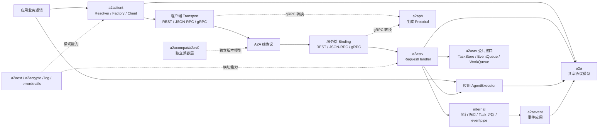
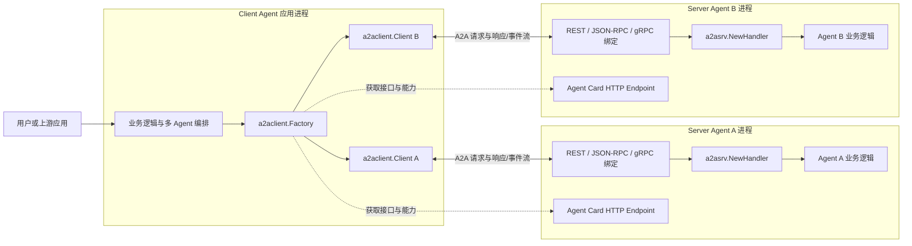
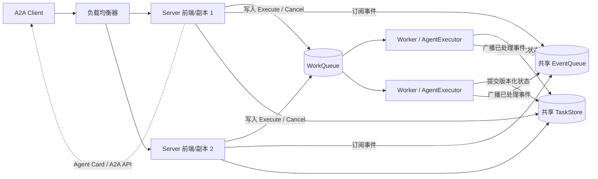
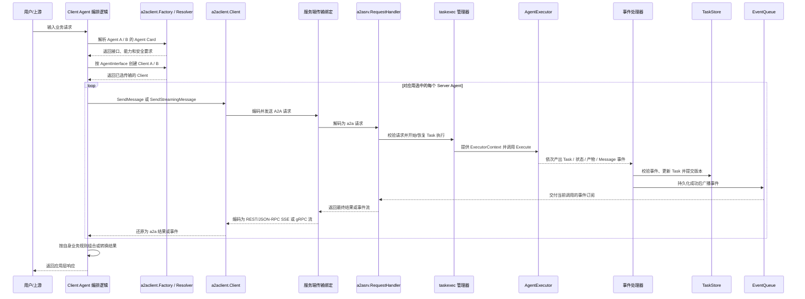
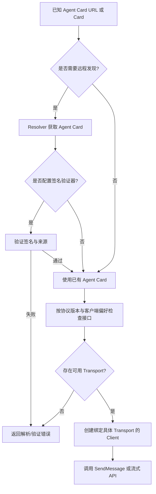
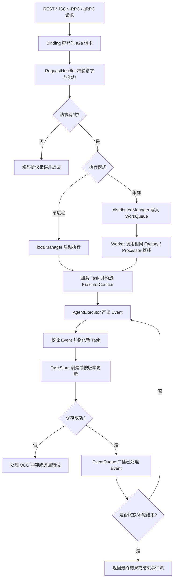
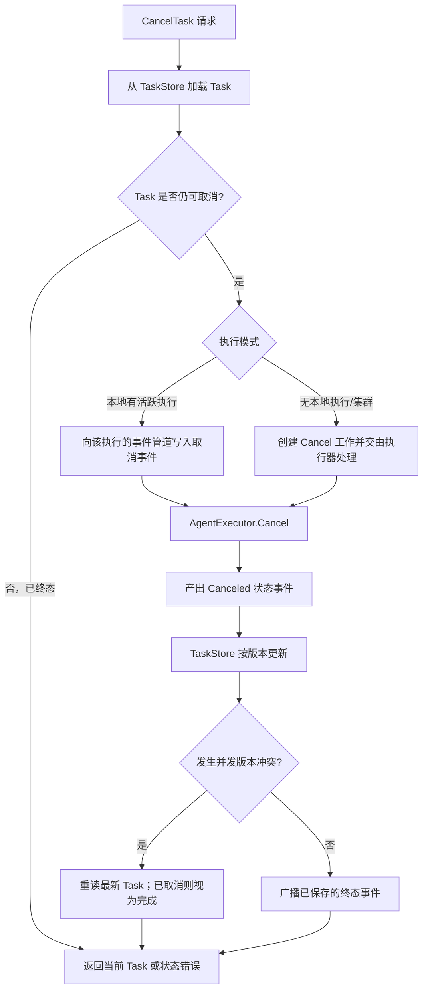

这个示例监听本机 HTTP，没有配置认证或 TLS，只应用于本地学习；部署到网络环境时应由应用配置认证、授权、TLS 和访问控制。
# A2A Go SDK 架构说明

本文面向第一次接触 A2A Go SDK 的 Go 开发者，依次说明它解决什么问题、代码如何分层、请求如何执行，以及如何部署和扩展。

先建立三个概念：Client Agent 是发起调用的应用，Server Agent 是接收请求并运行 Agent 的应用；Message 是一条对话输入/输出，Task 是需要保存、查询、续跑或取消的工作单元。SDK 提供两端协议能力与服务端任务执行管线，不提供模型运行时或业务数据库。

建议按本文顺序阅读：先跑通示例，再看模块和部署边界，最后沿请求流程理解事件、存储和并发处理。

## 使用示例

下面是一个完整的 JSON-RPC 服务端和客户端。创建一个 Go 模块，在模块根目录初始化依赖，并把两段程序分别放入 `cmd/server/main.go` 与 `cmd/client/main.go`：

```bash
go mod init example.com/hello-agent
go get github.com/a2aproject/a2a-go/v2@latest
```

### 服务端

```go
package main

import (
    "context"
    "iter"
    "log"
    "net"
    "net/http"

    "github.com/a2aproject/a2a-go/v2/a2a"
    "github.com/a2aproject/a2a-go/v2/a2asrv"
)

func main() {
    const listenAddress = ":9001"
    const invokeURL = "http://127.0.0.1:9001/invoke"

    agentCard := &a2a.AgentCard{
        Name:        "Hello Agent",
        Description: "Replies with a greeting",
        SupportedInterfaces: []*a2a.AgentInterface{
            a2a.NewAgentInterface(invokeURL, a2a.TransportProtocolJSONRPC),
        },
        DefaultInputModes:  []string{"text"},
        DefaultOutputModes: []string{"text"},
        Capabilities:       a2a.AgentCapabilities{Streaming: true},
    }

    executor := a2asrv.AgentExecutorFunc(func(
        ctx context.Context,
        execCtx *a2asrv.ExecutorContext,
    ) iter.Seq2[a2a.Event, error] {
        return func(yield func(a2a.Event, error) bool) {
            event := a2a.NewMessage(
                a2a.MessageRoleAgent,
                a2a.NewTextPart("Hello, world!"),
            )
            yield(event, nil)
        }
    })

    requestHandler := a2asrv.NewHandler(executor)
    mux := http.NewServeMux()
    mux.Handle("/invoke", a2asrv.NewJSONRPCHandler(requestHandler))
    mux.Handle(
        a2asrv.WellKnownAgentCardPath,
        a2asrv.NewStaticAgentCardHandler(agentCard),
    )

    listener, err := net.Listen("tcp", listenAddress)
    if err != nil {
        log.Fatalf("listen: %v", err)
    }
    log.Printf("A2A server listening on %s", listenAddress)
    if err := http.Serve(listener, mux); err != nil {
        log.Printf("server stopped: %v", err)
    }
}
```

### 客户端

```go
package main

import (
    "context"
    "log"

    "github.com/a2aproject/a2a-go/v2/a2a"
    "github.com/a2aproject/a2a-go/v2/a2aclient"
    "github.com/a2aproject/a2a-go/v2/a2aclient/agentcard"
)

func main() {
    ctx := context.Background()

    card, err := agentcard.DefaultResolver.Resolve(ctx, "http://127.0.0.1:9001")
    if err != nil {
        log.Fatalf("resolve agent card: %v", err)
    }

    client, err := a2aclient.NewFromCard(ctx, card)
    if err != nil {
        log.Fatalf("create A2A client: %v", err)
    }

    message := a2a.NewMessage(
        a2a.MessageRoleUser,
        a2a.NewTextPart("Hello, agent"),
    )
    result, err := client.SendMessage(ctx, &a2a.SendMessageRequest{Message: message})
    if err != nil {
        log.Fatalf("send message: %v", err)
    }
    log.Printf("agent replied: %+v", result)
}
```

### 运行与调用过程

打开两个终端并保持服务端运行。先在终端一启动服务端，再在终端二启动客户端：

```bash
go run ./cmd/server
```

```bash
go run ./cmd/client
```

服务端的 Agent Card 是发现信息，声明名称、能力和可调用接口；它不包含 Agent 的执行逻辑。`AgentExecutorFunc` 将业务逻辑接入服务端，本例直接产出 Agent `Message`，因此请求返回消息而不创建持久化 Task。`NewHandler` 提供协议无关的请求处理；JSON-RPC Handler 负责网络协议转换。

客户端先由 Resolver 从服务地址获取 Well-Known Agent Card，再由 `NewFromCard` 根据卡片接口选择已注册的传输。`NewMessage` 创建用户消息，`SendMessage` 发送请求并返回 Agent Message。默认 Client 已注册 JSON-RPC 与 REST；如果卡片没有可用接口或连接失败，创建 Client 时会返回错误。

### 改为有状态任务

需要保存进度、查询结果或继续执行时，执行器应产出 Task 事件。下面片段放在 `AgentExecutorFunc` 返回的 `func(yield ...)` 中：新任务先产出 Submitted Task；已有任务从 `StoredTask` 读取只读快照。随后状态事件推进任务，Artifact 事件累积结果，Completed 结束执行。

```go
if execCtx.StoredTask == nil {
    if !yield(a2a.NewSubmittedTask(execCtx, a2a.TaskStateSubmitted, nil), nil) {
        return
    }
}
if !yield(a2a.NewStatusUpdateEvent(execCtx, a2a.TaskStateWorking, nil), nil) {
    return
}
if !yield(a2a.NewArtifactEvent(execCtx, a2a.NewTextPart("result")), nil) {
    return
}
if !yield(a2a.NewStatusUpdateEvent(execCtx, a2a.TaskStateCompleted, nil), nil) {
    return
}
```

`NewSubmittedTask` 为新执行建立 TaskID、ContextID 和初始历史。Working 表示任务开始处理；Artifact 保存 Agent 输出，不会被误记为新的对话消息；Completed 是终态。每次 `yield` 都把事件交给服务端处理，服务端更新并保存 Task 后才向订阅者广播。若调用方停止接收事件，`yield` 返回 `false`，执行器应立即停止产出。
## 已实现能力

| 能力域 | 当前实现 |
| --- | --- |
| 协议模型 | A2A v1.0 核心类型与 JSON 编码；另有独立的 v0.3 兼容实现。消息和产物支持文本、原始字节、URL、结构化数据等 Part。 |
| 传输绑定 | 服务端支持 HTTP+JSON REST、HTTP JSON-RPC 和 gRPC；REST/JSON-RPC 流通过 SSE，gRPC 使用服务端流。兼容绑定位于对应的版本包中。 |
| 客户端 | Agent Card 解析、接口/协议版本兼容选择、请求拦截器和可注册传输；默认注册 JSON-RPC 与 REST，gRPC 由调用方显式注册。 |
| 任务运行 | 创建和延续任务、读取/列出/取消任务、订阅任务事件、流式消息、历史、状态更新和产物增量更新。 |
| 服务发现 | 静态或动态公开 Agent Card、认证客户端可用的扩展卡片，以及签名/验证工具。签名校验由调用方配置为可选能力。 |
| 可扩展运行时 | Agent 执行器、调用拦截器、执行上下文拦截器、扩展协商、并发限制、任务存储、事件队列和工作队列接口。 |
| 通知与部署 | 可选推送通知；默认单进程内存实现，以及依赖外部共享存储/队列的实验性集群模式。 |
| 横切能力 | 请求用户上下文、租户传播、日志上下文和结构化错误详情。认证身份验证、凭据获取、租户隔离及具体后端由应用或部署方提供。 |

该 SDK 提供的是 A2A 协议客户端/服务端构件，不是 Agent 模型运行时，也不内置生产级数据库、消息代理、身份提供方或授权策略。

## 核心对象速览

| 对象 | 初学者可以这样理解 |
| --- | --- |
| Agent Card | 服务目录项：告诉 Client 去哪里调用、支持什么协议和能力，不包含 Agent 的实现。 |
| Message | 一条对话内容，由一个或多个 Part 组成；最简单的请求/响应可以只有 Message。 |
| Task | 有状态工作记录：保存状态、历史和产物，可查询、继续、取消；不是每条 Message 都必须属于 Task。 |
| Event | 执行期间发生的一次变化；Message、Task、状态更新和 Artifact 更新都能作为 Event 被流式传递。 |
| AgentExecutor | 应用提供的业务适配器：接收执行上下文，调用模型/工具，并把结果转换成 Event。 |

最小调用链是：Client 发现 Agent Card 并发送 Message；服务端把请求交给 AgentExecutor；Agent 可以直接返回 Message，也可以通过 Task/Event 表达可持久化的长任务。传输层只负责把这些对象编码到 REST、JSON-RPC 或 gRPC。

## 项目结构与架构图

### 目录职责

项目按协议模型、客户端、服务端、传输绑定和内部执行机制拆分。应用通常只依赖 `a2a`、`a2aclient`、`a2asrv` 及所需的传输包；`internal` 是 SDK 私有实现，不属于应用扩展 API。

| 路径 | 主要职责 | 应用是否直接依赖 |
| --- | --- | --- |
| `a2a/` | 协议领域模型、事件、请求/响应、Agent Card 和构造函数；客户端与服务端共享的类型层。 | 是 |
| `a2aclient/` | 协议无关客户端、Agent Card Resolver、Factory、Transport 接口和调用拦截器。 | 是 |
| `a2asrv/` | RequestHandler、AgentExecutor、服务端中间件，以及公开的 TaskStore、EventQueue、WorkQueue 等替换接口。 | 是 |
| `a2agrpc/` 与 `a2apb/` | gRPC 客户端/服务端绑定、生成的 Protobuf 类型及模型转换。 | 需要 gRPC 时依赖 |
| `a2acompat/a2av0/` | 独立的 A2A v0.3 兼容模型和传输，不与 v1.0 核心类型混用。 | 迁移或兼容时依赖 |
| `a2aevent/`、`a2aext/`、`a2acrypto/` | 事件应用、扩展协商/传播、Agent Card 签名与验证工具。 | 按需依赖 |
| `internal/` | 执行协调、事件管道、Task 更新及传输辅助实现。由 SDK 内部调用，应用不应导入。 | 否 |
| `examples/` 与 `e2e/` | 可运行集成示例与跨模块行为验证。 | 阅读/运行参考 |

### 模块依赖与调用边界

图中实线表示主要调用/依赖方向；A2A 核心模型贯穿客户端和服务端。线上协议到核心模型的转换由绑定层负责，Agent 业务逻辑不直接依赖网络传输。



图中各块表示的职责：`a2aclient` 负责发现 Agent Card 并调用协议无关的 Client；Transport 将核心请求编码成线上协议。服务端 Binding 完成反向转换，`RequestHandler` 调用执行协调和后端接口。应用只实现 `AgentExecutor`；`internal` 承担生产者/消费者协调、事件校验与 Task 更新。`a2apb` 是 gRPC 的线类型，v0.3 兼容模型与 v1.0 核心模型隔离；扩展、签名、日志和错误详情属于横切能力。

### 架构总览

记住三层就能读懂大部分代码：`a2a` 是客户端和服务端共用的数据模型；传输绑定负责把 REST、JSON-RPC、gRPC 转换成这些模型；`a2asrv` 负责任务执行与状态，应用通过 `AgentExecutor` 提供 Agent 行为。存储和队列是可替换接口，不与某一种数据库或网络协议绑定。

## 部署视图：一个 Client Agent，多个 Server Agent

`a2a-go` 的 client/server 不是必须单独运行的守护进程，而是嵌入应用进程的 Go SDK。Client Agent 在自己的进程里使用 `a2aclient.Factory` 和一个或多个 `a2aclient.Client`；每个 Server Agent 在自己的服务进程里使用 `a2asrv.NewHandler`、AgentExecutor 和一种或多种服务端传输绑定。双方通过 Agent Card 声明的 A2A 接口直接通信。



这里的“一对多”是应用拓扑，不是 SDK 内置的服务端路由器：Client Agent 根据业务逻辑决定调用哪个 Server Agent、调用顺序，以及是否并行调用；A2A-Go 提供发现、连接、协议转换和请求 API，不会自动把一次请求广播到所有 Server Agent，也不会自动聚合多个结果。Server Agent A 与 B 各自执行和保存自己的 Task；如需共享业务状态，必须由应用显式传递信息或另行设计共享后端。

每个 Server Agent 可单进程运行，也可独立启用 `a2asrv` 集群模式，由前端实例接收 A2A 请求、工作实例执行 Agent，并共享其 TaskStore/EventQueue/WorkQueue。客户端仍连接该 Server Agent 对外公布的 A2A 接口，不需要感知其内部部署形态。

### 集群部署视图

下图表示逻辑职责，不要求前端与 Worker 必须是不同二进制或不同进程。示例集群把它们部署为多个相同服务副本；`WithClusterMode` 将工作分派给 WorkQueue，且三个后端都必须具备跨实例语义。



节点职责：负载均衡器只负责将外部请求送到 Server 副本；前端负责协议接入、创建订阅并提交工作，不一定与 Worker 分进程。WorkQueue 保存待执行的 Execute/Cancel 工作，Worker 调用 Agent 并产出事件。TaskStore 保存版本化任务快照；EventQueue 将已保存事件送回前端订阅者。客户端只访问 Server 的公开 A2A 地址，不直接连接这些内部后端。

每个 Server 副本都可以用同一段初始化代码连接共享后端。三个对象必须由部署方提供具备跨进程语义的实现；仅把内存实现放进配置并不能形成集群。

```go
clusterConfig := a2asrv.ClusterConfig{
    TaskStore:    sharedTaskStore,
    QueueManager: sharedEventQueue,
    WorkQueue:    sharedWorkQueue,
}
requestHandler := a2asrv.NewHandler(
    executor,
    a2asrv.WithClusterMode(clusterConfig),
)
```

`WithClusterMode` 切换到分布式执行管理器，前端将工作投递给 WorkQueue，注册在队列上的 Worker 消费任务。代码中前端与 Worker 可以是同一个服务进程的两个职责；若要单独部署 Worker，应用仍需按队列 API 启动处理端并共享相同的后端。

## 请求数据流：发现、调用、事件返回

下面展示 Client Agent 依次调用两个独立 Server Agent 的典型路径。实际应用可只调用其中一个，也可自行并发调用；Task 和结果默认不会在两个服务端之间自动复制。



若使用非流式 `SendMessage`，客户端收到的是最终 Message 或 Task；流式调用/任务订阅则逐个收到事件。服务端先应用并保存事件，再向订阅者广播，因而实时事件流与可查询 Task 状态沿用同一更新结果。REST 和 JSON-RPC 的事件在线上使用 SSE，gRPC 使用 server-streaming；进入 SDK 后均转换为 `a2a.Event`。

时序图参与者说明：`App` 是决定调用哪个 Agent、是否组合结果的业务编排层；`Factory / Resolver` 读取并选择 Agent Card 接口；`Client` 调用已选 Transport。服务端 `Binding` 负责线协议转换，`RequestHandler` 路由协议操作，执行管理器创建执行管线。`AgentExecutor` 只生成业务事件；处理器更新 TaskStore 后才写入 EventQueue，订阅端再把事件送回客户端。

## 关键流程

### Agent Card 发现与客户端创建



Factory 只会从已注册的 Transport 中选择；JSON-RPC/REST 默认可用，gRPC 需要显式注册。解析卡片并不自动代表其可信，是否验证签名由 Resolver 配置决定。

节点说明：URL 是 Agent Card 的发现入口；Resolver 获取并解析卡片，Verifier（可选）检查卡片签名。卡片的接口列表包含 URL、协议与版本；Factory 只从已注册的 Transport 中选择兼容接口。创建出的 Client 才负责后续请求。没有兼容接口或验证失败时，流程在创建 Client 前结束并返回错误。

### SendMessage 执行与事件持久化



流式和非流式接口共享服务端执行及持久化管线；差别在于客户端如何消费结果。事件只有在成功处理并保存后才广播。执行器应对已开始的任务用 Failed 状态表达运行失败；不要在发出部分事件后把普通运行失败当作未开始请求错误返回。

节点说明：Binding 解码网络请求，RequestHandler 做协议级校验并路由；`localManager` 在当前进程运行工作，`distributedManager` 则将工作投递给 Worker。`ExecutorContext` 携带本轮 Message、Task 标识和已有任务快照。Agent 产出事件后，Processor 校验事件并计算新 Task；TaskStore 持久化成功才允许 EventQueue 广播。OCC 冲突表示写入者使用了过期版本，服务端据最新 Task 判断是可恢复取消还是并发执行错误。终态事件或 Message 结束本轮响应。

### 取消任务



本地管理器可以合并同一实例内并发的重复取消；集群节点间不共享该内存状态，跨实例协调依赖共享 TaskStore 的版本检查和 WorkQueue。取消更新遇到版本冲突时，服务端重新读取 Task：若已取消则视为成功，若已进入其他终态则返回当前状态。

节点说明：`CancelTask` 首先读取当前 Task 并判断是否可取消；若本地正在执行，取消事件进入同一执行管线，否则（或在集群模式）作为独立工作分派。`AgentExecutor.Cancel` 负责通知外部运行时并产出 Canceled 事件。TaskStore 通过版本比较避免取消覆盖完成结果；已经取消时可幂等返回，已由其他状态终结时则保留当前终态。EventQueue 只广播成功写入的状态。

## 核心对象关系

这张类图只画公共概念和依赖关系，不代表每个类型都由接口实现直接持有。`defaultRequestHandler`、执行 Factory 和 Processor 是 `a2asrv` 的内部实现；应用实现 `AgentExecutor`，后端通过公开接口注入。


对象读法：`TaskID` 标识一个可读写的任务，`ContextID` 关联多轮/相关任务；`Message` 是对话内容，`Artifact` 是任务产物；`Event` 是执行输出以及流式传输的统一抽象。单进程模式不需要 WorkQueue；集群模式才用它把执行请求交给 Worker。
对象读法：`TaskID` 标识一个可读写的任务，`ContextID` 关联多轮/相关任务；`Message` 是对话内容，`Artifact` 是任务产物；`Event` 是执行输出以及流式传输的统一抽象。单进程模式不需要 WorkQueue；集群模式才用它把执行请求交给 Worker。

类图对象说明：

| 对象 | 职责与关系 |
| --- | --- |
| `Client`、`AgentCard`、`AgentInterface` | Client 持有选中的 Transport，并可使用卡片中的接口与能力；AgentCard 用一个或多个 AgentInterface 声明地址、协议和版本。 |
| `RequestHandler`、`ExecutionManager` | RequestHandler 是协议无关入口；ExecutionManager 选择本地或集群执行路径。应用通常使用默认实现，不需要自行实现内部 Manager。 |
| `ExecutionFactory`、`AgentExecutor`、`ExecutorContext` | Factory 为执行/取消准备生产者与处理器；AgentExecutor 是应用实现的逻辑，接收执行上下文并产出事件。ExecutorContext 提供当前 Message、Task/Context 标识、已有 Task 快照及调用身份信息。 |
| `Task`、`Message`、`Artifact` | Task 保存状态、对话历史和产物；Message 用 Parts 表达用户/Agent 对话，Artifact 用 Parts 表达 Agent 生成的结果。TaskID 标识任务，ContextID 关联一组任务。 |
| `Event`、`TaskStatusUpdateEvent`、`TaskArtifactUpdateEvent` | Event 是统一事件抽象；Task、Message、状态更新和产物增量都可作为事件。状态事件推进生命周期，产物事件追加或结束某个 Artifact 的内容。 |
| `EventProcessor`、`Store` | Processor 校验事件并计算新 Task；Store 提供版本化持久化，`PrevVersion` 用于原子检测并发修改。 |
| `EventQueueManager`、`WorkQueue` | EventQueueManager 分发已处理事件给订阅者；WorkQueue 只负责集群模式下分派 Execute/Cancel 工作，不能替代事件广播。 |

箭头表示职责依赖而非所有权：请求入口通过执行管理器安排执行；Factory 将应用执行器与事件处理器配对；事件处理结果写入 Store 后才能发布给 EventQueue。`ExecutorContext.StoredTask` 是已有 Task 的只读快照，不应由 Agent 修改。

## 核心概念

### 先区分请求、执行和任务

一次 `SendMessage` 是客户端发起的协议请求；它可能启动一个新的 Task，也可能向已有 Task 追加一条用户消息并继续执行。Task 是可持久化、可查询、可取消的工作单元。执行则是 AgentExecutor 对某次请求实际运行的一次过程，不等同于 HTTP 请求的生命周期：默认本地管理器使用脱离请求取消信号的执行上下文，因此客户端断开后执行仍可继续并保存结果。集群模式下，执行工作可能由不同 Worker 处理，取消和执行通过共享 TaskStore 的版本号协调。

### AgentExecutor：应用逻辑的适配器

**是什么：** `a2asrv.AgentExecutor` 是 SDK 与应用 Agent 代码之间的接口，包含 `Execute` 和 `Cancel`。执行方法返回 `iter.Seq2[a2a.Event, error]`，也就是一串事件及可能的错误，而不是直接返回 HTTP 响应或数据库对象。

**为什么需要它：** Agent 只需描述“任务已提交、正在进行、产出了什么、何时结束”，不需要知道客户端使用 REST、JSON-RPC 还是 gRPC，也不需要自行实现任务存储、订阅和协议序列化。

**如何工作：** `a2asrv` 的 factory 为调用加载/创建 `ExecutorContext`，再由内部 executor 遍历 Agent 返回的事件并写入事件管道。另一个处理阶段负责校验、更新 Task、存储和广播。取消请求会调用 `Cancel`；`a2asrv.AgentExecutorFunc` 提供了默认取消行为，便于只用函数实现 `Execute`。

`Execute` 返回 `iter.Seq2[a2a.Event, error]`：它不是一次性返回值，而是一个可逐项消费的事件序列。Agent 通过 `yield(event, err)` 交出下一项；返回 `false` 表示消费者不再需要数据，执行器必须停止。

服务端内部把这条序列分成生产和处理两步：执行 goroutine 调用 Agent 并将事件写入本进程的 `eventpipe`；另一个处理阶段读取事件，检查事件和 Task 标识，计算新 Task 状态并写入 TaskStore。写入成功后才广播到 EventQueue，最后由当前请求的订阅者编码为响应或流事件。这样 Agent 无需等待网络写出，也不需要自行维护数据库。

新 Task 的首个事件应是 Task（通常用 `NewSubmittedTask` 建立 TaskID、ContextID 和初始历史）；已有 Task 的用户消息在 Agent 执行前已追加到历史。Agent 应用 `ExecutorContext` 构造关联同一任务的事件，并将它视为只读输入。事件及其引用的 Part、Metadata 等对象在 `yield` 后可能被存储和订阅端同时读取，因此不能再修改。

错误处理有明确边界：Task 尚未创建时发生的输入/初始化错误可以作为序列错误返回；执行已开始后，通常产出 `TaskStateFailed` 事件，让失败状态被保存和订阅，而不是只让 HTTP 调用失败。取消则调用 `AgentExecutor.Cancel`；`AgentExecutorFunc` 提供的默认实现只发 Canceled 状态，若 Agent 启动了子进程或远端工作，应用还必须实现真正的停止逻辑。

### 进阶：外部 Agent 适配（Claude Code 示例）

仓库没有内置 Claude Code 连接器；`a2asrv` 也不会自动启动 Claude Code。集成方式是在你的 Go Server Agent 应用中实现一个 `AgentExecutor` 适配器：它接收 A2A 的 `ExecutorContext`，调用外部运行时，再把运行时输出转换为 `a2a.Event`。外部运行时可以是本机 CLI 子进程、独立的内部服务，或应用已使用的 Agent SDK；A2A 层只依赖适配器，不依赖 Claude Code 的具体接口。

| A2A 输入/输出 | 适配器要做的映射 |
| --- | --- |
| `ExecutorContext.Message` | 将本次用户输入转换为 runtime 的 prompt/request；不要把不可信输入拼接成 shell 命令字符串。 |
| `StoredTask.History` | 需要多轮上下文时，转换成 runtime 接受的对话历史；如果 runtime 自己维护 session，则查找对应的 runtime session。 |
| `TaskID` / `ContextID` | 作为适配器侧关联键。它们不是 Claude Code session ID；若 runtime 返回独立 session ID，应由应用持久化映射。 |
| runtime 增量输出 | 需要流式展示时，转换为一个 Artifact 的多个 `TaskArtifactUpdateEvent`；若只需最终答复，可返回一条 Agent `Message`。 |
| runtime 正常结束/等待输入 | 正常结束时发 Completed 状态；若任务需要用户补充信息，发 InputRequired 状态并在后续请求中恢复任务。 |
| runtime 错误/取消 | 执行已开始后通常发 Failed 状态事件；实现 `Cancel` 将取消信号传给子进程或远程 runtime，并发出 Canceled 状态。 |

典型执行步骤如下：

1. 对新任务发出 `NewSubmittedTask`，再发 Working 状态；续跑时使用 `ExecutorContext.StoredTask` 和本次 Message 组装 runtime 输入。
2. 通过 runner 调用 runtime。CLI 方式通常使用 Go 的 `os/exec` 启动非交互模式，并读取其流式输出；服务方式则通过 HTTP/gRPC 或供应方 SDK 调用。具体参数和结构化输出格式取决于 runtime 版本，由适配器负责解析。
3. 将可向调用方公开的增量结果映射为 Artifact 更新；不要把 runtime 的调试日志、工具凭据或不应公开的内部输出直接透传。
4. 正常结束时发 Completed；错误时按任务阶段返回错误或发 Failed；用户需要补充信息时发 InputRequired。事件必须带有由 `ExecutorContext` 生成的同一 Task/Context 标识。
5. 在 `Cancel` 中找到对应的运行实例并停止 CLI/远程任务。若使用 `exec.CommandContext`，应把 SDK 提供的执行 context 传给命令，同时仍需实现 `AgentExecutor.Cancel`，让 A2A 取消能够正确终止外部工作。

以下仅展示适配层的伪代码结构，`RuntimeRunner` 和 `RuntimeUpdate` 由应用实现，不是本仓库提供的类型：

```go
func (e *ExternalAgent) Execute(
    ctx context.Context,
    execCtx *a2asrv.ExecutorContext,
) iter.Seq2[a2a.Event, error] {
    return func(yield func(a2a.Event, error) bool) {
        if execCtx.StoredTask == nil {
            if !yield(a2a.NewSubmittedTask(execCtx, a2a.TaskStateSubmitted, nil), nil) {
                return
            }
        }
        if !yield(a2a.NewStatusUpdateEvent(execCtx, a2a.TaskStateWorking, nil), nil) {
            return
        }

        var artifactID a2a.ArtifactID
        for update, err := range e.runner.Run(ctx, execCtx) {
            if err != nil {
                yield(a2a.NewStatusUpdateEvent(execCtx, a2a.TaskStateFailed, nil), nil)
                return
            }
            if update.Text != "" {
                var event *a2a.TaskArtifactUpdateEvent
                if artifactID == "" {
                    event = a2a.NewArtifactEvent(execCtx, a2a.NewTextPart(update.Text))
                    artifactID = event.Artifact.ID
                } else {
                    event = a2a.NewArtifactUpdateEvent(execCtx, artifactID, a2a.NewTextPart(update.Text))
                }
                if !yield(event, nil) {
                    return
                }
            }
        }
        yield(a2a.NewStatusUpdateEvent(execCtx, a2a.TaskStateCompleted, nil), nil)
    }
}
```

对于需要跨轮恢复的 Claude Code 会话，不要假设 A2A TaskStore 会保存 CLI 的私有 session：可以用独立应用存储按 TaskID 记录 runtime session ID，或从 Task history 重建输入。进程内 map 只适用于单进程生命周期；集群模式下 Execute 和 Cancel 可能落到不同 worker，session 映射与取消控制必须通过共享存储/队列或 runtime 自身的远程接口协调。

还要分别处理两类身份：A2A 调用用户/租户与运行 Claude Code 的操作系统账号、工作目录和工具权限。部署时应使用受限账号和隔离工作目录，显式配置可用工具/权限，并避免让一个用户的 runtime session、文件或凭据被另一个 Task 复用。A2A 的认证信息不会自动转化为 Claude Code 的登录态或授权策略。

### ExecutorContext：传给 Agent 的执行输入

`ExecutorContext` 不是 Go 的 `context.Context`，而是描述这次 A2A 执行的只读业务上下文。它包含触发执行的 Message、TaskID、ContextID、完整的已有 Task（若有）、请求 Metadata、User、Tenant 和 ServiceParams。实现 Agent 时通常用它读取历史/用户信息，并把它作为 `a2a.NewStatusUpdateEvent`、`a2a.NewArtifactEvent` 等构造函数的 `TaskInfoProvider`，保证输出事件属于正确的 Task/Context。

默认情况下，执行器拿到的 `StoredTask` 不应修改。若 Agent 需要额外数据，可配置 `ExecutorContextInterceptor`；例如 `ReferencedTasksLoader` 根据 Message 的 `ReferenceTasks` 从 Store 加载相关 Task。它运行在 Agent 执行之前，不同于对整个协议调用做拦截的 `CallInterceptor`。

### Event、TaskState 与 Artifact：用事件表达变化

**Event 是什么：** `a2a.Event` 是 SDK 内部和流式 API 共用的协议事件接口，当前包括完整 Task、Message、Task 状态更新和 Artifact 更新。Agent 负责产出事件；`a2aevent` 和服务端 task update manager 负责验证事件并将其应用到任务状态。

**TaskState 怎么读：** `Submitted`、`Working` 表示任务进展；`InputRequired` 表示当前轮执行结束、任务等待用户继续输入，Task 仍可继续；`Completed`、`Canceled`、`Failed`、`Rejected` 是终态，终态任务不再接受普通更新。

**Artifact 为什么独立：** Artifact 表示 Agent 产出的报告、文件或其他资源，不是对话历史中的 Message。`TaskArtifactUpdateEvent` 可按同一个 Artifact ID 追加 Part，并可标记最后一个 chunk，因此长内容可以边生成边持久化和传给订阅者。

**Message / Part：** Message 表示用户或 Agent 的一条消息，由有序 Part 构成；Part 支持文本、原始字节、URL 和结构化数据。Task 保存历史消息与 Artifact，ContextID 则把多个相关 Task 关联起来，不等同于 TaskID。

### TaskStore：任务状态的持久化契约

**是什么：** `a2asrv/taskstore.Store` 是服务端读写 Task 的接口，提供 `Create`、`Update`、`Get`、`List`。默认 `NewHandler` 使用内存实现；应用可通过 `WithTaskStore` 注入自有数据库或其他持久化适配器。它存的是 A2A Task 状态，不是 Agent 内部任意业务数据的通用 ORM。

**为什么需要它：** Task 需要跨请求读取、续跑、取消和订阅；集群模式下多个实例还必须看到一致的任务状态。将 Store 定义为接口，使执行逻辑不依赖某个数据库。

**如何更新：** 内部 `taskupdate.Manager` 接收 Agent 事件，检查 TaskID/ContextID 和状态转换，使用 `a2aevent`/UpdateMaterializer 计算新状态，然后调用 `Store.Update`。Store 同时收到新 Task、触发更新的 Event、旧状态和 `PrevVersion`。实现必须原子地检查版本并更新：版本不匹配应返回 `ErrConcurrentModification`，防止执行、取消或其他写入互相覆盖。`Get` 必须返回与版本对应的完整 Task 快照。

默认 materializer 在服务端物化完整 Task。自定义 materializer 可让某些存储直接根据 Event 更新记录，但外部 Store 的公开读取结果仍必须是完整 Task。集群实现还应考虑用户/租户隔离与认证器，而这些隔离策略由具体 Store 和应用配置决定。

### EventQueue 与 WorkQueue：名称相似，解决不同问题

| 接口 | 用途 | 典型生产者/消费者 | 为什么单独存在 |
| --- | --- | --- | --- |
| `eventqueue.Manager` | 订阅和广播已经处理的 Task 事件。执行管线写入事件，客户端请求/订阅侧读取事件。 | 后端事件处理器 -> 一个或多个订阅者 | 一个任务可以有实时订阅者，集群中读写事件的实例也可能不同。 |
| `workqueue.Queue` | 将 Execute/Cancel 工作请求从接入请求的前端分派给执行 Agent 的后端。Payload 携带任务、请求和可编码的调用上下文。 | 前端 RequestHandler -> Worker handler | 将 Agent 运行与接入流量的实例解耦，支持分布式 worker、重试和心跳。 |
| `eventpipe`（internal） | 单次执行内连接 Agent 事件生产端和服务端处理端的进程内管道。 | Agent executor -> event processor | 将 Agent 产出与持久化/广播处理分开；不是集群消息队列，也不是客户端订阅接口。 |

默认单进程模式创建内存 EventQueue 和 TaskStore，不需要 WorkQueue。集群模式通过 `WithClusterMode` 要求调用方提供共享 TaskStore、跨实例 EventQueue 和 WorkQueue；仅提供接口对象并不会让进程内存队列自动变成分布式服务。

### RequestHandler、传输绑定与客户端

`a2asrv.RequestHandler` 是服务器内部的协议无关业务入口，接收 `a2a` 请求并调用执行管理、Store 和订阅机制。REST/JSON-RPC/gRPC handler 是协议适配器：解析线格式，转换成核心类型，调用 RequestHandler，再编码响应。REST 和 JSON-RPC 用 SSE 承载流式事件，gRPC 用 server-streaming；AgentExecutor 无需感知这些差异。

客户端的 `a2aclient.Client` 也隐藏具体传输。Agent Card 描述接口、能力、技能和安全要求；Resolver 获取并可选验证卡片，Factory 再按版本兼容性与客户端偏好选择已注册的 Transport。Factory 默认提供 JSON-RPC/REST，gRPC 需要显式注册。客户端 `AuthInterceptor` 可从应用提供的 `CredentialsService` 按会话和安全方案取凭据并附加到调用中，但凭据获取/刷新仍属于应用职责。

### 其他经常遇到的名词

| 名词 | 含义与用途 |
| --- | --- |
| `TaskID` / `ContextID` | TaskID 唯一标识一个任务；ContextID 把多个相关任务归为一个会话或工作上下文。新任务可由服务端生成二者。 |
| `CallContext` / `ServiceParams` | 单次服务端协议调用的元数据和身份/租户/扩展信息。Transport 建立调用上下文，拦截器和 handler 在请求期间读取或更新它。 |
| `CallInterceptor` | 请求/响应边界的 Before/After 扩展点，可观测、拒绝或改写调用；服务端和客户端各有自己的接口。 |
| Agent Card | Agent 的发现清单。公开卡片描述公开能力；认证后可返回扩展卡片。`a2acrypto` 提供签名/验证，只有配置 Resolver.Verifier 时客户端才校验签名。 |
| Extension | 通过 URI 和 Metadata 声明的协议扩展。客户端请求支持的扩展，服务端校验/激活并让 Transport 返回已激活扩展；SDK 提供协商机制，不替业务实现扩展功能。 |
| Push notification | 客户端为 Task 注册推送配置后，服务端通过可替换的 ConfigStore/Sender 发通知。它是订阅之外的异步通知通道，投递可靠性由 Sender 实现决定。 |

## 单进程与集群模式

两种模式使用同一套 `AgentExecutor` 和事件处理逻辑，区别在于工作在哪里执行、状态如何共享：

| 模式 | 请求处理 | Agent 执行 | 必需后端 |
| --- | --- | --- | --- |
| 单进程（默认） | 当前进程中的 RequestHandler | 当前进程的本地执行管理器 | 默认内存 TaskStore、内存 EventQueue；不需要 WorkQueue |
| 集群（`WithClusterMode`） | 前端实例接收请求并订阅事件 | WorkQueue 将工作分配给 worker | 具备共享/跨实例语义的 TaskStore、EventQueue 和 WorkQueue |

集群模式是可选能力。仓库提供基于 MySQL 的任务存储和队列示例，并用 Docker Compose 启动多个服务副本、MySQL 和 Nginx。仅注入接口不会使内存实现自动具备跨进程能力；部署方还需保证版本冲突检测、跨实例事件分发、工作确认/重试和长任务心跳等语义。

## 安全、扩展与租户边界

- **认证集成**：服务端 `CallContext.User` 可由认证中间件或拦截器填充；客户端凭据存储和附加通过 `CredentialsService`/`AuthInterceptor` 接入。SDK 没有绑定具体身份提供方。
- **Agent Card 信任**：卡片签名由 `a2acrypto` 生成/验证；客户端 Resolver 只有在设置 Verifier 后才会校验签名。调用 `Factory.CreateFromCard` 时应确保卡片来源可信，或先经 Resolver 验证。
- **扩展协商**：客户端可声明想使用的扩展；服务端检查调用所请求的扩展，并记录执行期间激活的扩展供传输层返回。`a2aext` 提供客户端激活器等工具，不替应用实现扩展逻辑。
- **多租户**：租户值可进入请求/执行上下文并跨工作队列编码传播。REST 提供按 URL 模板提取租户的 Handler；具体租户鉴权、数据隔离和存储键设计由应用与后端实现承担。
- **推送通知**：启用后，客户端可为任务管理推送配置，服务端在任务更新时调用配置的 Sender。发送端和配置存储可替换，具体投递可靠性由其实现决定。
- **拦截器与执行上下文**：调用拦截器处理请求/响应边界；`ExecutorContextInterceptor` 在创建执行器上下文时补充 Agent 所需数据，例如加载消息引用的相关任务。二者所处阶段不同，不应混为一类中间件。

## 扩展点

- **Agent 行为**：实现 `a2asrv.AgentExecutor`，将应用的增量输出转换成 A2A 事件；无需绑定网络协议。
- **服务端绑定**：直接实现 `a2asrv.RequestHandler`，或复用默认 `a2asrv.NewHandler` 后包装 REST、JSON-RPC 或 gRPC 传输。
- **存储与调度**：实现 `a2asrv/taskstore`、`a2asrv/eventqueue` 和 `a2asrv/workqueue` 接口。单进程自定义存储与集群部署的共享存储需求不同。
- **请求横切逻辑**：使用服务端 `CallInterceptor`、客户端 `CallInterceptor`、上下文编解码、推送通知和并发限制等公开接口。
- **协议与扩展**：新增传输时适配 `a2aclient.Transport`/`TransportFactory` 和服务器请求处理器；协议扩展通过 `a2aext` 与调用上下文交互。

实现新 TaskStore 时，`Get` 应返回与版本号匹配的完整 Task 快照；`Update` 必须原子比较 `PrevVersion` 并更新，版本不匹配时返回 `ErrConcurrentModification`。集群 EventQueue 必须让不同实例上的写入者与订阅者交换同一 Task 的事件；WorkQueue 必须定义工作确认、失败重试和长任务心跳行为。只在单进程内有效的内存队列不满足集群契约。
## 使用场景对照

- **立即答复**：Agent 产出一条 Agent Message，`SendMessage` 返回 Message；无需创建 Task。
- **长任务或流式任务**：Agent 先产出 Submitted Task，再持续产出状态与 Artifact 更新；TaskStore 保存完整状态，客户端可订阅事件或查询任务。
- **集群执行**：前端把工作写入 WorkQueue，Worker 执行相同的 Agent 事件管线；共享 TaskStore 和 EventQueue 支持跨实例查询与订阅。
- **运行时适配**：将外部模型或工具的增量输出转换成 `a2a.Event`；A2A 层负责任务状态、事件广播和协议映射，外部运行时会话及权限仍由应用管理。
