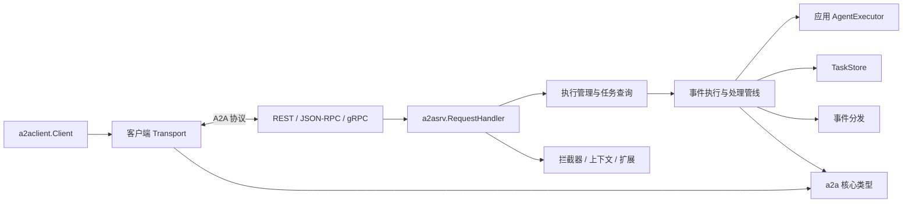
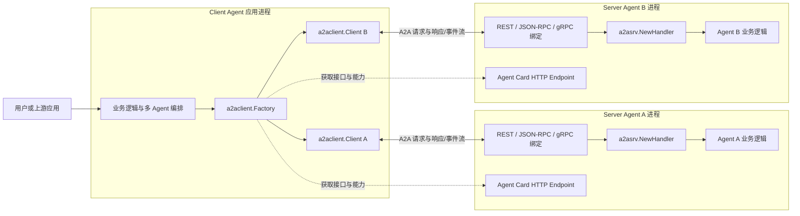
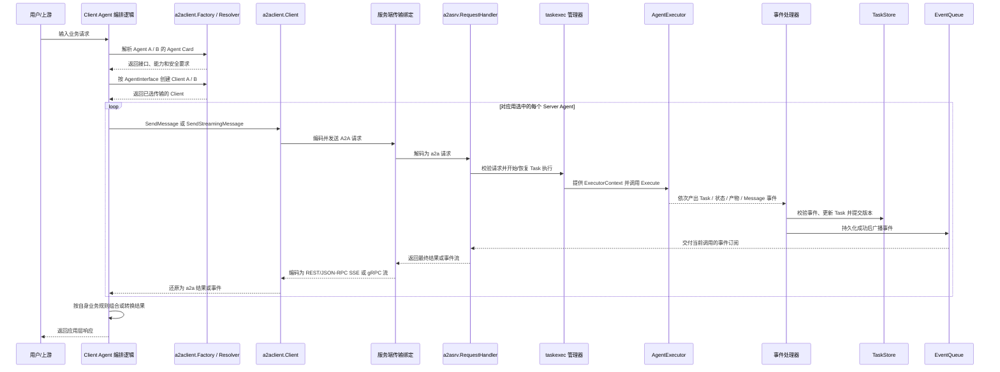
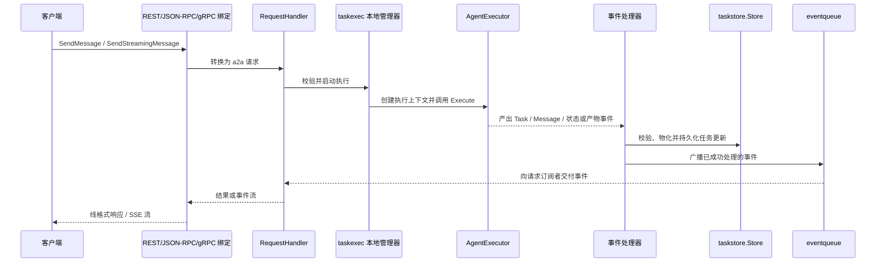
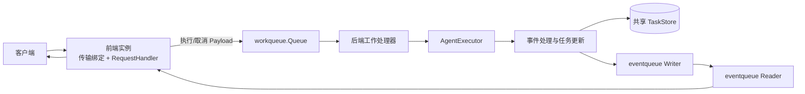

# A2A Go SDK 架构说明

本文描述 SDK 的主要模块、依赖边界和请求执行路径。它面向阅读代码、实现自定义 Agent 或扩展后端的开发者；具体并发语义以 [并发模型](CONCURRENCY_MODEL.md) 和当前实现为准。

## 已实现能力

| 能力域 | 当前实现 |
| --- | --- |
| 协议模型 | A2A v1.0 核心类型与 JSON 编码；另有独立的 v0.3 兼容实现。消息和产物支持文本、原始字节、URL、结构化数据等 Part。 |
| 传输绑定 | 服务端支持 HTTP+JSON REST、HTTP JSON-RPC 和 gRPC；REST/JSON-RPC 流通过 SSE，gRPC 使用服务端流。兼容绑定位于对应的版本包中。 |
| 客户端 | Agent Card 解析、接口/协议版本兼容选择、请求拦截器和可注册传输；默认注册 JSON-RPC 与 REST，gRPC 由调用方显式注册。 |
| 任务运行 | 创建和延续任务、读取/列出/取消任务、订阅任务事件、流式消息、历史、状态更新和产物增量更新。 |
| 服务发现 | 静态或动态公开 Agent Card、认证客户端可用的扩展卡片，以及签名/验证工具。签名校验由调用方配置为可选能力。 |
| 可扩展运行时 | Agent 执行器、调用拦截器、执行上下文拦截器、扩展协商、并发限制、任务存储、事件队列和工作队列接口。 |
| 通知与部署 | 可选推送通知；默认单进程内存实现，以及依赖外部共享存储/队列的实验性集群模式。 |
| 横切能力 | 请求用户上下文、租户传播、日志上下文和结构化错误详情。认证身份验证、凭据获取、租户隔离及具体后端由应用或部署方提供。 |

该 SDK 提供的是 A2A 协议客户端/服务端构件，不是 Agent 模型运行时，也不内置生产级数据库、消息代理、身份提供方或授权策略。

## 设计边界

SDK 的核心边界是协议领域模型与传输绑定分离：`a2a` 定义客户端、服务端共同使用的协议类型；传输层将 REST、JSON-RPC 或 gRPC 的线格式转换为这些类型；服务端通过 `AgentExecutor` 接入应用逻辑，并负责任务状态、持久化和事件分发。



## 部署架构：一个 Client Agent，多个 Server Agent

`a2a-go` 的 client/server 不是必须单独运行的守护进程，而是嵌入应用进程的 Go SDK。Client Agent 在自己的进程里使用 `a2aclient.Factory` 和一个或多个 `a2aclient.Client`；每个 Server Agent 在自己的服务进程里使用 `a2asrv.NewHandler`、AgentExecutor 和一种或多种服务端传输绑定。双方通过 Agent Card 声明的 A2A 接口直接通信。



这里的“一对多”是应用拓扑，不是 SDK 内置的服务端路由器：Client Agent 根据业务逻辑决定调用哪个 Server Agent、调用顺序，以及是否并行调用；A2A-Go 提供发现、连接、协议转换和请求 API，不会自动把一次请求广播到所有 Server Agent，也不会自动聚合多个结果。Server Agent A 与 B 各自执行和保存自己的 Task；如需共享业务状态，必须由应用显式传递信息或另行设计共享后端。

每个 Server Agent 可单进程运行，也可独立启用 `a2asrv` 集群模式，由前端实例接收 A2A 请求、工作实例执行 Agent，并共享其 TaskStore/EventQueue/WorkQueue。客户端仍连接该 Server Agent 对外公布的 A2A 接口，不需要感知其内部部署形态。

## 数据流：发现、调用、事件返回

下面展示 Client Agent 依次调用两个独立 Server Agent 的典型路径。实际应用可只调用其中一个，也可自行并发调用；Task 和结果默认不会在两个服务端之间自动复制。



若使用非流式 `SendMessage`，客户端收到的是最终 Message 或 Task；流式调用/任务订阅则逐个收到事件。服务端先应用并保存事件，再向订阅者广播，因而实时事件流与可查询 Task 状态沿用同一更新结果。REST 和 JSON-RPC 的事件在线上使用 SSE，gRPC 使用 server-streaming；进入 SDK 后均转换为 `a2a.Event`。

## 模块地图

| 模块 | 职责与边界 |
| --- | --- |
| [`a2a`](../../a2a/) | 协议领域模型、常量、请求/响应、任务、消息、事件、Agent Card 及构造函数。与传输和具体 Agent 实现无关。 |
| [`a2aevent`](../../a2aevent/) | 将消息、状态和产物更新应用到任务状态，提供事件更新及终态判断等工具。 |
| [`a2asrv`](../../a2asrv/) | 服务端核心。`RequestHandler` 处理协议操作，`AgentExecutor` 连接应用逻辑；提供拦截器、认证上下文、Agent Card、推送、任务存储、事件队列和工作队列等扩展接口。 |
| [`a2aclient`](../../a2aclient/) | 协议无关客户端、拦截器和传输工厂；可从 Agent Card 或已知接口创建客户端，并按兼容版本及偏好选择传输。 |
| [`a2agrpc`](../../a2agrpc/) | gRPC 服务端/客户端绑定。实现协议类型与生成的 Protobuf 类型之间的转换，并委托给服务端 `RequestHandler`。 |
| [`a2apb`](../../a2apb/) | A2A v1.0 的生成 Protobuf 类型；`v1/pbconv` 提供与 Go 核心模型之间的转换。 |
| [`a2acompat/a2av0`](../../a2acompat/a2av0/) | A2A v0.3 兼容实现及迁移辅助，不应与当前 v1.0 核心模型混为一层。 |
| [`a2acrypto`](../../a2acrypto/) | Agent Card 的 JWS 签名和验证工具。 |
| [`a2aext`](../../a2aext/) | A2A 扩展激活、元数据及上下文传播辅助工具。 |
| [`log`](../../log/) 与 [`errordetails`](../../errordetails/) | 结构化日志上下文，以及可跨协议编码的类型化错误详情。 |
| [`internal`](../../internal/) | 非公开实现细节，包括执行协调、任务更新、事件管道、JSON-RPC/REST/SSE 辅助实现和测试工具；应用不应依赖这些内部包。 |
| [`e2e`](../../e2e/) 与 [`examples`](../../examples/) | 跨模块行为验证和可运行参考实现。 |

服务端可替换的持久化/分发接口位于 `a2asrv` 下，而不是 `internal`：`taskstore.Store` 管理任务状态，`eventqueue.Manager` 分发已处理事件，`workqueue.Queue` 在集群模式下分派执行工作。默认单进程模式使用内存任务存储和内存事件队列。

## 核心概念与实现

### 先区分请求、执行和任务

一次 `SendMessage` 是客户端发起的协议请求；它可能启动一个新的 Task，也可能向已有 Task 追加一条用户消息并继续执行。Task 是可持久化、可查询、可取消的工作单元。执行则是 AgentExecutor 对某次请求实际运行的一次过程，不等同于 HTTP 请求的生命周期：默认本地管理器会让执行在客户端断开后继续，结果仍由服务端记录。具体上下文取消与并发细节见[并发模型](CONCURRENCY_MODEL.md)。

### AgentExecutor：应用逻辑的适配器

**是什么：** `a2asrv.AgentExecutor` 是 SDK 与应用 Agent 代码之间的接口，包含 `Execute` 和 `Cancel`。执行方法返回 `iter.Seq2[a2a.Event, error]`，也就是一串事件及可能的错误，而不是直接返回 HTTP 响应或数据库对象。

**为什么需要它：** Agent 只需描述“任务已提交、正在进行、产出了什么、何时结束”，不需要知道客户端使用 REST、JSON-RPC 还是 gRPC，也不需要自行实现任务存储、订阅和协议序列化。

**如何工作：** `a2asrv` 的 factory 为调用加载/创建 `ExecutorContext`，再由内部 executor 遍历 Agent 返回的事件并写入事件管道。另一个处理阶段负责校验、更新 Task、存储和广播。取消请求会调用 `Cancel`；`a2asrv.AgentExecutorFunc` 提供了默认取消行为，便于只用函数实现 `Execute`。

最小的任务式执行器可以按下面的顺序发事件。示例省略了导入和外层服务启动代码：

```go
executor := a2asrv.AgentExecutorFunc(func(
    ctx context.Context,
    execCtx *a2asrv.ExecutorContext,
) iter.Seq2[a2a.Event, error] {
    return func(yield func(a2a.Event, error) bool) {
        if execCtx.StoredTask == nil {
            if !yield(a2a.NewSubmittedTask(execCtx, execCtx.Message), nil) {
                return
            }
        }

        if !yield(a2a.NewStatusUpdateEvent(execCtx, a2a.TaskStateWorking, nil), nil) {
            return
        }
        if !yield(a2a.NewArtifactEvent(execCtx, a2a.NewTextPart("result")), nil) {
            return
        }
        yield(a2a.NewStatusUpdateEvent(execCtx, a2a.TaskStateCompleted, nil), nil)
    }
})
handler := a2asrv.NewHandler(executor)
```

新 Task 的首个持久化事件应是 Task（常用 `NewSubmittedTask`，它同时建立 TaskID、ContextID 和初始历史）；已有 Task 的用户消息在调用 Agent 前已由 SDK 追加到历史。Agent 应使用 `ExecutorContext` 构造关联同一任务的事件，并在 `yield` 返回 false 时停止产出。发出事件及它引用的 Part、Metadata 等数据后，不得再修改这些对象，因为存储和订阅处理会并发读取它们。

### ExecutorContext：传给 Agent 的执行输入

`ExecutorContext` 不是 Go 的 `context.Context`，而是描述这次 A2A 执行的只读业务上下文。它包含触发执行的 Message、TaskID、ContextID、完整的已有 Task（若有）、请求 Metadata、User、Tenant 和 ServiceParams。实现 Agent 时通常用它读取历史/用户信息，并把它作为 `a2a.NewStatusUpdateEvent`、`a2a.NewArtifactEvent` 等构造函数的 `TaskInfoProvider`，保证输出事件属于正确的 Task/Context。

默认情况下，执行器拿到的 `StoredTask` 不应修改。若 Agent 需要额外数据，可配置 `ExecutorContextInterceptor`；例如 `ReferencedTasksLoader` 根据 Message 的 `ReferenceTasks` 从 Store 加载相关 Task。它运行在 Agent 执行之前，不同于对整个协议调用做拦截的 `CallInterceptor`。

### Event、TaskState 与 Artifact：用事件表达变化

**Event 是什么：** `a2a.Event` 是 SDK 内部和流式 API 共用的协议事件接口，当前包括完整 Task、Message、Task 状态更新和 Artifact 更新。Agent 负责产出事件；`a2aevent` 和服务端 task update manager 负责验证事件并将其应用到任务状态。

**TaskState 怎么读：** `Submitted`、`Working` 表示任务进展；`InputRequired` 表示当前轮执行结束、任务等待用户继续输入，Task 仍可继续；`Completed`、`Canceled`、`Failed`、`Rejected` 是终态，终态任务不再接受普通更新。

**Artifact 为什么独立：** Artifact 表示 Agent 产出的报告、文件或其他资源，不是对话历史中的 Message。`TaskArtifactUpdateEvent` 可按同一个 Artifact ID 追加 Part，并可标记最后一个 chunk，因此长内容可以边生成边持久化和传给订阅者。

**Message / Part：** Message 表示用户或 Agent 的一条消息，由有序 Part 构成；Part 支持文本、原始字节、URL 和结构化数据。Task 保存历史消息与 Artifact，ContextID 则把多个相关 Task 关联起来，不等同于 TaskID。

### TaskStore：任务状态的持久化契约

**是什么：** `a2asrv/taskstore.Store` 是服务端读写 Task 的接口，提供 `Create`、`Update`、`Get`、`List`。默认 `NewHandler` 使用内存实现；应用可通过 `WithTaskStore` 注入自有数据库或其他持久化适配器。它存的是 A2A Task 状态，不是 Agent 内部任意业务数据的通用 ORM。

**为什么需要它：** Task 需要跨请求读取、续跑、取消和订阅；集群模式下多个实例还必须看到一致的任务状态。将 Store 定义为接口，使执行逻辑不依赖某个数据库。

**如何更新：** 内部 `taskupdate.Manager` 接收 Agent 事件，检查 TaskID/ContextID 和状态转换，使用 `a2aevent`/UpdateMaterializer 计算新状态，然后调用 `Store.Update`。Store 同时收到新 Task、触发更新的 Event、旧状态和 `PrevVersion`。实现必须原子地检查版本并更新：版本不匹配应返回 `ErrConcurrentModification`，防止执行、取消或其他写入互相覆盖。`Get` 必须返回与版本对应的完整 Task 快照。

默认 materializer 在服务端物化完整 Task。自定义 materializer 可让某些存储直接根据 Event 更新记录，但外部 Store 的公开读取结果仍必须是完整 Task。集群实现还应考虑用户/租户隔离与认证器，而这些隔离策略由具体 Store 和应用配置决定。

### EventQueue 与 WorkQueue：名称相似，解决不同问题

| 接口 | 用途 | 典型生产者/消费者 | 为什么单独存在 |
| --- | --- | --- | --- |
| `eventqueue.Manager` | 订阅和广播已经处理的 Task 事件。执行管线写入事件，客户端请求/订阅侧读取事件。 | 后端事件处理器 -> 一个或多个订阅者 | 一个任务可以有实时订阅者，集群中读写事件的实例也可能不同。 |
| `workqueue.Queue` | 将 Execute/Cancel 工作请求从接入请求的前端分派给执行 Agent 的后端。Payload 携带任务、请求和可编码的调用上下文。 | 前端 RequestHandler -> Worker handler | 将 Agent 运行与接入流量的实例解耦，支持分布式 worker、重试和心跳。 |
| `eventpipe`（internal） | 单次执行内连接 Agent 事件生产端和服务端处理端的进程内管道。 | Agent executor -> event processor | 将 Agent 产出与持久化/广播处理分开；不是集群消息队列，也不是客户端订阅接口。 |

默认单进程模式创建内存 EventQueue 和 TaskStore，不需要 WorkQueue。集群模式通过 `WithClusterMode` 要求调用方提供共享 TaskStore、跨实例 EventQueue 和 WorkQueue；仅提供接口对象并不会让进程内存队列自动变成分布式服务。

### RequestHandler、传输绑定与客户端

`a2asrv.RequestHandler` 是服务器内部的协议无关业务入口，接收 `a2a` 请求并调用执行管理、Store 和订阅机制。REST/JSON-RPC/gRPC handler 是协议适配器：解析线格式，转换成核心类型，调用 RequestHandler，再编码响应。REST 和 JSON-RPC 用 SSE 承载流式事件，gRPC 用 server-streaming；AgentExecutor 无需感知这些差异。

客户端的 `a2aclient.Client` 也隐藏具体传输。Agent Card 描述接口、能力、技能和安全要求；Resolver 获取并可选验证卡片，Factory 再按版本兼容性与客户端偏好选择已注册的 Transport。Factory 默认提供 JSON-RPC/REST，gRPC 需要显式注册。客户端 `AuthInterceptor` 可从应用提供的 `CredentialsService` 按会话和安全方案取凭据并附加到调用中，但凭据获取/刷新仍属于应用职责。

### 其他经常遇到的名词

| 名词 | 含义与用途 |
| --- | --- |
| `TaskID` / `ContextID` | TaskID 唯一标识一个任务；ContextID 把多个相关任务归为一个会话或工作上下文。新任务可由服务端生成二者。 |
| `CallContext` / `ServiceParams` | 单次服务端协议调用的元数据和身份/租户/扩展信息。Transport 建立调用上下文，拦截器和 handler 在请求期间读取或更新它。 |
| `CallInterceptor` | 请求/响应边界的 Before/After 扩展点，可观测、拒绝或改写调用；服务端和客户端各有自己的接口。 |
| Agent Card | Agent 的发现清单。公开卡片描述公开能力；认证后可返回扩展卡片。`a2acrypto` 提供签名/验证，只有配置 Resolver.Verifier 时客户端才校验签名。 |
| Extension | 通过 URI 和 Metadata 声明的协议扩展。客户端请求支持的扩展，服务端校验/激活并让 Transport 返回已激活扩展；SDK 提供协商机制，不替业务实现扩展功能。 |
| Push notification | 客户端为 Task 注册推送配置后，服务端通过可替换的 ConfigStore/Sender 发通知。它是订阅之外的异步通知通道，投递可靠性由 Sender 实现决定。 |

核心定义见 [`a2a/core.go`](../../a2a/core.go)、[`a2asrv/agentexec.go`](../../a2asrv/agentexec.go)、[`a2asrv/exectx.go`](../../a2asrv/exectx.go)、[`a2asrv/taskstore/api.go`](../../a2asrv/taskstore/api.go) 和 [`internal/taskupdate/manager.go`](../../internal/taskupdate/manager.go)。

## 服务端请求路径

### 单进程模式



`a2asrv.NewHandler` 创建协议无关处理器。传输绑定（如 `NewRESTHandler`、`NewJSONRPCHandler`、`a2agrpc/v1.NewHandler`）只负责把协议调用映射到 `RequestHandler`，不承载 Agent 业务逻辑。`a2asrv.InterceptedHandler` 包装请求处理器，负责调用拦截器、请求上下文、扩展和协议版本检查等横切行为。服务端拦截器的 Before 按注册顺序执行，After 按相反顺序执行。

执行过程中，Agent 通过 `AgentExecutor.Execute` 返回事件序列，而不是直接写 HTTP/gRPC 响应。SDK 将事件经内部管道交给处理器：先应用任务更新并写入任务存储，再将成功处理的事件广播给订阅者；已配置时还可触发推送通知。非流式调用返回最终 Message 或 Task，流式调用和任务订阅逐项交付事件。正常完成、等待用户输入或终态事件会结束当前执行，精确取消和清理行为见 [并发模型](CONCURRENCY_MODEL.md)。

传输层决定线上流的表示：REST 和 JSON-RPC 通过 SSE 传输事件，gRPC 通过 server-streaming RPC 传输事件；这不会改变 AgentExecutor 使用的核心事件类型。

`a2aevent` 描述事件如何改变 Task：用户 Message 进入历史，Artifact 更新可追加或替换产物，状态事件更新任务状态。TaskStore 的版本号用于乐观并发控制，避免并发执行/取消覆盖彼此的状态。

### 集群模式



通过 `WithClusterMode` 注入共享 `TaskStore`、事件队列和工作队列后，前端负责接收请求、提交工作并订阅事件；工作队列处理器在任一后端实例执行 Agent。单进程与集群模式复用相同的 Agent、事件处理和任务更新逻辑，差别主要在执行调度和跨进程事件传输。跨节点运行要求这些接口背后的实现具备相应的共享/分发能力；SDK 不内置特定数据库或消息代理。

集群模式是可选能力。参考实现见 [`examples/clustermode`](../../examples/clustermode/)：任务状态、工作负载和事件队列由 MySQL 示例适配器提供。工作队列可自行采用拉取或推送式实现；长任务可借助队列心跳延长消息租约。

部署侧必须保证 TaskStore 的共享状态和并发版本语义、EventQueue 的跨实例读写，以及 WorkQueue 的确认/重试等语义满足所选实现要求。仅注入接口并不会自动让内存实现具备跨进程能力。

## 客户端连接路径

客户端可直接使用已知 `AgentInterface`，也可先由 `a2aclient/agentcard` 的 Resolver 获取 `AgentCard`，再由 `Factory` 根据接口声明和配置偏好选择兼容的传输和协议版本；连接建立失败时可继续尝试其他兼容接口。Resolver 支持自定义 HTTP 客户端/解析器，并可选用 `a2acrypto.Verifier` 校验卡片签名。服务端可用静态或动态卡片处理器公开 Agent Card，也可包装 Producer 为卡片签名。

默认 Factory 注册 JSON-RPC 和 REST；gRPC 通过 `a2agrpc/v1.WithGRPCTransport` 显式注册。客户端拦截器适合处理调用级的观测、认证等逻辑。内置 `AuthInterceptor` 可根据 Agent Card 安全要求从应用提供的 CredentialsService 取凭据并放入请求参数，但不负责获取或刷新凭据。服务端可通过传输适配器/拦截器设置调用用户身份，认证和授权策略仍由应用决定。

## 安全、扩展与租户边界

- **认证集成**：服务端 `CallContext.User` 可由认证中间件或拦截器填充；客户端凭据存储和附加通过 `CredentialsService`/`AuthInterceptor` 接入。SDK 没有绑定具体身份提供方。
- **Agent Card 信任**：卡片签名由 `a2acrypto` 生成/验证；客户端 Resolver 只有在设置 Verifier 后才会校验签名。调用 `Factory.CreateFromCard` 时应确保卡片来源可信，或先经 Resolver 验证。
- **扩展协商**：客户端可声明想使用的扩展；服务端检查调用所请求的扩展，并记录执行期间激活的扩展供传输层返回。`a2aext` 提供客户端激活器等工具，不替应用实现扩展逻辑。
- **多租户**：租户值可进入请求/执行上下文并跨工作队列编码传播。REST 提供按 URL 模板提取租户的 Handler；具体租户鉴权、数据隔离和存储键设计由应用与后端实现承担。
- **推送通知**：启用后，客户端可为任务管理推送配置，服务端在任务更新时调用配置的 Sender。发送端和配置存储可替换，具体投递可靠性由其实现决定。
- **拦截器与执行上下文**：调用拦截器处理请求/响应边界；`ExecutorContextInterceptor` 在创建执行器上下文时补充 Agent 所需数据，例如加载消息引用的相关任务。二者所处阶段不同，不应混为一类中间件。

## 扩展点

- **Agent 行为**：实现 `a2asrv.AgentExecutor`，将应用的增量输出转换成 A2A 事件；无需绑定网络协议。
- **服务端绑定**：直接实现 `a2asrv.RequestHandler`，或复用默认 `a2asrv.NewHandler` 后包装 REST、JSON-RPC 或 gRPC 传输。
- **存储与调度**：实现 `a2asrv/taskstore`、`a2asrv/eventqueue` 和 `a2asrv/workqueue` 接口。单进程自定义存储与集群部署的共享存储需求不同。
- **请求横切逻辑**：使用服务端 `CallInterceptor`、客户端 `CallInterceptor`、上下文编解码、推送通知和并发限制等公开接口。
- **协议与扩展**：新增传输时适配 `a2aclient.Transport`/`TransportFactory` 和服务器请求处理器；协议扩展通过 `a2aext` 与调用上下文交互。

实现新 TaskStore 时必须保留完整可读任务状态，并按 `PrevVersion` 检查更新冲突；实现集群 WorkQueue/EventQueue 时还需处理跨实例传递、确认/重试和订阅语义。具体接口约束见 [`a2asrv/taskstore/api.go`](../../a2asrv/taskstore/api.go)、[`a2asrv/workqueue/queue.go`](../../a2asrv/workqueue/queue.go) 和 [`a2asrv/eventqueue/queue.go`](../../a2asrv/eventqueue/queue.go)。

## 示例和深入阅读

- [`examples/helloworld`](../../examples/helloworld/) 演示同一个简单 Agent 分别接入 REST、JSON-RPC、gRPC，以及客户端通过 Agent Card 发现服务。
- [`examples/clustermode`](../../examples/clustermode/) 演示外部任务存储、队列和多实例执行。
- [`examples/observability`](../../examples/observability/) 展示观测相关接入方式。
- [并发模型](CONCURRENCY_MODEL.md) 细化执行管线、取消、事件队列、工作队列及 OCC 的并发语义。
- [开发者速览](OVERVIEW.md) 提供简版概念和目录索引。
