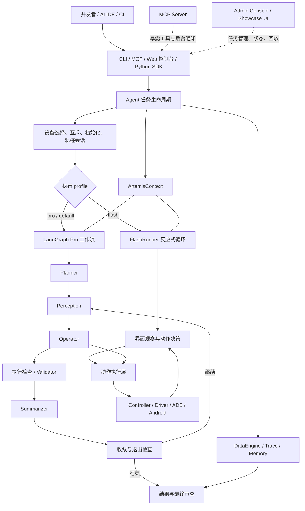
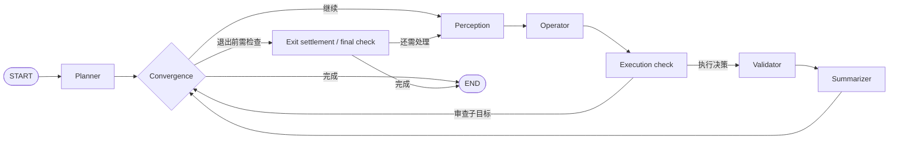
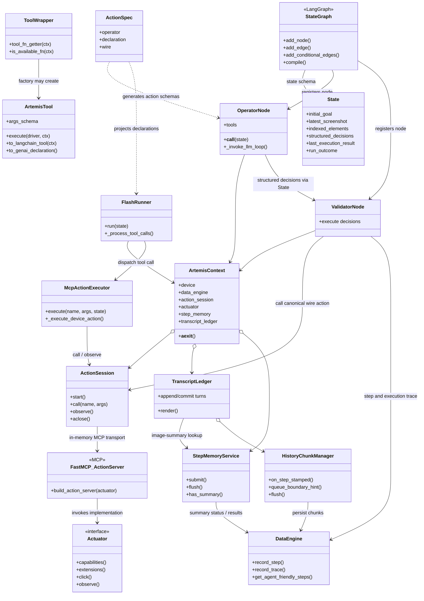

# ARTEMIS 架构与源码导航

本文面向首次阅读源码的开发者和维护者，说明 ARTEMIS 解决什么问题、任务如何运行、源码模块如何分工，以及修改某类功能时应从哪里入手。内容依据当前仓库实现整理；具体配置项和接口行为以源码及各模块 README 为准。

## 项目是什么

ARTEMIS 是一个面向 Android 真机和模拟器的多模态移动自动化 Agent 与测试平台。它接收自然语言目标，观察设备界面，再通过设备动作工具执行操作；同时提供任务规划、执行校验、日志/视频诊断、执行轨迹记录与结果回放能力。

它既可以作为开发者本机运行的 CLI，也可以作为 AI IDE 可调用的 MCP 服务、带有任务队列和轨迹回放的 Web 控制台，或通过 Python 客户端接入。项目的主要使用场景是：

- 让 Agent 或测试人员用自然语言驱动 Android 应用完成跨页面、跨应用任务。
- 探索真实应用界面，生成和验证移动端测试流程。
- 通过截图、UI 层级、OCR、ADB、Logcat 和视频等信号诊断执行问题。
- 从轨迹和结构化结果复查任务执行过程，或通过 SDK/MCP 将自动化能力集成到其他工具。

## 架构概览



### 关键边界

- **接入层不等于执行引擎。** CLI、MCP、Web 控制台和 SDK 提供不同入口；实际设备准备、任务上下文、profile 选择和清理由 Agent 任务生命周期负责。
- **两种 profile 使用不同执行器。** `flash` 使用 `FlashRunner`，以观察、决策、动作的反应式循环快速推进；`pro`/默认路径构建 LangGraph 工作流，包含 Planner、Operator、校验、摘要和退出收敛逻辑。Flash 不经过 Pro 图中的 Planner/Validator 节点链。
- **上下文是运行时组合根。** `ArtemisContext` 将设备、LLM 配置、执行设置、数据引擎、后台任务和记忆服务关联到一次任务运行；图 State 则承载跨节点的显式任务状态。
- **设备动作与 Agent 决策分层。** Agent/工具提出动作，统一控制器和 Driver 面向设备执行；动作协议和执行器集中在 `artemis/mcp/`，设备后端由 Driver/ADB 适配。
- **轨迹与记忆是执行支撑能力。** DataEngine 记录会话、步骤和感知/动作数据；Memory 管理步骤摘要和对话历史，帮助长任务控制上下文。它们不替代控制流本身。

## 一次任务如何运行

1. 入口接收目标和选项。CLI 的 `run` 命令创建默认配置并解析 profile、设备、应用限制和结果选项；MCP 和控制台将请求交给对应的任务执行路径。
2. Agent 解析 profile，创建 `ArtemisContext` 和初始 `State`，选择设备并获取设备执行锁，然后准备设备、应用、会话轨迹和输出目录。
3. profile 为 `flash` 时，Agent 创建 `FlashRunner`。它读取当前界面，调用模型选择工具/动作，使用统一动作执行器与设备交互，并维护当前任务的转录与可选步骤摘要。
4. 其他 profile 进入 `artemis.graph.graph.get_graph()` 构建的 LangGraph。主干为 `Planner → 收敛门 → Perception → Operator → execution_check → Validator → Summarizer → 收敛门`。根据计划完成状态、用户停止信号和检查结果继续执行，或进入退出结算及最终检查。
5. 任务结束时汇总状态和结果，关闭会话、后台任务、设备资源并保留可检查的轨迹。Web 控制台可展示任务状态与回放；MCP 工具可查询或管理后台任务。

> 图中节点和条件路由会随配置启用或跳过部分检查。需要理解具体分支时，以 `artemis/graph/graph.py` 的节点注册和边定义为准。

## 源码结构

### 核心运行时：`artemis/`

| 模块 | 职责 | 阅读入口 |
| --- | --- | --- |
| `artemis/interfaces/cli/` | Typer CLI 和命令实现：运行任务、批量任务、诊断、MCP、服务、轨迹及辅助工具 | `main.py`、`commands/run.py` |
| `artemis/interfaces/sdk/` | Python SDK 接口与任务封装 | `client.py`、`task.py` |
| `artemis/context.py` | 单次运行的共享上下文、执行设置和资源清理 | `ArtemisContext`、`ExecutionSetup` |
| `artemis/graph/` | Pro profile 的 LangGraph State、节点编排、条件路由、检查点与退出结算 | `graph.py`、`state.py`、`checkpoints.py` |
| `artemis/agents/` | Agent 能力实现，按规划、执行、感知、检查和报告职责组织 | 见下方 Agent 模块表 |
| `artemis/tools/` | 提供给 Agent 的工具定义、参数封装和调用包装 | `index.py`、`tool_wrapper.py`、`mobile/` |
| `artemis/mcp/` | 进程内动作协议、动作会话、执行器、动作清单及 Actuator 后端 | `action_executor.py`、`action_session.py`、`actuators/` |
| `artemis/controllers/`、`artemis/drivers/` | 将统一控制接口适配到 Android、模拟器、云端或 Mock 设备驱动 | `unified_controller.py`、`drivers/factory.py` |
| `artemis/clients/` | Accessibility Helper 与屏幕客户端接入 | `accessibility_client.py`、`screen_client_factory.py` |
| `artemis/config/` | 应用设置、LLM/Agent 配置、路径和配置解析 | `settings.py`、`agent.py`、`llm.py` |
| `artemis/services/`、`artemis/llm/` | 模型服务调用、Provider 路由、结构化输出与可靠性处理 | `services/llm.py`、`llm/router.py` |
| `artemis/data_engine/` | 会话、步骤、轨迹、图像及持久化数据管理 | `engine.py`、`trace.py`、`storage.py` |
| `artemis/memory/` | 转录账本、历史分块、步骤记忆与上下文压缩 | `transcript.py`、`step_memory.py`、`chunking.py` |
| `artemis/runtime/` | 设备池、设备锁、守护进程、服务生命周期和 Trace Store 等运行时设施 | `device_pool.py`、`device_lock.py`、`trace_store.py` |
| `artemis/telemetry/` | 遥测与观测相关实现 | 按具体调用点继续追踪 |
| `artemis/platform/` | 平台相关适配与实现 | 按操作系统或平台入口追踪 |
| `artemis/toolchain/` | 工具链能力的描述和解析 | `descriptors.py`、`resolver.py` |
| `artemis/core/`、`artemis/utils/` | 共用核心类型/诊断能力及配置、计划、坐标、视频等辅助逻辑 | 以被调用的具体模块为准 |
| `artemis/resources/` | 打包资源定位与访问 | 资源加载调用点 |

### Agent 职责：`artemis/agents/`

| 子模块 | 主要职责 |
| --- | --- |
| `planner/` | Pro 任务计划生成与计划变更校验 |
| `operator/` | 根据目标、界面观察和计划选择工具与设备动作 |
| `explorer/` | 探索界面、定位交互目标并提供不同深度的探索能力 |
| `validator/` | 动作声明、执行反馈与安全/前置条件相关校验；Flash 也复用其中部分工具声明和逻辑 |
| `checker/` | 检查计划检查点和任务最终结果 |
| `summarizer/`、`flash/summarizer.py` | 归纳任务进度、步骤和视觉状态 |
| `flash/` | Flash profile 的快速反应式执行器与上下文压缩 |
| `diagnoser/`、`log_analyzer/`、`video_analyzer/` | 诊断任务、分析日志和视频片段 |
| `image_processor/`、`object_detector/` | 图像处理和视觉目标检测 |
| `history_analyzer/` | 对历史任务/执行信息进行分析 |
| `outputter/` | 生成最终报告或结构化输出 |
| `prompt_assembly.py` | 组装 Agent 提示内容 |

### 接入、应用和配套包

| 路径 | 职责 |
| --- | --- |
| `mcp_server/` | 面向外部 AI IDE 的 MCP Server、工具注册、后台任务运行与通知；`rules.md` 是提供给外部 AI 助手的移动测试协作规范 |
| `apps/admin_console/` | FastAPI 管理与轨迹服务，提供任务队列、设备/会话/步骤、媒体、流式事件和回放 API |
| `apps/showcase_ui/` | 管理和演示 Web 前端，使用 Angular 工程结构；由控制台服务提供后端 API/静态资源 |
| `packages/artemis-client/` | 可独立安装的远程 Python 客户端包 |
| `packages/artemis-accessibility-helper/` | Android Accessibility Helper 配套应用/组件 |
| `third_party/mobile_use/` | ARTEMIS 所依赖并扩展的移动自动化基础层，包含 Agent/Task 生命周期、设备上下文、配置 Builder、图基础设施及底层工具；`run_automation()` 是 CLI 任务进入 Agent 的关键连接点 |
| `tests/` | 单元、工具、集成及端到端测试；默认 pytest 配置只运行非集成/非端到端等常规测试集 |
| `config/` | 仓库默认运行配置，如 `artemis.jsonc` |
| `scripts/` | 设备验收、并发验证、质量检查和开发运行辅助脚本 |
| `docs/` | 项目设计、架构、操作与其他文档资源 |

## 外部框架与依赖

依赖声明分别位于 [pyproject.toml](../pyproject.toml)、[apps/showcase_ui/package.json](../apps/showcase_ui/package.json) 和配套服务的 requirements 文件。下表描述的是源码使用场景；声明依赖不代表每条执行路径都会加载它。

### 主要框架

| 框架 / 包 | 用途 | 代码入口 |
| --- | --- | --- |
| LangGraph (`langgraph`) | Pro 工作流的有状态图、节点和条件路由。它负责节点间控制流，不等于 Flash 的循环。 | [artemis/graph/graph.py](../artemis/graph/graph.py)、[artemis/graph/state.py](../artemis/graph/state.py) |
| LangChain (`langchain`、`langchain-core`) | 聊天模型接口、消息类型、`BaseTool`/`StructuredTool`、工具 schema 与 `bind_tools`；ARTEMIS 的 LLM 服务和 Agent 工具层建立在这些协议上。 | [artemis/services/llm.py](../artemis/services/llm.py)、[artemis/tools/base.py](../artemis/tools/base.py)、[artemis/agents/operator/operator.py](../artemis/agents/operator/operator.py) |
| MCP Python SDK (`mcp`) / FastMCP | 实现进程内设备动作 MCP Server/Client，以及供 IDE 连接的独立任务 MCP Server。 | [artemis/mcp/action_server.py](../artemis/mcp/action_server.py)、[artemis/mcp/action_session.py](../artemis/mcp/action_session.py)、[mcp_server/base.py](../mcp_server/base.py) |
| Pydantic (`pydantic`、`pydantic-settings`) | 运行状态、动作/工具参数、结构化结果和配置的类型定义与校验。LangChain 工具 schema 也由 Pydantic 模型生成。 | [artemis/graph/state.py](../artemis/graph/state.py)、[artemis/mcp/action_types.py](../artemis/mcp/action_types.py)、[artemis/config/agent.py](../artemis/config/agent.py) |
| FastAPI / Uvicorn | 管理控制台和配套 HTTP API 的服务端及 ASGI 运行时；与 MCP stdio/SSE 服务是不同入口。 | [apps/admin_console/server.py](../apps/admin_console/server.py)、[apps/admin_console/](../apps/admin_console) |
| Angular / RxJS | Showcase UI 的前端框架、路由/组件及异步数据流。 | [apps/showcase_ui/package.json](../apps/showcase_ui/package.json)、[apps/showcase_ui/src/](../apps/showcase_ui/src) |

### 其他直接依赖（Python）

| 类别 | 依赖 | 主要用途 |
| --- | --- | --- |
| 模型提供方 | `google-genai`、`langchain-google-genai`、`langchain-google-vertexai`、`langchain-openai`、`langchain-anthropic` | Google Gemini / Vertex AI、OpenAI 兼容模型及 Anthropic 模型接入；Provider 创建和路由集中在 [artemis/llm/router.py](../artemis/llm/router.py)。 |
| CLI 与终端 | `typer`、`rich`、`inquirer`、`colorama` | CLI 命令、终端格式化、交互式配置和跨平台终端颜色。 |
| Android | `adbutils`、`uiautomator2` | ADB 设备发现/控制及 Android UI 自动化客户端能力。 |
| 图像、视频与数值 | `pillow`、`opencv-python`、`imageio-ffmpeg`、`matplotlib`、`numpy`、`scipy` | 图像读写、视觉处理、视频/FFmpeg、绘图及数值分析。 |
| 网络与服务 | `httpx`、`requests`、`websockets`、`sseclient-py`、`fastapi`、`uvicorn[standard]` | HTTP、WebSocket、SSE 客户端及 API 服务通信。 |
| 配置与模板 | `python-dotenv`、`jinja2`、`typing-extensions` | 环境变量、提示模板和兼容型类型声明。 |
| 运行时工具 | `psutil`、`retry`、`posthog`、`uuid-utils`、`jupyter-client`、`ipykernel` | 进程/系统信息、重试支持、遥测、标识符、Jupyter 内核执行。 |
| 工作区包 | `artemis-client` | 本仓库工作区内的远程 Python SDK 包，非第三方框架。 |

`langchain-community`、`langchain-mcp-adapters` 也在主项目依赖清单中，但在当前 Python 源码中没有发现对其模块的直接导入。当前 MCP 传输使用 `mcp` SDK 的 `create_connected_server_and_client_session` / FastMCP，不是通过 `langchain-mcp-adapters` 将远程 MCP 工具自动注入 Agent。依赖可能服务于扩展或兼容场景，不应据其声明推断当前 Agent 的调用路径。

`pytest`、`pytest-asyncio`、`pytest-cov`、`syrupy`、`pyright`、`ruff`、`pre-commit` 属于开发/测试依赖，不参与常规运行时 Agent 回路。Showcase UI 的测试工具链见其 `devDependencies`。

## LangChain 与 LangGraph 如何协作

ARTEMIS 将二者用于不同层次：

1. **LangGraph 管工作流控制面。** `get_graph(ctx)` 以 `State` 创建 `StateGraph`，注册 Planner、Perception、Operator、Validator、Summarizer、执行检查和退出结算节点，最后编译为可执行图。条件边读取 `State` 与 `ArtemisContext` 决定继续、结算或结束。
2. **LangChain 管模型/消息/工具接口。** `BaseChatModel`、`BaseMessage` 和 `StructuredTool` 统一不同模型提供方与工具 schema。Operator 用 `bind_tools()` 暴露本轮可用工具，收到模型返回的 `tool_calls` 后由 ARTEMIS 决定是否直接执行辅助工具或转成设备动作。
3. **模型后端由 ARTEMIS 服务层路由。** `get_llm()` 按配置创建 Google、Vertex、OpenAI 兼容或 Anthropic 模型；`acomplete()`、重试/熔断、用量和 trace 记录在服务层处理，不由 LangGraph 自动完成。
4. **Flash 不是 LangGraph 图。** Flash 使用同一 LangChain 消息和模型接口，但外层是 `FlashRunner.run()` 的显式 `while` 循环；它将 Pydantic 参数 schema 投影为 GenAI `ToolDeclaration`。设备动作的 canonical schema 由 `artemis/mcp/action_specs.py` 同时投影为 Pro 的 LangChain 工具外壳、Flash 的 JSON 声明和 MCP wire schema。

Pro 的主要状态流如下。Planner 和 Summarizer 节点不代表“一个节点只调用一次模型”；节点内部仍可调用 LLM 或工具。



图的具体边定义在 [artemis/graph/graph.py](../artemis/graph/graph.py)；显式跨节点状态及 reducer 在 [artemis/graph/state.py](../artemis/graph/state.py)。`State` 用 `extra="forbid"` 限制未声明字段，节点可见性检查另见 [artemis/graph/visibility.py](../artemis/graph/visibility.py)。

## Agent 循环如何构建

### Pro：LangGraph 外循环 + Operator 内部工具回合

- `get_graph(ctx)` 在每次任务中创建图并用 `compile()` 编译；图的入口是 Planner。收敛门根据任务计划、检查结果、用户停止信号及待处理检查点决定下一步。
- Perception 获取屏幕截图/UI 树并更新索引元素；Operator 读取 State、计划和历史，组合提示词，再通过 `base_llm.bind_tools(traced_tools)` 请求模型。
- Operator 的 `_invoke_llm_loop()` 有迭代上限。模型无工具调用时结束此 Operator 回合；有调用时拆分辅助工具与终结动作，执行辅助工具并把 `ToolMessage` 加回消息后继续模型回合。结果依赖型辅助工具与设备动作混发时会先推迟设备动作；终结设备动作转为结构化决策返回图。
- 接下来 `execution_check` 记录本回合步骤并检查计划/检查点；Validator 执行决策；Summarizer 汇总后回到收敛门。退出时可能先进行 checkpoint/final check 结算，再结束。
- Pro Operator 的动作工具是 `operator_shell_tool()` 生成的 **声明外壳**，其函数体不是动作执行器。真实执行发生在 Validator：`to_canonical_call()` 将决策映射为 MCP wire 名称/参数，再用共享 `ActionSession.call()` 执行。

### Flash：反应式显式循环

`FlashRunner.run()` 的每一轮大致按以下顺序运行：

1. 检查轮数上限，采集屏幕/UI 并构建当前 observation tail 与会话历史。
2. 从动作清单和 helper declarations 组装本轮 JSON 工具声明，调用 `llm.bind_tools()`，经 `acomplete()` 请求模型。
3. 将模型 `tool_calls` 交给 `_process_tool_calls()`。`report_task_status` 产生最终报告；其他调用交给 `McpActionExecutor`，设备动作后重新观察屏幕、更新 UI 索引和消息。
4. 将工具结果/动作结果记入本轮 transcript 和 DataEngine；视觉步骤摘要异步派发，不阻塞下一个决策回合。
5. 报告任务状态或到达轮数上限时退出，否则继续观察并请求模型。

Flash 的控制流/工具适配在 [artemis/agents/flash/runner.py](../artemis/agents/flash/runner.py)，动作实际路由在 [artemis/mcp/action_executor.py](../artemis/mcp/action_executor.py)。Pro 与 Flash 共用动作 manifest，但图结构和 Agent 回合管理方式不同。

## 记忆管理：支持什么、如何实现

这里的“记忆”不是单一向量数据库。当前实现主要是本地 DataEngine/任务笔记、会话 transcript、步骤视觉摘要、可检索轨迹和分层压缩。

| 记忆能力 | 内容与用途 | 实现 |
| --- | --- | --- |
| 任务笔记 / scratchpad | 通过 `save_note`、`append_note`、`update_note`、`read_note`、`list_notes` 管理任务计划与辅助笔记；写入当前 DataEngine 的任务目录。Operator 对 `task_plan` 写入有专门拦截和计划变更处理。 | [artemis/tools/scratchpad.py](../artemis/tools/scratchpad.py)、[artemis/graph/graph.py](../artemis/graph/graph.py) |
| 执行历史与轨迹 | DataEngine 持久化 session、step、动作/工具 trace、截图/层级等；供复盘、检查与历史工具使用。它保留可追溯的记录，不等同于送进模型的完整 prompt。 | [artemis/data_engine/engine.py](../artemis/data_engine/engine.py)、[artemis/data_engine/trace.py](../artemis/data_engine/trace.py) |
| 活跃会话 transcript | Pro 与 Flash 可用 `TranscriptLedger` 保存系统前缀、已冻结历史、近期原始消息和当前轮 tail。它维持消息顺序及 tool-call/result 配对，并让两种 profile 使用同一套消息生命周期管理。 | [artemis/memory/transcript.py](../artemis/memory/transcript.py) |
| 单步视觉摘要（L1） | 动作前后截图、动作和结果形成视觉状态转移摘要；后台异步运行，可有限并发、重试并在结束时有界 flush。按 DataEngine step id 为主键，支持 tool-call id 等别名。 | [artemis/agents/flash/summarizer.py](../artemis/agents/flash/summarizer.py)、[artemis/memory/step_memory.py](../artemis/memory/step_memory.py) |
| 历史片段压缩（L2） | 按里程碑边界、最大步数或 token 阈值将一段历史做 capsule。摘要包含 ① 片段概要/影响，② 覆盖步骤区间的压缩叙述，③ 由记录机械生成的逐步动作账本；校验 ② 区间连续且无遗漏/重叠。 | [artemis/memory/chunking.py](../artemis/memory/chunking.py)、[artemis/memory/step_capsule.md](../artemis/memory/step_capsule.md) |
| Era 与冷历史召回（L3） | 多个片段可合并成 era；更老的 era 可折叠为 recall-only 概述/索引。压缩不删除 DataEngine 原步骤，较冷的逐步事实可通过历史查询按需取回。 | [artemis/memory/chunking.py](../artemis/memory/chunking.py)、[artemis/tools/history/](../artemis/tools/history) |
| 历史检索与重放 | `search_history` 查找历史动作、屏幕文本等；`replay_steps` 返回选定步骤信息；`get_step_screenshot` 取回历史截图。检索结果受配置的步数/文本/结果上限限制。 | [artemis/tools/history/](../artemis/tools/history)、[artemis/config/agent.py](../artemis/config/agent.py) |

### Transcript 的上下文收敛

`TranscriptLedger` 将会话组织为稳定前缀、冻结历史、活跃窗口、当前轮 tail。`ScrubEdgeCompressor` 对旧内容设置两道边界：

- **文本边界**：较旧 observation 去除 UI 元素列表、计划复述及标记为 ephemeral 的提示块；当前观测保留可用索引，避免模型误用过期的元素编号。
- **截图边界**：旧截图由已完成的视觉摘要原位替换；摘要仍在等待时暂时保留截图，超过 grace window 后放置带 step 引用的占位符；摘要失败也保留明确占位。
- **分层压缩阈值**：使用 prompt token budget 的 start/soft/hard ratio。软阈值优先压缩最老开放片段并换成 L2；硬阈值可强制换入待完成压缩块，并将冻结历史折叠为 L3。最近活动步骤数有下限。
- **摘要与真实记录分离**：摘要服务只负责模型可读的紧凑视图；DataEngine 仍保留可检索的逐步数据。`full` 视图用于输出/历史分析等需要细节的 Agent，`digest` 视图则用召回标记代替完整逐步账本。

当 transcript 功能关闭时，相关调用保留旧的逐轮构造路径；历史 chunk 也依赖 transcript 功能启用。各 Agent 如何过滤历史由 `ContextPolicy` 决定（例如 Operator 按里程碑裁剪、Planner 保留更多近期步骤、Outputter/History Analyzer 使用完整视图、Diagnoser/Committee 使用里程碑白名单）。策略默认值和配置覆盖在 [artemis/memory/context_policy.py](../artemis/memory/context_policy.py)。

## Context 管理

ARTEMIS 同时管理两种不同的 context，不能混为一个：

1. **运行时对象 `ArtemisContext`**：每个任务一份组合根，持有设备、LLM/Agent 配置、执行选项、DataEngine、后台任务、MCP 会话、step memory、transcript 和 checkpoint 状态。`__aexit__` 负责关闭动作会话、flush 摘要/分块任务、清理后台任务并关闭 DataEngine。
2. **LangGraph `State`**：跨图节点传递的显式业务状态，如目标、当前观察/UI 索引、Operator 决策、执行反馈、停止标记和最终 outcome；不保存整段对话消息，消息正文由 Agent/Transcript 管理。
3. **Prompt context**：Operator 的 `PromptBuilder` 按组件组合系统提示、观测、计划、反馈、事件、后台任务和历史提示；`build_history_for()` 根据 Agent 的 `ContextPolicy` 裁剪最近步骤、旧里程碑和 chunk 视图。
4. **Token 与多模态预算**：prompt 构建记录/估算消息 token 与字符量；transcript 的预算阈值触发压缩。工具返回截图会按提供方兼容性放在 ToolMessage 或紧随其后的 HumanMessage；旧截图可由摘要替换，避免不断携带完整图像。
5. **辅助 Agent 的按需上下文**：Planner、Diagnoser、Committee、History Analyzer 等不直接共享 Operator 全量 transcript，而是根据自身策略拿到编译后的计划/历史视图；工具结果可按字数/条数上限裁剪。

关键代码：[`ArtemisContext`](../artemis/context.py)、[`State`](../artemis/graph/state.py)、[`PromptBuilder`](../artemis/agents/operator/prompts.py)、[`ContextPolicy`](../artemis/memory/context_policy.py)、[`TranscriptLedger`](../artemis/memory/transcript.py)。

## 工具：能力、注册与调用

### 工具能力分层

| 类别 | 代表工具/动作 | 用途与可见性 |
| --- | --- | --- |
| 设备动作 | `click`、`click_sequence`、`long_press`、`input_text`、`swipe`、`press_key`、`manage_app`、`wait_for_delay` 等 | 操作屏幕或应用。`click_sequence` 是 manifest 中结构必需动作；其余按 actuator 能力可选。`wait_for_text`、`open_link`、`erase_one_char`、`focus_and_clear_text` 属于可选 wire 动作，不一定暴露给模型。 |
| 内部观察动作 | `observe_screen`、`take_screenshot`、`get_ui_hierarchy` | MCP adapter 自用，提供截图/UI 树，不声明给模型。 |
| 笔记工具 | `save_note`、`append_note`、`update_note`、`read_note`、`list_notes` | 操作 scratchpad/计划；Pro Planner 和 Operator 按各自工具装配使用。 |
| Agent/helper 工具 | `ask_explorer`、`ask_diagnoser`、`ask_committee`、`video_analyzer`、`run_adb_command`、`manage_task`、`analyze_task_output` | 调用探索、诊断、视频分析、ADB 后台任务和输出分析。启用取决于 profile、配置与工具用途，不是所有 Agent 都能看到全部工具。 |
| 历史工具 | `search_history`、`replay_steps`、`get_step_screenshot` | 对冷历史做查询、重放或取回截图；Operator/Flash 使用相关声明，其他 Agent 可按角色单独装配。 |
| Flash 控制工具 | `report_task_status`、`click_sequence` 等 | Flash 专用任务完成报告及其工具调用协议；`report_task_status` 使循环生成最终结果并退出。 |
| 外部 IDE MCP 工具 | `mobile_run_task`、`mobile_manage_task`、`mobile_get_device_state`、`mobile_inspect_trace`、`mobile_diagnose` | 外部客户端提交/管理任务、读取设备/轨迹或诊断运行环境，不是内部设备动作声明。 |

动作集合、必选/可选/内部分类以及后端扩展契约见 [artemis/mcp/action_manifest.py](../artemis/mcp/action_manifest.py)；动作的 Operator、Flash、wire 三种参数形态集中在 [artemis/mcp/action_specs.py](../artemis/mcp/action_specs.py)。

### 如何注册和调用

1. **通用工具定义**：工具用 `ToolWrapper` 保存一个按 `ArtemisContext` 创建 LangChain 工具的工厂、生命周期回调及可选可用性条件；`CompositeToolWrapper` 可返回多个工具。`get_tools_from_wrappers()` 过滤不可用工具并实例化；ARTEMIS 的 `get_tools_from_wrappers()` 再用 `trace_langchain_tool()` 包装轨迹记录。
2. **图内装配**：`get_graph()` 为 Planner 和 Operator 分别创建工具集合。Operator 工具包含笔记、诊断/探索、ADB、任务管理、历史工具以及按需启用的视频工具。模型以 `bind_tools()` 获得当前角色的声明。
3. **Flash 装配**：Flash 从动作 manifest、helper declarations 和历史工具声明建立 `ToolDeclaration` 集合，通过 actuator 能力过滤，再将其绑定到模型。
4. **模型返回调用**：Pro Operator 检查返回的 `tool_calls`。笔记/历史/诊断等 helper 可由工具 handler 执行；终结设备动作先转成结构化决策，之后由 Validator 执行。Flash 将所有调用分派给 `McpActionExecutor`，只有指定为 Agent-side 的 helper 工具直接在 Agent 进程执行。
5. **动作落到设备**：`McpActionExecutor` 统一设备工具调用：验证/归一化参数、将 UI 元素 index 解析成坐标（或校验带描述的归一化坐标）、映射到 wire dialect；随后经 `ActionSession` 调用 MCP server，读取 `ActionResult`，重新观察屏幕并更新 State/轨迹。
6. **能力扩展**：Actuator 实现 `capabilities()` 和可选 `extensions()`；`build_action_server()` 仅注册该后端实际提供的动作及扩展。扩展动作必须声明目标 Agent 角色，并提供自包含描述。缺少必需动作或内部观察动作会在会话启动时违反 manifest 契约并报错。

## MCP：两条调用路径

### Agent 内部的 Action MCP

这是 Pro Validator 与 Flash 执行设备动作使用的进程内 MCP：

1. 首次设备动作时，`get_action_session(ctx)` 选择 `ctx.actuator` 或默认 `AdbActuator`，校验能力并调用 `build_action_server(actuator)`。
2. `ActionSession` 通过 MCP SDK 的内存传输 `create_connected_server_and_client_session()` 建立 client/server pair，并由一个 owner task 串行处理请求。会话按需创建并缓存到 `ArtemisContext.action_session`。
3. Pro Validator 将动作映射成 canonical wire 调用后使用 `session.call()`；Flash 经 `McpActionExecutor → session.call()`。底层 `session.call_tool()` 返回 MCP structured content，再校验为 `ActionResult`。
4. 结果经由 Agent 层整理为执行反馈、ToolMessage、后置观察及 trace。动作失败通过 `ActionResult.ok/code/message` 明确表示；协议错误则作为 MCP 调用错误处理。
5. 任务上下文退出时关闭 ActionSession。Agent 不直接操作 ADB actuator 的 wire 方法，而是经由该适配层统一执行。

### 外部 IDE 的任务 MCP

这是 IDE/客户端连接的独立 FastMCP Server（stdio 或 SSE），入口为 `python -m mcp_server`：

- [mcp_server/base.py](../mcp_server/base.py) 创建共享 `FastMCP("artemis")` 实例。
- [mcp_server/__init__.py](../mcp_server/__init__.py) 导入 `mcp_server.tools`；各工具模块用 `@mcp.tool()` 注册，因此导入会完成注册。
- 对外提供 `mobile_run_task`、`mobile_manage_task`、`mobile_get_device_state`、`mobile_inspect_trace`、`mobile_diagnose`。其中 `mobile_run_task` 将任务提交到设备队列/后台 runner 并返回 trace id；管理和查询工具随后使用该 ID。
- 外部 `mobile_run_task` 启动的 Agent runner 才会走前述 Pro/Flash 内部 Agent loop；外层 MCP `CallTool` 返回的是任务状态/ID，内层设备动作则走独立的 Action MCP session。

**结论：** MCP 同时作为外部任务 API 和内部动作协议，但它们是不同 Server、不同工具集、不同生命周期。当前源码没有使用 `langchain-mcp-adapters` 自动发现并将外部 MCP Server 工具绑定到 Operator；Pro/Flash 的动作工具由本仓库 manifest 与工具装配代码显式生成。

## 相关类图

下图只表示主要对象/调用关系，箭头不代表 Python 继承；实线调用关系以代码中的构造和方法调用为准。



## 常见修改从哪里开始

| 需求 | 建议入口 |
| --- | --- |
| 增加或修改 CLI 命令 | `artemis/interfaces/cli/main.py` 注册命令，再修改 `commands/` 下对应实现 |
| 修改 Pro 工作流、路由或检查点 | `artemis/graph/graph.py`；状态字段改动同步检查 `artemis/graph/state.py` 和对应节点测试 |
| 修改 Flash 行为 | `artemis/agents/flash/runner.py`，必要时继续到 `artemis/mcp/action_executor.py` 或共享 Agent 工具 |
| 增加 Agent 角色或改提示/决策 | 对应 `artemis/agents/<role>/`，沿 `artemis/graph/graph.py` 或 Flash 工具装配确认其是否接入运行流 |
| 增加设备操作/动作后端 | `artemis/mcp/action_specs.py`、`action_manifest.py`、`actuators/`；再检查 Controller/Driver 的映射和设备测试 |
| 适配新的设备驱动 | `artemis/drivers/`、`artemis/controllers/`，并检查 `ArtemisContext` 中设备初始化和工厂选择 |
| 修改 LLM Provider 或容错 | `artemis/llm/`、`artemis/services/llm.py` 与 `artemis/config/llm.py` |
| 修改轨迹、步骤存储或回放数据 | `artemis/data_engine/`；控制台读取/回放 API 位于 `apps/admin_console/` |
| 修改长期任务上下文/摘要 | `artemis/memory/` 及 `artemis/agents/flash/` 或 `artemis/agents/summarizer/` 的调用点 |
| 增加 IDE 可用 MCP 工具 | `mcp_server/tools/`；通用设备动作工具则可能属于 `artemis/tools/` 或 `artemis/mcp/`，先确认工具运行在哪个进程 |
| 修改控制台页面或 API | 前端在 `apps/showcase_ui/`；服务端路由、数据访问和任务队列在 `apps/admin_console/` |
| 修改默认行为或运行配置 | `artemis/config/`、`config/artemis.jsonc`，并检查 `pyproject.toml` 中的依赖/入口配置 |

## 本地入口与验证

常用入口：

```bash
uv run artemis --help
uv run artemis run "打开系统设置并查看电量" --profile flash
uv run artemis mcp
uv run artemis ui
```

项目要求 Python 3.12+。常规 Python 测试使用 pytest；`pyproject.toml` 中配置了默认排除集成、端到端、云端、手工和 Android 测试的标记。修改特定模块时优先运行相邻单元测试；设备依赖测试需要真实设备或模拟器，并按测试标记显式执行。

## 阅读建议

1. 从 `pyproject.toml` 查看命令入口和依赖，再读 `artemis/interfaces/cli/main.py` 了解命令注册。
2. 追踪 `commands/run.py` → `third_party/mobile_use/main.py` → `third_party/mobile_use/sdk/agent.py`，理解任务创建、设备准备和 profile 分流。
3. 对 Pro 路径阅读 `artemis/graph/state.py` 与 `artemis/graph/graph.py`；对 Flash 路径阅读 `artemis/agents/flash/runner.py`。
4. 沿某个工具调用继续阅读 `artemis/tools/`、`artemis/mcp/`、Controller 和 Driver，最后观察数据如何进入 DataEngine/Trace。
5. 需要理解外部集成时分别阅读 `mcp_server/README.md`、`apps/admin_console/` 和 `packages/artemis-client/`。

