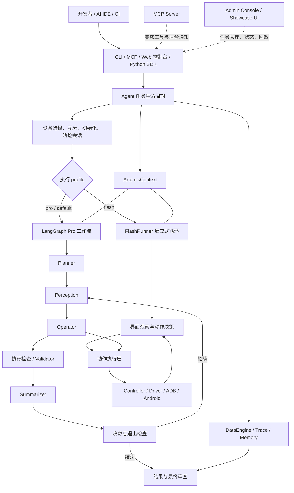

# ARTEMIS 架构与源码导航

本文面向首次阅读源码的开发者和维护者，说明 ARTEMIS 解决什么问题、任务如何运行、源码模块如何分工，以及修改某类功能时应从哪里入手。内容依据当前仓库实现整理；具体配置项和接口行为以源码及各模块 README 为准。

## 项目是什么

ARTEMIS 是一个面向 Android 真机和模拟器的多模态移动自动化 Agent 与测试平台。它接收自然语言目标，观察设备界面，再通过设备动作工具执行操作；同时提供任务规划、执行校验、日志/视频诊断、执行轨迹记录与结果回放能力。

它既可以作为开发者本机运行的 CLI，也可以作为 AI IDE 可调用的 MCP 服务、带有任务队列和轨迹回放的 Web 控制台，或通过 Python 客户端接入。项目的主要使用场景是：

- 让 Agent 或测试人员用自然语言驱动 Android 应用完成跨页面、跨应用任务。
- 探索真实应用界面，生成和验证移动端测试流程。
- 通过截图、UI 层级、OCR、ADB、Logcat 和视频等信号诊断执行问题。
- 从轨迹和结构化结果复查任务执行过程，或通过 SDK/MCP 将自动化能力集成到其他工具。

## 架构概览



### 关键边界

- **接入层不等于执行引擎。** CLI、MCP、Web 控制台和 SDK 提供不同入口；实际设备准备、任务上下文、profile 选择和清理由 Agent 任务生命周期负责。
- **两种 profile 使用不同执行器。** `flash` 使用 `FlashRunner`，以观察、决策、动作的反应式循环快速推进；`pro`/默认路径构建 LangGraph 工作流，包含 Planner、Operator、校验、摘要和退出收敛逻辑。Flash 不经过 Pro 图中的 Planner/Validator 节点链。
- **上下文是运行时组合根。** `ArtemisContext` 将设备、LLM 配置、执行设置、数据引擎、后台任务和记忆服务关联到一次任务运行；图 State 则承载跨节点的显式任务状态。
- **设备动作与 Agent 决策分层。** Agent/工具提出动作，统一控制器和 Driver 面向设备执行；动作协议和执行器集中在 `artemis/mcp/`，设备后端由 Driver/ADB 适配。
- **轨迹与记忆是执行支撑能力。** DataEngine 记录会话、步骤和感知/动作数据；Memory 管理步骤摘要和对话历史，帮助长任务控制上下文。它们不替代控制流本身。

## 一次任务如何运行

1. 入口接收目标和选项。CLI 的 `run` 命令创建默认配置并解析 profile、设备、应用限制和结果选项；MCP 和控制台将请求交给对应的任务执行路径。
2. Agent 解析 profile，创建 `ArtemisContext` 和初始 `State`，选择设备并获取设备执行锁，然后准备设备、应用、会话轨迹和输出目录。
3. profile 为 `flash` 时，Agent 创建 `FlashRunner`。它读取当前界面，调用模型选择工具/动作，使用统一动作执行器与设备交互，并维护当前任务的转录与可选步骤摘要。
4. 其他 profile 进入 `artemis.graph.graph.get_graph()` 构建的 LangGraph。主干为 `Planner → 收敛门 → Perception → Operator → execution_check → Validator → Summarizer → 收敛门`。根据计划完成状态、用户停止信号和检查结果继续执行，或进入退出结算及最终检查。
5. 任务结束时汇总状态和结果，关闭会话、后台任务、设备资源并保留可检查的轨迹。Web 控制台可展示任务状态与回放；MCP 工具可查询或管理后台任务。

> 图中节点和条件路由会随配置启用或跳过部分检查。需要理解具体分支时，以 `artemis/graph/graph.py` 的节点注册和边定义为准。

## 源码结构

### 核心运行时：`artemis/`

| 模块 | 职责 | 阅读入口 |
| --- | --- | --- |
| `artemis/interfaces/cli/` | Typer CLI 和命令实现：运行任务、批量任务、诊断、MCP、服务、轨迹及辅助工具 | `main.py`、`commands/run.py` |
| `artemis/interfaces/sdk/` | Python SDK 接口与任务封装 | `client.py`、`task.py` |
| `artemis/context.py` | 单次运行的共享上下文、执行设置和资源清理 | `ArtemisContext`、`ExecutionSetup` |
| `artemis/graph/` | Pro profile 的 LangGraph State、节点编排、条件路由、检查点与退出结算 | `graph.py`、`state.py`、`checkpoints.py` |
| `artemis/agents/` | Agent 能力实现，按规划、执行、感知、检查和报告职责组织 | 见下方 Agent 模块表 |
| `artemis/tools/` | 提供给 Agent 的工具定义、参数封装和调用包装 | `index.py`、`tool_wrapper.py`、`mobile/` |
| `artemis/mcp/` | 进程内动作协议、动作会话、执行器、动作清单及 Actuator 后端 | `action_executor.py`、`action_session.py`、`actuators/` |
| `artemis/controllers/`、`artemis/drivers/` | 将统一控制接口适配到 Android、模拟器、云端或 Mock 设备驱动 | `unified_controller.py`、`drivers/factory.py` |
| `artemis/clients/` | Accessibility Helper 与屏幕客户端接入 | `accessibility_client.py`、`screen_client_factory.py` |
| `artemis/config/` | 应用设置、LLM/Agent 配置、路径和配置解析 | `settings.py`、`agent.py`、`llm.py` |
| `artemis/services/`、`artemis/llm/` | 模型服务调用、Provider 路由、结构化输出与可靠性处理 | `services/llm.py`、`llm/router.py` |
| `artemis/data_engine/` | 会话、步骤、轨迹、图像及持久化数据管理 | `engine.py`、`trace.py`、`storage.py` |
| `artemis/memory/` | 转录账本、历史分块、步骤记忆与上下文压缩 | `transcript.py`、`step_memory.py`、`chunking.py` |
| `artemis/runtime/` | 设备池、设备锁、守护进程、服务生命周期和 Trace Store 等运行时设施 | `device_pool.py`、`device_lock.py`、`trace_store.py` |
| `artemis/telemetry/` | 遥测与观测相关实现 | 按具体调用点继续追踪 |
| `artemis/platform/` | 平台相关适配与实现 | 按操作系统或平台入口追踪 |
| `artemis/toolchain/` | 工具链能力的描述和解析 | `descriptors.py`、`resolver.py` |
| `artemis/core/`、`artemis/utils/` | 共用核心类型/诊断能力及配置、计划、坐标、视频等辅助逻辑 | 以被调用的具体模块为准 |
| `artemis/resources/` | 打包资源定位与访问 | 资源加载调用点 |

### Agent 职责：`artemis/agents/`

| 子模块 | 主要职责 |
| --- | --- |
| `planner/` | Pro 任务计划生成与计划变更校验 |
| `operator/` | 根据目标、界面观察和计划选择工具与设备动作 |
| `explorer/` | 探索界面、定位交互目标并提供不同深度的探索能力 |
| `validator/` | 动作声明、执行反馈与安全/前置条件相关校验；Flash 也复用其中部分工具声明和逻辑 |
| `checker/` | 检查计划检查点和任务最终结果 |
| `summarizer/`、`flash/summarizer.py` | 归纳任务进度、步骤和视觉状态 |
| `flash/` | Flash profile 的快速反应式执行器与上下文压缩 |
| `diagnoser/`、`log_analyzer/`、`video_analyzer/` | 诊断任务、分析日志和视频片段 |
| `image_processor/`、`object_detector/` | 图像处理和视觉目标检测 |
| `history_analyzer/` | 对历史任务/执行信息进行分析 |
| `outputter/` | 生成最终报告或结构化输出 |
| `prompt_assembly.py` | 组装 Agent 提示内容 |

### 接入、应用和配套包

| 路径 | 职责 |
| --- | --- |
| `mcp_server/` | 面向外部 AI IDE 的 MCP Server、工具注册、后台任务运行与通知；`rules.md` 是提供给外部 AI 助手的移动测试协作规范 |
| `apps/admin_console/` | FastAPI 管理与轨迹服务，提供任务队列、设备/会话/步骤、媒体、流式事件和回放 API |
| `apps/showcase_ui/` | 管理和演示 Web 前端，使用 Angular 工程结构；由控制台服务提供后端 API/静态资源 |
| `packages/artemis-client/` | 可独立安装的远程 Python 客户端包 |
| `packages/artemis-accessibility-helper/` | Android Accessibility Helper 配套应用/组件 |
| `third_party/mobile_use/` | ARTEMIS 所依赖并扩展的移动自动化基础层，包含 Agent/Task 生命周期、设备上下文、配置 Builder、图基础设施及底层工具；`run_automation()` 是 CLI 任务进入 Agent 的关键连接点 |
| `tests/` | 单元、工具、集成及端到端测试；默认 pytest 配置只运行非集成/非端到端等常规测试集 |
| `config/` | 仓库默认运行配置，如 `artemis.jsonc` |
| `scripts/` | 设备验收、并发验证、质量检查和开发运行辅助脚本 |
| `docs/` | 项目设计、架构、操作与其他文档资源 |

## 常见修改从哪里开始

| 需求 | 建议入口 |
| --- | --- |
| 增加或修改 CLI 命令 | `artemis/interfaces/cli/main.py` 注册命令，再修改 `commands/` 下对应实现 |
| 修改 Pro 工作流、路由或检查点 | `artemis/graph/graph.py`；状态字段改动同步检查 `artemis/graph/state.py` 和对应节点测试 |
| 修改 Flash 行为 | `artemis/agents/flash/runner.py`，必要时继续到 `artemis/mcp/action_executor.py` 或共享 Agent 工具 |
| 增加 Agent 角色或改提示/决策 | 对应 `artemis/agents/<role>/`，沿 `artemis/graph/graph.py` 或 Flash 工具装配确认其是否接入运行流 |
| 增加设备操作/动作后端 | `artemis/mcp/action_specs.py`、`action_manifest.py`、`actuators/`；再检查 Controller/Driver 的映射和设备测试 |
| 适配新的设备驱动 | `artemis/drivers/`、`artemis/controllers/`，并检查 `ArtemisContext` 中设备初始化和工厂选择 |
| 修改 LLM Provider 或容错 | `artemis/llm/`、`artemis/services/llm.py` 与 `artemis/config/llm.py` |
| 修改轨迹、步骤存储或回放数据 | `artemis/data_engine/`；控制台读取/回放 API 位于 `apps/admin_console/` |
| 修改长期任务上下文/摘要 | `artemis/memory/` 及 `artemis/agents/flash/` 或 `artemis/agents/summarizer/` 的调用点 |
| 增加 IDE 可用 MCP 工具 | `mcp_server/tools/`；通用设备动作工具则可能属于 `artemis/tools/` 或 `artemis/mcp/`，先确认工具运行在哪个进程 |
| 修改控制台页面或 API | 前端在 `apps/showcase_ui/`；服务端路由、数据访问和任务队列在 `apps/admin_console/` |
| 修改默认行为或运行配置 | `artemis/config/`、`config/artemis.jsonc`，并检查 `pyproject.toml` 中的依赖/入口配置 |

## 本地入口与验证

常用入口：

```bash
uv run artemis --help
uv run artemis run "打开系统设置并查看电量" --profile flash
uv run artemis mcp
uv run artemis ui
```

项目要求 Python 3.12+。常规 Python 测试使用 pytest；`pyproject.toml` 中配置了默认排除集成、端到端、云端、手工和 Android 测试的标记。修改特定模块时优先运行相邻单元测试；设备依赖测试需要真实设备或模拟器，并按测试标记显式执行。

## 阅读建议

1. 从 `pyproject.toml` 查看命令入口和依赖，再读 `artemis/interfaces/cli/main.py` 了解命令注册。
2. 追踪 `commands/run.py` → `third_party/mobile_use/main.py` → `third_party/mobile_use/sdk/agent.py`，理解任务创建、设备准备和 profile 分流。
3. 对 Pro 路径阅读 `artemis/graph/state.py` 与 `artemis/graph/graph.py`；对 Flash 路径阅读 `artemis/agents/flash/runner.py`。
4. 沿某个工具调用继续阅读 `artemis/tools/`、`artemis/mcp/`、Controller 和 Driver，最后观察数据如何进入 DataEngine/Trace。
5. 需要理解外部集成时分别阅读 `mcp_server/README.md`、`apps/admin_console/` 和 `packages/artemis-client/`。
