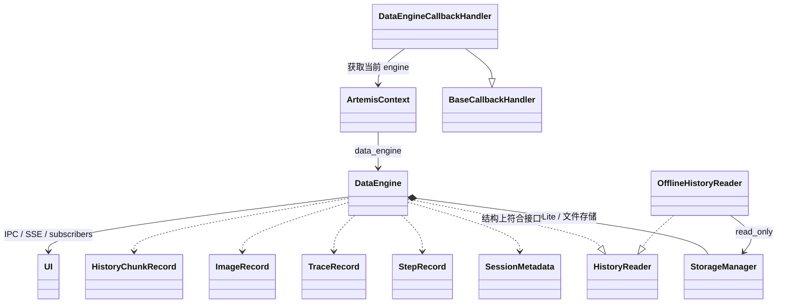

## 一句话概括

`data_engine` 是 Artemis 的**任务运行记录与历史数据层**：它不是负责执行 AI 或操作设备的“引擎”，而是为一次任务统一保存 session、每步屏幕与动作、LLM/工具调用 trace、历史摘要和视频状态，并将事件实时发布给 UI。核心实现是 `DataEngine`，持久化由 `StorageManager` 负责。

## 它记录什么、怎么存

数据模型定义在 `models.py`，主要包括：

- **Session**：目标、起止时间、状态、设备信息。
- **Image**：按截图 SHA-256 去重；图片文件放在 traces 下的 `images/`，OCR 和 UI 层级等元数据放 SQLite。
- **Step**：每轮任务的序号、截图引用、动作、思考、执行结果和附加信息。
- **Trace**：LLM、agent、tool、log 等执行事件；通过 `parent_trace_id` 构成父子调用关系。
- **HistoryChunk、VideoRecording、FailedOutput、BackgroundTask**：历史压缩、录像状态、失败模型输出和后台任务状态。

SQLite 表结构由 `StorageManager._init_db` 初始化；具体写入分别由 `create_session`、`create_step`、`create_trace` 等方法完成。截图文件与记录分开保存，Step 只引用图片哈希。数据库默认位于 traces 目录下，路径由 `get_data_engine_db_path` 确定。

写入并非全部阻塞在任务主流程上：`record_step` 和 `record_trace` 会把存储工作交给后台任务/线程，结束时 `shutdown()` 等待待处理写入完成。`DataEngine` 还通过订阅、IPC 和云端桥接发布 `session_started`、`step_recorded`、`trace_recorded` 等事件。

## 类关系图



`DataEngine` 没有显式继承 `HistoryReader`，但实现了它需要的历史读取方法；离线读取器 `OfflineHistoryReader` 通过同一接口读取已有数据库。追踪侧由 `DataEngineCallbackHandler` 和 `trace` 装饰器提供；装饰器会在函数开始、成功或失败时形成 trace。调用层级靠 `CURRENT_TRACE_ID、CURRENT_NODE_NAME` 这类 ContextVar 传递。

## 运行流程

1. **创建 session**：SDK 的 `Agent._prepare_tracing` 初始化 `DataEngine`、选择 traces 路径，并调用 `start_session()`。
2. **为当前轮准备 step**：Pro 图的 `perception_node` 获取屏幕、OCR/UI 层级，并预分配 Step ID。截图保存为图片记录，trace 可用这个 ID 关联到对应 step。
3. **执行并采集 trace**：Pro 图运行时添加 `DataEngineCallbackHandler`；`services/llm.py` 也将 handler 绑定到模型。LLM 开始、结束或报错时记录 prompt/message、response、token usage、时长和状态。`trace` 装饰器用于记录 agent/tool 函数调用及其结果。
4. **提交 step**：图的 `execution_check_node` 在每轮结束时调用 `record_step()`，保存截图引用、动作、思考和元数据。Flash 路径由 `FlashRunner` 自己记录 step。
5. **持久化及通知**：`DataEngine` 将数据写入 SQLite/图片文件，并发布实时事件；视频控制器也会更新录像状态。
6. **结束与读取**：SDK 结束 session；`ArtemisContext.__aexit__` 调用 `DataEngine.shutdown()` 清空待写入任务。之后可由实时历史接口或离线读取器检索、渲染和回放。

`record_step` 的具体入口在 `engine.py`，trace 写入入口在 `engine.py`。

## 哪些代码调用它、目的是什么

| 调用方 | 作用 |
|---|---|
| SDK `_prepare_tracing` 和 `third_party/mobile_use/sdk/agent.py` | 创建并启动 session；在任务结束时更新状态。 |
| `graph/perception.py`、`graph/graph.py`、`agents/flash/runner.py` | 保存屏幕观测和每轮执行结果，建立 step 历史。Pro 图与 Flash 的记录入口不同。 |
| `DataEngineCallbackHandler`、`services/llm.py`、`trace` 装饰器 | 记录模型调用与 agent/tool 执行轨迹，便于观察调用层级、结果和错误。 |
| `UnifiedMobileController` | 记录录像开始、结束或失败，并关联到 session。 |
| `planner`、`operator`、`checker`、`diagnoser`、`outputter` 等 | 读取已有步骤，给规划、判断、诊断和输出提供任务上下文。 |
| `tools/history/search.py`、`tools/history/screenshot.py`、`OfflineHistoryReader` | 搜索历史、查看步骤与截图；离线模式只读已存数据库。 |
| `mcp_server/tools/inspect_trace.py`、`ReplayManager` | 用历史记录做 trace 检查和单步回放。 |

### 1. Session 生命周期

| 调用方 | 调用接口 | 用途 |
|---|---|---|
| SDK `Agent._prepare_tracing` | `DataEngine(ctx)`、`start_session(goal, device_info, session_id)` | 创建引擎并初始化任务 session；session ID 优先使用已有任务或环境中的 ID。 |
| 运行 SDK `third_party/mobile_use/sdk/agent.py` | `end_session(status)` | 任务完成、失败或取消时更新状态与结束时间。 |
| `ArtemisContext.__aexit__` | `shutdown()` | 等待后台存储操作结束，随后关闭 IPC 连接。 |

### 2. 屏幕观测与步骤记录

| 调用方 | 调用接口 | 用途 |
|---|---|---|
| Pro 路径 `perception_node` | `allocate_step_id()`、`get_or_create_image(...)`、`get_image_path(image_name)` | 为本轮分配 ID；保存截图、UI 层级及 OCR，并取得截图路径。 |
| Pro 路径 `execution_check_node` | `record_step(...)` | 将这一轮的截图、动作、思考和额外元数据写成 Step。 |
| Flash 路径 `FlashRunner` | `allocate_step_id()`、`record_step(...)` | Flash 不经过相同的 Pro 图记录节点，因此自行提交步骤；执行动作与最终报告都有记录入口。 |
| Flash 摘要服务 `summarizer.py` | `update_step_summary(...)` | 异步生成步骤摘要，并写回 Step。 |
| Validator `execution_loop.py` | `update_step_execution_result(...)` | 更新步骤的执行结果和可能的 post 截图引用。 |

`record_step(...)` 的关键参数包括 `pre_screenshot_bytes`、`post_screenshot_bytes`、`ui_tree`、`ocr_result`、`action_taken`、`operator_raw_thinking`、`operator_native_thinking`、`last_execution_result`、`extra_metadata`。实现见 `DataEngine.record_step`。

### 3. LLM、agent、工具调用轨迹

| 调用方 | 调用接口 | 用途 |
|---|---|---|
| 图执行流程 `third_party/mobile_use/sdk/agent.py` | 注册 `DataEngineCallbackHandler(context)` | 接收 LangChain/LangGraph 的模型生命周期回调。 |
| Artemis LLM 服务 `services/llm.py` | `DataEngineCallbackHandler(ctx)` | 在模型请求开始、完成和失败时写入 trace。 |
| `DataEngineCallbackHandler` | `record_trace(...)` | 记录 LLM 输入/输出、用量、状态、耗时，以及思考文本。 |
| `trace 装饰器` | `record_trace(...)` | 包装 agent/tool 函数，记录开始、成功或失败及其参数、结果。 |
| Validator `execution_loop.py`、Video Analyzer 等 | `record_trace(...)` | 写入手动埋点，例如验证事件、分析器内部事件。 |

Trace 的通用写入接口是 `DataEngine.record_trace`，参数包括 `type`、`name`、`payload`、`step_id`、`parent_trace_id`、`status`、`duration`、`trace_id`。父子 ID 用来关联调用层级。

### 4. 录像、后台任务和实时输出

| 调用方 | 调用接口 | 用途 |
|---|---|---|
| 设备录像控制器 `UnifiedMobileController` | `record_video_start(...)` | 保存录像开始信息。 |
| 同一控制器 `UnifiedMobileController` | `record_video_stop(...)`、`record_video_failure(...)` | 保存录像完成或失败状态。 |
| ADB 后台任务工具 `command_tool.py` | `register_background_task(...)`、`unregister_background_task(...)`、`get_all_background_tasks()` | 管理并查询后台任务及其状态、日志。 |
| LLM 流式输出 `services/llm.py` | `stream_output(...)` | 向 UI/IPC 发布输出分片。它主要用于实时传输，不等同于将每个分片作为独立 trace 写进 SQLite。 |

相关接口的实现分别见 `engine.py`、`engine.py`、`engine.py`。

### 5. 历史读取者

`Operator`、`Planner`、`Checker`、`Diagnoser`、`Outputter` 和 `HistoryAnalyzer` 等，主要调用：

- `get_agent_friendly_steps()`：读取整理后的完整步骤历史；
- `get_agent_friendly_steps_in_range(start_step, end_step)`、`get_agent_friendly_step(step_number)`：读取指定范围或单步；
- `get_step_image_path(step_number, which)`：获取步骤截图；
- `get_history_chunks()`：读取压缩后的历史块。

离线工具使用 `OfflineHistoryReader`，例如 `inspect_trace.py` 用它查看历史步骤、搜索内容和获取截图，而不是启动一个写入中的 DataEngine。

## 二、存储的数据格式

数据库 schema 在 `StorageManager._init_db`，业务字段对应的 Pydantic 模型在 `models.py`。

整体上是 **SQLite 元数据 + 独立图片文件**：

- ID、名称、状态等存为 `TEXT`；
- 时间和耗时通常是 Unix 秒的 `REAL`；
- 动作、payload、OCR、UI 树、设备信息等结构化对象通常序列化为 JSON 字符串，存到 SQLite 的 `TEXT` 列；
- 截图内容不内嵌 SQLite，而是存到 `images/<SHA-256>.jpg`，数据库用哈希引用它。

### Session

`sessions` 表的字段包括 `session_id`、`initial_goal`、`start_time`、`end_time`、`status`、`device_info`、`pid`、`video_filepath`。

```json
{
  "session_id": "4dfc...uuid",
  "initial_goal": "打开应用并搜索商品",
  "start_time": 1793700000.1,
  "end_time": null,
  "status": "running",
  "device_info": {
    "device_id": "emulator-5554",
    "device_width": 1080,
    "device_height": 2400
  },
  "pid": 1234,
  "video_filepath": null
}
```

这里示例中的字段值仅说明格式。`device_info` 在 SQLite 中是 JSON 字符串；`status` 在运行中为 `running`，终态由调用方传入，例如 `completed`、`failed` 或 `cancelled`。

### Image

`images` 表存图像哈希、时间、OCR 结果、UI 层级和附加元数据；图片本体在 `images/<image_name>.jpg`。

```json
{
  "image_name": "a1b2...64位SHA-256",
  "timestamp": 1793700001.2,
  "ocr_result": [
    {"text": "搜索", "x": 40, "y": 120}
  ],
  "ui_tree": [
    {"text": "搜索", "resource-id": "search_box", "bounds": "[0,100][300,160]"}
  ],
  "extra_metadata": {}
}
```

图片按 SHA-256 去重；同一截图也可能被多个步骤引用。

### Step

`steps` 表存步骤本身及图片引用。动作、执行结果和 `extra_metadata` 是 JSON 字段；思考与摘要是文本字段。

```json
{
  "step_id": "step-uuid",
  "session_id": "session-uuid",
  "step_number": 1,
  "timestamp": 1793700002.3,
  "pre_image_name": "a1b2...64位SHA-256",
  "post_image_name": null,
  "summary": "我点击了搜索框",
  "action_taken": [{"action": "click", "x": 120, "y": 140}],
  "operator_raw_thinking": "我需要先打开搜索",
  "operator_native_thinking": null,
  "last_execution_result": {"status": "dispatched", "result": "动作已执行"},
  "extra_metadata": {
    "width": 1080,
    "height": 2400,
    "subgoal_hash": "..."
  }
}
```

在 Pro 路径里，step 通常记录本轮观察到的 pre 截图和决策；Flash 路径可能同时记录 pre/post 截图。

### Trace

`traces` 表存调用树节点：`trace_id`、`session_id`、`step_id`、`parent_trace_id`、`type`、`name`、`timestamp`、`duration`、`status`、`payload`。

一种 agent/tool trace 的 payload 结构大致如下：

```json
{
  "args": {
    "query": "\"查找设置按钮\""
  },
  "result": "\"找到设置按钮\""
}
```

`trace` 装饰器会用 `smart_serialize` 处理参数和结果，因此有些值会变成字符串，而不一定原样保留为 JSON 对象。LLM trace 的 payload 则可能包含 `messages` 或 `prompts`、`response` 和 `token_usage`：

```json
{
  "messages": [
    {"type": "human", "content": "查找设置按钮"}
  ],
  "response": [
    {"type": "ai", "content": "我会先查看当前页面"}
  ],
  "token_usage": {
    "input_tokens": 120,
    "output_tokens": 25
  }
}
```

trace 通常先以 `running` 状态写入，再更新为 `success` 或 `failed`；`payload` 在 SQLite 中是 JSON 字符串。模型/工具具体写入的内容依调用类型而异。

### HistoryChunk

`history_chunks` 表保存一个步骤区间的压缩历史版本，包括 `start_step_number`、`end_step_number`、来源 Step IDs、`version`、`status`、`band1`、`band2`、`band3` 和 `rendered_text`。

```json
{
  "start_step_number": 1,
  "end_step_number": 5,
  "source_step_ids": ["step-1", "step-2", "step-3"],
  "version": 2,
  "status": "ready",
  "band1": {"synopsis": "打开应用并进入搜索页"},
  "band2": "随后输入关键词并查看结果……",
  "band3": "Step 1: tap 搜索框; Step 2: 输入关键词",
  "rendered_text": "压缩后供上下文使用的文本"
}
```

这些字段中，`band1` 是 JSON 对象；`band2`、`band3` 和 `rendered_text` 是文本。较新的版本可以覆盖读取视图中的旧版本，但数据库本身保留追加写入的版本记录。

### Video、后台任务和失败输出

- `video_recordings`：保存 `video_id`、所属 session、设备、开始/结束时间、文件路径、`status` 和 `error`。
- `background_tasks`：保存 `task_id`、摘要、状态、时间、关联 trace 和日志。
- `failed_outputs`：保存模型名、prompt、原始输出和错误信息，供排查失败模型输出使用。

对应模型可见 `VideoRecordingRecord`、`BackgroundTaskRecord`、`FailedOutputRecord`；表定义在 `storage.py`。

### 两种“步骤格式”要区分

SQLite 中的 `StepRecord` 是原始存储结构。代理读取时，`get_agent_friendly_steps()` 会把 Step 和它的 traces 整理成更方便消费的格式：加入 `relative_time`、`interleaved_events`、`tool_calls`，并对坐标做归一化。这个读取视图不是简单地把数据库行原样返回。


## 1. 物理目录结构

实际根目录取决于运行配置：

- 若 `execution_setup.traces_path` 已设置，`DataEngine` 使用该路径，并在其中创建 `data_engine.db`。
- 否则使用全局配置的 traces 目录；默认 DB 路径由 `get_data_engine_db_path()` 生成。
- 每个 session 创建一个自己的目录，供该 session 的 notes 等数据使用。

常见布局大致如下：

```text
<traces_root>/
├── data_engine.db             # 所有 session 共用的 SQLite 数据库
├── images/                    # 按 SHA-256 命名的截图文件
│   ├── <image_hash>.jpg
│   └── ...
├── <session_id>/              # session 独立目录
│   ├── ...                    # notes、任务相关文件
│   └── steps/
│       └── <step_id>/
│           └── post.jpg       # 某些更新路径写出的步骤截图副本
└── replay/                    # 回放功能的工作目录/产物
```

`images/` 里的截图是主要的去重存储：数据库记录图片哈希，Step 通过哈希引用截图。`steps/<step_id>/post.jpg` 是 `update_step_action()` 路径可能写出的步骤级副本，不应与按哈希保存的图片主存储混为一谈。路径与目录创建逻辑见 `DataEngine.__init__()`、`base_dir`、`StorageManager.create_session()` 和 `update_step_action()`。

录像文件本体也不存进 SQLite；录像控制器写入视频文件，再由 `video_recordings.local_video_path` 和 session 的 `video_filepath` 保存路径。某些录像还会有 `recording.json` 清单描述分段文件，见 `unified_controller.py` 和 `utils/video.py`。

## 2. SQLite 中的数据组织

表结构由 `StorageManager._init_db()` 初始化。核心关联可以概括为：

```text
sessions
  ├── steps ── pre_image_name / post_image_name ──> images
  │     └── traces (step_id)
  │           └── traces (parent_trace_id，调用树)
  ├── history_chunks
  ├── video_recordings
  ├── background_tasks
  └── failed_outputs
```

各表用途：

| 表 | 存放内容 | 主要字段举例 |
|---|---|---|
| `sessions` | 一次任务的生命周期信息 | `session_id`、目标、状态、起止时间、设备信息 |
| `images` | 截图的 OCR/UI 元数据和哈希 | `image_name`、`ocr_result`、`ui_tree` |
| `steps` | 每轮观察和动作 | `step_number`、图片哈希、动作、摘要、执行结果 |
| `traces` | LLM、agent、工具、日志调用轨迹 | `type`、`name`、`status`、`payload`、父 trace ID |
| `history_chunks` | 一段步骤历史的压缩版本 | 步骤范围、版本、状态、压缩文本 |
| `video_recordings` | 录像的状态和文件路径 | 开始/结束时间、状态、错误 |
| `background_tasks` | 后台任务状态及日志 | 任务 ID、摘要、状态、日志 |
| `failed_outputs` | 模型失败原始输出 | prompt、raw output、错误信息 |

其中 `steps`、`traces` 等表使用外键字段表达关联；`trace_id`、`parent_trace_id` 进一步将一次调用的子调用串成树。模型定义可见 `models.py`，例如 `StepRecord` 和 `TraceRecord`。

## 3. 数据在数据库中的编码方式

SQLite 列主要用 `TEXT`、`REAL` 和整数类型。结构化字段通常先序列化为 JSON 字符串，再存进 `TEXT` 列，例如：

- `sessions.device_info`
- `steps.action_taken`、`steps.last_execution_result`、`steps.extra_metadata`
- `traces.payload`
- `images.ocr_result`、`images.ui_tree`
- `history_chunks.band1`、`history_chunks.source_step_ids`

例如一条 Step 的结构化内容逻辑上可能是：

```json
{
  "step_number": 3,
  "pre_image_name": "64位SHA-256",
  "action_taken": [
    {"action": "click", "x": 120, "y": 240}
  ],
  "last_execution_result": {
    "status": "dispatched",
    "result": "动作已执行"
  },
  "extra_metadata": {
    "width": 1080,
    "height": 2400
  }
}
```

写入数据库时，`action_taken`、`last_execution_result` 和 `extra_metadata` 会各自成为 JSON 字符串列值。截图字节本身不进这条记录，而是放在 `images/<SHA-256>.jpg`。

Trace 的 `payload` 则随调用类型变化，例如工具调用可保存 `args` 与 `result`，LLM 调用可保存 `messages`、`response` 和 `token_usage`。相关的序列化与插入逻辑见 `StorageManager.create_step()`、`StorageManager.create_trace()`。

## 4. 写入架构：运行时对象 → 后台写入 → 文件/数据库

主写入链如下：

```text
Pro / Flash / LLM callbacks / tools
                │
                ▼
          DataEngine API
         ┌──────┴──────┐
         ▼             ▼
  图片写入文件       StorageManager
  images/*.jpg       SQLite 表
         └──────┬──────┘
                ▼
       SSE / IPC / 云端事件通知
```

- `DataEngine` 是运行期门面：负责分配 step、组装记录、关联 session/step/trace，并触发事件。
- `StorageManager` 负责 SQLite schema、数据库读写和模型转换。
- 大部分存储工作由 `_run_in_background()` 调度：有事件循环时用 `asyncio.to_thread`，否则使用受跟踪的后台线程。结束阶段 `shutdown()` 会等待这些操作结束，见 `_run_in_background()` 和 `shutdown()`。
- SQLite 以 WAL 模式初始化；每次数据库操作打开独立连接，并通过 `StorageManager` 的锁保护该实例的访问。相关代码见 `StorageManager._get_connection()`。

## 5. 读取架构：在线历史与离线检查

有两类读取模式：

1. **在线读取**：运行中的 `DataEngine` 调用 `StorageManager`，返回 step、trace、图片路径或 history chunks。`get_agent_friendly_steps()` 会把原始 Step 和关联 traces 组合、渲染为代理更容易消费的结构。
2. **离线只读**：`OfflineHistoryReader` 用同一个存储层，但以 `read_only=True` 打开既有 DB，供 MCP trace inspection 等功能读取；只读模式不会初始化目录、建表或创建 WAL 文件，见 `StorageManager.__init__()`。

离线读取的典型用途包括查历史步骤、查看截图和检索 trace；入口示例是 `inspect_trace.py`。

## 6. 持久化与实时推送是两条不同路径

`DataEngine` 还有订阅者、IPC socket、云端 SSE 等事件发布机制。比如记录 Step 时，一方面安排数据库/文件写入，另一方面发布 `step_recorded`；trace 则发布 `trace_recorded`。

所以可以这样区分：

- **SQLite 和文件目录**：用于之后查询、分析、离线检查和回放的持久化事实。
- **SSE / IPC / subscribers**：用于运行过程中的 UI 实时更新。
- **代理友好的 history**：由持久化的 Step + Trace 加工出来的读取视图，不是另一份独立主存储。

主入口分别是 `DataEngine._publish()`、`record_step()` 和 `record_trace()`。
