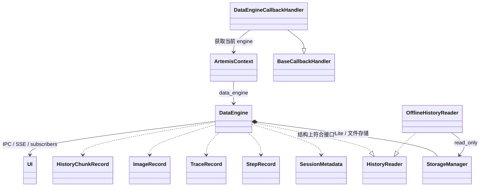

## 一句话概括

`data_engine` 是 Artemis 的**任务运行记录与历史数据层**：它不是负责执行 AI 或操作设备的“引擎”，而是为一次任务统一保存 session、每步屏幕与动作、LLM/工具调用 trace、历史摘要和视频状态，并将事件实时发布给 UI。核心实现是 `DataEngine`，持久化由 `StorageManager` 负责。

## 它记录什么、怎么存

数据模型定义在 `models.py`，主要包括：

- **Session**：目标、起止时间、状态、设备信息。
- **Image**：按截图 SHA-256 去重；图片文件放在 traces 下的 `images/`，OCR 和 UI 层级等元数据放 SQLite。
- **Step**：每轮任务的序号、截图引用、动作、思考、执行结果和附加信息。
- **Trace**：LLM、agent、tool、log 等执行事件；通过 `parent_trace_id` 构成父子调用关系。
- **HistoryChunk、VideoRecording、FailedOutput、BackgroundTask**：历史压缩、录像状态、失败模型输出和后台任务状态。

SQLite 表结构由 `StorageManager._init_db` 初始化；具体写入分别由 `create_session`、`create_step`、`create_trace` 等方法完成。截图文件与记录分开保存，Step 只引用图片哈希。数据库默认位于 traces 目录下，路径由 `get_data_engine_db_path` 确定。

写入并非全部阻塞在任务主流程上：`record_step` 和 `record_trace` 会把存储工作交给后台任务/线程，结束时 `shutdown()` 等待待处理写入完成。`DataEngine` 还通过订阅、IPC 和云端桥接发布 `session_started`、`step_recorded`、`trace_recorded` 等事件。

## 类关系图

`DataEngine` 没有显式继承 `HistoryReader`，但实现了它需要的历史读取方法；离线读取器 `OfflineHistoryReader` 通过同一接口读取已有数据库。追踪侧由 `DataEngineCallbackHandler` 和 `trace` 装饰器提供；装饰器会在函数开始、成功或失败时形成 trace。调用层级靠 `CURRENT_TRACE_ID、CURRENT_NODE_NAME` 这类 ContextVar 传递。

## 运行流程

1. **创建 session**：SDK 的 `Agent._prepare_tracing` 初始化 `DataEngine`、选择 traces 路径，并调用 `start_session()`。
2. **为当前轮准备 step**：Pro 图的 `perception_node` 获取屏幕、OCR/UI 层级，并预分配 Step ID。截图保存为图片记录，trace 可用这个 ID 关联到对应 step。
3. **执行并采集 trace**：Pro 图运行时添加 `DataEngineCallbackHandler`；`services/llm.py` 也将 handler 绑定到模型。LLM 开始、结束或报错时记录 prompt/message、response、token usage、时长和状态。`trace` 装饰器用于记录 agent/tool 函数调用及其结果。
4. **提交 step**：图的 `execution_check_node` 在每轮结束时调用 `record_step()`，保存截图引用、动作、思考和元数据。Flash 路径由 `FlashRunner` 自己记录 step。
5. **持久化及通知**：`DataEngine` 将数据写入 SQLite/图片文件，并发布实时事件；视频控制器也会更新录像状态。
6. **结束与读取**：SDK 结束 session；`ArtemisContext.__aexit__` 调用 `DataEngine.shutdown()` 清空待写入任务。之后可由实时历史接口或离线读取器检索、渲染和回放。

`record_step` 的具体入口在 `engine.py`，trace 写入入口在 `engine.py`。

## 哪些代码调用它、目的是什么

| 调用方 | 作用 |
|---|---|
| SDK `_prepare_tracing` 和 `third_party/mobile_use/sdk/agent.py` | 创建并启动 session；在任务结束时更新状态。 |
| `graph/perception.py`、`graph/graph.py`、`agents/flash/runner.py` | 保存屏幕观测和每轮执行结果，建立 step 历史。Pro 图与 Flash 的记录入口不同。 |
| `DataEngineCallbackHandler`、`services/llm.py`、`trace` 装饰器 | 记录模型调用与 agent/tool 执行轨迹，便于观察调用层级、结果和错误。 |
| `UnifiedMobileController` | 记录录像开始、结束或失败，并关联到 session。 |
| `planner`、`operator`、`checker`、`diagnoser`、`outputter` 等 | 读取已有步骤，给规划、判断、诊断和输出提供任务上下文。 |
| `tools/history/search.py`、`tools/history/screenshot.py`、`OfflineHistoryReader` | 搜索历史、查看步骤与截图；离线模式只读已存数据库。 |
| `mcp_server/tools/inspect_trace.py`、`ReplayManager` | 用历史记录做 trace 检查和单步回放。 |

## 设计目的

它把原本分散在 agent、LLM、工具、设备录像和 UI 通知中的运行信息，统一关联到 **session → step → trace** 结构中。这样 Artemis 可以：

- 给代理提供可搜索的历史上下文；
- 在 UI 中实时展示步骤、模型调用和录像状态；
- 调试失败、回看截图与调用链；
- 离线检查或回放任务；
- 将存储 I/O 移出主执行路径，减少对自动化流程的阻塞。
