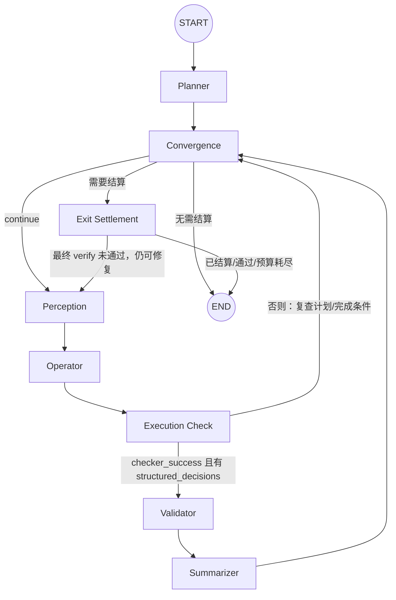
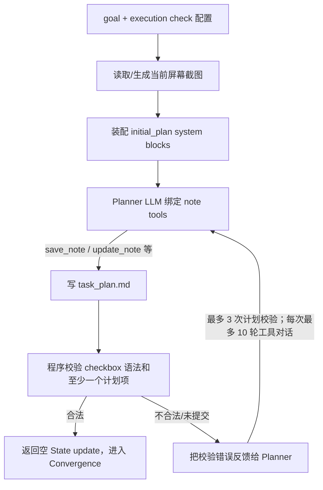
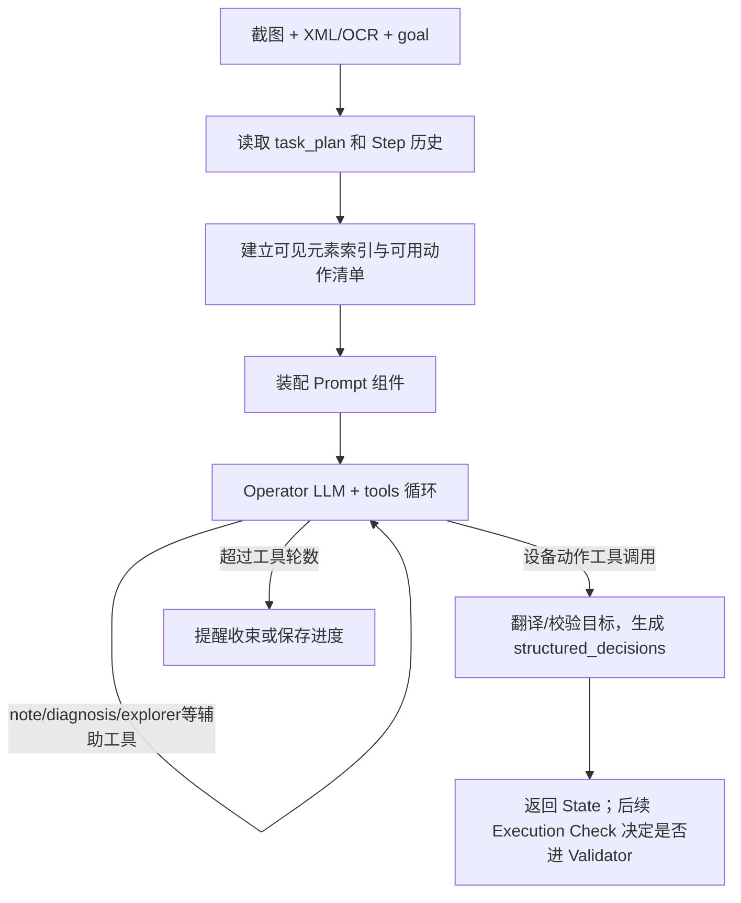
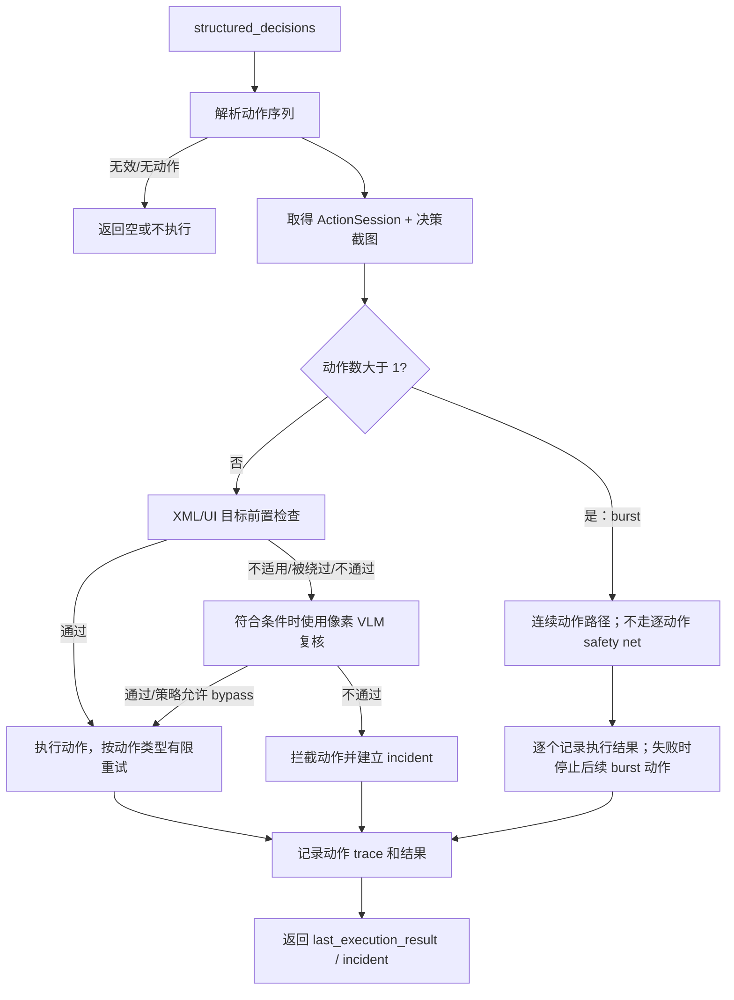
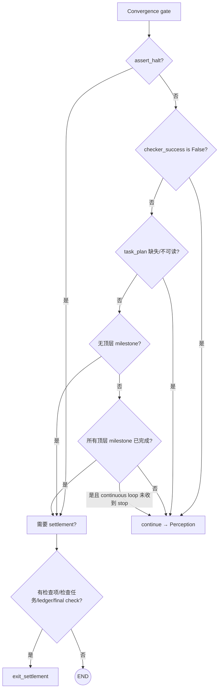
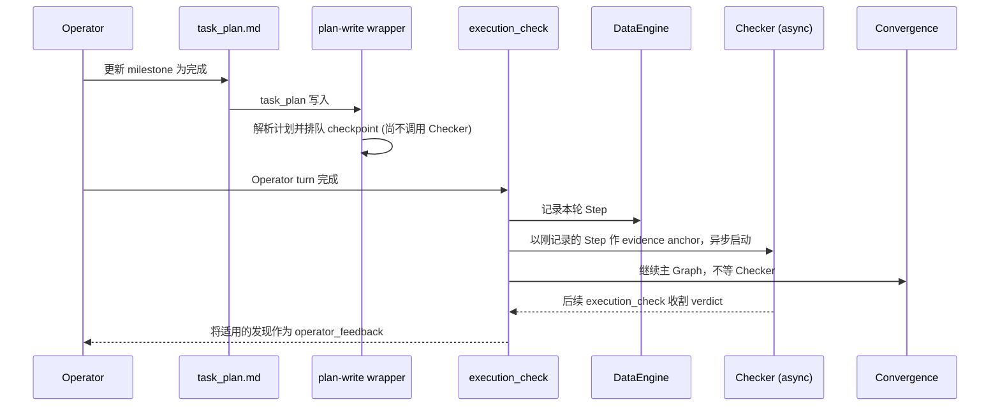
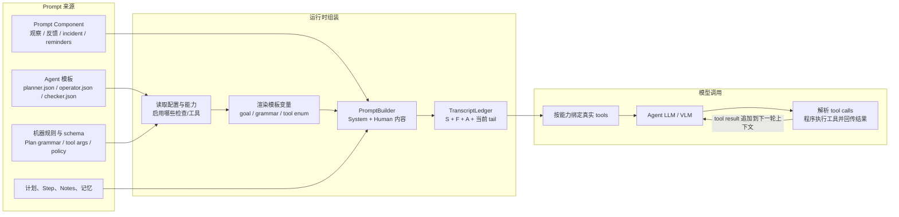

# ARTEMIS Pro Graph：节点、业务流程与 Prompt 解析

## 摘要

ARTEMIS Pro 把一次移动端自动化运行编排成一个循环 Graph：Planner 先把用户目标整理成可追踪计划；Perception 采集当前设备状态；Operator 基于目标、计划和屏幕决定做什么；Execution Check 记录本轮并安排验收；Validator 在动作真正发出前检查目标，再经 ActionSession 执行动作；Summarizer 异步生成步骤摘要；Convergence 判断继续、结算还是结束。任务退出时，Exit Settlement 等待中途检查、按配置执行最终审核并生成 RunOutcome。

它解决的是长流程自动化中的**规划、观察、动作、证据和验收分离**问题。Graph 节点之间用显式 `State` 传递少量控制/观察数据；设备、DataEngine、异步检查任务和计划文件等副作用资源放在 `ArtemisContext`。因此计划可以修改、动作可以拦截和重试、检查可以独立运行，而步骤证据仍可追溯。

本文按代码实际控制流讲解每个节点：输入、输出、副作用、业务步骤、LLM/Prompt、为什么这样设计，以及节点间的具体条件。**只覆盖 Pro Graph**；Flash profile 走 `FlashRunner` 循环。

## 1. 一张图先看懂控制流



### 阅读图的关键点

1. **Planner 只在 Graph 入口节点固定出现一次**；之后计划主要由 Operator 通过受保护的 note 工具更新。计划检查失败或有 feedback 时会通过循环回到 Operator，不代表反复执行初始 Planner。
2. **Convergence 是一个 deferred 汇合节点加条件路由**，不是调用模型的 Agent。它本身不改变 State，路由依据 `convergence_gate()` 对计划、停止信号和检查状态的确定性判断。
3. **Operator 与 Validator 分工不同**：Operator 选择动作并产出结构化决策；Validator 才执行设备动作。Operator 提供的动作工具不是绕过 Validator 的直接设备执行路径。
4. **`execution_check` 不等于 Checker。** 它记录每一轮 Operator 的 Step，收割异步检查并启动排队的 checkpoint。真正的审核由 Checker Agent 执行。
5. **中途 checkpoint 与最终 Checker 是图外异步/收尾工作流**，并非 Graph 中注册的独立业务节点。它们的反馈会被带回 Graph。
6. **Summarizer 节点只派发任务，不等待摘要**；摘要 LLM 工作在共享 StepMemory 后台进行。

## 2. Graph 中几个核心业务概念

| 概念 | 在 ARTEMIS 中的意思 | 不要误解为 |
|---|---|---|
| `State` | LangGraph 节点间传递的当前状态，例如目标、截图、动作决策、结果和路由信号。 | 完整对话记录或数据库 session。 |
| `ArtemisContext` | 节点共享的运行时依赖和资源，例如设备、DataEngine、ActionSession、异步 Checker。 | 供模型阅读的一整段 prompt。 |
| `task_plan.md` | Planner/Operator 共用的可编辑计划；checkbox、缩进和状态由代码解析。 | LangGraph State 中的 `plan` 对象或数据库任务树。 |
| milestone / subgoal | 计划的顶层条目 / 嵌套条目；标识阶段性目标和进度。 | 动作记录或 DataEngine Step。 |
| Step | 一轮 Operator 执行证据记录；可能包含多个动作或无动作的决策轮。 | 单次 tap/click。 |
| checkpoint | Checker 对一个完成 milestone 的 `on_complete` 条件做的中途验收。 | LangGraph 的 CheckpointSaver / State 持久化快照。 |
| `verify` / `assert` | 计划中的验收条件 / 测试断言。前者失败可触发修复；后者失败记录测试结果，配置要求时可 halt。 | 同一种“失败就重试”的规则。 |
| Execution Incident | 动作被安全网拦截或执行失败时留给 Operator 处理的事实和上下文。 | Checker 的最终任务验收失败。 |

计划语法和状态含义由 [plan_grammar.py](../artemis/utils/plan_grammar.py) 统一提供给 Planner Prompt 和程序路由，避免提示模型的规则与实际执行的规则各自演化。

## 3. 节点总览：输入、输出与 LLM

这里的“输入/输出”描述节点读取的主要 State 字段及返回的 State 更新。计划文件、DataEngine 写入、设备控制、创建异步任务属于副作用，不一定经过 State 返回。

| 节点 | 主要输入 | 主要输出 / 副作用 | LLM |
|---|---|---|---|
| `planner` | `initial_goal`、可选 `latest_screenshot`；`ctx` 中的 notes/DataEngine、LLM 配置 | 主要写入 `notes/task_plan.md`；Graph State 返回 `{}` | **是**：初始计划；最多 3 轮格式修正、每轮最多 10 次工具循环；计划编辑后的异步审查另有 LLM |
| `perception` | 上一轮决策 `structured_decisions`、context 中设备/Controller、注入指令文件 | 更新截图、UI hierarchy、OCR、`operator_raw_data`、用户指令和停止信号；分配 Step ID | **否（Agent LLM）**；可选 Google Vision OCR 网络调用 |
| `operator` | 原始目标、最新屏幕、元素索引、task plan、历史、反馈、事件、可用工具 | `structured_decisions`、思考字段、元素索引、工具调用记录等 | **是**：绑定工具的多轮决策循环 |
| `execution_check` | Operator 决策、感知原始数据、已有 checkpoint/planner-validation 任务 | 写 DataEngine Step；返回 Step ID、反馈和路由元数据；启动待执行 checkpoint | 节点自身**不发起同步 LLM**；可等待 Planner validation、异步派发 Checker |
| `validator` | `structured_decisions`、决策时截图、当前元素信息和 `current_step_id` | 设备动作、action traces、执行结果和 incident；更新 `last_execution_result` 等 | 通常不调 LLM；动作安全网走视觉像素验证时**可调用 VLM** |
| `summarizer` | `current_step_id`、DataEngine 中 Step/前后截图、目标/子目标、动作结果 | 异步向 StepMemory 派发视觉转移摘要 | 节点自身不等待 LLM；后台摘要 lens **会调用 LLM** |
| `convergence` | 计划文件、`checker_success`、`user_stop_requested`、assert halt、检查配置/ledger | 空 State 更新；按条件路由至 Perception、Exit Settlement 或 END | **否** |
| `exit_settlement` | 最终目标、计划、检查 ledger、异步 checkpoint、停止/halt 状态 | 结算检查；可能返回 feedback 和 `continue` 路由；生成 `run_outcome` | 结算不一定调用；启用 final check 时**调用 Checker LLM** |

### LLM 使用边界速览

```text
Planner              LLM：初始计划；必要时校验计划修改
Perception           无 Agent LLM；OCR 配置启用时调用 Vision OCR API
Operator             LLM：每轮理解页面并选择下一步/工具
Execution Check      本身是程序逻辑；会等待 Planner 审查或后台启动 Checker
Validator            程序执行；像素安全网可调用 VLM
Summarizer           派发本身非阻塞；后台 StepMemory lens 调用摘要 LLM
Convergence          纯代码条件判断
Exit Settlement     可选 Checker LLM 做最终审核
```

“某节点 LLM=否”不代表整轮运行没有模型调用；要区分节点主逻辑和它派发或等待的后台工作。

## 4. 每个 GraphNode 的细节

### 4.1 Planner：把自然语言目标转成计划

**源码**：[planner.py](../artemis/agents/planner/planner.py)、[planner.json](../artemis/agents/planner/planner.json)  
**State 输入**：`initial_goal`、可选 `latest_screenshot`。  
**State 输出**：`{}`。计划通过工具写入 DataEngine notes，不放在 State 的计划字段中。



**中间业务逻辑**

1. 读取 planner prompt 配置；根据 midway/final check 开关决定是否把检查项生成说明装进 system prompt。
2. 如果 State 没有有效截图，Planner 直接截屏；可用时将图像交给 DataEngine 保存并更新本地 State 的 screenshot 路径。
3. 把用户原始目标和截图放入多模态 Human message。
4. 绑定 `save_note`、`read_note`、`update_note`、`list_notes` 等工具，让 LLM 以 note 写入计划。
5. 程序独立确认确实提交了计划、checkbox 状态字符合法且至少有一个计划项；错误会反馈给模型重做。格式校验是程序约束，不只依赖 prompt 自觉。

**为什么需要 Planner**：长目标若直接交给执行 Agent，容易遗漏阶段、循环边界、观察证据或验收要求。把用户意图先变成可读、可编辑、机器可解析的计划，Convergence 才能确定任务进度和结束条件。

**Prompt 总结与亮点**

- **角色**：资深移动测试工程师，为执行 Agent 设计稳健、可观察、受可行性边界约束的里程碑。
- **意图拆解**：理解真实结果，不把用户措辞机械映射成 UI 文案/搜索词；考虑同义词和间接信息。
- **视觉起点**：计划要以当前设备截图为依据。
- **分层策略**：优先高信号路径，并提供失败时的务实备选路径；对扫描/轮询设定上限、频率和退出条件。
- **风险预案**：预想登录墙、权限弹窗、网络延迟等移动端阻碍，并设想可观察的验证信号。
- **计划层级**：顶层 2–5 个战略 milestone；迭代/轮询的每一轮记在循环 milestone 下的嵌套 subgoal。
- **检查项**：仅当配置启用对应检查时，prompt 才装入 `verify` / `assert` 生成语义。

提示词规定“模型应该怎样计划”；`parse_plan()`、计划写入保护和 Graph route 才是“程序会如何执行和判断”。

#### 后续的 Planner validation 是另一条 LLM 路径

Operator 改动顶层 milestone 时，受控的 task-plan 写入流程可能异步调用 `run_async_planner_validation()`：它以初始目标、旧计划、新计划、Operator 记录的思考和执行历史为输入，用结构化 `ValidationResult` 判断变更是否仍服务于原目标。结果是**advisory**：计划不回滚；若有顾虑，Execution Check 把原因作为 `[planner]` feedback 交给下一轮 Operator。它不是初始 Planner 节点的重复执行，也不是 `checker_success` 的最终验收。

### 4.2 Perception：采集当前真实界面

**源码**：[perception.py](../artemis/graph/perception.py)  
**State 输入**：上轮 `structured_decisions`（用于判断要不要等页面稳定）；其余主要输入来自设备 Controller 和 DataEngine。  
**State 输出**：

```python
{
    "latest_screenshot": ".../images/<sha256>.jpg",
    "latest_ui_hierarchy": [...],   # OCR 与 UI 元素融合后的视图
    "operator_raw_data": {
        "screenshot_b64": "...",
        "xml_hierarchy": [...],
        "ocr_results": [...],
        "width": 1080,
        "height": 2400,
    },
    "injected_instruction": None,
    "user_stop_requested": False,
}
```

**中间业务逻辑**

1. 如果当前没有预分配的 Step ID，就在 DataEngine 预分配；后续工具 traces 可以归属到本轮。
2. 从 session 目录检查并消费一次性 `injected_instruction.json`。含用户指令时，将当时已有的计划检查行设为可由用户指导调整；`release_loop` 会设置停止信号。
3. 根据上轮动作选择立即读屏或先短暂等待稳定，再通过 `UnifiedMobileController` 获取截图、UI hierarchy 和尺寸。
4. OCR 若已配置，则请求 Google Vision OCR，并把坐标映射回原屏幕；失败会记录 warning 并退回 XML-only。随后融合 OCR 文本与 XML 元素。
5. 截图和 UI/OCR 元数据通过 DataEngine 后台保存；把最新感知值返回 State。

**为什么这样做**：所有动作都以新观察为依据，避免 Operator 对过期页面盲点；同时把 OCR 当作 XML 的补充，避免 OCR 服务不可用就让整个执行循环失效。

**LLM/Prompt**：Perception 本身不组装 Agent Prompt，也不调用 Operator/Planner LLM。可选 OCR 是独立视觉识别 API，不是 Graph 推理节点。

### 4.3 Operator：基于计划和观察选下一步

**源码**：[operator.py](../artemis/agents/operator/operator.py)、[operator.json](../artemis/agents/operator/operator.json)  
**State 输入**：`initial_goal`、`operator_raw_data`、`latest_ui_hierarchy`、计划/历史（从 DataEngine 和 `task_plan.md` 读取）、注入指令、工具结果反馈、incident 等。  
**State 输出**：`structured_decisions`、raw/native thinking、`indexed_points`、`indexed_elements`、`current_step_id`、subagent call metadata、tool-limit 标志。



**中间业务逻辑**

1. 从 DataEngine 取 Agent-friendly Steps，从 notes 读 `task_plan`；据此整理计划与历史，判断当前活跃 subgoal。
2. 把融合后的 UI 层级转换成可读的最小元素列表及索引：便于模型说“点击元素 3”，并保留元素语义和坐标映射。
3. 根据当前 actuator 后端能力挂载可用动作，再挂载 note、history、diagnoser、explorer、ADB 管理等工具；工具能力与 prompt 教学段保持一致。
4. PromptBuilder 汇集主模板、观察、incident、截图相似性、历史提示、用户注入、后台任务、checker/planner feedback、推理提醒和工具上限提醒。
5. LLM 可在一轮中调用辅助工具并继续推理；动作 shell 会先被翻译成结构化动作并校验目标参数，最终产出 `structured_decisions`。
6. 设备动作的真实执行不在这个节点发生。图后续经 `execution_check_edge` 决定是否进入 Validator。

**为什么这样做**：Operator 是“根据当前事实选择动作”的决策层，而不是设备驱动器。把选择与执行隔开，Validator 可以统一施加安全网、重试、trace 和 incident 语义。

**Prompt 总结与亮点**

- **视觉优先**：截图是真实设备状态的首要依据；元素列表是辅助定位表，不取代看图。
- **按目标、计划、历史协同**：决定不仅看这一张屏幕，也要理解正在推进哪个 milestone、此前已做什么。
- **准确和有限**：避免盲试；长列表单向遍历、维护锚点和 ledger，避免漏项、重复和来回震荡。
- **分开探索和执行**：允许先查资料/探索或记笔记，再调用会结束本轮决策的设备动作。
- **事故反馈闭环**：安全网拦截和设备错误会作为显式 Execution Incident 告诉 Operator；“动作通道恢复”不等于用户意图已经完成。
- **动态指令**：用户中途指令作为当轮上下文进入 prompt，且与 Step 绑定，后续可追溯。

Prompt 是由主模板和 Prompt Components 装配的，并非单一静态字符串；启用 transcript 配置时还可走 TranscriptLedger 的构造路径。

### 4.4 Execution Check：记录本轮并安排中途审核

**源码**：[graph.py](../artemis/graph/graph.py)、[checkpoints.py](../artemis/graph/checkpoints.py)  
**输入**：Operator 本轮 `operator_raw_data`、`structured_decisions`、思考记录；Context 中 DataEngine、planner validation 和待检查任务。  
**输出**：`checker_success`、`current_step_id`、`operator_feedback`，并清空已消费的 `subagent_calls`。

**中间业务逻辑**

1. 没有 DataEngine 时，返回 `checker_success=True`，让普通执行路径仍可路由。
2. 收割已经完成的异步 checkpoint（不等待仍在运行的审核）。
3. 若有顶层计划修改的异步 Planner validation，则在这里读取结果；不同意时添加 `[planner]` advisory feedback。
4. 只要有原始感知数据，就为本轮 Operator turn 记录 Step，即使没有设备动作、计划被拒或本轮只探索。记录截图、UI/OCR、决策、思考、活动 subgoal hash 和用户指令。
5. **Step 落盘后**再启动排队的 checkpoint，保证审核 evidence anchor 指向刚才标记 milestone 完成的正确 Step。
6. 将收割/启动的检查发现合并进 `operator_feedback`。

**为什么这样做**：执行证据不能依赖“动作有没有成功”才保存；失败决策和无动作轮同样是排错需要的历史。Checkpoint 在 Step 保存之后再启动，避免以错误步骤作为完成证据。

**LLM**：该节点自己的主逻辑是确定性代码。但它可能等待此前启动的 Planner validation LLM；也会异步启动 checkpoint Checker LLM，不阻塞主 Graph。

#### Execution Check 的出边条件

```python
if state.checker_success and state.structured_decisions:
    return "execute_decisions"  # Validator
return "review_subgoals"        # Convergence
```

这里的 `checker_success` 是这个路由上的门控信号，不应理解成 Checker 已经判定整个目标成功。真实 Checker verdict 在 checkpoint/final-check ledger 中。

### 4.5 Validator：安全检查后才执行设备动作

**源码**：[validator.py](../artemis/agents/validator/validator.py)、[execution_loop.py](../artemis/agents/validator/execution_loop.py)、[precondition_xml.py](../artemis/agents/validator/precondition_xml.py)、[precondition_pixel.py](../artemis/agents/validator/precondition_pixel.py)、[action_execution.py](../artemis/agents/validator/action_execution.py)  
**输入**：Operator 的 `structured_decisions`、本轮 `current_step_id`、State 中决策截图/元素数据；Context 中 ActionSession 和设备。  
**输出**：`last_execution_result`、`open_incident`、`last_closed_incident`；副作用为设备动作、action traces、截图和 DataEngine Step 更新。



**业务解释**

- **Safety Net（动作前置安全网）**：检查 Operator 做决策时看到的目标，执行前它是否仍存在、位置是否变化、是否被遮挡。优先使用有语义元数据的 XML/UI 校验；必要时用图像像素层级的 VLM 复核。
- **Burst（动作 burst）**：多项动作可能按快速连续路径执行。为避免逐动作检查/重试破坏原本的动作时序，该路径不运行单动作 safety net，失败后会停止后续动作并标记未执行项。
- **有限重试**：单个已批准动作对设备发出失败时有限重试；这不意味着动作效果已被证明。操作是否达成目标由下一轮新感知和 Operator/Checker 判断。
- **Incident**：失败/拦截会记录原因、类别和证据，由 Operator 下轮处理；一次后续动作成功只表示执行通道恢复，不代表原始意图自动完成。

**LLM**：多数 Validator 工作是程序逻辑和设备调用。只有适用动作触发像素安全网时，会通过 `validator_pixel_safety_net` 等模型配置请求结构化视觉判断；XML 检查和动作派发本身不需 LLM。

### 4.6 Summarizer：将已记录 Step 派发到后台摘要

**源码**：[summarizer.py](../artemis/agents/summarizer/summarizer.py)、[step_memory.py](../artemis/memory/step_memory.py)、[summarizer.py](../artemis/agents/flash/summarizer.py)  
**输入**：`current_step_id`；其余上下文从 DataEngine Step 取，包括前后截图、动作、执行结果、目标和当前 subgoal。  
**输出**：不更新 Graph State（返回 `{}`）；向共享 `StepMemoryService` 提交工作。

1. 没有 DataEngine 或 `current_step_id` 时直接跳过。
2. 读取 Step、图片和动作信息；截图缺失时可退化为文字输入。
3. 组合 Operator 意图、原始目标、当前子目标、用户注入指令和动作执行结果作为摘要 focus。
4. 调用 `StepMemoryService.dispatch()`，后台任务有限重试；Graph 不等待摘要完成。
5. 摘要 ready 后以 `visual_transition` 来源更新 DataEngine Step 摘要。

**为什么异步**：摘要能改善之后的历史提示，但它不是下一动作的必要前提。让每轮都等待视觉 LLM 会将非关键记忆工作加到设备控制延迟上。

**LLM**：SummarizerNode 只是 dispatch；视觉转移 lens 后台调用 LLM。需要把它计为“整个运行会产生的 LLM 调用”，但不能说 Summarizer Graph 节点同步等它完成。

### 4.7 Convergence：确定是否还需要执行

**源码**：[graph.py](../artemis/graph/graph.py)、[graph.py](../third_party/mobile_use/graph.py)  
**输入**：State 中停止/检查信号及 Context 中 DataEngine、检查配置；从 `task_plan.md` 读取机器可解析计划。  
**输出**：空 State 更新；`convergence_gate()` 决定路由到 `perception`、`exit_settlement` 或 `END`。



**业务逻辑及优先级**

1. assert halt 锁存时，不再进入通常动作循环，转向需要的退出结算。
2. `checker_success is False` 时回到循环；初始 `None` 不算失败。
3. 缺失或不可读的计划不会被当作“成功完成”；正常路线继续，让执行器有机会修复计划状态。
4. 无顶层目标或所有顶层目标完成时，检查是否还需要 settlement。
5. `[Loop:continuous]` 的 milestone 即使标为完成，只要没有显式用户 stop 信号就继续循环。
6. 其他未完成计划继续到 Perception，获取新鲜页面。

如果没有 DataEngine，`convergence_gate()` 直接返回 `end`。这是 Graph 对执行资源缺失的明确路径，不是 LLM 推理结果。

**为什么这样做**：完成条件读取计划的机器状态而非模型最后一句自然语言，避免 Agent 口头说“完成”但计划仍有未完成 milestone；连续监控也不会被模型擅自标完成而停止。

**LLM/Prompt**：不调用 LLM，也没有 prompt；就是确定性调度逻辑。

### 4.8 Exit Settlement：等待检查、最终审核、生成结果

**源码**：[graph.py](../artemis/graph/graph.py)、[checkpoints.py](../artemis/graph/checkpoints.py)、[checker.py](../artemis/agents/checker/checker.py)、[checker.json](../artemis/agents/checker/checker.json)  
**输入**：目标、计划、已记账的 checkpoint verdict、待结算后台检查、用户 stop/assert halt 和最终检查配置。  
**输出**：`exit_settlement_route`、可能的 `operator_feedback`、可选 `run_outcome`；落盘 verdict ledger / outcome。

**两阶段流程**

1. **Settlement barrier**：等待已启动的 checkpoint 完成，等待时间有上限；到期的尝试记为 unchecked/inconclusive 等状态，不无限阻塞任务退出。清理未启动的 pending checkpoint，不在退出时新开中途检查。
2. **Final check（按配置启用）**：Checker 以原始用户目标、计划、所有检查项、ledger、执行摘要和最终屏幕为依据生成结构化 verdict。若 verify 不满足，且未 stop/halt 且还有重试预算，则将问题作为 feedback 返回，重置相关 subgoal 状态并回到 Perception；预算耗尽或被停止时以 blocked outcome 收尾。`assert` failure 记录为测试结果，不触发同一种 verify 修复循环。
3. **RunOutcome**：按机器规则汇总目标状态和 tests 统计，写入运行目录并返回到 State。

**为什么要区分 settlement 与 final check**：即使不启用最终目标审核，退出前仍必须把已经开始的中途检查收尾；反之，只启用 final check 也要明确审核目标和最终状态。二者触发条件不同，但共用一个退出入口。

**Checker Prompt 总结与亮点**

- **独立验收者**：Checker 只读证据，无设备动作、无 note 写入、无 sub-agent；释放/修复规则由调用方代码决定，模型不能靠一句“通过”直接改状态。
- **结构化逐项判断**：每项产出 `passed`、`failed` 或 `inconclusive`，并提供具体证据；缺失 verdict 会补为 inconclusive，缺乏证据支撑的 failed 会被降级。
- **中途审查证据锚定**：只允许使用完成时锚定的截图/历史和持久化探查，不拿后来变化的实时屏幕冒充完成时证据。
- **最终审查看当前结果**：额外提供最终屏幕、完整目标、用户中途指导、最终计划和历史 ledger。
- **检查类型语义不同**：verify 是完成验收，失败可能要求修复；assert 是测试断言，失败记录为测试失败，不自动改造成执行修复。
- **Probe 限制**：可用只读设备探查时，其能力由工具清单约束；Prompt 本身不是权限边界。

### 4.9 Checker checkpoint：不是 GraphNode，但会改变下一轮输入

中途 checkpoint 的触发点不是每次动作，而是计划首次把一个顶层 milestone 标记完成，且 milestone 下有 `on_complete` 检查项。



- `verify` 失败且结果仍适用于当前计划时，可以按 `checkpoint_max_repairs` 有限次数把对应 subgoal 退回进行中并反馈 Operator。
- `assert` 失败被记录；只有 `assert_failure_policy="halt"` 时才锁存 halt。
- 过期计划、用户撤回的检查项、被新尝试 supersede 的结果可以保留 ledger，但不会错误地修复当前计划。
- 错误/超时不伪造成通过；保持 inconclusive，释放策略由程序决定。

这套 checkpoint 是业务验收记录，不是 LangGraph State 快照或恢复机制。

## 5. 节点之间究竟传什么

### 5.1 State：图的显式通道

`State` 位于 [state.py](../artemis/graph/state.py)，是 Pydantic 模型并设置 `extra="forbid"`；节点只能更新声明过的字段。主要字段如下：

| 数据分组 | 字段示例 | 哪些节点使用 |
|---|---|---|
| 目标/控制 | `initial_goal`、`injected_instruction`、`user_stop_requested` | Planner、Operator、Perception、Convergence、Checker |
| 感知 | `latest_screenshot`、`latest_ui_hierarchy`、`operator_raw_data` | Perception 写；Planner/Operator/Validator 读 |
| 决策/定位 | `structured_decisions`、`indexed_points`、`indexed_elements` | Operator 写；Validator 执行前读；下一轮 Perception 用决策判 settling |
| 执行/故障 | `last_execution_result`、`open_incident`、`last_closed_incident` | Validator 写；下一轮 Operator 读 |
| 轮次/反馈 | `current_step_id`、`operator_feedback`、`subagent_calls` | Execution Check、Validator、Summarizer、Operator |
| 退出/结果 | `checker_success`、`exit_settlement_route`、`run_outcome` | Convergence、Exit Settlement、任务收尾 |

多个 State 字段使用 `take_last` reducer；`user_stop_requested` 使用 sticky-OR，外部 stop 一旦置真，不会被后续 `False` 更新清除。

### 5.2 Context：共享依赖和副作用资源

`ArtemisContext` 保存设备、DataEngine、执行设置、ActionSession、当前异步 Planner/Checker 任务、检查 ledger/repair 状态、StepMemory 等。Context 不是每个节点返回的 State patch；很多节点通过它执行读写、启动后台工作和调用设备。

### 5.3 节点可见性

[visibility.py](../artemis/graph/visibility.py) 中的 `NODE_VISIBILITY` 声明各节点可读/写字段；`strict_state()` 在严格模式/测试中检查越权读取或就地修改。新增 State 字段时需要同步核对 reducer、节点可见性合同和对应测试。

## 6. 典型场景走一遍

用户要求“打开设置，把语言改成 English，并确认生效”，Pro 路径可概括为：

1. `Planner` 用原始目标和当前截图产生 `task_plan.md`，例如“更改系统语言”和“验证界面显示 English”两个 milestone。
2. `Convergence` 看到仍有未完成 milestone，路由 Perception。
3. `Perception` 获取最新屏幕与 UI 元素；Operator 读屏并决定点语言设置条目。
4. `Operator` 返回一条结构化动作，不直接触屏；随后 Execution Check 把本轮截图、计划 hash 和决策写入 Step。
5. `execution_check_edge` 因 `checker_success=True` 且有动作，进入 Validator。Validator 检查目标仍在页面，再经 ActionSession 点击。
6. Summarizer 异步派发前后界面摘要；Convergence 决定继续，Perception 刷新屏幕。
7. Operator 看到新页面并选择 English；同样经 Step 记录、Validator 执行和下一轮感知。
8. Operator 观察到页面语言改变，更新计划并完成 milestone。存在 `on_complete` 条件时，Execution Check 异步启动 checkpoint Checker。
9. 所有顶层 milestone 完成后进入 Exit Settlement；等待已启动检查并按配置执行 final check，最终生成 `run_outcome`。

可能的例外：

- Operator 只用 Explorer/notes 探索、没有动作决策：Execution Check 仍记录 Step，edge 回 Convergence；若计划仍未完成，下一轮继续。
- Validator 拦截目标或动作失败：产生 incident，下一轮 Operator 读取失败原因并重新观察/决策，不会把“动作没执行”报告成成功。
- Final verify 失败且还有额度：Exit Settlement 返回 Operator feedback，Graph 回 Perception 修复；断言失败则按测试断言语义记录，不等价于同一修复路径。

## 7. Prompt 设计总览：Prompt 各自解决什么

| Prompt | 模型角色与输入 | 设计亮点 | 不负责什么 |
|---|---|---|---|
| Planner initial plan | 目标 + 当前截图；任务意图拆解、风险和检查配置 | 可观察、可行、有边界的 milestone；把循环实例嵌套；工具化提交计划并由程序校验格式 | 不执行动作；不决定 Graph 路由 |
| Planner validation | 初始目标、计划前后版本、Operator 推理/执行历史 | 对顶层计划变更提供具体、轻量 advisory，防止目标漂移 | 不回滚计划；不是中途/最终 Checker verdict |
| Operator | 当前截图、可见元素、计划、历史、反馈和可用工具 | Vision-first；目标与当前状态一起推理；动作范围精确；长列表防遗漏/重复；失败恢复 | 不发出真实设备动作；不负责最终任务验收 |
| Validator pixel safety net | 目标控件描述、决策时 crop、执行前当前 crop、Operator 选动作的上下文 | 执行前确认目标还在、可见且可交互；结构化结果指导拦截/放行 | 不是整项任务成功审核；不替代 XML 优先的前置检查 |
| Checker checkpoint | 完成时锚点、原始目标、该 milestone 和其 check items、执行摘要 | 证据锚定、只读工具、逐项结构化 verdict | 不操作设备；不直接修改计划/决定修复 |
| Checker final | 原始目标、最终计划、ledger、执行摘要、最终屏幕和 check items | 全局收尾复核；对 verify/assert 分开给 verdict | 不负责动作安全网；不直接支配 Graph release |
| Visual transition summary | 动作、前后截图、执行结果、目标/子目标 focus | 中立描述“屏幕如何变化”，作为历史压缩/后续上下文 | 不决定下一步动作，也不做通过/失败验收 |

> Prompt 原文很长且会按配置拼装；本节按功能概括，不把所有模板逐字复制。真正的程序约束由解析器、工具 schema、State 字段、边条件和权限表共同实施，不能只靠 Prompt。

## 7.1 Prompt 总体架构：谁负责内容，谁负责拼装

ARTEMIS 的 Prompt 不是“把一条超长字符串直接塞给模型”。它由**角色模板、运行时上下文组件、历史/记忆渲染、工具定义**组成；不同 Agent 有各自的 Prompt，而共享的原则是：把稳定规则与每轮变化的事实分开，并让会影响行为的约束尽量同时落在代码机制上。



图中的 `RULES` 不是所有内容都原样插入 Prompt：例如 plan grammar 会渲染成模型可读规则；动作参数的类型和合法范围还由真实 Tool schema 校验。Checker 的只读能力同样是工具表限制，不是让 Prompt 文字单独承担权限控制。

### Prompt 构造的层次

1. **静态模板层**：角色、目标职责、操作原则、安全/恢复规程、计划语法、可用能力说明和输出协议，主要来自 `planner.json`、`operator.json`、`checker.json` 等文件。
2. **能力/配置层**：根据实际已绑定的工具、执行 profile、检查开关、执行器能力，增删对应的工具名、说明块和检查语义。
3. **运行时事实层**：每轮注入最新 screenshot/UI、当前 plan、必要历史、Validator 结果、当前 incident、用户指导、后台任务状态和 Checker feedback。
4. **对话工具循环层**：模型返回 tool call 后由代码匹配并执行真实工具，再把 ToolMessage 结果加回消息列表；工具调用和工具结果本身也是后续上下文的一部分。
5. **历史治理层**：TranscriptLedger 保存/裁剪/压缩多轮上下文；数据超出窗口后，通过摘要 capsule、Step 记录和历史查询保留可恢复的信息。

### Operator 具体如何组装

`OperatorNode.__call__()` 是运行时入口，大致顺序如下：

1. 从 State 取最新截图、XML hierarchy、尺寸和当前注入信息。
2. 从 DataEngine 读取历史 Step，从 notes 读取 `task_plan.md`，构建面向 Operator 的 plan/history 视图。
3. 把当前 UI hierarchy 格式化为人可读、可索引的元素列表，并把每个索引映射到实际元素/坐标。
4. 查询真实运行可用工具集：执行器不支持的动作、未配置的 video analyzer、无 DataEngine 时不可用的 history 工具不会被挂到模型工具列表，也不会被 Prompt 宣传。
5. 依配置选择 legacy 或 transcript 路径，再由模板和组件组成消息。
6. 调用 LLM，并绑定同一轮可用工具；每次 tool call 都由代码校验、执行并返回结果，最多进行 `OPERATOR_MAX_TOOL_ITERATIONS` 次循环。

**Prompt 声称可用的工具和实际绑定的工具必须一致。** `resolve_operator_prompt_tools()` 与 `get_graph()` 中的工具配置共同实现这一点；模板 helper `prompt_assembly.py` 会把工具列表按既定顺序渲染，并整体移除没有对应工具的教学段，避免模型被告知可用一个实际不存在的能力。

### Legacy 与 Transcript 两种消息布局

- **Legacy 两消息路径**：一条 SystemMessage 放入渲染后的主模板（其中包含变化较大的 plan/history）；一条 HumanMessage 放入当前截图、UI 元素及动态提醒。Prompt component 负责把大模板的静态部分放进 system，把 observation 部分作为 human 内容。
- **Transcript 路径（当前配置默认启用）**：把 operator 模板中的 plan/history 段替换成静态指针，形成每个 session 只建立一次的 system prefix；真正的对话历史放在后续 transcript 中，当前 plan 则每轮重新 recite。

Transcript 路径消息顺序是：

```text
S  静态 SystemMessage（session 内稳定的角色/规则/能力合同）
F  冷启动恢复历史 + 已压缩冻结块（旧 turns 的 capsule / era）
A  最近的原始活动对话（未压缩的 turns）
T  当前 observation tail（新计划、截图、UI 元素和本轮动态提示）
```

这是消息排列策略，不表示这四部分全是同一种内容：只有 S 是固定系统前缀；F/A/T 是 Human/AI/Tool 等消息组成的历史或当前尾部。

### 动态组件的典型职责

| 组件 | 注入内容 | 为什么需要 |
|---|---|---|
| `TemplatePromptComponent` | Operator 主规则、计划语法、工具列表、burst/工具轮数限制 | 为模型提供长期稳定的“怎么做”合同。 |
| `PlanRecitationPromptComponent` | Transcript 路径每轮加入当前 task plan | 历史经过压缩后，仍把当前进度清楚放在最新上下文。 |
| `ObservationPromptComponent` | 当前 screenshot + 可见 UI 元素索引 | 模型以当前真实屏幕为决策依据。 |
| `ExecutionIncidentPromptComponent` | 当前未解决 Incident 或一次性关闭通知 | 明确失败动作是否实际执行、失败原因和后续需要处理的意图。 |
| `ScreenshotSimilarityPromptComponent` | 最近数步屏幕几乎未变化的提示 | 提醒 Agent 注意卡住/重复，但不代替它判断原因。 |
| `HistoricalStateHintPromptComponent` | 当前画面与较早历史画面相似时，提示可查历史 | 帮助识别返回旧界面；只用 dHash 比较，不调用模型。 |
| `InjectedInstructionPromptComponent` | 用户中途指导；解释它优先于计划并保留原文 | 及时接收任务转向，同时保留可追溯指令。 |
| `BackgroundTasksPromptComponent` | 正运行/刚完成的 ADB 后台任务和输出 | Agent 不会把尚未结束的后台工作误当作无状态。 |
| `FeedbackPromptComponent` | 来源标注的 Checker 发现或 Planner advisory | 将程序/审核反馈送到下一轮，而不是让它隐含在日志中。 |
| `ReasoningReminderPromptComponent` | 上一轮没有可见解释时，要求本轮简短说明 | 让操作理由可观察；不额外发一次 LLM 请求。 |
| `ToolLimitWarningPromptComponent` | 上轮耗尽工具轮数时提示收束/换策略 | 防止只探索、不执行或不保存进度。 |

组件通常按固定顺序追加；没有动态事实时可不生成对应块。`ephemeral=True` 标记只对近期轮次有用的提醒/feedback，历史老化后会被 scrub，而不是永久重复出现在所有轮次。

## 7.2 Prompt 如何降低“模型没有照做”的概率

Prompt Engineering 能**引导**模型，不能数学上保证模型每次都正确。ARTEMIS 把关键行为要求落成“说明 + 可执行接口 + 程序校验 + 运行时验收”多层防线：

| 层次 | ARTEMIS 做法 | 具体例子 |
|---|---|---|
| 规则明确 | Prompt 使用角色、编号原则、正反例、边界条件和明确响应动作，而非只写“谨慎操作”。 | Operator 说明截图优先；长列表单向扫描并记录锚点；动作失败后重看页面、不要盲重试。 |
| 当前上下文明确 | 把 goal、最新截图、可见元素、活动计划、历史摘要、feedback 放在对应且有标题的区块。 | 每轮 Observation 有 `Current Screenshot` 与 `Visible UI Elements`；Transcript 路径重述当前 task plan。 |
| 能力可执行 | Tool call 用结构化参数 schema；模型只能调用本轮绑定的工具。 | 缺少 target description 的纯坐标动作会被参数转换校验拒绝；未实现的 actuator 动作不向模型公开。 |
| 计划格式程序校验 | 对 `task_plan` 的 checkbox grammar、层级和状态用解析器检查；非法计划给明确错误反馈。 | Planner 必须调用 note 工具提交计划，程序读回后校验；Operator 计划写入会防止意外改写 milestone 或删除受保护检查项。 |
| 动作执行安全网 | 执行前针对单动作校验目标仍在、位置可接受；失败可拦截并反馈，而非默默执行。 | XML/UI 校验优先，适用时像素 VLM 复核；失败形成 incident。 |
| 独立验收与闭环 | Operator 的“我完成了”不是唯一证据；Checker 读证据产出逐项 verdict，程序按预算决定修复、阻塞或放行。 | 完成 milestone 后 checkpoint；任务退出时可执行 final check；verify 与 assert 按不同语义处理。 |
| 失败和循环边界 | 限制工具轮数、动作 burst 数、Checker 迭代/修复预算和检查超时；失败信息可进入下一轮。 | ToolLimitWarning 提醒 Agent 收束；`[Loop:continuous]` 必须等用户显式停止。 |

### Prompt 规则的写法有什么特点

1. **把抽象目标转成可观察行为**：如“确认语言生效”比“完成设置操作”更容易和屏幕证据、验收条件对应。
2. **写清前提、动作和结果**：遇到页面转场先等待；长列表先标锚点再滚动；若锚点丢失只允许一次有界恢复。
3. **把异常作为正常流程设计**：权限弹窗、目标移动、列表边界、动作被拦截都有明确备选处置，不让模型在失败后只重复原动作。
4. **用固定结构和标题分块**：角色/原则在 system，当前屏幕/计划/反馈在 human observation；事件都使用有语义的 marker，让模型易于区分事实来源和当前任务。
5. **机器可检查项尽量结构化**：Plan checkbox、tool arguments、`CheckVerdict` JSON 等适合解析的内容，不依赖模型写一段自然语言后再猜结果。
6. **把解释和硬约束分开**：Prompt 告诉模型为何和何时做；安全、权限、合法参数和停止条件由代码实现。模型仍可能选错，但错误可以被拒绝、记录、反馈和修复。

因此，“确保正确”的准确表述是：**系统通过多层防线降低错误概率，并让关键错误可检测、可阻断、可恢复；并没有任何 Prompt 能单独保证 LLM 正确。**

## 7.3 长任务如何减少中间遗忘

ARTEMIS 不尝试把无限长对话全塞进每一次调用，而是把“当前进度”“近期事实”“更早历史”“可查证据”分层：

| 信息层 | 处理方式 | 防止遗忘的作用 |
|---|---|---|
| 用户目标 | 保存在 `State.initial_goal`；进入 Planner/Operator/Checker 对应上下文。 | 避免长历史压缩后目标本身消失。 |
| 当前计划 | 作为 `task_plan.md` note 持久保存；Operator 从文件读，Transcript 路径每轮复述当前计划。 | milestone/subgoal 状态成为短小且新鲜的进度账本，不靠回忆历史中“之前做到了哪”。 |
| 最近几轮对话 | TranscriptLedger 的 active region 保留原始截图、决策、工具交互和结果；滑动窗口确保最近原始细节仍可见。 | 当前动作依赖最近证据，不依赖远期压缩摘要。 |
| 较早但仍重要的轮次 | `ScrubEdgeCompressor` 先替换过旧的 UI 列表/临时提醒，再在视觉摘要 ready 后替换旧截图；历史 chunk manager 进一步生成分段 capsule。 | 保留“做了什么、界面如何变化、结果如何”的紧凑版本，减少上下文无限增长。 |
| 很久以前的历史 | 上下文压力极高时把已冻结历史折叠为 recall-only era / 每步索引；需要细节时可用 `search_history`、`replay_steps`、`get_step_screenshot` 等工具查询。 | 不把所有旧原文永远留在每次 prompt，同时保留可回查路径。 |
| 任务外事实/长数据 | 用有描述性的 notes 记录清单、候选项、监控结果等，而不是只留在对话里。 | 结构化持久记忆可跨轮、跨 prompt 压缩继续使用。 |
| 关键外部指令 | 指令原文保留到 Step 元数据；Prompt 中的解释 wrapper 可 ephemeral；历史 capsule 会把用户指令行保留。 | 压缩后仍能追溯用户中途改变了什么要求。 |
| 失败和验收结果 | Incident 进入当前轮反馈；Checker verdict 落 ledger；错误、未检查和未确定有各自状态。 | 不把“模型刚才说过成功”当作唯一记忆或事实。 |

### 压缩不是简单截断

TranscriptLedger 的核心顺序是 `S + F + A + tail`。生成下一轮输入时：

1. **Scrub edge（滑动清理边界）**：旧 UI 元素索引和仅对上一轮有效的 blocks 很快离开 prompt。因为元素编号只对最新画面有效，清掉旧编号可以防止模型误点过期的 `[3]`。
2. **截图替换**：旧截图先等待 StepMemory 的视觉转移摘要；摘要 ready 后以文本摘要代替图像。摘要未 ready 时有 grace window；摘要失败不会把原始 Step 记录删除，StepMemory 会有限重试。
3. **Chunk（分段压缩）**：按完整 turn/step 区间归并历史，保留区间覆盖和可追溯来源；较早历史转换成 capsule，而不逐消息随意截断。
4. **Hard pressure 下 fold**：上下文接近硬阈值时优先替换已就绪的 L2 chunk；若仍超预算，才折叠为更紧凑的 recall-only era 和最小索引。
5. **可检索而非全量常驻**：较老的细节移出 prompt 后仍由 DataEngine/notes/历史搜索工具支持回查。

当前 Transcript 配置默认启用，常见缺省值包括 `context_budget_tokens=80000`、start/soft/hard ratios `0.35/0.7/0.9`、`min_active_steps=5`、XML scrub depth `1`、截图 scrub depth `3`、低占用放宽深度 `6`；实际值可在运行配置覆盖。这里的 token budget 是压缩触发的估算/策略阈值，不是服务商上下文窗口的硬性设置。

还要注意：**压缩不能保证每个自然语言细节永远在 prompt 内。** 设计目标是把当前必须执行的内容留在 goal/plan/近期 tail，把长程过程变为 capsule，把需要时才查的证据留在 recall source。对于用户明确要求必须保留的细节，应写入 plan/note/check 条目，而不应假设模型会从已压缩历史中自动记住。

## 7.4 KV cache / Prompt cache：做了什么，哪些不能保证

在推理服务中，KV cache 通常复用前缀 token 已计算的 Key/Value；许多托管模型也把相近能力称作 prompt caching。对 ARTEMIS 来说，最有效的应用方式是**让每轮请求的前缀稳定、动态内容靠后**。

### 代码中有利于前缀复用的设计

1. **Transcript 路径把 Operator system prompt 做成 session 内 byte-stable 前缀**：`render_transcript_static_system()` 把变化的 plan/history 段替换成固定指针；`TranscriptLedger.set_static_prefix()` 每个 session 只设置一次。
2. **消息顺序是 prefix-first**：先发稳定的 S（SystemMessage），再发可变化的 restored/frozen/active history 和当前 observation tail。每轮新截图、当前计划、elapsed time、反馈都在变化内容区域，而不改 system prefix。
3. **固定规则不随 verdict 切换模板**：Operator system template 不因某轮 checker 结果切换成另一份 Prompt；变化的检查结果通过独立 feedback block 追加。
4. **工具提示稳定且与能力匹配**：可用工具按确定顺序渲染；同一 session 下执行器和配置不变时，tool enumeration/教学段可保持一致。
5. **静态前缀的稳定性有回归测试**：`test_operator_transcript.py` 检查同一配置下多次渲染静态 system prompt 一致；legacy 路径另有 golden hash 测试保护旧输出。
6. **记录服务端反馈的 cache token usage**：统一 usage parser 和 `TokenMeter` 统计 `cached_tokens`、会话及来源维度 cached ratio，Operator 也记录每次 prompt token 数给历史压缩阈值使用。

### 重要限制：不是 Artemis 在本地保证 KV cache 命中

- 代码建立的是**稳定前缀条件**，不是模型服务端 KV cache 的强制开关。
- 是否缓存、缓存的最小 token 长度、存活时间、跨请求/跨实例是否共享、tool schema 是否纳入缓存，由具体模型/provider/API 的实现决定。
- 即使 system message 文本稳定，如果 model version、系统指令、工具 schema、消息顺序或其前缀 token 有变化，服务端也可能无法复用相同前缀。
- Legacy 路径把 plan/history 渲染进 system template 的可变区域，前缀稳定性通常不如 Transcript 路径。
- 当前代码的 cache metrics 是**观测缓存 token 使用**，不是保证某个固定 cache-hit rate。

### 可迁移的 KV/prompt-cache 实践

1. 长期不变的角色、规则和格式协议放前面；用户目标、计划、时间戳、截图、近期反馈放后面。
2. 维持 system prompt、tool schema、工具排序和消息前缀稳定；能力变更时才变更对应块。
3. 不要每轮把全量 history 和实时数据拼进 system prefix；把变化内容隔离到 suffix/observation。
4. 避免只为了“动态 personalization”重写静态指令的句子/排序；用单独变量或尾部字段表达。
5. 通过 provider usage 数据验证缓存是否真的发生；不要只根据 Prompt 看起来相同就假设 cache hit。
6. cache 与上下文压缩是不同优化：稳定前缀提高重用机会；压缩控制总上下文大小和延迟；两者可以协同但不能互相替代。

## 7.5 值得学习和借鉴的 Prompt 工程手法

- **角色分离**：Planner 负责规划、Operator 负责动作决策、Validator 负责安全执行、Checker 负责只读验收；避免一个 Prompt 同时“想计划、做动作、宣布成功”。
- **一个事实只有一个权威来源**：屏幕是当前事实，plan 是阶段进度，Step/Trace 是发生过的证据，ledger 是 Checker verdict；提示中明说它们分别代表什么。
- **短期注意力与长期记忆分层**：最新 observation 给模型完整可操作信息，旧历史逐步摘要，重要证据可查；不要用无限增长的聊天记录代替 memory design。
- **能力与说明同步**：工具不可用就同时从 tool schema 和 prompt instruction 中移除，减少幻觉调用。
- **把关键动作做成状态机**：例如轮询任务包含 baseline、等待、刷新、diff、处理事件、更新 ledger，而不是一句“持续监控”。
- **正向规则 + 反例 + 恢复路径**：说明推荐策略，也说明不要盲目重复、不要反向扫描、失败后如何转向。
- **让结果可验收**：计划和 Checker 约定可观察标准；执行层与验收层独立，避免模型既做运动员又当裁判。
- **只把有限生命周期内容做成 ephemeral**：动态提醒不会污染永久历史，用户真正要求和证据仍保留。
- **用数据调 prompt，而不是凭感觉**：保存 Prompt golden tests、真实设备 A/B 和每个来源的 token/cache metrics；改动后验证正确性、延迟、token 和 cache 行为。

推荐复用的是工程原则，不是照搬超长 Prompt。写新 Agent Prompt 时，可按“职责 → 权威输入 → 可用工具 → 正常流程 → 异常/边界 → 输出/验收 → 程序强制点”组织，然后用测试检查模板渲染、tool alignment 和流程边界。

## 8. 为什么 Graph 采用这种组织方式

1. **把决策与设备执行隔离**：Operator 先提出动作，Validator 再统一做安全检查和派发，降低误点风险。
2. **每轮先有新观察再决策**：执行后回到 Perception，避免用陈旧截图连续操作。
3. **用计划而不是模型回答决定是否完成**：机器解析 checkbox 状态和连续循环规则，减少自然语言“完成”造成的过早退出。
4. **Execution Check 总是保存证据**：即使本轮无动作、只探索或执行受阻，仍可事后查明 Agent 当时看到什么和做过什么。
5. **检查与主执行异步解耦**：checkpoint 可以在主循环继续时审核；退出时再有界等待，平衡延迟和结果完整性。
6. **结构化状态和 Context 分开**：State 适合跨节点传递和路由；Context 持有长生命周期资源、副作用和后台任务。
7. **可追溯而不是只返回最终文本**：Step、action/LLM trace、checkpoint ledger 和 RunOutcome 保留“为什么继续/为什么退出”的证据。

## 9. 代码导航与测试入口

| 主题 | 文件 |
|---|---|
| Graph 节点注册和所有边 | [graph.py](../artemis/graph/graph.py) |
| State 字段、reducer | [state.py](../artemis/graph/state.py) |
| 节点读写可见性合同 | [visibility.py](../artemis/graph/visibility.py) |
| 初始计划、计划格式和 validation | [planner.py](../artemis/agents/planner/planner.py)、[planner.json](../artemis/agents/planner/planner.json) |
| Operator 决策、工具循环、Prompt 组装 | [operator.py](../artemis/agents/operator/operator.py)、[operator.json](../artemis/agents/operator/operator.json)、[prompts.py](../artemis/agents/operator/prompts.py) |
| 工具能力与 Prompt 声明对齐 | [prompt_assembly.py](../artemis/agents/prompt_assembly.py)、[prompts.py](../artemis/agents/operator/prompts.py) |
| Transcript S/F/A/tail、scrub 和 token 校准 | [transcript.py](../artemis/memory/transcript.py)、[context_compressor.py](../artemis/agents/flash/context_compressor.py)、[chunking.py](../artemis/memory/chunking.py) |
| Prompt transcript/context budget 配置 | [agent.py](../artemis/config/agent.py) |
| 缓存 token usage 统计 | [token_meter.py](../artemis/services/token_meter.py)、[usage.py](../artemis/llm/google/usage.py) |
| 感知、OCR、用户中途指令 | [perception.py](../artemis/graph/perception.py)、[ocr_api.py](../artemis/utils/ocr_api.py) |
| 动作验证与执行循环 | [validator.py](../artemis/agents/validator/validator.py)、[execution_loop.py](../artemis/agents/validator/execution_loop.py)、[action_execution.py](../artemis/agents/validator/action_execution.py) |
| 像素安全网 Prompt | [precondition_pixel.py](../artemis/agents/validator/precondition_pixel.py)、[pixel_safety_net.md](../artemis/agents/validator/pixel_safety_net.md) |
| checkpoint、ledger、run outcome | [checkpoints.py](../artemis/graph/checkpoints.py)、[checker.py](../artemis/agents/checker/checker.py)、[checker.json](../artemis/agents/checker/checker.json) |
| Step 摘要后台任务 | [summarizer.py](../artemis/agents/summarizer/summarizer.py)、[step_memory.py](../artemis/memory/step_memory.py) |
| deferred convergence 辅助函数 | [graph.py](../third_party/mobile_use/graph.py) |
| Graph / checkpoint / exit settlement 测试 | [tests/unit/graph/](../tests/unit/graph/) |

建议阅读顺序：`get_graph()` → `State` / visibility → `convergence_gate()` 和出边 → `perception` → `operator` → `execution_check_node()` → `validator` → `summarizer` → `checkpoints.py` 与 `exit_settlement_node()`。

## 10. 最重要的边界回顾

- Planner / Operator / Validator 是会调用 LLM 的 Agent 节点；Convergence 是纯路由代码。
- Execution Check 是执行证据和检查生命周期的协调点，不代表 Checker 已经验收成功。
- Summarizer GraphNode 异步提交摘要任务；生成摘要的后台 lens 才调用 LLM。
- Validator 的大部分工作是确定性校验和设备执行；视觉像素安全网是条件性 VLM 路径。
- Checkpoint 是基于证据的业务验收，不是 LangGraph 状态快照。
- Task plan 表达意图和完成进度；DataEngine Step/Trace 表达执行事实；两者用 hash/锚点建立关联，但不是同一数据结构。
