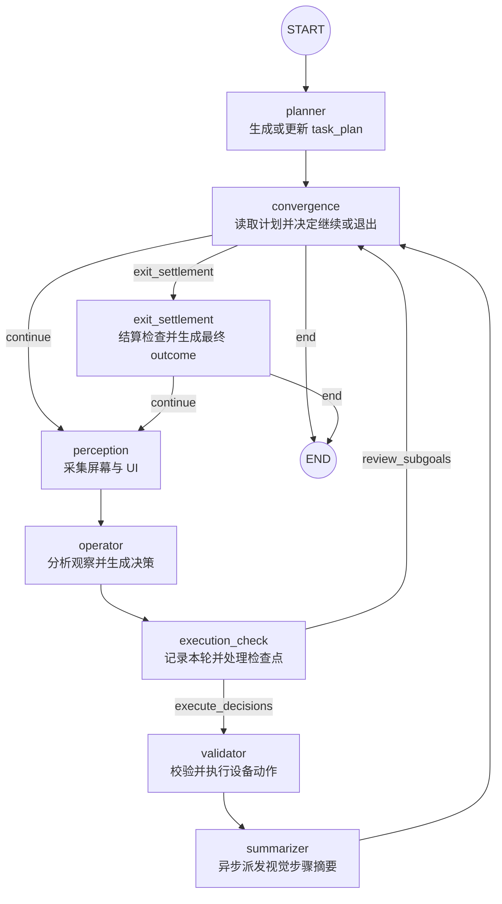

# ARTEMIS Graph 工作流源码分析

本文依据 `artemis/graph/` 的实现说明 ARTEMIS Pro 执行图是什么、节点如何连接、各节点负责什么，以及 State、检查点和退出结算如何共同影响流程。本文描述的是代码中的控制流，不是某次运行的固定步骤清单；实际路径取决于任务计划、动作决策、检查配置和执行状态。

## Graph 是什么

ARTEMIS Graph 是 Pro profile 的任务编排层。它使用 LangGraph `StateGraph` 将规划、界面感知、动作决策、动作执行、执行记录、摘要和退出审核组合成可循环的状态图。入口由 `get_graph(ctx)` 创建并编译，运行时共享同一个 `ArtemisContext`，图节点之间通过显式 `State` 字段交换数据。

这个 Graph **不是**所有 profile 共用的执行器：Flash profile 使用 `FlashRunner` 的反应式循环，不经过这里定义的 Planner、Validator 等节点链。Graph 负责控制“下一步运行什么”；设备动作仍由 Validator 经 `ActionSession` 调用动作服务执行。

## 整体拓扑

### 阅读拓扑时的几个要点

1. **Planner 是图入口。** 首轮先创建计划，再到 `convergence` 判断是否需要执行设备操作。若计划已完成且不需要退出审核，Graph 可以不经过 Perception/Operator 就结束。
2. **`convergence` 是共享路由点，不是 Agent。** 它由 `third_party/mobile_use/graph.py` 的 `add_convergence_node()` 注册为 deferred node；它本身不修改业务 State，后续路由由 `convergence_gate()` 决定。
3. **执行路径存在两种汇合。** Operator 后所有回合先进入 `execution_check`；若有有效结构化决策且检查路由允许执行，则到 Validator，再到 Summarizer。无决策或需要重新审视子目标时，直接回到 `convergence`。
4. **回到 Perception 才开始下一轮设备观察。** Validator 执行动作后不会直接让 Operator 使用旧截图；经过 Summarizer 与 `convergence` 决定继续时，再由 Perception 刷新界面。
5. **退出审核是可选的二阶段路径。** `convergence` 可以直达 `END`；若存在检查项、待结算检查或启用的最终检查，则先进入 `exit_settlement`。最终验证未通过且仍有重试预算时，可以给 Operator 反馈并回到 Perception。

## 节点职责与输入输出

| 节点 | 主要职责 | 关键实现与状态 |
| --- | --- | --- |
| `planner` | 按用户目标创建或更新任务计划（`task_plan`）；也可能在首轮补充截图。计划修改可触发异步的 Planner validation。 | `artemis/agents/planner/planner.py` 中的 `PlannerNode`；计划通过 notes 工具保存，不是图 State 中的一段对话字段。 |
| `perception` | 获取设备截图和 UI 层级；按配置运行 OCR 并融合层级；消费外部注入的指令和停止信号；将本轮观察写入 State，并将图像数据交给 DataEngine。 | `artemis/graph/perception.py::perception_node`；写入 `latest_screenshot`、`latest_ui_hierarchy`、`operator_raw_data`、`injected_instruction`、`user_stop_requested`。 |
| `operator` | 阅读目标、计划、观察、历史与反馈，决定接下来要调用的工具或设备动作；结构化设备动作决策交给下游执行。 | `artemis/agents/operator/operator.py::OperatorNode`；写入 `structured_decisions`、思考记录、索引映射、步骤 ID 等。声明的动作工具只是决策接口，不在 Operator 节点中直接完成最终设备动作。 |
| `execution_check` | 对每个有原始感知数据的 Operator 回合写入 DataEngine 步骤（不要求该回合执行过设备动作）；收割已完成的 checkpoint 结果、处理异步 Planner validation 反馈，并在记录步骤后启动排队中的 checkpoint。 | `artemis/graph/graph.py::execution_check_node`、`artemis/graph/checkpoints.py`；返回 `current_step_id`、`operator_feedback` 等。它不是最终目标审核器。 |
| `validator` | 读取 Operator 的结构化决策，进行动作前置条件检查，经 MCP `ActionSession` 执行动作，并记录执行结果、故障或未解决 incident。 | `artemis/agents/validator/validator.py::ValidatorNode`，具体执行分布在 `agents/validator/`；写入 `last_execution_result`、incident 和更新后的屏幕索引等。 |
| `summarizer` | 为刚完成的步骤派发视觉状态转移摘要，通常通过 StepMemory 后台处理；不会在主循环中等待摘要生成完毕。 | `artemis/agents/summarizer/summarizer.py::SummarizerNode`；依赖 `current_step_id`、DataEngine 记录及共享 StepMemory。 |
| `convergence` | 检查计划进度、停止信号、assert halt 和退出检查需求，选择继续循环、进入结算或结束。 | `artemis/graph/graph.py::convergence_gate`；由 `third_party/mobile_use/graph.py` 注册的 deferred convergence node 承接。 |
| `exit_settlement` | 等待并结算所有已启动的中途检查；按设置执行最终检查；必要时将失败的 verify 反馈给 Operator；最终生成结构化运行结果。 | `artemis/graph/graph.py::exit_settlement_node`、`artemis/graph/checkpoints.py`；写入 `exit_settlement_route`、`operator_feedback`、`run_outcome`。 |

`get_graph()` 中总计注册 **8 个业务节点**（planner、perception、operator、execution_check、validator、summarizer、convergence、exit_settlement），另有 LangGraph 的 `START` 和 `END` 端点。Checker 不在该列表中：中途 checkpoint 与最终 Checker 是由执行检查/退出结算逻辑调用的审核流程。

## 路由规则

### `execution_check` 分流

`execution_check_edge()` 当前按两项判断：

- `checker_success` 为真且 `structured_decisions` 非空：路由到 `validator`，执行 Operator 产生的动作。
- 否则：路由到 `convergence`，重新评估计划进度或退出条件。

`execution_check_node()` 负责记录回合、处理后台审核结果和填充反馈；不要将它与 `Checker` 的验收职责混为一谈。实际动作执行是否发生，以路由到 Validator 为准。

### `convergence_gate()` 决定继续还是离开循环

在存在 DataEngine 的正常任务路径中，路由检查大致按以下优先级进行：

1. **assert halt 已锁存：** 终止正常执行循环，进入必要的结算路径。
2. **`checker_success` 明确为 False：** 继续循环；初始值 `None` 不算失败。当前 `execution_check_node()` 默认将其置为 True；异步 Planner validation 则是 advisory review，通过 `operator_feedback` 提示 Operator，并不等同于此路由标记。
3. **任务计划缺失或不可读：** 记录问题并继续，而不是将缺失计划误判为成功。
4. **没有顶层子目标：** 不执行普通 Operator 循环；若仍有最终审核/检查项需要处理，先进入结算。
5. **所有顶层子目标已完成：** 通常进入结算或结束；若计划标记了 `[Loop:continuous]` 且用户尚未发出 `release_loop` 停止信号，则继续。
6. **计划仍有未完成子目标：** 继续到 Perception。

计划是否完成来自 `task_plan` 文件的解析结果，而非单独看某一轮 Operator 回复。外部停止信号由 Perception 消费后写入 `user_stop_requested`；该字段使用 sticky-OR reducer，因此一旦为真，后续更新不会将其清回 false。

### `exit_settlement` 的二阶段收尾

结算入口由 `_terminal_route()` 判断。只要计划包含检查项、仍有排队/运行中的 checkpoint、已有 verdict ledger，或启用了 final check，就需要经过结算；否则 Graph 可以直接结束。

1. **结算屏障：** `settle_all_checkpoints()` 等待已启动的中途检查，等待受 `settlement_timeout` 限制；未能完成的检查被记为 `unchecked`。此时不做修复副作用。尚未启动的排队项会被清理。
2. **最终审核（若启用）：** `run_final_check()` 根据用户原始目标、计划和检查项审核。未满足的 verify 项可以在 `final_check_max_attempts` 范围内回到循环，并通过 `operator_feedback` 提示 Operator；达到预算、收到用户停止或 assert halt 时，不再重试，并可能产生 `blocked` outcome。审核通过或无需重试后继续结束。

结尾的 `run_outcome` 将目标完成状态与测试项状态分开汇总：目标可为 `completed`、`partial` 或 `blocked`；检查项统计包含 `passed`、`failed`、`inconclusive`、`unchecked` 等。assert 失败和 verify 未满足的含义不同，具体折算由 `compute_test_summary()` 与 `compute_run_outcome()` 实现。

## State 与 Context：图如何传递数据

### `State` 是节点之间的显式通道

`artemis/graph/state.py::State` 是 Pydantic 模型，`extra="forbid"`：未声明的字段不能作为 State 写入。每个字段使用 LangGraph reducer，例如 `take_last` 保留最新值；`user_stop_requested` 使用 `sticky_or` 锁存停止信号。主要字段可按用途理解为：

| 数据组 | 示例字段 | 用途 |
| --- | --- | --- |
| 控制与路由 | `initial_goal`、`user_stop_requested`、`checker_success`、`exit_settlement_route` | 用户目标、持续循环停止条件和图路由信号。 |
| 感知 | `latest_screenshot`、`latest_ui_hierarchy`、`operator_raw_data` | 提供给 Planner/Operator 的界面和用于落盘的原始感知数据。 |
| 决策与执行 | `structured_decisions`、`last_execution_result`、`open_incident`、`last_closed_incident` | Operator 决策、Validator 执行反馈和待处理故障上下文。 |
| 回合与反馈 | `current_step_id`、`operator_feedback`、`operator_tool_limit_exceeded`、`subagent_calls` | 当前步骤、Checker/Planner 反馈以及工具调用元数据。 |
| 最终结果 | `run_outcome` | 退出结算写出的机器可读结果。 |

整段对话历史并不存放在图 State 中；它由 Agent/Transcript 等机制管理。设备、DataEngine、异步检查任务、计划文件、动作会话等运行期对象则由 `ArtemisContext` 持有。因此，查看某个值时应先判断它属于图 State，还是 context / DataEngine 等副作用资源。

### 可见性清单约束节点边界

`artemis/graph/visibility.py::NODE_VISIBILITY` 为每个节点声明可读和可写 State 字段。启用 `ARTEMIS_STRICT_STATE=1` 时，`strict_state()` 会在测试中拦截越权读取或就地修改；`check_update()` 可校验节点返回的字段是否在写集合内。生产环境默认不启用代理检查。变更 State 字段时应同步检查 reducer、节点可见性清单、读写节点和相关测试。

## Checkpoint 与 Checker 在 Graph 中的位置

检查能力是附着在主控制流上的支路，不是额外的 LangGraph 主干节点：

- **中途 checkpoint**：计划中的顶层子目标完成时，若启用 midway checks 且该目标包含 `on_complete` 检查项，计划编辑逻辑将 checkpoint 排队。`execution_check_node()` 先记录当前步骤，再将其作为证据锚点启动异步检查；后续回合收割已完成结果，结束时由结算屏障统一收尾。
- **最终检查**：`exit_settlement_node()` 在结算后调用 Checker 审核原始目标和最终检查项；失败的 verify 可以让图返回 Perception/Operator 修复，不通过无限追加循环实现。
- **assert / verify 区别**：两者都进入 verdict ledger，但失败政策和最终统计语义不同；assert 失败可依 `assert_failure_policy` 锁存 halt，verify 未满足可在最终审核预算内重试。
- **结论依据可追溯**：检查尝试、证据锚点、Verdict 和汇总结果由 `artemis/graph/checkpoints.py` 管理；Graph 通过 State 传递控制信号，不将全部检查明细塞进 State。

配置总开关与独立中途/最终开关定义在 `artemis/context.py::ExecutionSetup`。默认配置下中途检查关闭、最终检查开启；实际值可被运行配置覆盖。需要确认某次运行的行为时，应同时检查配置和执行上下文，不能只依据图结构推断“检查一定会执行”。

## 修改与测试从哪里入手

| 修改目标 | 主要入口 | 配套检查 |
| --- | --- | --- |
| 增加/删除节点或改边 | `artemis/graph/graph.py::get_graph` | 节点输入输出、`NODE_VISIBILITY`、图路由测试。 |
| 改变什么时候继续/退出 | `artemis/graph/graph.py::convergence_gate`、`execution_check_edge`、`exit_settlement_gate` | 检查计划状态、连续循环、停止信号、断言 halt 和最终检查预算。 |
| 增加跨节点数据 | `artemis/graph/state.py::State` | reducer、节点读写清单、State 初始化和严格可见性测试。 |
| 改变屏幕获取或外部注入 | `artemis/graph/perception.py::perception_node` | 截图/UI/OCR、step data、注入指令及停止信号。 |
| 改变步骤记录或中途 checkpoint | `artemis/graph/graph.py::execution_check_node`、`artemis/graph/checkpoints.py` | 步骤证据锚点、异步任务收割、并发上限和结束结算。 |
| 改变最终审核和结果结构 | `artemis/graph/graph.py::exit_settlement_node`、`artemis/graph/checkpoints.py` | verify 重试、assert halt、run outcome 和 ledger。 |
| 改变动作执行 | `artemis/agents/validator/`、`artemis/mcp/action_session.py` | 前置条件、动作路由、执行反馈与 incident 生命周期。 |

相关单元测试位于 `tests/unit/graph/`，重点包括：

- `test_exit_settlement.py`：收敛路由、结算/final-check 开关组合、退出结果与重试行为。
- `test_checkpoints.py`：checkpoint 排队/启动/锚定/收割和结算。
- `test_graph.py`：计划编辑包装及计划写入校验。
- `tests/unit/agents/` 下的 Planner、Operator、Validator 与 Summarizer 测试：验证各节点自身行为。

## 源码阅读顺序

1. 从 `artemis/graph/graph.py::get_graph()` 看节点注册和所有边。
2. 阅读 `convergence_gate()` 与三个 route helper，弄清正常循环和终止条件。
3. 阅读 `artemis/graph/state.py` 和 `artemis/graph/visibility.py`，确认节点之间允许传递的数据。
4. 顺序跟踪 `perception.py`、`agents/operator/`、`execution_check_node()`、`agents/validator/` 和 `agents/summarizer/`。
5. 若任务包含验收，再读 `checkpoints.py` 和 `exit_settlement_node()`，区分异步中途检查与最终检查。

## 主要文件索引

- [artemis/graph/graph.py](../artemis/graph/graph.py)：节点注册、图边、执行记录、路由和退出结算。
- [artemis/graph/state.py](../artemis/graph/state.py)：图 State 字段及 reducer。
- [artemis/graph/perception.py](../artemis/graph/perception.py)：屏幕/UI/OCR 感知及外部指令消费。
- [artemis/graph/checkpoints.py](../artemis/graph/checkpoints.py)：中途/最终检查数据模型、ledger、结算和结果汇总。
- [artemis/graph/visibility.py](../artemis/graph/visibility.py)：节点 State 可见性合同及严格检查。
- [third_party/mobile_use/graph.py](../third_party/mobile_use/graph.py)：共享的 deferred convergence node 辅助函数。
- [tests/unit/graph/](../tests/unit/graph/)：Graph、结算与 checkpoint 单元测试。
