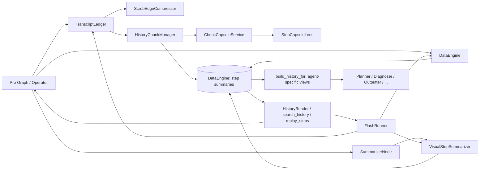
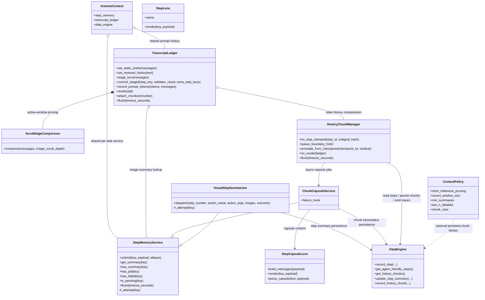
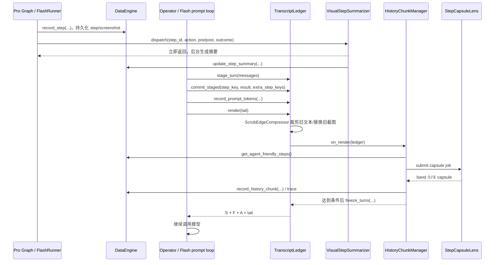

# Artemis Memory 代码解析

本文按当前代码说明 Artemis 的任务记忆（`artemis.memory`）设计：它是什么、主要组件如何协作、核心接口由谁调用，以及这套设计解决的问题。

> **范围说明：** 这里的 memory 主要是一次自动化任务中的运行上下文与历史，不是跨用户、跨任务的长期个人记忆。原始执行证据由 DataEngine 保存；memory 子系统负责整理 prompt 历史、异步生成摘要、压缩较旧的上下文，并提供按需回查入口。

## 1. 总体架构

memory 不是单个存储类，而是几层职责协作：

1. **证据层（DataEngine）**：保存原始 Step、截图、UI/OCR、动作、执行结果和 Trace。它是完整历史与回查的事实来源。
2. **单步视觉摘要（StepMemoryService + VisualStepSummarizer）**：异步把截图/动作变成简短视觉变化说明，供近期历史裁剪时替换截图。
3. **对话账本（TranscriptLedger）**：在 Pro 和 Flash 的 agent 会话内维护当前 prompt 历史；分为静态前缀、恢复/冻结历史、活动轮次和当前轮 tail。
4. **深度压缩（HistoryChunkManager）**：将较旧的已提交轮次切成历史 chunk，异步生成 capsule；上下文压力持续增大时进一步折叠成 recall-only era。
5. **读取视图与回忆工具**：`build_history_for` 按消费者生成不同详略的历史；`search_history`、`replay_steps`、截图工具按需查原始记录。



组件实现与配置入口：

- [`artemis/memory/step_memory.py`](../artemis/memory/step_memory.py)：后台任务调度基类与 `StepLens` 接口。
- [`artemis/memory/transcript.py`](../artemis/memory/transcript.py)：`TranscriptLedger`、轮次记录和 prompt 历史视图。
- [`artemis/agents/flash/context_compressor.py`](../artemis/agents/flash/context_compressor.py)：近期消息的 scrub edge 裁剪。
- [`artemis/memory/chunking.py`](../artemis/memory/chunking.py)：chunk capsule、三层历史压缩和持久化。
- [`artemis/memory/context_policy.py`](../artemis/memory/context_policy.py)：各 agent 的历史渲染策略。
- [`artemis/memory/__init__.py`](../artemis/memory/__init__.py)：公开 API 和 `ensure_step_memory` 组合入口。
- [`artemis/config/agent.py`](../artemis/config/agent.py)：`agent.memory.*` 配置。

## 2. 类图



`VisualStepSummarizer` 为兼容 Flash 既有实现，直接覆写 `_attempt`，并不继承 `StepLens`；`StepCapsuleLens` 则通过 `StepMemoryService` 中配置的 `StepLens.render()` 执行。二者共享调度、并发限制、重试和 flush 逻辑。

## 3. 关键概念

### 3.1 原始历史与 prompt 历史不是一回事

- **原始历史**：DataEngine 中的 steps、traces、截图和历史块，是可供搜索/回放的事实记录。
- **prompt 历史**：`TranscriptLedger` 为下一次模型调用组织的消息。它可以删掉过时 UI 列表、用文字摘要替换旧截图，或把多轮原始对话折叠成 chunk。
- **compiled history**：`build_history_for()` 为 Planner、Outputter 等辅助 agent 准备的短期提示文本，按策略选择摘要、近期详细步骤、milestone 和 chunk。

因此，prompt 压缩并不等于删除 DataEngine 原始记录。被 prompt 摘要替换的旧截图/轮次，仍可通过历史工具回查；少数即时消息裁剪是在当前内存账本上进行，不作为修改 DataEngine 原始 Step 的操作。

### 3.2 StepMemoryService 与 Lens

`StepMemoryService` 只管理**如何执行摘要工作**，不定义摘要语义：

- `submit(key, payload, aliases=())`：异步提交工作，不阻塞 agent 主路径。
- `get_summary(key)`、`has_summary(key)`、`has_job(key)`、`has_failed(key)`、`is_pending(key)`：按 canonical key 或 alias 查询状态。
- `flush(timeout_seconds=None)`：有界等待任务；超时取消仍在运行的摘要任务。
- `StepLens.render(key, payload)`：定义一次工作如何产生文本；异常或空结果视为失败尝试。

服务保证最大并发、有限重试和有界退出等待。默认每次失败会按短退避重试，最多执行 `1 + retry_limit` 次。任务运行在 `detached_trace()` 中，避免摘要模型调用被错误归因到提交摘要的 operator step。

### 3.3 两种摘要粒度

| 粒度 | 实现 | 输入与输出 | 用途 |
|---|---|---|---|
| 单步视觉变化 | `VisualStepSummarizer` | 动作、执行结果、前后截图及 operator focus → 单步摘要 | 在近期历史里替换较旧的截图；摘要也写回对应 Step。 |
| 多步 chunk capsule | `StepCapsuleLens` | 一个已完成 segment 的轮次 transcript 和 Step 事实 → capsule JSON | 将一段旧对话压缩为意图、行为、效果、状态与区间摘要等内容。 |

这两种摘要不能互相代替：单步 lens 描述视觉变化；chunk lens 负责保留跨多步的任务意图与过程脉络。

### 3.4 TranscriptLedger 的 S/F/A/T 区域

`TranscriptLedger` 为一条 session 保存 prompt transcript：

- **S — Static prefix**：静态系统提示，只安装一次。
- **F — Frozen history**：进程重启后恢复的旧历史，以及已压缩的 chunk/era。
- **A — Active window**：已提交的原始轮次，按轮追加。
- **T — Tail**：当前轮最新观测和临时提示，每轮重新构造；只有轮次完成后才提交到 A。

`stage_turn()` 暂存刚完成的对话；待 step ID 和执行/验证结果可用时，`commit_staged()` 再将它提交至 A 并绑定 step keys。Flash 一轮可含多个 action/step，因此可用 `extra_step_keys` 补上该轮所有 Step ID。

当前 operator 的 prompt 由 `render(tail)` 产生，形状为 `S + F + A + T`。Ledger 记录 operator 自己最近的 prompt token 数，并根据 provider usage 对字符/token 比例做校准；chunk 阈值不使用全局 session token meter，因为其他 agent 的模型调用会覆盖该 meter。

### 3.5 Scrub edge：先裁近期细节

`ScrubEdgeCompressor` 对活动窗口采用两条边：

1. **文本边**：当旧观测后面已有更新的观测时，默认移除重型 UI 列表、计划复述和标记为 ephemeral 的单轮消息块，避免旧屏幕的元素索引被误用。
2. **截图边**：当观测达到配置深度后，将截图原位替换为对应 step 的视觉摘要；摘要仍在生成时给一个 grace window，之后保留带 Step 引用的 pending 占位；生成失败时放 unavailable 占位。

消息顺序和工具调用/回复配对保持不变。已经冻结的内容不因晚到的摘要而回填修改。压缩只作用于 prompt 使用的消息视图，不抹掉 DataEngine 中的截图与 Step。

### 3.6 Chunk、三段信息与 Era

`HistoryChunkManager` 在 TranscriptLedger render 时评估压缩触发条件。segment 可以由 subgoal/milestone 切换、大小阈值或 context pressure 形成；至少保留一个最近 turn 滑动窗口，不把它压入 chunk。

每个 chunk 有三段：

1. **Band ①：Synopsis & effects**：做什么、实际做了什么、留下什么影响、进入/退出状态、已验证事实、未解决项、失败路径和重要实体等结构化 capsule。
2. **Band ②：Compressed step summary**：按 step 区间写的过程摘要；interval 覆盖范围会机械校验，不允许缺步或重叠。
3. **Band ③：Step action ledger**：从 DataEngine Step 机械生成的动作/结果清单，不依赖 LLM；用户注入指令行会被保留。

Chunk 完整摘要准备好之前，原始轮次留在活动 transcript 中；capsule 失败时保留原始文本并允许之后重试。到达 hard context 阈值才允许紧急强制折叠 pending chunk。

较老的 chunk 可以并入 **Era**。如果达到更高压缩压力或 era 保留上限，旧 era 进入 **recall-only**：prompt 保留 period 概述和每步最小索引，具体内容通过 `search_history` 或 replay 工具回查。L3 fold 是单向的 prompt 视图变更，不删除原始 step 数据。

### 3.7 Agent-specific ContextPolicy

同一段历史对不同 agent 的用途不同，所以 `ContextPolicy` 控制 `build_history_for()` 的渲染策略：

- Operator：按当前 milestone 和最近窗口组织，保留其继续操作所需的细节。
- Planner：聚焦近期执行进度，减少与计划修改无关的旧细节。
- Outputter / HistoryAnalyzer：倾向查看较完整历史，chunk 使用 full 视图。
- Diagnoser / Committee：可使用 milestone whitelist 过滤。
- `operator_cold_start`：进程恢复时从原始 Step 历史重建初始 transcript，不直接套用 chunk 概述。

chunk 视图可为 `full`、`digest` 或禁用：digest 会显示 chunk 的 band ①/②，并把 band ③换成 `search_history` 提示。

## 4. 核心接口与调用位置

### 4.1 服务与单步摘要接口

| 接口 | 调用方 | 用途 |
|---|---|---|
| `ensure_step_memory(ctx)` | [`SummarizerNode._dispatch_visual_summary()`](../artemis/agents/summarizer/summarizer.py)；Pro [`Operator._ensure_transcript_ledger()`](../artemis/agents/operator/operator.py) | 取得 `ctx.step_memory` 上共享实例；必要时创建并挂到 context。 |
| `VisualStepSummarizer.dispatch(...)` | [`SummarizerNode`](../artemis/agents/summarizer/summarizer.py)；Flash [`FlashRunner`](../artemis/agents/flash/runner.py) | 按 DataEngine Step ID 提交单步视觉摘要。Flash 也可传 `action_key` 作为 alias，兼容 transcript 消息上的 tool-call ID。 |
| `StepMemoryService.submit(key, payload, aliases)` | `VisualStepSummarizer.dispatch()`；`HistoryChunkManager` | 把摘要作业加入有界后台调度。调用者不等待模型返回。 |
| `get_summary()` / `has_summary()` / `has_job()` / `has_failed()` / `is_pending()` | [`ScrubEdgeCompressor`](../artemis/agents/flash/context_compressor.py) | 判断旧截图应替换为摘要、暂时保留，还是显示 pending/failed 占位。 |
| `flush(timeout_seconds)` | [`ArtemisContext.__aexit__()`](../artemis/context.py)；FlashRunner 结束路径 | 有界排空后台摘要，避免任务退出时丢掉已启动工作或无限等待。 |

Pro 的主要单步摘要调用链：

```text
graph.SummarizerNode
  -> ensure_step_memory(ctx)
  -> VisualStepSummarizer.dispatch(step_id, action, screenshots, outcome, focus)
  -> StepMemoryService.submit(...)
  -> VisualStepSummarizer._attempt(...)
  -> DataEngine.update_step_summary(...)
  -> TranscriptLedger / ScrubEdgeCompressor 读取 summary
```

Pro 每步的图片通常由 `DataEngine` 读取；FlashRunner 在 action 完成后 dispatch。两种路径复用相同的服务语义。

### 4.2 TranscriptLedger 接口

| 接口 | 调用方 | 用途 |
|---|---|---|
| `TranscriptLedger(...)` | [`Operator._ensure_transcript_ledger()`](../artemis/agents/operator/operator.py)、[`FlashRunner._build_ledger()`](../artemis/agents/flash/runner.py) | 为当前 session 创建 prompt 历史账本，并接入单步摘要服务。 |
| `set_static_prefix(messages)` | Operator / FlashRunner 初始化 transcript | 固定系统提示区 S。 |
| `set_restored_history(text)` | Operator 冷启动恢复路径 | 进程重启但 DataEngine 中已有 steps 时，把已有历史放到 F 区。 |
| `stage_turn(messages)` | Operator 的 `_stage_transcript_turn()`；FlashRunner turn loop | 暂存一轮完成后的消息；等待 step id 和执行结果就绪。 |
| `commit_staged(step_key, validator_result, extra_step_keys)` | Operator 下一轮建 prompt；FlashRunner `_commit_turn()` | 将 staged 轮次提交至 A，绑定摘要 key 和多 action step keys。 |
| `record_prompt_tokens(tokens, messages)` | Operator `_invoke_llm_loop()`；FlashRunner | 保存当前 agent 的 prompt 使用量，为动态压缩阈值提供依据，也用于估算字符/token 比。 |
| `render(tail)` | Operator `_build_prompt_transcript()`；FlashRunner turn loop | 执行一次文本/图片 scrub 与 chunk 评估，并返回完整 prompt 消息序列。 |
| `attach_chunker(chunker)` / `chunker.on_step_stamped(...)` | Operator/Flash wiring；Pro `execution_check_node`、FlashRunner | 把里程碑 stamp 送给 chunk 管理器，以识别 segment 边界。 |

Pro transcript 由 [`Operator._build_prompt()`](../artemis/agents/operator/operator.py) 根据 `memory.transcript.enabled` 分支接入；关闭时回退到旧的 per-turn prompt 构建路径。FlashRunner 自己用 ledger 管理 reactive loop 的 transcript。

### 4.3 Chunking 与摘要 lens 接口

| 接口 | 调用方 | 用途 |
|---|---|---|
| `HistoryChunkManager.on_step_stamped(step_id, subgoal_hash)` | Pro [`execution_check_node`](../artemis/graph/graph.py)；FlashRunner `_notify_history_chunker()` | 为已记录步骤标注当前 subgoal，供后续按 segment 切分。 |
| `HistoryChunkManager.queue_boundary_hint()` | 图中的计划/里程碑边界通知 | 暂存可能的边界提示；需下一条 stamped step 确认 hash 改变后才闭合 segment。 |
| `HistoryChunkManager.on_render(ledger)` | `TranscriptLedger.render()` | 读取 prompt token 阈值，关闭待压缩 segment、收取 capsule 结果并决定是否替换原文。 |
| `StepCapsuleLens.render(key, payload)` | `ChunkCapsuleService` | 从轮次 transcript 和结构化 step 事实生成 band ①/② capsule。Band ③由程序机械生成。 |
| `HistoryChunkManager.annotate_from_checkpoint(...)` | [`graph/checkpoints.py`](../artemis/graph/checkpoints.py) | 检查结果稍后才到达时，对已压缩 chunk 增加后验标注并创建新版本。 |
| `HistoryChunkManager.flush()` | [`ArtemisContext.__aexit__()`](../artemis/context.py) | 等待 capsule 作业，并将已完成结果持久化；不强制重写 prompt 的冻结区。 |

### 4.4 编译历史与回查接口

`build_history_for(agent, task_plan, steps, current_subgoal_hash, ...)` 在 [`context_policy.py`](../artemis/memory/context_policy.py) 中组合 `ContextPolicy` 和 `build_plan_and_history()`：

| 使用处 | policy key | 目的 |
|---|---|---|
| [`Operator._build_plan_and_history()`](../artemis/agents/operator/operator.py) | `operator` | 构造 operator 当前轮的计划/历史上下文。 |
| Operator 冷启动恢复 | `operator_cold_start` | 用现存 step 记录恢复 transcript。 |
| [`planner.py`](../artemis/agents/planner/planner.py) | `planner` | 给 Planner 提供压缩后的执行背景。 |
| [`diagnoser.py`](../artemis/agents/diagnoser/diagnoser.py) | `diagnoser` | 限定在相关 subgoal 的失败/执行信息。 |
| [`outputter.py`](../artemis/agents/outputter/outputter.py) | `outputter` | 生成最终输出时查看完整度较高的历史。 |
| [`history_analyzer.py`](../artemis/agents/history_analyzer/history_analyzer.py) | `history_analyzer` | 分析历史全貌。 |
| [`committee_tool.py`](../artemis/tools/committee_tool.py) | `committee` | 给委员会/讨论工具提供 milestone 过滤后的历史。 |

另外，Operator 与 Flash 的历史工具声明由 [`tools/history/__init__.py`](../artemis/tools/history/__init__.py) 管理：

- `search_history`：确定性检索动作、结果、summary、tool calls、notes 和近期截图的 OCR/UI 文本；可限定 step 范围。
- `replay_steps`：按预算返回指定步骤的可读执行过程。
- `get_step_screenshot` 等截图接口：取原始前/后截图。

这些工具解决了“prompt 里不可能永久放下所有历史”的问题：压缩历史中提示可检索范围，真正需要细节时再按需加载原始记录。

## 5. 端到端流程



实际异步顺序允许摘要晚于 prompt render；pending grace 和原始轮次保留机制避免把尚未就绪的摘要当作事实。出现 hard context pressure 时，才允许强制折叠 pending capsule。

## 6. 配置摘要

配置模型在 [`config/agent.py`](../artemis/config/agent.py) 的 `MemoryConfig` 下：

| 配置组 | 主要作用 | 代码中的默认值示例 |
|---|---|---|
| `memory.runtime` | 单步/capsule job 的最大并发、重试、flush 时限 | 并发 2、重试 3 次、flush 30 秒。 |
| `memory.transcript` | 是否启用 Pro transcript；近期文本/截图 scrub 深度；token budget 和压缩阈值 | transcript 启用；图片深度 3，低压力时可放宽到 6；budget 80k，start/soft/hard 比例 0.35/0.7/0.9。 |
| `memory.chunking` | chunk 最小/最大步骤、源 token 触发值、模型和保留数 | min 3、max 12、约 2000 source tokens 触发、最多保留 8 个 chunk。 |
| `memory.recall` | `search_history` 是否启用及响应限制 | 启用；最多 5 条结果，默认扫描最近 150 步的屏幕文本。 |
| `memory.replay` | 单次 replay 步数与响应 token 上限 | 最多 5 步、估算 12k tokens。 |
| `memory.policies` | 按 agent 覆盖 `ContextPolicy` | 默认空，使用内置策略。 |

其中 Pro Operator 的 transcript flag 是回滚开关：关闭后使用 legacy prompt 构造路径；辅助 agent 的 compiled history 仍然由各自 `ContextPolicy` 控制。配置定义与默认值以当前代码为准，运行时配置文件可覆盖。

## 7. 为什么这么设计，解决什么问题

### 问题：prompt 历史随任务变长

持续执行任务会不断累积截图、UI 树、动作和工具结果，直接全量保留会增加 token 消耗、请求延迟，并最终超过模型上下文限制。

**设计应对：** 短期先通过 scrub edge 去掉重复/过时的 UI 细节和旧截图；长期再按 milestone、step 数量和 context pressure 生成 chunk；高压时折叠成 era。

### 问题：异步摘要慢或失败，不能卡住设备操作

摘要只是上下文优化，不应让一个慢模型请求阻塞主自动化；但若太早丢弃截图或 transcript，摘要失败会永久损失证据。

**设计应对：** StepMemoryService 非阻塞派发、有界并发/重试/flush；摘要未 ready 时尽量保留原始 turn，失败有显式状态，pending 占位指向原始 step；只有硬阈值才走强制降级路径。

### 问题：摘要可能漏掉动作细节或编造事实

纯 LLM 总结有损，也可能遗漏一个动作、模糊时间线或把推测写成事实。

**设计应对：** chunk 使用“模型生成叙述 + 程序生成动作账本”的组合。Band ①/② 提供语义概括，Band ③机械列出每步动作与结果；band ② 的区间覆盖由程序检查；完整 step 记录仍可通过检索/replay 找回。

### 问题：不同 agent 需要不同粒度的历史

Operator 需要最近几轮可操作细节；Planner 主要看执行进度；Outputter 和 HistoryAnalyzer 更需要完整上下文；Diagnoser/Committee 可能只关心指定 milestone。

**设计应对：** `ContextPolicy` 与 `build_history_for()` 将历史编译策略集中管理，避免每个 agent 重复实现过滤/详略控制。

### 问题：新旧代码、重启恢复与 Pro/Flash 路径不同

Pro 以图的 step 为主，Flash 一轮可能包含多个 action；进程重启后，内存 transcript 不复存在；关闭新 transcript 后还应能回退。

**设计应对：** Step ID 是摘要和 chunk 的 canonical key，tool-call ID 可作为兼容 alias；TranscriptLedger 通过 `extra_step_keys` 支持一个 Flash turn 多步；冷启动可从 DataEngine step 记录重建；Pro transcript 由配置开关控制，`ctx.step_memory` 作为 Pro/Flash 共用组合根。

## 8. 阅读代码的建议顺序

1. 从 [`memory/__init__.py`](../artemis/memory/__init__.py) 看公开组件与 `ensure_step_memory()`。
2. 看 [`step_memory.py`](../artemis/memory/step_memory.py) 理解任务调度、重试、keying、flush。
3. 看 [`transcript.py`](../artemis/memory/transcript.py) 与 [`context_compressor.py`](../artemis/agents/flash/context_compressor.py) 理解单轮消息如何进入 prompt、何时裁剪。
4. 看 [`chunking.py`](../artemis/memory/chunking.py) 理解多步 capsule、压缩触发、ready gating、Era 和持久化。
5. 对照 [`operator.py`](../artemis/agents/operator/operator.py)、[`runner.py`](../artemis/agents/flash/runner.py) 看 Pro/Flash 如何接入。
6. 看 [`context_policy.py`](../artemis/memory/context_policy.py) 与 agent 调用点，再看 history tools 如何从原始记录回查。
