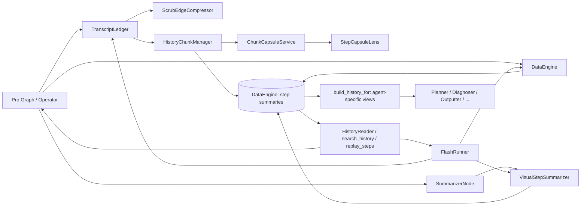
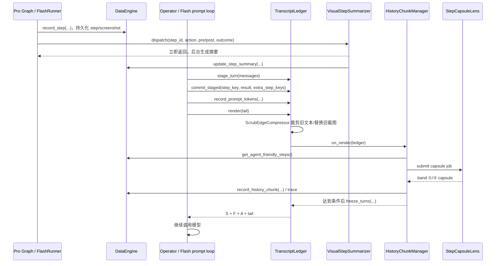

# Artemis Memory 代码解析

本文按当前代码说明 Artemis 的任务记忆（`artemis.memory`）设计：它是什么、主要组件如何协作、核心接口由谁调用，以及这套设计解决的问题。

> **范围说明：** 这里的 memory 主要是一次自动化任务中的运行上下文与历史，不是跨用户、跨任务的长期个人记忆。原始执行证据由 DataEngine 保存；memory 子系统负责整理 prompt 历史、异步生成摘要、压缩较旧的上下文，并提供按需回查入口。

## 摘要：设计、问题与原因

- **用什么设计：** 采用“原始证据持久化 + prompt 分层视图 + 异步分级压缩 + 按需回查”的组合设计。DataEngine 保留完整 Step、截图和 Trace；TranscriptLedger 组织当前对话；单步视觉摘要和多步 chunk capsule 按需异步生成；ContextPolicy 为不同 agent 挑选合适的历史视图。
- **解决什么问题：** 长任务会累积大量截图、UI 内容、动作和推理，完整历史直接塞入每次 prompt 会造成上下文膨胀、成本和延迟上升，也可能超过模型上下文限制；而只保留摘要又会丢失核查细节所需的证据。
- **为什么这么做：** 把“事实保存”和“模型可读上下文”分开：原始数据不因压缩而删除，近期关键步骤保留细节，较旧历史逐步摘要，精确证据再通过搜索或 replay 获取。摘要放在后台生成，避免阻塞操作主流程；各 agent 使用不同历史视图，避免无关历史干扰。

## 1. 总体架构

memory 不是单个存储类，而是几层职责协作：

1. **证据层（DataEngine）**：保存原始 Step、截图、UI/OCR、动作、执行结果和 Trace。它是完整历史与回查的事实来源。
2. **单步视觉摘要（StepMemoryService + VisualStepSummarizer）**：异步把截图/动作变成简短视觉变化说明，供近期历史裁剪时替换截图。
3. **对话账本（TranscriptLedger）**：在 Pro 和 Flash 的 agent 会话内维护当前 prompt 历史；分为静态前缀、恢复/冻结历史、活动轮次和当前轮 tail。
4. **深度压缩（HistoryChunkManager）**：将较旧的已提交轮次切成历史 chunk，异步生成 capsule；上下文压力持续增大时进一步折叠成 recall-only era。
5. **读取视图与回忆工具**：`build_history_for` 按消费者生成不同详略的历史；`search_history`、`replay_steps`、截图工具按需查原始记录。



组件实现与配置入口：

- [`artemis/memory/step_memory.py`](../artemis/memory/step_memory.py)：后台任务调度基类与 `StepLens` 接口。
- [`artemis/memory/transcript.py`](../artemis/memory/transcript.py)：`TranscriptLedger`、轮次记录和 prompt 历史视图。
- [`artemis/agents/flash/context_compressor.py`](../artemis/agents/flash/context_compressor.py)：近期消息的 scrub edge 裁剪。
- [`artemis/memory/chunking.py`](../artemis/memory/chunking.py)：chunk capsule、三层历史压缩和持久化。
- [`artemis/memory/context_policy.py`](../artemis/memory/context_policy.py)：各 agent 的历史渲染策略。
- [`artemis/memory/__init__.py`](../artemis/memory/__init__.py)：公开 API 和 `ensure_step_memory` 组合入口。
- [`artemis/config/agent.py`](../artemis/config/agent.py)：`agent.memory.*` 配置。

## 2. 类图


`VisualStepSummarizer` 为兼容 Flash 既有实现，直接覆写 `_attempt`，并不继承 `StepLens`；`StepCapsuleLens` 则通过 `StepMemoryService` 中配置的 `StepLens.render()` 执行。二者共享调度、并发限制、重试和 flush 逻辑。

## 3. 关键概念

### 3.1 原始历史与 prompt 历史不是一回事

- **原始历史**：DataEngine 中的 steps、traces、截图和历史块，是可供搜索/回放的事实记录。
- **prompt 历史**：`TranscriptLedger` 为下一次模型调用组织的消息。它可以删掉过时 UI 列表、用文字摘要替换旧截图，或把多轮原始对话折叠成 chunk。
- **compiled history**：`build_history_for()` 为 Planner、Outputter 等辅助 agent 准备的短期提示文本，按策略选择摘要、近期详细步骤、milestone 和 chunk。

因此，prompt 压缩并不等于删除 DataEngine 原始记录。被 prompt 摘要替换的旧截图/轮次，仍可通过历史工具回查；少数即时消息裁剪是在当前内存账本上进行，不作为修改 DataEngine 原始 Step 的操作。

### 3.2 StepMemoryService 与 Lens

`StepMemoryService` 只管理**如何执行摘要工作**，不定义摘要语义：

- `submit(key, payload, aliases=())`：异步提交工作，不阻塞 agent 主路径。
- `get_summary(key)`、`has_summary(key)`、`has_job(key)`、`has_failed(key)`、`is_pending(key)`：按 canonical key 或 alias 查询状态。
- `flush(timeout_seconds=None)`：有界等待任务；超时取消仍在运行的摘要任务。
- `StepLens.render(key, payload)`：定义一次工作如何产生文本；异常或空结果视为失败尝试。

服务保证最大并发、有限重试和有界退出等待。默认每次失败会按短退避重试，最多执行 `1 + retry_limit` 次。任务运行在 `detached_trace()` 中，避免摘要模型调用被错误归因到提交摘要的 operator step。

### 3.3 两种摘要粒度

| 粒度 | 实现 | 输入与输出 | 用途 |
|---|---|---|---|
| 单步视觉变化 | `VisualStepSummarizer` | 动作、执行结果、前后截图及 operator focus → 单步摘要 | 在近期历史里替换较旧的截图；摘要也写回对应 Step。 |
| 多步 chunk capsule | `StepCapsuleLens` | 一个已完成 segment 的轮次 transcript 和 Step 事实 → capsule JSON | 将一段旧对话压缩为意图、行为、效果、状态与区间摘要等内容。 |

这两种摘要不能互相代替：单步 lens 描述视觉变化；chunk lens 负责保留跨多步的任务意图与过程脉络。

#### 哪些记忆步骤会调用 LLM？

Memory 中只有“把事实转成自然语言摘要/胶囊”的生成步骤需要 LLM；调度、筛选、裁剪、账本和存储本身都是程序逻辑。

| 阶段 | 是否调用 LLM | 具体行为与触发条件 |
|---|---|---|
| 单步视觉摘要 `VisualStepSummarizer` | **会** | 开启摘要且成功派发任务后，后台将动作、执行结果和前/后截图交给视觉模型生成该 Step 的变化摘要。Pro 和 Flash 都可能走此路径；它异步执行，不阻塞主操作循环。 |
| 多步 capsule `StepCapsuleLens` | **会** | segment 到达边界/压缩触发条件并派发 capsule job 后，后台模型一次生成 band ①/②（结构化概述与区间摘要）。若输出校验失败会重试；配置了 fallback 时也可能切换模型。短任务、未触发压缩或未成功派发时，不会因此发生这次调用。 |
| `StepMemoryService` 调度 | **自身不调用** | 管理并发、重试、任务状态和 flush；它调用 lens 的实现，而 LLM 调用发生在具体 lens 内。 |
| Band ③动作账本 | **不需要** | 从 DataEngine Step 的动作、结果等字段按固定规则拼接；不由模型生成。 |
| segment 划分、subgoal/milestone 标注、chunk 范围和压缩触发判断 | **不需要** | 解析计划/hash、比较步骤范围和阈值，由普通代码完成。 |
| `TranscriptLedger` / scrub edge | **不需要** | stage/commit/render、查摘要状态、按深度移除旧 UI 文本或用已有摘要替换截图，均为确定性处理；这里消费摘要，不生成摘要。 |
| `ContextPolicy` / `build_history_for()` | **不需要** | 按策略筛选步骤、选择详略、注入已有 chunk 并拼出历史文本，不在函数内部调用模型。 |
| DataEngine 持久化、历史搜索和 replay | **不需要** | 写入/读取记录及按条件检索是存储和查询操作。Agent 可以在之后根据这些结果再调用 LLM，但那是调用方的推理，不是这些 Memory/存储接口自行发起的调用。 |

因此，“memory 流程里出现模型”不等于每一步都要模型：原始证据采集、整理、裁剪、筛选和回查不依赖 LLM；只有可选的单步视觉摘要和满足条件后触发的多步 capsule 生成需要 LLM。即使摘要未就绪或失败，原始 Step/截图仍保留，prompt 可暂时保留原始内容或展示 pending/unavailable 占位。

### 3.4 TranscriptLedger 的 S/F/A/T 区域

`TranscriptLedger` 为一条 session 保存 prompt transcript：

- **S — Static prefix**：静态系统提示，只安装一次。
- **F — Frozen history**：进程重启后恢复的旧历史，以及已压缩的 chunk/era。
- **A — Active window**：已提交的原始轮次，按轮追加。
- **T — Tail**：当前轮最新观测和临时提示，每轮重新构造；只有轮次完成后才提交到 A。

`stage_turn()` 暂存刚完成的对话；待 step ID 和执行/验证结果可用时，`commit_staged()` 再将它提交至 A 并绑定 step keys。Flash 一轮可含多个 action/step，因此可用 `extra_step_keys` 补上该轮所有 Step ID。

当前 operator 的 prompt 由 `render(tail)` 产生，形状为 `S + F + A + T`。Ledger 记录 operator 自己最近的 prompt token 数，并根据 provider usage 对字符/token 比例做校准；chunk 阈值不使用全局 session token meter，因为其他 agent 的模型调用会覆盖该 meter。

### 3.5 Scrub edge：先裁近期细节

`ScrubEdgeCompressor` 对活动窗口采用两条边：

1. **文本边**：当旧观测后面已有更新的观测时，默认移除重型 UI 列表、计划复述和标记为 ephemeral 的单轮消息块，避免旧屏幕的元素索引被误用。
2. **截图边**：当观测达到配置深度后，将截图原位替换为对应 step 的视觉摘要；摘要仍在生成时给一个 grace window，之后保留带 Step 引用的 pending 占位；生成失败时放 unavailable 占位。

消息顺序和工具调用/回复配对保持不变。已经冻结的内容不因晚到的摘要而回填修改。压缩只作用于 prompt 使用的消息视图，不抹掉 DataEngine 中的截图与 Step。

### 3.6 Chunk、三段信息与 Era

`HistoryChunkManager` 在 TranscriptLedger render 时评估压缩触发条件。segment 可以由 subgoal/milestone 切换、大小阈值或 context pressure 形成；至少保留一个最近 turn 滑动窗口，不把它压入 chunk。

每个 chunk 有三段：

1. **Band ①：Synopsis & effects**：做什么、实际做了什么、留下什么影响、进入/退出状态、已验证事实、未解决项、失败路径和重要实体等结构化 capsule。
2. **Band ②：Compressed step summary**：按 step 区间写的过程摘要；interval 覆盖范围会机械校验，不允许缺步或重叠。
3. **Band ③：Step action ledger**：从 DataEngine Step 机械生成的动作/结果清单，不依赖 LLM；用户注入指令行会被保留。

Chunk 完整摘要准备好之前，原始轮次留在活动 transcript 中；capsule 失败时保留原始文本并允许之后重试。到达 hard context 阈值才允许紧急强制折叠 pending chunk。

较老的 chunk 可以并入 **Era**。如果达到更高压缩压力或 era 保留上限，旧 era 进入 **recall-only**：prompt 保留 period 概述和每步最小索引，具体内容通过 `search_history` 或 replay 工具回查。L3 fold 是单向的 prompt 视图变更，不删除原始 step 数据。

#### 术语快速解释

| 术语 | 通俗解释 | 它不是 |
|---|---|---|
| **scrub edge** | 沿着最近对话往回移动的“裁剪线”。越过文本边后，旧 UI 树/临时提示会被剥掉；越过截图边后，旧图片换成摘要或可回查占位。 | 不是删除数据库中的截图或 Step。 |
| **segment** | 一段连续的任务步骤，通常属于同一个活动 subgoal/milestone；也是待压缩的输入范围。 | 不是单个 Step，也不是模型本身。 |
| **chunk** | segment 压缩后的记录单元，带步骤范围、来源 Step IDs、三段内容和版本。 | 不是唯一原始历史；原始 Step 仍在 DataEngine。 |
| **capsule** | `StepCapsuleLens` 对一个 chunk 生成的结构化摘要，主要形成 band ①/②。 | 不负责机械动作账本；band ③由代码生成。 |
| **era** | 多个旧 chunk 的合并展示单元。普通 era 仍带合并摘要、标题和各 chunk 的步骤账本。 | 不是新的 session 或执行阶段。 |
| **recall-only** | 更高压缩级别：prompt 只留 period 概述、步骤号/时间/动作最小索引和 `search_history` 指引。 | 不代表数据库中的旧内容被删除；细节仍可检索/回放。 |
| **full / digest** | 给辅助 agent 的 chunk 展示形式。full 包含 band ③；digest 省略长账本，改放按 Step 范围搜索的提示。 | 不改变持久化的 chunk 原文。 |

segment 和 chunk 的边界/结构可以这样理解：

```text
Segment（内存中的待处理步骤范围）
  = 一串连续的已提交 turn，通常属于同一 subgoal hash
  关闭原因 trigger = milestone | size | pressure
  关闭前：turn 仍是原始 transcript
  关闭后：生成 ChunkState，并异步请求 capsule

ChunkState（运行时镜像）            HistoryChunkRecord（SQLite 持久化）
  ordinal                              chunk_id / session_id
  start_step_number                    start/end_step_number
  source_step_ids                      start/end_step_id
  subgoal_hash / milestone_label       subgoal_hash / version / status
  band1 / band2 / band3                band1 / band2 / band3
  status / annotations                 rendered_text / created_at
```

`HistoryChunkRecord` 是持久化模型；上面的 `ChunkState` 是压缩器的内存状态，字段并非一一相同。每次状态或 checkpoint annotation 更新会增加一个新版本，而不是把历史 chunk 原地抹掉。

#### 一个具体例子：同一段历史怎样逐步变短

假设用户要求“打开购物应用，搜索咖啡机并查看价格”。DataEngine 原始记录大致如下（示例数据，不是固定格式）：

```text
Step 1, T+00:03
  pre screenshot: images/91ab...jpg
  UI/OCR: 首页，搜索框显示“搜索商品”
  action: click(search_box)
  result: dispatched

Step 2, T+00:06
  pre screenshot: images/5ce2...jpg
  UI/OCR: 搜索输入框已打开
  action: input_text("咖啡机")
  result: dispatched

Step 3, T+00:09
  pre screenshot: images/7f31...jpg
  UI/OCR: 商品结果页，显示多个咖啡机及价格
  action: press_key(ENTER)
  result: dispatched
```

**阶段 A — scrub edge：** 新观测出现后，旧消息先去掉过期 UI 元素列表和每轮临时提示。旧 screenshot 达到图片深度后，如果视觉摘要已就绪，可被原位替换为：

```text
--- Historical Visual Transition ---
我打开商品搜索，输入“咖啡机”并提交，随后看到商品结果列表及对应价格。
```

如果摘要还没就绪，图片会在 grace window 内保留；之后可替换为“摘要待生成/不可用，证据见 DataEngine Step 1”。最近的活动窗口因此保留细节，较旧观察不再一直占用图像 token。

**阶段 B — segment 与 capsule：** 若 Step 1–3 属于同一 milestone，例如“搜索商品”，它们可成为同一个 segment。chunk capsule 可能类似：

```json
{
  "doing": "查找并比较咖啡机商品",
  "did": "打开搜索、提交“咖啡机”查询并到达结果列表",
  "effect": "当前页面显示多个商品及价格",
  "entry_state": "购物应用首页",
  "exit_state": "咖啡机搜索结果页",
  "verified_facts": ["搜索结果页可见商品价格"],
  "unresolved": ["尚未选定具体商品"],
  "failed_paths": [],
  "important_entities": ["咖啡机"],
  "intervals": [
    {"start_step": 1, "end_step": 3, "text": "打开搜索并进入咖啡机结果列表"}
  ]
}
```

这份 JSON 是 **Band ① 的结构化数据**，其中 `intervals` 同时提供 Band ② 的区间摘要内容。存储/渲染后的 chunk 大致如下（字段和值是示例；标题与呈现结构按代码生成）：

```text
① Synopsis & effects
  What this segment was doing: 查找并比较咖啡机商品
  What was actually done: 打开搜索、提交“咖啡机”查询并到达结果列表
  Effects / left behind: 当前页面显示多个商品及价格
  Entry: 购物应用首页    Exit: 咖啡机搜索结果页
  Verified: 搜索结果页可见商品价格
  Unresolved: 尚未选定具体商品
  Failed paths: -
  Entities: 咖啡机

② Compressed step summary
  - Steps 1–3: 打开搜索并进入咖啡机结果列表
```

**怎么区分 ① 和 ②？** Band ①回答“这段整体在做什么、前后状态和结果是什么”；Band ②按连续步骤区间简述“过程大致怎么推进”。本例只有一个区间覆盖 Step 1–3；如果中间有不同阶段，可能拆成多个相邻 interval，例如 `Steps 1–2: 打开搜索并输入查询`、`Step 3: 显示结果列表`。LLM 产出区间文本，程序检查所有 interval 是否完整覆盖 chunk 的步骤范围且没有重叠，再由代码排版成 Band ②。

Band ③与前两段不同：它不是概述，而是逐 Step 保留动作和执行结果。该段由 DataEngine 步骤记录按固定格式机械生成，不由 LLM 改写：

```text
③ Step action ledger
- Step 1 (T+00:03): click(search_box) -> dispatched
- Step 2 (T+00:06): input_text("咖啡机") -> dispatched
- Step 3 (T+00:09): press_key(ENTER) -> dispatched
```

如果某一步记录了用户注入指令，Band ③还会加一行原文，例如：

```text
  User @ Step 2: "只查看价格低于 1000 元的商品"
```

一句话记忆：**Band ①看整体结论和状态，Band ②看分段过程，Band ③查逐步动作/结果证据。** ①/②是供快速阅读的压缩内容；③更接近可审计的动作索引，但需要截图或完整过程时仍应通过 DataEngine 的历史/replay 接口回查。

**阶段 C — Era：** 多个 chunk 可以合成普通 era：合并 verified facts，按 chunk 保留标题和账本。再遇到更强 context 压力或 era 数量上限时，旧 era 可变为 recall-only：

```text
[Era 1 | Steps 1–24 | T+00:03 → T+02:10]
查找并比较家电商品。Did: 搜索咖啡机并查看价格; 打开商品详情。
Verified: 搜索结果页显示价格; 商品详情页显示库存。
(Step-level ledger via search_history for steps 1–24)
- Step 1 (T+00:03): click(search_box)
- Step 2 (T+00:06): input_text("咖啡机")
...
```

recall-only 中的最小索引刻意不携带全部 tool result、思考和 UI/OCR；如果后续 agent 需要确认某一步的具体错误或屏幕文字，应调用 `search_history`、`replay_steps` 或截图工具。

#### scrub edge 的深度示意

如果 `image_scrub_depth=3`，把最新带图观察当作 depth 1，则概念上是：

```text
最新 observation       depth 1   图片保留，当前 UI 列表仍可用
上一条带图 observation depth 2   图片保留，过期 UI 列表可以先移除
更旧 observation       depth 3+  到图片边：摘要就绪则换摘要
                                      摘要 pending 则 grace 期间保留图片
                                      grace 用尽后用可回查占位替代
```

实际实现还考虑当前 tail、没有图片但含 UI 列表的消息、`image_scrub_depth_relaxed` 和 `pending_grace_steps`，所以这是帮助理解的深度图，不是对每一种消息的精确索引承诺。裁剪按原消息位置原位改写，不重新排序 tool call / tool result。

### 3.7 Agent-specific ContextPolicy

同一段历史对不同 agent 的用途不同，所以 `ContextPolicy` 控制 `build_history_for()` 的渲染策略：

- Operator：按当前 milestone 和最近窗口组织，保留其继续操作所需的细节。
- Planner：聚焦近期执行进度，减少与计划修改无关的旧细节。
- Outputter / HistoryAnalyzer：倾向查看较完整历史，chunk 使用 full 视图。
- Diagnoser / Committee：可使用 milestone whitelist 过滤。
- `operator_cold_start`：进程恢复时从原始 Step 历史重建初始 transcript，不直接套用 chunk 概述。

chunk 视图可为 `full`、`digest` 或禁用：digest 会显示 chunk 的 band ①/②，并把 band ③换成 `search_history` 提示。

## 4. 按 STAR 理解每种 agent 的“记忆”

这里的 **STAR** 指 Situation（情境）、Task（当前职责）、Action（取用/处理哪些记忆）、Result（记忆如何影响结果）。这不是代码里的数据结构，而是读懂各 agent prompt 的讲解框架。

首先要区分：**agent 通常没有各自独立的持久记忆库**。它们共享 DataEngine 中同一 session 的 Step/Trace、任务计划和 notes；每次调用时按职责取一部分，编译为当前 prompt。Operator 的 transcript ledger 是例外的运行时对话账本，但它仍通过 Step ID 连接共享的 DataEngine 记录。

| Agent / STAR | Situation：它面对什么情境 | Task：要解决什么 | Action：它拿到/使用哪些记忆 | Result：这份记忆怎样帮助它 |
|---|---|---|---|---|
| **Operator** | 正在当前页面执行用户目标；每轮都有最新截图、UI 元素和计划。 | 选择下一步设备操作或调用工具。 | 主路径使用 transcript 的 S/F/A/T：最近轮次保留截图、UI、动作结果、工具回复和 operator reasoning；旧图片经单步摘要替换，旧段落可变成 chunk。当前尾部带最新观察、活动计划和必要的临时提示。传统 compiled-history 路径通过 `operator` policy 强调当前 milestone 和最近 3 步；最新一步始终详细。 | 能在延续任务时看到最近证据，同时不会因历史图片无限累积而撑爆 prompt。 |
| **FlashRunner** | 以 reactive loop 连续处理观测和工具调用；一轮内可能执行多个 action。 | 快速决定下一次工具调用或提交最终状态。 | `TranscriptLedger` 的 S/F/A/T；A 区存每轮 observation、AI 工具调用、ToolMessage 结果。commit 时用 `step_key + extra_step_keys` 对应这一轮记录的多个 DataEngine steps；旧截图可由共享的 `VisualStepSummarizer` 替换。Flash 主循环并不通过 `operator` ContextPolicy 生成 transcript。 | 保留工具调用协议和多 action 的步骤关联，同时独立于 Pro graph 构造 prompt。 |
| **Planner** | Operator 或调用方请求规划/评估计划变更；已有执行步骤可说明哪些尝试做过。 | 判断接下来要推进什么、是否需要调整计划。 | `planner` policy：活动 milestone 步骤 + 最近 5 步，并把最近 2 步要求为详细视图；其余适合的步骤以摘要为主。该调用点目前没有把 DataEngine 传给 `build_history_for`，所以不会把持久化 chunk block 注入这一 compiled view。 | 获得足以判断进度和近期证据的上下文，不必重读所有旧推理。 |
| **Validator / Checker** | 需要根据操作前后状态和 task plan 检查执行/验收条件。 | 判断某个要求是否满足、给出证据或失败原因。 | Validator 的计划/历史编译复用 `planner` policy；Checker 的部分路径直接读取 agent-friendly steps，并结合检查项、checkpoint anchor 和当前反馈。 | 比只看 Operator 的一句结论更有执行证据，也能定位需复查的步骤。 |
| **Diagnoser** | 任务失败、结果异常或需要诊断原因。 | 找到失败步骤/路径，并避免重复无效尝试。 | `diagnoser` policy；调用方用 `get_recent_subgoal_hashes()` 计算 whitelist，仅保留相应 subgoal 的步骤加最新一步。传入 DataEngine 后，若 transcript chunking 已启用，可读 chunk 的 digest 视图；此外 Diagnoser 自己还可读取 logs、notes、设备信息。 | 把上下文集中在相关 milestone 与失败路径，降低无关历史干扰。 |
| **Committee** | 多个角色要共同讨论目标、计划或难点。 | 让各成员基于共同事实给出分析/建议。 | `committee` policy 使用 milestone whitelist，近期 subgoal 范围由调用方计算；最近 3 步可以详细保留。传入 DataEngine 时可加入 digest chunk，并额外附加 `failed_plans_history.md`。 | 委员会能参考已尝试/失败方案，减少建议互相矛盾或重复失败策略。 |
| **Outputter** | 设备执行流程已结束，需要组织对用户的最终回答。 | 汇总实际完成情况和可报告结果。 | `outputter` policy 的 `uncompressed=True`、`last_n_detailed=0`、`chunk_view="full"`：编译所有步骤，并可读包含 band ③的完整 chunk；同时读取当前计划和验证结果。调用点将 DataEngine 传入以启用 chunk blocks。 | 比较完整地汇总做了什么、结果是什么以及验证状态，而不是只凭最近几步作答。 |
| **HistoryAnalyzer** | 用户询问过去做过什么、在哪一步出现某事件。 | 对整段执行历史作分析或回答历史问题。 | `history_analyzer` policy 对所有步骤采用完整视图（最近一步详细），chunk 用 full 视图；必要时可调用 history tools 找回截图、tool calls、OCR/UI 文本。 | 可进行跨阶段回顾；当压缩摘要不足以回答细节时能回到原始记录。 |
| **Summarizer / VisualStepSummarizer** | 一个 Step 刚执行完成，前后截图/动作证据已经可用。 | 为单步生成中性、可回看的视觉变化摘要。 | 读取这一 Step 的 action、execution outcome、前/后截图；可附 operator reasoning、goal、active subgoal 和用户注入指令。它不读取整段 session transcript 来替代当前证据。 | 把高 token 成本的旧截图转成短文本，供 Operator 的 scrub edge 复用；摘要写回该 Step。 |
| **StepCapsuleLens** | HistoryChunkManager 关闭了一个较旧 segment，准备异步压缩。 | 对步骤区间形成结构化 capsule 和区间叙述。 | 接收该段中每个 turn 的 transcript、关联 Step 的动作/结果/视觉摘要/notes 写入/用户指令；按要求输出 band ①/② JSON，覆盖校验失败会重试。 | 形成可压缩的跨步骤脉络；band ③仍由程序保留精确动作账本。 |

表中的“记忆”是调用时提供的证据视图，不代表模型参数被更新，也不代表每个 agent 都会读完整数据库。实际是否看到 chunk 取决于调用者是否传 `engine`、transcript 配置是否启用、是否已有 chunk，以及 policy 的 `chunk_view`。

这些调用拿到的内容大致长这样（省略 prompt 其它部分）：

```text
Operator / Flash 最近上下文：
  [当前观察：截图 + 可见 UI]
  [上轮 Operator 的工具调用与工具结果]
  [最近步骤的动作、执行结果和思考]
  [较旧截图的视觉摘要 / chunk 概要]

Planner compiled history：
  --- Task Plan ---
  [当前计划]
  --- Execution History ---
  [最近 5 步 + 活动 milestone 中相关步骤]
  [最近 2 步优先展示 reasoning/tool calls/action/result]

Diagnoser compiled history：
  --- Task Plan ---
  [当前计划]
  --- Execution History ---
  [whitelist 中的相关 milestone 步骤 + 最新步骤]
  [可能的 digest chunk + logs/notes 等诊断资料]

Outputter / HistoryAnalyzer compiled history：
  --- Execution History ---
  [全部步骤可见；有摘要的步骤可简写，无摘要/被要求详细的步骤展开]
  [可用时插入 full chunk（含 Band ③）]
```

这不是四种不同的数据库 schema，而是同一批事实经不同过滤/格式化后形成的 prompt 内容。

### STAR 示例：Diagnoser 为什么只看部分历史

```text
Situation: 搜索流程卡住，用户/主流程要求诊断。
Task: 找出卡住原因，并建议可验证的下一步。
Action:
  1. 从 DataEngine 读取 agent-friendly steps。
  2. 从 task_plan 得到当前 subgoal hash。
  3. get_recent_subgoal_hashes() 生成相关 milestone whitelist。
  4. build_history_for("diagnoser", ..., keep_subgoal_hashes=..., engine=...)
  5. 附加 logs、notes 等诊断工具可读信息。
Result: Diagnoser 的 prompt 重点呈现当前/相关 milestone 的动作、失败结果、
        tool trace 和压缩 chunk；如果需精确证据，再调用 search_history/replay。
```

这样设计是**最小够用的上下文**，而不是“所有 agent 都看一份无限增长的完整 transcript”。

## 5. ContextPolicy 是怎样实现的？

`ContextPolicy` 是一个不可变 dataclass，用配置声明“某类 agent 应如何看历史”；它本身**不保存历史、不做检索、也不执行摘要**。实际执行分为以下步骤：

```text
agent call site
  -> build_history_for(agent_name, plan, steps, active_subgoal, ...)
  -> resolve_policy(agent_name)
  -> load_chunk_blocks(engine, policy.chunk_view)  # 可选
  -> build_plan_and_history(..., policy-derived kwargs)
  -> prompt text
```

#### 5.1 声明默认策略

策略定义在 [`context_policy.py`](../artemis/memory/context_policy.py) 的 `CONTEXT_POLICIES`。例如代码当前的 Planner 默认值：

```python
ContextPolicy(
    strategy="strict_milestone",       # 注释/文档标签，不直接参与算法分支
    strict_milestone_pruning=True,
    recent_window_size=5,
    last_n_detailed=2,
)
```

其中实际传入算法的字段包括 `strict_milestone_pruning`、`recent_window_size`、`min_summaries`、`last_n_detailed`、`all_detailed`；`uncompressed` 会转换为 `min_summaries=len(steps)`，`whitelist` 决定是否传入 `keep_subgoal_hashes`。`strategy` 是便于阅读的描述字段，当前不被 `build_history_for()` 读取。

#### 5.2 运行时覆盖配置

`resolve_policy(agent)` 按 agent 名查默认策略，再读取 `load_agent_config().memory.policies[agent]`。只接受 dataclass 已声明的字段，用 `dataclasses.replace()` 生成新的 immutable policy，不修改全局默认对象；未知字段会 warning。

示例：

```yaml
agent:
  memory:
    policies:
      planner:
        recent_window_size: 7
        last_n_detailed: 3
```

这会覆盖 Planner 的默认窗口/详细步数，不会改变其它 agent 的策略。对没有默认条目的 agent 调用 `resolve_policy()` 会报 `KeyError`，避免悄悄落入不确定默认策略。

#### 5.3 转换成历史选择规则

`build_history_for()` 把 policy 字段转换成 `build_plan_and_history()` 参数。后者执行的核心规则是：

1. 总是把最新 step 加入可见集合。
2. 如果 policy/caller 提供 `keep_subgoal_hashes`，可见集合再加入 whitelist 中的步骤。
3. 否则，如果启用严格 milestone pruning，则加入当前活动 milestone 的步骤和最近 `recent_window_size` 步。
4. 非严格策略则从最新步骤向前选取：满足当前 milestone 或 `min_summaries` 数量的历史会保留。
5. 最新 `last_n_detailed` 步强制详细；`all_detailed=True` 时所有可见步骤详细。无摘要的 step 也会详细呈现，避免只剩空标题。
6. 如果有 chunk block，先渲染 chunk 并跳过其范围内对应的普通 step 行；但最近/必须详细展示的 step 不会被 chunk 隐藏。

摘要存在时，一般较旧步骤以简短 summary + action/result 表示；详细步骤会显示 reasoning/tool calls、action 和 execution result。具体文本格式由 [`build_plan_and_history()`](../artemis/utils/task_tree.py) 决定。

以 Planner 默认策略为例，假设共有 Step 1–8，当前 milestone 是 `search`，Step 4–8 属于 `search`：

```text
输入：
  current_subgoal_hash = "search"
  steps = [1, 2, 3, 4, 5, 6, 7, 8]
  recent_window_size = 5
  last_n_detailed = 2

可见性：
  Step 4–8：当前 milestone，保留
  Step 1–3：不属于活动 milestone，也不在最近 5 步，严格 pruning 下省略

详略：
  Step 7–8：强制详细
  Step 4–6：若有 summary，通常短格式；若没有 summary，则详细展开
```

这是规则效果示意。步骤的 milestone 信息来自 `extra_metadata.subgoal_hash`；最终展示内容还依赖每个 Step 是否有 summary/action/result。

#### 5.4 full/digest chunk 的注入条件

`load_chunk_blocks(engine, view)` 只有同时满足以下条件才会加载持久化 chunk：

- 调用 `build_history_for()` 时传入 `engine`；
- `view` 是 `full` 或 `digest`；
- `agent.memory.transcript.enabled` 为 true；
- DataEngine 能返回已有 history chunks。

`full` 原样使用 `rendered_text`，包括 chunk 的 band ③；`digest` 截掉 band ③正文，换成“Steps X–Y 可通过 search_history 查询”的提示。`chunk_view=None` 或不传 `engine` 都不会向该 compiled view 注入 chunk。

#### 5.5 当前默认策略矩阵

| 策略 key | 当前实现中的规则 | chunk 视图 | 常见调用位置 |
|---|---|---|---|
| `operator` | 严格当前 milestone + 最近 3 步；`last_n_detailed` 由 Operator 构造参数传入 | 默认 digest，但 Operator 传统 compiled-history 调用未传 engine，因此通常无 chunk 注入 | [`Operator._build_plan_and_history()`](../artemis/agents/operator/operator.py) |
| `operator_cold_start` | `uncompressed=True`，用 DataEngine Steps 恢复全部历史；最近 1 步详细 | 不使用 chunk | Operator 进程重启恢复 transcript |
| `planner` | 严格当前 milestone + 最近 5 步，最近 2 步详细 | 默认 digest；当前 Planner/Validator 调用点未传 engine | [`planner.py`](../artemis/agents/planner/planner.py)、Validator history |
| `outputter` | `uncompressed=True`，不额外强制详细最近 N 步（但无摘要步骤仍会详细） | full；调用点传 engine | [`outputter.py`](../artemis/agents/outputter/outputter.py) |
| `history_analyzer` | `uncompressed=True`，最近 1 步详细 | full；调用点传 engine | [`history_analyzer.py`](../artemis/agents/history_analyzer/history_analyzer.py) |
| `diagnoser` | whitelist 中的 subgoal steps + 最新 step | digest；调用点传 engine | [`diagnoser.py`](../artemis/agents/diagnoser/diagnoser.py) |
| `committee` | whitelist 中的 subgoal steps + 最新 step，最近 3 步详细 | digest；调用点传 engine | [`committee_tool.py`](../artemis/tools/committee_tool.py) |

注意：`min_summaries` 是非严格策略的回溯下限；严格 milestone pruning 分支主要由活动 milestone 和最近窗口决定。配置字段名不应脱离 `build_plan_and_history()` 的分支逻辑单独解读。

## 6. 核心接口与调用位置

### 4.1 服务与单步摘要接口

| 接口 | 调用方 | 用途 |
|---|---|---|
| `ensure_step_memory(ctx)` | [`SummarizerNode._dispatch_visual_summary()`](../artemis/agents/summarizer/summarizer.py)；Pro [`Operator._ensure_transcript_ledger()`](../artemis/agents/operator/operator.py) | 取得 `ctx.step_memory` 上共享实例；必要时创建并挂到 context。 |
| `VisualStepSummarizer.dispatch(...)` | [`SummarizerNode`](../artemis/agents/summarizer/summarizer.py)；Flash [`FlashRunner`](../artemis/agents/flash/runner.py) | 按 DataEngine Step ID 提交单步视觉摘要。Flash 也可传 `action_key` 作为 alias，兼容 transcript 消息上的 tool-call ID。 |
| `StepMemoryService.submit(key, payload, aliases)` | `VisualStepSummarizer.dispatch()`；`HistoryChunkManager` | 把摘要作业加入有界后台调度。调用者不等待模型返回。 |
| `get_summary()` / `has_summary()` / `has_job()` / `has_failed()` / `is_pending()` | [`ScrubEdgeCompressor`](../artemis/agents/flash/context_compressor.py) | 判断旧截图应替换为摘要、暂时保留，还是显示 pending/failed 占位。 |
| `flush(timeout_seconds)` | [`ArtemisContext.__aexit__()`](../artemis/context.py)；FlashRunner 结束路径 | 有界排空后台摘要，避免任务退出时丢掉已启动工作或无限等待。 |

Pro 的主要单步摘要调用链：

```text
graph.SummarizerNode
  -> ensure_step_memory(ctx)
  -> VisualStepSummarizer.dispatch(step_id, action, screenshots, outcome, focus)
  -> StepMemoryService.submit(...)
  -> VisualStepSummarizer._attempt(...)
  -> DataEngine.update_step_summary(...)
  -> TranscriptLedger / ScrubEdgeCompressor 读取 summary
```

Pro 每步的图片通常由 `DataEngine` 读取；FlashRunner 在 action 完成后 dispatch。两种路径复用相同的服务语义。

### 4.2 TranscriptLedger 接口

| 接口 | 调用方 | 用途 |
|---|---|---|
| `TranscriptLedger(...)` | [`Operator._ensure_transcript_ledger()`](../artemis/agents/operator/operator.py)、[`FlashRunner._build_ledger()`](../artemis/agents/flash/runner.py) | 为当前 session 创建 prompt 历史账本，并接入单步摘要服务。 |
| `set_static_prefix(messages)` | Operator / FlashRunner 初始化 transcript | 固定系统提示区 S。 |
| `set_restored_history(text)` | Operator 冷启动恢复路径 | 进程重启但 DataEngine 中已有 steps 时，把已有历史放到 F 区。 |
| `stage_turn(messages)` | Operator 的 `_stage_transcript_turn()`；FlashRunner turn loop | 暂存一轮完成后的消息；等待 step id 和执行结果就绪。 |
| `commit_staged(step_key, validator_result, extra_step_keys)` | Operator 下一轮建 prompt；FlashRunner `_commit_turn()` | 将 staged 轮次提交至 A，绑定摘要 key 和多 action step keys。 |
| `record_prompt_tokens(tokens, messages)` | Operator `_invoke_llm_loop()`；FlashRunner | 保存当前 agent 的 prompt 使用量，为动态压缩阈值提供依据，也用于估算字符/token 比。 |
| `render(tail)` | Operator `_build_prompt_transcript()`；FlashRunner turn loop | 执行一次文本/图片 scrub 与 chunk 评估，并返回完整 prompt 消息序列。 |
| `attach_chunker(chunker)` / `chunker.on_step_stamped(...)` | Operator/Flash wiring；Pro `execution_check_node`、FlashRunner | 把里程碑 stamp 送给 chunk 管理器，以识别 segment 边界。 |

Pro transcript 由 [`Operator._build_prompt()`](../artemis/agents/operator/operator.py) 根据 `memory.transcript.enabled` 分支接入；关闭时回退到旧的 per-turn prompt 构建路径。FlashRunner 自己用 ledger 管理 reactive loop 的 transcript。

### 4.3 Chunking 与摘要 lens 接口

| 接口 | 调用方 | 用途 |
|---|---|---|
| `HistoryChunkManager.on_step_stamped(step_id, subgoal_hash)` | Pro [`execution_check_node`](../artemis/graph/graph.py)；FlashRunner `_notify_history_chunker()` | 为已记录步骤标注当前 subgoal，供后续按 segment 切分。 |
| `HistoryChunkManager.queue_boundary_hint()` | 图中的计划/里程碑边界通知 | 暂存可能的边界提示；需下一条 stamped step 确认 hash 改变后才闭合 segment。 |
| `HistoryChunkManager.on_render(ledger)` | `TranscriptLedger.render()` | 读取 prompt token 阈值，关闭待压缩 segment、收取 capsule 结果并决定是否替换原文。 |
| `StepCapsuleLens.render(key, payload)` | `ChunkCapsuleService` | 从轮次 transcript 和结构化 step 事实生成 band ①/② capsule。Band ③由程序机械生成。 |
| `HistoryChunkManager.annotate_from_checkpoint(...)` | [`graph/checkpoints.py`](../artemis/graph/checkpoints.py) | 检查结果稍后才到达时，对已压缩 chunk 增加后验标注并创建新版本。 |
| `HistoryChunkManager.flush()` | [`ArtemisContext.__aexit__()`](../artemis/context.py) | 等待 capsule 作业，并将已完成结果持久化；不强制重写 prompt 的冻结区。 |

### 4.4 编译历史与回查接口

`build_history_for(agent, task_plan, steps, current_subgoal_hash, ...)` 在 [`context_policy.py`](../artemis/memory/context_policy.py) 中组合 `ContextPolicy` 和 `build_plan_and_history()`：

| 使用处 | policy key | 目的 |
|---|---|---|
| [`Operator._build_plan_and_history()`](../artemis/agents/operator/operator.py) | `operator` | 构造 operator 当前轮的计划/历史上下文。 |
| Operator 冷启动恢复 | `operator_cold_start` | 用现存 step 记录恢复 transcript。 |
| [`planner.py`](../artemis/agents/planner/planner.py) | `planner` | 给 Planner 提供压缩后的执行背景。 |
| [`diagnoser.py`](../artemis/agents/diagnoser/diagnoser.py) | `diagnoser` | 限定在相关 subgoal 的失败/执行信息。 |
| [`outputter.py`](../artemis/agents/outputter/outputter.py) | `outputter` | 生成最终输出时查看完整度较高的历史。 |
| [`history_analyzer.py`](../artemis/agents/history_analyzer/history_analyzer.py) | `history_analyzer` | 分析历史全貌。 |
| [`committee_tool.py`](../artemis/tools/committee_tool.py) | `committee` | 给委员会/讨论工具提供 milestone 过滤后的历史。 |

另外，Operator 与 Flash 的历史工具声明由 [`tools/history/__init__.py`](../artemis/tools/history/__init__.py) 管理：

- `search_history`：确定性检索动作、结果、summary、tool calls、notes 和近期截图的 OCR/UI 文本；可限定 step 范围。
- `replay_steps`：按预算返回指定步骤的可读执行过程。
- `get_step_screenshot` 等截图接口：取原始前/后截图。

这些工具解决了“prompt 里不可能永久放下所有历史”的问题：压缩历史中提示可检索范围，真正需要细节时再按需加载原始记录。

## 7. 端到端流程



实际异步顺序允许摘要晚于 prompt render；pending grace 和原始轮次保留机制避免把尚未就绪的摘要当作事实。出现 hard context pressure 时，才允许强制折叠 pending capsule。

## 8. 配置摘要

配置模型在 [`config/agent.py`](../artemis/config/agent.py) 的 `MemoryConfig` 下：

| 配置组 | 主要作用 | 代码中的默认值示例 |
|---|---|---|
| `memory.runtime` | 单步/capsule job 的最大并发、重试、flush 时限 | 并发 2、重试 3 次、flush 30 秒。 |
| `memory.transcript` | 是否启用 Pro transcript；近期文本/截图 scrub 深度；token budget 和压缩阈值 | transcript 启用；图片深度 3，低压力时可放宽到 6；budget 80k，start/soft/hard 比例 0.35/0.7/0.9。 |
| `memory.chunking` | chunk 最小/最大步骤、源 token 触发值、模型和保留数 | min 3、max 12、约 2000 source tokens 触发、最多保留 8 个 chunk。 |
| `memory.recall` | `search_history` 是否启用及响应限制 | 启用；最多 5 条结果，默认扫描最近 150 步的屏幕文本。 |
| `memory.replay` | 单次 replay 步数与响应 token 上限 | 最多 5 步、估算 12k tokens。 |
| `memory.policies` | 按 agent 覆盖 `ContextPolicy` | 默认空，使用内置策略。 |

其中 Pro Operator 的 transcript flag 是回滚开关：关闭后使用 legacy prompt 构造路径；辅助 agent 的 compiled history 仍然由各自 `ContextPolicy` 控制。配置定义与默认值以当前代码为准，运行时配置文件可覆盖。

## 9. 为什么这么设计，解决什么问题

### 问题：prompt 历史随任务变长

持续执行任务会不断累积截图、UI 树、动作和工具结果，直接全量保留会增加 token 消耗、请求延迟，并最终超过模型上下文限制。

**设计应对：** 短期先通过 scrub edge 去掉重复/过时的 UI 细节和旧截图；长期再按 milestone、step 数量和 context pressure 生成 chunk；高压时折叠成 era。

### 问题：异步摘要慢或失败，不能卡住设备操作

摘要只是上下文优化，不应让一个慢模型请求阻塞主自动化；但若太早丢弃截图或 transcript，摘要失败会永久损失证据。

**设计应对：** StepMemoryService 非阻塞派发、有界并发/重试/flush；摘要未 ready 时尽量保留原始 turn，失败有显式状态，pending 占位指向原始 step；只有硬阈值才走强制降级路径。

### 问题：摘要可能漏掉动作细节或编造事实

纯 LLM 总结有损，也可能遗漏一个动作、模糊时间线或把推测写成事实。

**设计应对：** chunk 使用“模型生成叙述 + 程序生成动作账本”的组合。Band ①/② 提供语义概括，Band ③机械列出每步动作与结果；band ② 的区间覆盖由程序检查；完整 step 记录仍可通过检索/replay 找回。

### 问题：不同 agent 需要不同粒度的历史

Operator 需要最近几轮可操作细节；Planner 主要看执行进度；Outputter 和 HistoryAnalyzer 更需要完整上下文；Diagnoser/Committee 可能只关心指定 milestone。

**设计应对：** `ContextPolicy` 与 `build_history_for()` 将历史编译策略集中管理，避免每个 agent 重复实现过滤/详略控制。

### 问题：新旧代码、重启恢复与 Pro/Flash 路径不同

Pro 以图的 step 为主，Flash 一轮可能包含多个 action；进程重启后，内存 transcript 不复存在；关闭新 transcript 后还应能回退。

**设计应对：** Step ID 是摘要和 chunk 的 canonical key，tool-call ID 可作为兼容 alias；TranscriptLedger 通过 `extra_step_keys` 支持一个 Flash turn 多步；冷启动可从 DataEngine step 记录重建；Pro transcript 由配置开关控制，`ctx.step_memory` 作为 Pro/Flash 共用组合根。

## 10. 阅读代码的建议顺序

1. 从 [`memory/__init__.py`](../artemis/memory/__init__.py) 看公开组件与 `ensure_step_memory()`。
2. 看 [`step_memory.py`](../artemis/memory/step_memory.py) 理解任务调度、重试、keying、flush。
3. 看 [`transcript.py`](../artemis/memory/transcript.py) 与 [`context_compressor.py`](../artemis/agents/flash/context_compressor.py) 理解单轮消息如何进入 prompt、何时裁剪。
4. 看 [`chunking.py`](../artemis/memory/chunking.py) 理解多步 capsule、压缩触发、ready gating、Era 和持久化。
5. 对照 [`operator.py`](../artemis/agents/operator/operator.py)、[`runner.py`](../artemis/agents/flash/runner.py) 看 Pro/Flash 如何接入。
6. 看 [`context_policy.py`](../artemis/memory/context_policy.py) 与 agent 调用点，再看 history tools 如何从原始记录回查。
