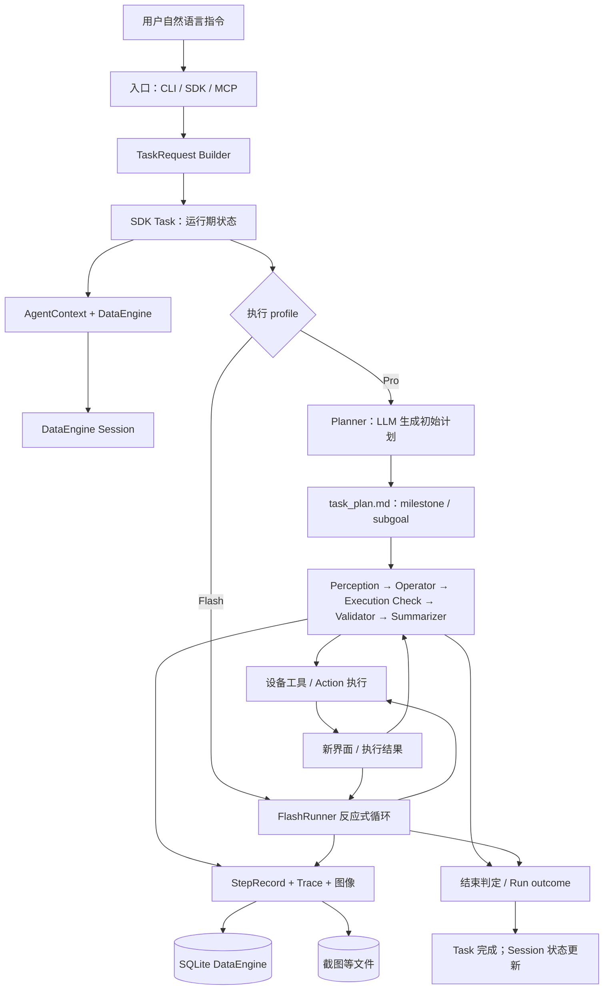
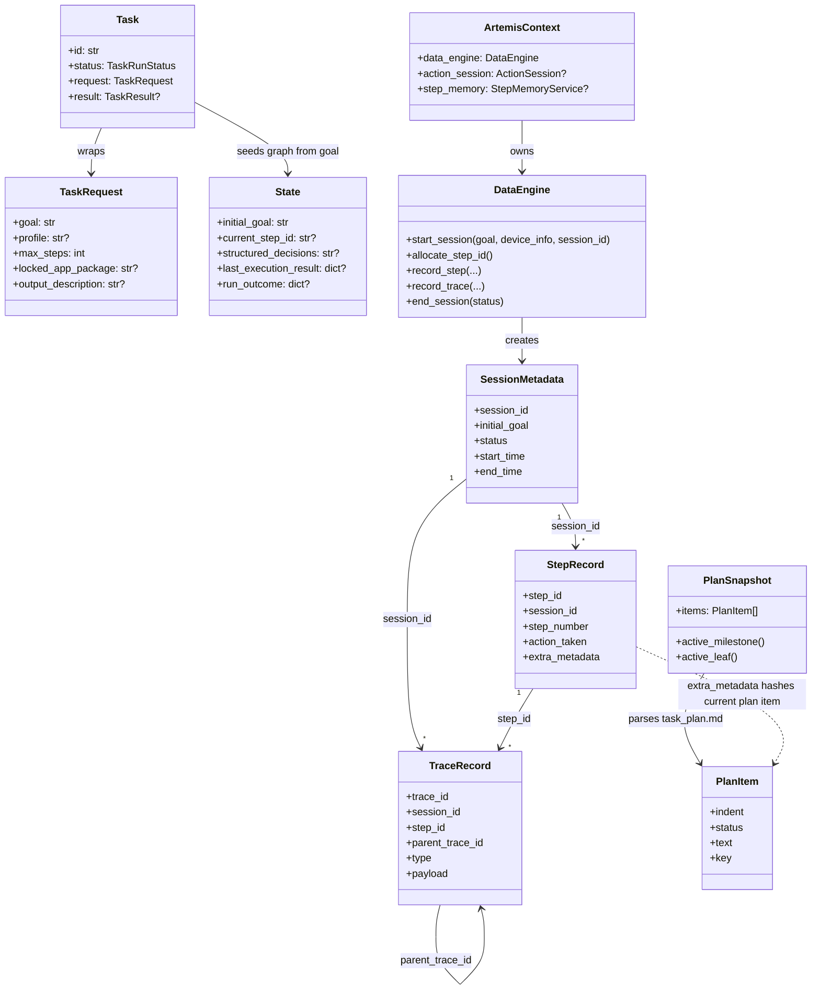

# ARTEMIS：从用户指令到任务执行

## 摘要：用什么设计，解决什么问题，为什么这么做

ARTEMIS 把一次自然语言指令拆成几个职责不同的层次：**TaskRequest 描述请求，Task 表示一次运行，Planner 用 `task_plan.md` 把目标组织成里程碑和子目标，Agent 循环把当前界面变成一步步操作，DataEngine 则把运行过程作为 Session、Step、Trace 和图像持久化。**

这样设计是为了避免把“用户说了什么”“计划做到哪”“设备实际发生了什么”混成一个对象。计划可以被调整，操作可以重试或被校验，而执行证据仍然能按顺序查询和回放。重要边界是：**milestone/subgoal 是任务计划中的条目，不是数据库中的 Task 子对象；Step 是一条执行记录，也不等于一个点击。**

## 1. 先用一个例子建立整体概念

假设用户输入：

> 打开设置，把系统语言改成英文，并确认设置生效。

逻辑上会经历：

1. **请求（TaskRequest）**：保存原始目标及 profile、输出格式、最大步数、目标 App 等选项。
2. **运行对象（Task）**：SDK 创建一个运行期 Task，记录请求、设备、状态和结果。
3. **执行会话（Session）**：DataEngine 为运行创建 session 记录；后续的步骤、调用轨迹、截图都关联到这个 session。
4. **计划（`task_plan.md`）**：Pro 路径中的 Planner 读取原始目标和当前屏幕，生成机器可解析的任务计划，例如：

   ```markdown
   - [ ] 将系统语言改为英文
     - [ ] 打开系统设置
     - [ ] 找到语言设置
     - [ ] 选择 English 并确认
   - [ ] 验证界面语言已生效
   ```

5. **执行循环**：Agent 观察屏幕，Operator 选操作，工具/设备执行，Validator 检查执行结果；循环直到完成、受阻或达到限制。
6. **执行证据（Step/Trace）**：每轮 Operator 的决策和界面证据被记录；设备工具调用作为 trace 关联到适当的 Step。
7. **结束**：Task 得到运行结果，DataEngine 更新 Session 的结束时间和状态。

计划中的层级是有用的概念模型，但代码并没有把它们实例化成一棵 `Task → Milestone 对象 → Subgoal 对象 → Step 对象` 的数据库对象树。计划主要是一个 Markdown note；Step 是另一条独立、按时间排序的执行事实。

## 2. 概念分层：名字相近，但不是同一件事

| 名称 | 含义 | 生命周期 / 持久化 |
|---|---|---|
| `TaskRequest` | 调用者提交的目标和运行选项 | SDK 请求模型；通过 Builder 构造 |
| `Task` | 单次运行的状态封装，持有 request、device、status 和 result | SDK 运行期对象；不是 DataEngine 的 `sessions` 表 |
| `Session` | 一次执行历史的持久化边界 | DataEngine `sessions` 表；同一个 session id 串起 steps、traces、图像等 |
| `State` | LangGraph 的运行期状态，例如原始目标、当前截图、决策、事件和结果 | 节点间传递；不等于持久化 session |
| `task_plan.md` | Planner/Operator 共用的任务计划文本 | DataEngine base directory 下的 notes 文件 |
| milestone | 计划中缩进为 0 的 checkbox 条目 | `task_plan.md` 的计划条目；由解析结果推导 |
| subgoal | 计划中某个 milestone 之下的嵌套 checkbox 条目 | 同上；代码也使用条目文本的稳定 hash 关联证据 |
| `StepRecord` | 一条 Agent 执行轮次的摘要记录，含动作、前后图像引用、执行结果和元数据 | DataEngine `steps` 表 |
| Trace | 一次工具调用、LLM 调用、Agent 事件等细粒度运行轨迹 | DataEngine `traces` 表，可关联 session、step 和父 trace |
| Action/tool call | 一次具体的设备操作或工具调用 | 通常作为 Step 关联的 trace；不保证一条 Step 只有一个调用 |

### 2.1 一个容易混淆的“Step”

在 Pro graph 中，Step 的记录点通常是一次 Operator 轮次结束后（代码称 Operator turn）：里面可能包括模型决策和多个工具调用。Step 并非“点一下”的同义词。

Flash 由 `FlashRunner` 控制循环，Step 具体记录点由 Flash runner 的轮次/动作路径决定。因此不要把 Pro 的 Operator turn 与 Flash 的每个单独点击机械等同。两者都会落入 DataEngine 的 Step 记录体系。

## 3. 架构图：指令如何走到持久化



图中 Planner 生成的计划主要服务于 Pro graph。Flash 是一个更偏快速反应的执行路径，不应假设它必定先经过同一套 Planner 节点。

## 4. 核心类的“原型”与职责

以下是帮助理解的**概念化原型**，字段以实际代码为准，并非要求照抄的替代实现。

### 4.1 请求：`TaskRequest`

来自 [task.py](../third_party/mobile_use/sdk/types/task.py)：

```python
class TaskRequest:
    goal: str
    profile: str | None
    task_name: str | None
    output_description: str | None
    output_format: type | None
    max_steps: int
    locked_app_package: str | None
    app_path: Path | None
    record_trace: bool
```

它回答“**调用者希望做什么，以及运行约束是什么**”。例如，`goal` 是用户的目标；`profile="pro"` 选择执行配置；`locked_app_package` 限制目标 App。Builder 把这些可选设置逐步组装成不可含混的请求。

```python
request = (
    agent.new_task("打开设置并把系统语言改成英文")
    .using_profile("pro")
    .with_locked_app_package("com.android.settings")
    .build()
)
await agent.run_task(request=request)
```

入口实现示例：

- CLI 的 `artemis run` 通过 `execute_task()` 设置配置，再交给 `run_automation()`： [run.py](../artemis/interfaces/cli/commands/run.py)、[main.py](../third_party/mobile_use/main.py)。
- MCP 后台入口把用户描述构造成 request 后调用 Agent SDK，参见 [task_runner.py](../mcp_server/background/task_runner.py)。

### 4.2 运行封装：`Task`

SDK 的 `Task` 持有 `id`、`device`、`status`、`request`、创建/结束时间和 `result`。在 `Agent._run_task()` 中构造，并在开始、结束时更新状态。

它适合表达“**这一单运行正在排队、运行、完成、失败还是取消**”，但不是步骤历史的容器。步骤历史属于 DataEngine 的 Session。

### 4.3 运行状态：`State`

LangGraph 的 `State` 有 `initial_goal`、当前感知结果、`structured_decisions`、`current_step_id`、执行结果和 incident 等字段。入口通过 `State.initial(goal)` 设置 `initial_goal`。

State 是循环控制面：节点读入当前观察，产生决策和反馈，再把新的状态交给下一节点。它不负责把所有内容写成数据库，也不是一个持久化的计划树。

### 4.4 计划：`PlanItem` 与 `PlanSnapshot`

[plan_grammar.py](../artemis/utils/plan_grammar.py) 用 `PlanItem` 表示 checkbox 行的派生结果，`PlanSnapshot` 提供顶层条目、父子关系、当前活跃条目等只读视图。

```python
PlanItem(
    indent=0,
    status=" ",
    text="将系统语言改为英文",
    line_no=1,
)
```

根据缩进，`indent == 0` 是顶层条目（milestone）；其下的 checkbox 是嵌套 subgoal。`[ ]` 表示待做、`[/]` 表示进行中、`[x]` 表示完成，另有 blocked 状态。该解析视图由计划文本推导，并不另行保存为数据库实体。

### 4.5 持久化记录：`SessionMetadata`、`StepRecord`、`TraceRecord`

简化原型如下，字段省略部分为展示目的：

```python
class SessionMetadata:
    session_id: UUID | str
    initial_goal: str
    start_time: float
    end_time: float | None
    status: str
    device_info: dict

class StepRecord:
    step_id: UUID | str
    session_id: UUID | str
    step_number: int
    pre_image_name: str | None
    post_image_name: str | None
    summary: str | None
    action_taken: object | None
    last_execution_result: object | None
    extra_metadata: dict

class TraceRecord:
    trace_id: UUID | str
    session_id: UUID | str
    step_id: UUID | str | None
    parent_trace_id: UUID | str | None
    type: str
    name: str
    payload: dict
```

这些真实模型位于 [models.py](../artemis/data_engine/models.py)。数据库与文件系统的读写由 [storage.py](../artemis/data_engine/storage.py) 完成，生命周期协调由 [engine.py](../artemis/data_engine/engine.py) 完成。

## 5. 端到端流程：代码实际做了什么

### 第 1 步：入口接收原始目标

CLI、SDK 和 MCP 是不同的“入口适配器”，但最终都将目标交给 Agent/automation 运行路径。

以 CLI 调用为例，`execute_task(goal=...)` 装配 Agent 配置，再由 `run_automation()` 创建 Agent、执行 `agent.new_task(goal)`、构建 request 并调用 `agent.run_task(request=...)`。

因此“指令转成 task”不是自然语言先被某个独立编译器翻译成一串数据库任务；最初保留的是用户原话，作为 `TaskRequest.goal`。

### 第 2 步：SDK 创建 Task 和初始 State

`Agent._run_task()`：

1. 根据 request 选择 profile/config。
2. 创建运行期 `Task`，并将它加入 Agent 的 task 列表。
3. 创建 `ArtemisContext`，连接 device、ADB、LLM config 和 agent config。
4. 用 `State.initial(task.request.goal)` 建立 LangGraph 初始状态。

这时尚未有 Planner 的 milestone/subgoal；初始 State 里最关键的是未拆解的 `initial_goal`。

### 第 3 步：取得设备执行权并初始化 Session

Agent 先协调设备执行锁，再进入 tracing 初始化。在 `_prepare_tracing()` 中创建 `DataEngine`，并用 Task 的目标及 session id 调用 `start_session()`。

Session id 会优先复用调用者提供的 id 或环境变量中的 id；若都没有，则 DataEngine 创建 UUID。它是关联一次执行及其证据的标识，不应自动等同于用户业务系统里的外层任务编号。

Session 记录至少包含初始 goal、设备信息、起止时间、状态等。`start_session()` 还会设置当前 DataEngine session，后续新建的 Step/Trace 都由其关联。

### 第 4 步：Pro Planner 把目标整理成计划（Pro 路径）

Pro graph 从 Planner 节点开始。Planner 读取初始 goal 和当前设备截图，调用 LLM，通过 note 工具写出 `task_plan.md`。程序再用 `parse_plan()` 校验 checkbox 语法，并要求至少有一个计划条目；格式无效时会将错误反馈给 Planner 重新生成。

例子：

```markdown
- [ ] 将系统语言改为英文
  - [ ] 进入系统设置
  - [ ] 打开语言选项
  - [ ] 选择 English
- [ ] 验证设置生效
```

这里顶层两项是 milestone，每项下面的缩进项是 subgoal。计划项状态会随进展更新，系统以稳定 hash 等标记把执行 Step 关联到当时的活跃计划项。

`task_plan.md` 是说明和机器状态共存的双通道文本：checkbox、缩进和状态由代码解析；条目自然语言语义主要由 Agent 理解。对计划写入还有格式和变更保护逻辑，避免无意重写里程碑。

### 第 5 步：感知、执行、验证循环

Pro graph 的主要顺序可以概括为：

```text
Planner → Convergence → Perception → Operator → Execution Check
                                                ├─ 需要审视计划：回到 Convergence
                                                └─ 继续动作：Validator → Summarizer → Convergence
```

- **Perception**：采集当前屏幕、UI hierarchy、OCR 等观察数据；准备一个 step id，便于本轮 traces 归属。
- **Operator**：读取目标、计划和当前观察，决定下一步；可以调用一个或多个工具。
- **Execution Check**：收集本轮结果，记录 Operator turn 的 Step，并处理检查点等后续任务。
- **Validator**：跟进动作执行结果；若动作失败或需修复，会通过反馈让 Agent 重规划，而非把失败伪装成成功。
- **Summarizer**：更新面向后续轮次的摘要/记忆。
- **Convergence**：根据目标、计划进度、限制和终止条件决定继续还是进入结束处理。

图结构定义见 [graph.py](../artemis/graph/graph.py)。实际终止前还可能经过 exit settlement，处理收尾检查并生成 machine-readable run outcome。

Flash profile 不走上述完整 Pro 图节点链；它由 `FlashRunner` 执行快速反应式循环，但同样使用 `State`、`ArtemisContext` 和 DataEngine 的记录能力。

### 第 6 步：为 Step 和 Trace 留下证据

Pro 路径的 execution check 从 Operator 本轮结果中组织 `StepRecord`，其中可能包括动作结构、Operator 思考字段、执行结果、前截图及 `subgoal_hash` 等元数据。Step 记录不是目标的分解结果，而是 Agent 实际运行的证据。

工具调用和 LLM 调用等更细颗粒信息由 trace 装饰器/包装器记录。Trace 可通过 `step_id` 挂靠到当前 Step，也可通过 `parent_trace_id` 表示父子调用关系。这样可以从“某次 Step”追到当轮具体用了什么工具、工具如何返回。

截图按 SHA-256 内容 hash 去重：Step 存图像名，图片文件保存在全局 `images/` 目录，图像元数据则存入数据库。具体存储结构见下节。

### 第 7 步：判定结束并更新结果

Graph/Flash runner 结束后，SDK 根据任务运行结果更新 `Task` 的最终状态；DataEngine 调用 `end_session()` 写入结束时间和状态。失败、取消也有对应的终态处理，不只是成功路径才结束 session。

注意：面向用户的 Task 完成结果、DataEngine 的 Session 状态以及计划 checkbox 是三种相关但不同的结果视图。比如某个测试断言失败，自动化流程仍可能完成，但最终测试摘要会报告失败断言。

## 6. Session 与 Step 是如何组织的



图中 `Task → State`、`StepRecord → PlanItem` 表示运行过程中的信息传递/引用关系，不是 SQLite 外键。SQLite 中的持久化外键关系主要是 session/step/trace 之间的关联。

## 7. 持久化结构：什么数据在哪里

DataEngine 的 `StorageManager` 管理 SQLite 与文件系统。数据库路径依配置而定；执行 tracing 配置提供目录时，常见数据库为该目录下的 `data_engine.db`。不能假设所有安装和运行环境都使用同一个固定绝对路径。

主要数据形状：

| 数据 | SQLite 表或文件 | 用途 |
|---|---|---|
| Session 元数据 | `sessions` | session id、初始目标、起止时间、状态、设备信息 |
| 执行 Step | `steps` | 次序、动作、摘要、执行结果、截图引用、计划 hash 等元数据 |
| 工具/模型细节 | `traces` | 类型、名称、payload、step/parent trace 关联、时间和状态 |
| 截图元数据 | `images` | 内容 hash、OCR、UI tree、附加信息 |
| 截图二进制 | `images/<sha256>.jpg` | 实际图像文件；不同 Step 可共享相同内容图 |
| 任务计划 / 其他 notes | `notes/task_plan.md` 等 | 计划文本及其它 Agent 可读写的 note |
| 压缩后的历史记忆 | `history_chunks` | 按 step 区间存储压缩历史 capsule/bands 等 |
| 视频记录 | `video_recordings` 和对应文件 | 录屏状态、路径和时间等 |
| 外部 trace/export | traces 输出目录中的文件 | 可选的 trace 工件；与 DataEngine SQLite 数据库不是一回事 |

简化关系图：

```text
sessions
  ├── steps (session_id)
  │     ├── pre_image_name / post_image_name ──> images.image_name
  │     └── traces (step_id)
  │            └── traces.parent_trace_id ──> traces.trace_id
  ├── traces (session_id; 包括未挂到特定 Step 的运行事件)
  ├── history_chunks (session_id + step 区间)
  └── video_recordings (session_id)

文件系统：
  <trace base>/images/<sha256>.jpg
  <session note directory>/notes/task_plan.md
  <trace/output directory>/<可选导出的 trace 或视频文件>
```

不要把计划文本当作执行数据库的唯一来源：`task_plan.md` 代表 Agent 当前的计划和进度；`steps` / `traces` 是已经发生的操作证据；二者通过 metadata/hash 等方式关联，但职责不同。

## 8. Task、Session、计划状态之间的边界

### Task vs Session

- `Task` 是 SDK 中的一次运行对象：请求、状态和运行结果。
- `Session` 是 DataEngine 中的证据/历史边界：steps、traces、图像和记忆数据。
- 实际实现会根据 session id、环境变量或 task id 确定 session id，因此两者在某些路径中可能复用标识；**标识复用不代表模型相同**。

### Session vs State

- `State` 是当前运行时在 graph 节点之间传递的最新状态。
- `Session` 是持久化的运行历史。
- State 中可能保存当前 `step_id`，但 State 本身不是 steps 表，也不保留全部 trace 明细。

### Milestone / Subgoal vs Step

- milestone/subgoal 表达“想完成什么”；存在于计划中。
- Step 表达“Agent 某轮实际做了什么”；存在于 DataEngine 中。
- 计划项可以被拆分、调整、标完成；Step 作为历史证据保留，不因计划改写而变成另一个动作。
- 系统可把当前活动计划项的 hash 写进 Step 元数据，支持按目标阶段组织回忆与检查。

## 9. 为什么这样分层：解决的问题

1. **原始目标与计划分开**：保留用户真正提出的目标，同时允许 Planner 将目标整理成可追踪的里程碑，减少长任务“做着做着忘了总目标”的问题。
2. **计划与事实分开**：Agent 可以改计划；但已发生的动作和工具返回仍作为 Step/Trace 历史保存，便于复盘和排错。
3. **状态与持久化分开**：运行循环只需要有限的当前 State，不必把所有截图/工具返回塞进 prompt 或内存对象；DataEngine 为详细历史提供单独存储。
4. **Session 关联证据**：同一 session id 可以把用户目标、执行步骤、调用轨迹、图像和压缩记忆串起来。
5. **Step 与 Trace 分层**：Step 方便理解和展示“这一轮发生了什么”；Trace 支持向下追踪一轮中的多个工具/模型事件。
6. **统一记录同时支持不同执行 profile**：Pro 与 Flash 控制流不同，但可复用 session/step/trace 等观测和存储设施。

## 10. 代码导航与调用入口

| 要了解的内容 | 代码位置 |
|---|---|
| CLI task 入口及参数 | [run.py](../artemis/interfaces/cli/commands/run.py) |
| CLI 创建 Agent 并运行 request | [main.py](../third_party/mobile_use/main.py) |
| TaskRequest、Task、TaskResult 类型 | [task.py](../third_party/mobile_use/sdk/types/task.py) |
| `new_task()`、`run_task()`、Task 生命周期、profile 执行 | [agent.py](../third_party/mobile_use/sdk/agent.py) |
| Artemis SDK 的 DataEngine 初始化及 session 建立 | [agent.py](../artemis/sdk/agent.py) |
| State 字段与初始状态 | [state.py](../artemis/graph/state.py) |
| Graph 节点和控制边 | [graph.py](../artemis/graph/graph.py) |
| 初始计划、计划格式检查、计划验证 | [planner.py](../artemis/agents/planner/planner.py) |
| milestone/subgoal 语法解析和派生视图 | [plan_grammar.py](../artemis/utils/plan_grammar.py) |
| Session/Step/Trace 生命周期与截图处理 | [engine.py](../artemis/data_engine/engine.py) |
| Session/Step/Trace 记录模型 | [models.py](../artemis/data_engine/models.py) |
| SQLite schema 与数据读写 | [storage.py](../artemis/data_engine/storage.py) |
| MCP 后台 task 的入口适配 | [task_runner.py](../mcp_server/background/task_runner.py) |

## 11. 一句话总结

**用户指令先成为 TaskRequest 的 goal；SDK 为它创建运行期 Task 和 State；Pro Planner 将目标写成 `task_plan.md` 中的 milestone/subgoal；执行循环通过 Step/Trace 记录真实过程；DataEngine 用 Session 把这些执行事实及图像、记忆关联并持久化。**计划项不是 Step，Task 也不是 Session；把三者分清，就能读懂 ARTEMIS 如何从一句指令走到可追踪的设备执行。
