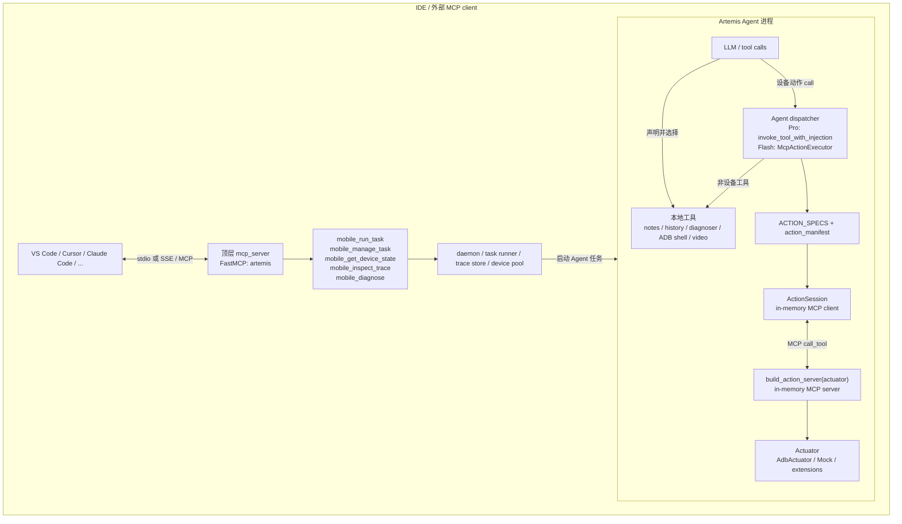
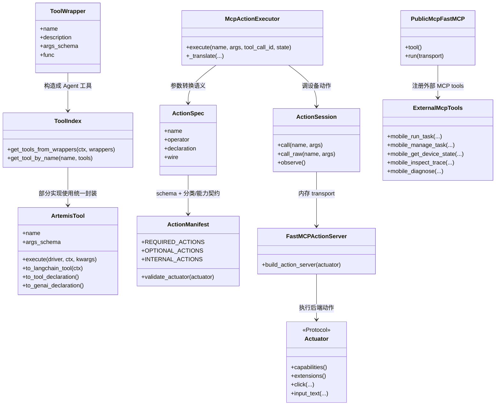

# Artemis 工具与 MCP 架构解析

本文按当前代码说明 Artemis 的工具体系：工具有哪些形态、如何注册和调用、MCP 在哪里参与，以及 `artemis/mcp/` 与顶层 `mcp_server/` 的区别。

> **先给结论：** 项目中的工具**不是全部都放在 MCP 中使用**。Agent 内部大量工具是本地 Python/LangChain 工具；设备动作在 Agent 内部通过进程内 MCP session 路由；另有面向 IDE/外部 MCP 客户端的独立 MCP Server。MCP 是工具互操作和传输方式之一，不是所有工具的唯一容器。

## 摘要：设计、问题与原因

- **用什么设计：** 用统一的工具描述/执行接口连接多种工具形态：普通工具按需绑定为 LangChain `BaseTool` 或 JSON `ToolDeclaration`；设备动作由 `ActionSpec` 定义 agent-facing 与 wire 两套 schema，经 `Actuator` 能力清单生成进程内 MCP server；外部 IDE 则连接单独的 `mcp_server`，调用高层任务与诊断工具。
- **解决什么问题：** 不同 Agent、模型和客户端需要不同工具 schema；设备后端能力不完全相同；工具还需要执行跟踪、参数转换、错误约定、上下文注入和多客户端接入。若每个调用点各自定义一份 schema 和执行逻辑，容易漂移，且外部接口与内部底层动作会耦合。
- **为什么这么做：** 把“工具语义/参数定义”“Agent 展示形式”“执行/传输”“设备后端”分开。Agent 只看到其任务需要的工具；MCP 只用于需要协议互操作或设备动作边界的路径；统一 schema 和 manifest 校验减少定义不一致，trace 和结构化结果便于调试与验证。

## 1. 先区分：工具、MCP 与 MCP Server

- **工具（tool）**：可被 Agent 或上层调用的一项能力，例如读写 note、搜历史、运行设备动作或提交自动化任务。
- **MCP**：Model Context Protocol，一种通过 server 暴露 tool schema 并接收 tool-call 的协议。MCP Server 是能力的提供端；MCP Client 是发起 `tools/list` / `tools/call` 的一端。
- **本地工具调用**：Agent 在同一进程内直接调用 Python/LangChain 函数。模型先看到工具 schema，返回 tool call 后由 Agent runtime 执行函数；整个过程不需要 MCP。

项目的两种 MCP 使用场景也要分开：

1. **Agent 内部设备动作 MCP**：`artemis/mcp/action_server.py` 以当前 `Actuator` 动态构建 FastMCP server；`ActionSession` 使用内存 transport 建立 client/server pair。它服务于同一个自动化任务中的设备动作执行，不是 IDE 安装的 server 子进程。
2. **外部 MCP 服务**：顶层 `mcp_server/` 提供 `mobile_run_task` 等高层工具；IDE/客户端通过 stdio 或 SSE 与它通信。工具调用可以启动后台任务，之后再查询、诊断和检查 trace。

此外，`artemis/mcp/adb_server.py` 和 `xml_search_server.py` 也定义了可单独启动的 MCP Server；CLI 的 `artemis mcp --server adb|xml` 会启动它们。它们和上述内部 action server、顶层 agent MCP server 都不是同一个实例。

## 2. 总体架构



上图中“模型发起 tool call”与“MCP client 发起 tools/call”是两层动作：Agent 可以把普通函数和设备动作 schema 提供给 LLM；LLM 返回动作意图后，Agent runtime 执行本地函数或调用进程内 MCP。IDE 的外部 MCP 客户端则直接向外部 server 发起 MCP 请求。

## 3. `artemis/tools/`、`artemis/mcp/`、`mcp_server/` 分别是什么？

| 路径 | 定义什么 | 典型内容 | 谁调用 |
|---|---|---|---|
| [`artemis/tools/`](../artemis/tools/) | 面向 Agent 的本地工具实现、包装与 schema 导出。工具可能会读写 DataEngine、调用子 Agent、执行 ADB 或查询历史。 | notes、history、committee、diagnoser、ADB shell、video、日志、图像处理等 | Operator、Planner、Diagnoser、Outputter、Flash 等 Agent runtime；多数不是 MCP。 |
| [`artemis/mcp/`](../artemis/mcp/) | 设备动作 MCP 协议/会话、动作 schema 和执行器；另包含可独立运行的 ADB/XML MCP server。 | `action_server.py`、`action_session.py`、`action_specs.py`、`action_executor.py`、`actuators/`、`adb_server.py`、`xml_search_server.py` | Pro Validator 和 Flash 的内部设备执行链；ADB/XML server 可由 CLI 单独启动。 |
| [`mcp_server/`](../mcp_server/) | 面向外部 IDE 和 MCP client 的高层 Artemis 服务。 | `base.py` 的 FastMCP 实例、server 入口、`tools/`、notifiers、后台任务和环境工具 | IDE/外部 MCP client 通过 MCP 协议；不是 Agent 内部 action server。 |

### 3.1 `artemis/tools/` 里的工具如何抽象？

多数 Agent 工具通过项目引入的 `ToolWrapper` 定义，再由 [`tools/index.py`](../artemis/tools/index.py) 生成带 trace 的 LangChain 工具。项目也有 [`ArtemisTool`](../artemis/tools/base.py)，其目标是把 schema、执行逻辑和多种导出形式统一封装，可导出 LangChain `StructuredTool`、项目 `ToolDeclaration` 或 Google GenAI function declaration。不同工具实现按现有代码路径使用这些抽象，并非所有工具都必须继承 `ArtemisTool`。

### 3.2 顶层 `mcp_server/` 对外提供什么？

[`mcp_server/tools/__init__.py`](../mcp_server/tools/__init__.py) 汇总注册五个主要 MCP 工具：

| MCP 工具 | 目的 |
|---|---|
| `mobile_run_task` | 非阻塞地提交 Flash/Pro 手机自动化任务，返回 trace/task 标识。 |
| `mobile_manage_task` | 查询、停止或向运行中的任务注入指令。 |
| `mobile_get_device_state` | 直接查看设备截图或 UI hierarchy。 |
| `mobile_inspect_trace` | 搜索任务历史、查看摘要、步骤、截图及执行细节。 |
| `mobile_diagnose` | 检查 Artemis 环境/设备并返回诊断与修复建议。 |

它们是高层“任务/API”接口，不是每个底层点击或输入动作的 MCP 包装。`mobile_run_task` 通常提交到 daemon/background runner；其后由 Artemis Agent 执行具体规划和设备动作。

## 4. 类图：工具定义与执行的主要关系



注意：图中 `ToolWrapper` 表示项目集成的通用 wrapper；`ArtemisTool` 是另一层统一抽象。工具生态还包含直接 LangChain 工具和 JSON tool declarations。

### 4.1 几个核心类：是什么、做什么、为什么有它们？

初看这些名字容易混在一起。可以先把一次设备动作分成四个问题：

1. **`ActionSpec`：这个动作叫什么、模型应该如何表达？**
2. **`Actuator`：底层由什么设备后端执行动作？**
3. **`ActionSession`：调用方怎样通过内部 MCP 把动作送到服务端？**
4. **`ActionResult`：动作结果怎样用稳定结构返回？**

它们不是四个同类“工具”，而是分别负责**定义、执行后端、通信会话、结果格式**。

| 名称 | 是什么 | 做什么 | 为什么需要 |
|---|---|---|---|
| `ActionSpec` | [`action_specs.py`](../artemis/mcp/action_specs.py) 中的冻结 dataclass；`ACTION_SPECS` 为每个 canonical action 保存一份规格。 | 描述动作名，以及 Pro/Flash 给模型看的参数形式、内部 MCP wire 参数形式和两者的差异。 | 防止 Operator、Flash 和 MCP server 各自手写 schema 后逐渐不一致；一个 `click` 定义可投影成多种接口。 |
| `Actuator` | [`actuators/base.py`](../artemis/mcp/actuators/base.py) 中的 `Protocol`（接口契约），**不是某台设备的具体实现**。 | 规定后端要提供哪些能力、动作方法和扩展工具。`AdbActuator` 是通过 ADB 控制 Android 的具体实现；也可换 Mock 或其他后端。 | 将“要点击哪里”与“如何驱动 Android/其他设备”隔离，MCP server 不必绑定某一个控制器实现。 |
| `ActionSession` | [`action_session.py`](../artemis/mcp/action_session.py) 中的进程内 MCP client/session 管理类。 | 建立 MCP 内存连接、排队调用 `call_tool`、提供 `call()` / `observe()` 等类型化便捷接口，并在任务结束时关闭会话。 | 让 Agent 有统一的调用入口；集中串行化设备请求，避免多个协作 Agent 同时操作设备；不需要再启动外部 MCP 子进程。 |
| `build_action_server()` | [`action_server.py`](../artemis/mcp/action_server.py) 中的 server 工厂函数，不是类。 | 根据 actuator 能力校验并注册 wire tools；收到 MCP 调用后，通过 `ActionSpec.wire.bind` 调用 actuator。 | 将 MCP 协议适配和设备实现解耦，并且只公开当前后端真正支持的动作。 |
| `ActionResult` | [`action_types.py`](../artemis/mcp/action_types.py) 中的 Pydantic 结果模型。 | 统一表达 `ok`、错误分类 `code`、动作名和人可读消息。 | 让调用方检查结构化状态，而不是猜测返回文本里是否含有“Error”。 |

#### 原型类定义：把“描述”与“执行”对起来

下面是**按当前代码职责缩写的原型**，用于理解关系，不是可以直接替换源码的完整实现；真实定义分别位于 `action_specs.py`、`actuators/base.py`、`action_session.py` 和 `action_types.py`。

```python
from collections.abc import Awaitable, Callable
from dataclasses import dataclass
from typing import Any, Protocol


@dataclass(frozen=True)
class ParamSpec:
    name: str
    annotation: Any
    required: bool = True
    default: Any = None


@dataclass(frozen=True)
class OperatorDialect:
    """模型/Agent 看到的动作参数形式。"""
    description: str
    params: tuple[ParamSpec, ...]


@dataclass(frozen=True)
class WireDialect:
    """MCP server 接收的参数形式，以及转调后端的函数。"""
    description: str
    params: tuple[ParamSpec, ...]
    bind: Callable[[Any, dict[str, Any]], Awaitable["ActionResult"]]


@dataclass(frozen=True)
class ActionSpec:
    """一个 canonical action 的各类接口描述；只保存规格，不执行动作。"""
    name: str
    operator: OperatorDialect | None = None
    declaration: Any | None = None
    wire: WireDialect | None = None
    differences: str = ""


class Actuator(Protocol):
    """设备后端契约；具体实现如 AdbActuator。"""
    def capabilities(self) -> frozenset[str]: ...

    async def click(
        self, nx: int, ny: int, times: int = 1, delay_ms: int = 100
    ) -> "ActionResult": ...


class ActionSession:
    """任务内 MCP client 包装；负责传输，不实现 click 的硬件动作。"""
    async def call(self, name: str, args: dict[str, Any]) -> "ActionResult": ...
    async def observe(self, settle_ms: int = 400) -> "ObserveResult": ...
    async def aclose(self) -> None: ...
```

逐个读这段原型时，可以这样理解：

- `ParamSpec` 是“一个参数说明卡”：名字、类型、是否必填和默认值。
- `OperatorDialect` 是 Agent/模型侧的“使用说明和参数表”；例如它允许 `target=3` 表示 UI 列表中的第 3 个元素。
- `WireDialect` 是 MCP action server 侧的参数表和适配函数；例如它要求 `target=[500, 300]` 这样的归一化坐标，并通过 `bind` 调后端。
- `ActionSpec` 将同一个动作的这些描述放在一起。`frozen=True` 表示规格创建后不可修改，避免运行中 schema 被意外改写。
- `Actuator(Protocol)` 只规定实现必须提供什么能力，不能像普通父类那样被实例化；`AdbActuator` 才是实际连接 controller、发出设备动作的对象。
- `ActionSession` 是运行期对象，有状态和生命周期；它拥有内存 MCP 会话并提供 `call()`，将返回数据解析为 `ActionResult`。它不负责决定 `target=3` 是哪个元素，也不直接调用 ADB。

#### 示例：`click(target=3)` 最后怎样点到设备？

假设当前 UI hierarchy 已生成编号列表，模型选择编号 `3` 点击搜索框。模型侧的 `target=3` 是**UI 元素索引**，不是屏幕坐标；内部 MCP wire 只接受归一化坐标。因此 Flash 的 `McpActionExecutor`（Pro 则由 Operator/Validator 路径）先结合当前已索引元素转换参数，然后通过 session 调用 server：

```text
模型动作：click(target=3)
  -> ActionSpec.operator：允许 target 是元素索引或 [x, y]
  -> executor：从本轮 indexed_elements 取第 3 项，得到元素中心点
  -> ActionSpec.wire：click(target=[500, 300], times=1, delay_ms=100)
  -> ActionSession.call("click", wire_args)
  -> FastMCP action server：验证/转换参数，调用 wire.bind(actuator, args)
  -> AdbActuator.click(500, 300, times=1, delay_ms=100)
  -> UnifiedMobileController：将 0–1000 归一化坐标映射成设备像素并执行 tap
  -> ActionResult(ok=True/False, code=..., message=...)
```

这里坐标 `[500, 300]` 仅为示意。若模型直接给坐标而非索引，模型侧还需给 `target_description`（如“搜索框”）用于记录动作目标；该描述不会传给 wire。坐标规范化及元素中心点解析位于 agent-side executor，不是 `ActionSpec` 本身在运行时解析。

一个精简的规格定义形状如下（删去了项目中的说明文案）：

```python
ActionSpec(
    name="click",
    operator=OperatorDialect(
        description="点击元素索引或归一化坐标",
        params=(
            ParamSpec("target", int | list[int]),
            ParamSpec("target_description", str | None, required=False),
            ParamSpec("times", int, required=False, default=1),
            ParamSpec("delay_ms", int, required=False, default=100),
        ),
    ),
    wire=WireDialect(
        description="在 0–1000 坐标系点击",
        params=(ParamSpec("target", list[int]), ...),
        bind=_wire_click,
    ),
)
```

`ActionSpec` 是**声明数据**，不是点击器，也不保持 session。`_wire_click` 从已校验的 wire 参数取坐标并调用 `actuator.click(...)`；实际 ADB 触摸由 `AdbActuator` 及 controller 完成。

将上面的规格绑定到执行端，概念上相当于：

```python
async def wire_click(actuator: Actuator, args: dict) -> ActionResult:
    x, y = args["target"]
    return await actuator.click(
        int(x),
        int(y),
        times=args.get("times", 1),
        delay_ms=args.get("delay_ms", 100),
    )

# Agent/executor 提供 MCP wire 形状的参数；ActionSession 负责送达。
result = await session.call("click", {"target": [500, 300], "times": 1})
if result.ok:
    print("点击动作已执行")
else:
    print(result.code, result.message)
```

真实实现中的 `_wire_click` 位于 [`action_specs.py`](../artemis/mcp/action_specs.py)，会从 `WireDialect.bind` 被调用；server 负责参数 schema 校验和包装 MCP 响应。上例刻意省略了这些基础设施代码。

#### `Actuator` 为什么是 Protocol，而不是 MCP server？

`Actuator` 只描述后端能力，例如 `capabilities()`、`extensions()`、`click()`、`swipe()`；它不知道模型 prompt、LangGraph state 或 MCP transport。`AdbActuator` 实现此契约。server 工厂把接口适配成 MCP 工具，因此职责可以替换：

```python
actuator = AdbActuator(ctx, controller)
server = build_action_server(actuator)  # MCP 层依赖 Actuator 契约
```

若用 Mock actuator 做测试，或未来新增不同设备后端，只需实现契约并声明 capabilities；server 和 Agent 的主调用链不必重新手写一套 MCP schema。`validate_actuator()` 会在首次建立 session 时检查 required/internal 能力，缺失则尽早报错，而不是执行到一半才失败。

#### `ActionSession` 管什么，不管什么？

`ActionSession` 管的是**同一任务进程中的 MCP client/server 会话生命周期与调用顺序**，不决定动作语义、不解析模型 schema，也不直接操纵触摸硬件。它的常用入口：

```python
session = await get_action_session(ctx, actuator=actuator)
result = await session.call("click", {"target": [500, 300]})
observation = await session.observe(settle_ms=400)
```

调用链中，`call()` 将 MCP `structuredContent` 校验成 `ActionResult`；server 再把调用委派给 actuator。`observe()` 调用的是 adapter 内部注册的观察工具，以获得截图/UI elements，而非让 `ActionSession` 自己实现截图。session 由 `ArtemisContext` 持有，任务退出时关闭。

一句话记忆：**ActionSpec 写“怎么描述动作”，Actuator 规定“谁来做动作”，ActionSession 负责“请求怎么送达”，ActionResult 说明“执行结果如何”。**

## 5. Agent 如何调用普通工具？

### 5.1 构造、绑定和执行三步

1. **构造**：在 Graph/Agent 组合阶段创建需要的工具实例。
2. **绑定**：把 schema 交给 LLM adapter，例如 `llm.bind_tools(tools=...)`。绑定只是让模型知道可选工具及参数，并不执行工具。
3. **执行**：模型返回 tool call 后，Agent runtime 按名称找到工具，调用函数/执行器；把结果构造成 tool message 继续对话或处理任务结果。

例如 Graph 将 notes 和 history 工具配置给 Operator：

```python
native_tools = get_tools_from_wrappers(ctx, native_wrappers)
operator_tools = operator_native_tools + operator_specialized_tools

# Operator 的模型调用循环
bound_llm = base_llm.bind_tools(tools=traced_tools)
response = await acomplete(bound_llm, current_messages)
```

返回调用后，Operator 用工具名查找 `tool_to_run`，再由通用执行辅助函数负责调用及 trace：

```python
result_obj = await invoke_tool_with_injection(
    tool=tool_to_run,
    args=tc["args"],
    tool_call_id=tc["id"],
    state=state,
)
```

[`invoke_tool_with_injection()`](../artemis/tools/tool_wrapper.py) 会按函数签名注入 `InjectedState` / `InjectedToolCallId`，执行同步或异步 handler，并在可用时写 DataEngine tool trace。失败用结构化 `ToolFailure`/错误状态表示，不应靠解析成功/失败措辞推断。

并非只有 Operator 有工具循环：Planner、Checker、Diagnoser、Outputter、HistoryAnalyzer、Committee、Explorer、Image/Video 等 Agent 会分别绑定自己需要的工具；各自 `bind_tools` 和执行调用点见文档末尾“代码导航”。

### 5.2 Flash 与 Pro 的动作调用外观不同

Pro Operator 看到由统一 action spec 生成的 LangChain shell/schema，产出结构化动作决策；Pro Validator 做执行前校验，再执行设备动作。Flash 把动作声明为 JSON `ToolDeclaration` 提供给模型，收到调用后交由 `McpActionExecutor` 分流。

这两种路径共享动作定义，但执行方式并不等于“所有 Agent 工具都走 MCP”：

- Pro/Flash 的**物理设备动作**最终经 `ActionSession` 调内部 action MCP。
- Flash 的 `read_note`、`search_history`、`ask_explorer` 等 agent-side tools 由 [`McpActionExecutor`](../artemis/mcp/action_executor.py) 本地分流，不发送给 action server。
- Pro 的 notes/history/diagnoser/ADB shell 等工具通常是本地 LangChain handler。

## 6. 内部设备动作如何通过 MCP？

### 6.1 单一动作定义，多个 schema dialect

[`artemis/mcp/action_specs.py`](../artemis/mcp/action_specs.py) 中的 `ACTION_SPECS` 为动作定义参数与说明，并区分：

- **operator dialect**：给 Agent 的动作表达，可接受 UI 元素索引或坐标；Pro 以 shell 工具呈现，Flash 从同一描述投影成 `ToolDeclaration`。
- **declaration dialect**：只需要 JSON schema 的 Agent 专用动作。
- **wire dialect**：MCP server 给执行后端使用的协议参数，例如已规范化的坐标和毫秒时长。

[`action_manifest.py`](../artemis/mcp/action_manifest.py) 划分 required、optional、internal 能力，并验证后端是否满足契约。比如 `click_sequence` 是当前 required 动作；截图、UI hierarchy、observe 是 adapter 内部使用的能力，不作为 Agent 的普通动作声明。

### 6.2 服务端按 actuator 能力动态注册

[`build_action_server()`](../artemis/mcp/action_server.py) 验证 actuator 后，只为已声明能力注册对应的 wire tools，并加入 backend extension tools。示意代码：

```python
validate_actuator(actuator)
caps = actuator.capabilities()
mcp = FastMCP(name)

for spec in wire_dialects():
    if spec.name in caps:
        mcp.add_tool(
            make_wire_handler(spec, actuator, _wrap, _wrap_exception),
            name=spec.name,
            description=spec.wire.description,
        )
```

因此 MCP `tools/list` 不会把后端不支持的 optional action 暴露出去。动作结果通过 `ActionResult` 结构化返回：设备拒绝动作通常是正常 tool result 中的 `ok=False`；协议层错误才使用 MCP `isError=True`。

### 6.3 Pro Validator 的执行路径

Pro 的主要调用关系：

```text
Operator LLM
  -> 输出 structured_decisions（动作意图）
  -> Validator.execution_loop 做 precondition/safety-net 检查
  -> action_execution.exec_action()
  -> to_canonical_call() 转为 canonical action + wire args
  -> ActionSession.call(...)
  -> MCP action server -> Actuator -> 设备
  -> ActionResult 回到 Validator / DataEngine trace
```

代码的核心动作调用形状：

```python
tool_name, wire_args = to_canonical_call(action_item, dims=(width, height))
res = await session.call(tool_name, wire_args)
return (True, "") if res.ok else (False, res.message)
```

[`action_execution.py`](../artemis/agents/validator/action_execution.py) 中的 `exec_action()` 会将 Operator 内部动作词汇翻译成 canonical action；`wait_for_delay` 则是本地 `asyncio.sleep`，不走 MCP。单动作通常先跑 Safety Net，动作 burst 则按快速路径执行，见 [`execution_loop.py`](../artemis/agents/validator/execution_loop.py)。

### 6.4 Flash 的执行路径与本地分流

Flash 的 `ToolDeclaration` 经 `bind_tools()` 提供给模型；响应工具调用后，每个调用交给 `McpActionExecutor.execute()`：

```python
if raw_name in AGENT_TOOL_NAMES:
    return await self._execute_agent_tool(...)
if raw_name in self.action_tool_names:
    return await self._execute_device_action(...)
```

设备动作路径中，executor 会先规范参数（如把 UI index 解析成坐标），再从 `ActionSession` 调内部 MCP：

```python
session = await self._session_or_start()
wire_name, wire_args, finalize, semantics = self._translate(...)
res = await session.call(wire_name, wire_args)
```

执行成功后可能调用 `session.observe()` 更新截图/UI hierarchy 和 Agent state。由此可见，Flash 有 MCP-backed **device action executor**，但它也同时执行本地 agent-side tools。

### 6.5 ActionSession 为什么使用进程内 MCP？

[`ActionSession`](../artemis/mcp/action_session.py) 用 `create_connected_server_and_client_session()` 建立 client/server 内存连接；owner task 串行处理 transport 请求。它提供一个所有 Agent 共享的设备动作 choke point，避免同一设备上的嵌套 agent 并发交错操作。它不是启动 `mcp_server` 子进程，也不经过 IDE 的 stdio/SSE 连接。

调用 API：

```python
session = await get_action_session(ctx, actuator=actuator)
result = await session.call("click", {"target": [500, 300]})
```

客户端 `call()` 将 MCP `structuredContent` 校验为 `ActionResult`；内部 observation 使用 `observe_screen` 等 adapter 工具。这些内部工具是 server/client adapter 间的实现细节，不全都会暴露给 LLM。

## 7. 外部 IDE 如何调用 MCP？

### 7.1 注册和启动

顶层 [`mcp_server/base.py`](../mcp_server/base.py) 创建共享 `FastMCP("artemis")` 实例；[`mcp_server/tools/`](../mcp_server/tools/) 模块通过 `@mcp.tool()` 注册函数。[`mcp_server/server.py`](../mcp_server/server.py) 导入工具模块，再按 stdio 或 SSE 运行 server：

```python
from mcp_server.base import mcp
import mcp_server.tools  # 导入时注册 tools

mcp.run(transport="stdio")
# 或 mcp.run(transport="sse", host=host, port=port)
```

CLI `artemis mcp --install ...` 为支持的 IDE 安装 MCP server 配置。配置一般指向 Python 命令和 `-m mcp_server`，由 IDE 托管 stdio 子进程；SSE 可用于显式选择网络 transport。

### 7.2 一次外部工具调用的完整流程

以 IDE 调用 `mobile_run_task` 为例：

```text
IDE 的 MCP client
  -> tools/list 发现 mobile_run_task 的 schema
  -> tools/call(name="mobile_run_task", arguments={...})
  -> FastMCP 分发到 mcp_server.tools.task_runner.mobile_run_task
  -> 校验参数/设备并创建 task trace
  -> daemon/background runner 启动 Flash 或 Pro
  <- 立即返回 trace_id、device_serial 等信息
  -> 后续调用 mobile_manage_task 查询/停止/注入指令
  -> mobile_inspect_trace 搜索或查看运行细节
```

MCP client/host 负责网络/stdio 传输和协议请求；MCP server 的 tool handler 负责 Artemis 领域逻辑。`mobile_run_task` 返回后，Agent 自动化任务由后台 runtime 完成，而不是让该 MCP tool handler 自己逐步执行每个 UI 点击。

## 8. `artemis/mcp/` 还有哪些可独立运行的 MCP server？

[`artemis/mcp/__init__.py`](../artemis/mcp/__init__.py) 导出：

- `adb_mcp`：来自 [`adb_server.py`](../artemis/mcp/adb_server.py)，Android ADB controller MCP server。
- `xml_mcp`：来自 [`xml_search_server.py`](../artemis/mcp/xml_search_server.py)，XML hierarchy fuzzy-search MCP server。

[`interfaces/cli/commands/mcp.py`](../artemis/interfaces/cli/commands/mcp.py) 根据 `--server agent|adb|xml` 选择运行实例：

- `agent`：顶层 `mcp_server` 的五个高层 Artemis 工具；
- `adb`：单独的 ADB controller tools；
- `xml`：单独的 XML fuzzy-search tools。

而 `ActionSession` 使用的 `build_action_server()` 是运行期为当前 actuator 构造的设备动作 MCP server，采用内存连接，**不等同于 CLI 的 `--server adb`**。

## 9. 工具分类：哪些需要 MCP？

| 工具/能力 | 典型例子 | 通常怎样调用 | MCP 是否必需 |
|---|---|---|---|
| Agent 内本地业务工具 | `read_note`、`save_note`、`search_history`、`ask_diagnoser`、`run_adb_command` | LangChain tool / Python handler 被 Agent runtime 执行 | 否 |
| Agent 内设备动作 | `click`、`input_text`、`swipe`、`press_key` | Operator/Flash 的动作意图经 Validator 或 `McpActionExecutor` 到内部 `ActionSession` | 是，当前统一 wire/action 边界采用 MCP |
| Agent 的内部适配工具 | `observe_screen`、`take_screenshot`、`get_ui_hierarchy` | `ActionSession.observe()` / screenshot / hierarchy 方法 | 通过内部 MCP；通常不直接暴露给模型 |
| 外部高层 MCP 工具 | `mobile_run_task`、`mobile_manage_task`、`mobile_inspect_trace` | IDE 的 MCP client 向顶层 `mcp_server` 发起请求 | 是，对 MCP host 暴露的接口 |
| ADB/XML 独立 MCP 服务 | `adb_mcp`、`xml_mcp` 中注册的工具 | 外部 MCP client 或显式启动的服务使用 | 仅在选择对应 server 时 |
| 工具回调/内部 Python 能力 | OCR、状态解析、schema 验证、坐标转换 | 函数直接调用 | 否 |

**回答“所有工具是否都放在 MCP 中使用？”：不是。** MCP server 是面向特定消费者的一种边界。工具可以只由 Agent 本地调用；同一动作也可以有模型 schema、本地参数转换和 MCP wire schema 多个层次。

## 10. 工具调用失败时如何处理与补救？

项目没有对所有工具套用同一种“失败就重试”策略。失败可能来自参数/能力、设备执行、MCP transport 或后台任务派发；每类错误采取不同处理，尤其不会盲目重放可能已执行的设备动作。

| 失败场景 | 已有保护/补救 | 目的与边界 |
|---|---|---|
| 后端缺少必需动作或内部观察能力 | 创建 `ActionSession` 时先运行 `validate_actuator()`；required/internal capability 不满足会在首次设备交互前失败。Optional action 按能力隐藏，不注册为 MCP 工具。 | 尽早暴露配置错误，不让任务执行到中途才发现工具不存在。 |
| 参数错误、无效 UI index、未知工具 | executor 的转换层返回明确参数错误；`ActionSession.call_raw()` 将 MCP `isError=True`（如未知工具/schema violation）转成异常；Flash 不支持的工具返回结构化 `ToolFailure`。 | 区分“请求不合法/协议错误”和“设备收到动作但执行失败”，不把它们伪装成成功。 |
| 设备动作失败 | server 将 actuator 异常转换成 `ActionResult(ok=False, code=..., message=...)`；正常设备拒绝使用 `isError=False` 携带结构化失败，让 Agent 可观察并决定下一步。 | 避免只靠错误文案判断状态；设备级失败不一定代表 MCP 通道坏了。 |
| Pro 执行前目标校验失败 | Validator 对有 UI 元素信息的目标先做 XML 检查，必要时回退到像素检查；校验不通过会拦截动作，不执行点击。 | 防止模型索引过期或目标不匹配时误操作。属于安全拦截，不会靠重试点击来“修好”。 |
| Pro 的单个设备动作暂时执行失败 | Vetted 的普通动作做有限本地重试（通常最多 2 次；`launch_app` 一次）；每次之间短暂停顿。失败时尝试截取失败截图、记录 attempts 和 action trace，并打开 execution incident 给 Operator 下一轮处理。 | 为短暂设备/时序错误提供一次恢复机会；若仍失败，把现场交给 Agent 基于新观察修复，而非无限重试。 |
| Pro fast-action burst 中一步失败 | burst 中每个动作只尝试一次；首个失败会中止余下动作，后续动作标为 skipped，并记录 incident 和执行报告。 | burst 依赖连续时序，插入重试或继续执行可能让后续动作对准错误页面。 |
| 内部 MCP 观察/截图卡住 | `take_screenshot` / `get_ui_hierarchy` 在 server 内部对 actuator 操作应用 `timeout_ms`，并返回正常的错误 payload。避免在 MCP transport 层超时或取消底层 `call_tool`。 | 防止晚到的 MCP 响应破坏共享内存 transport；超时仅结束该设备操作并报告错误。 |
| ActionSession transport 断开 | owner loop 发现 `BrokenResourceError` / `ClosedResourceError` 后退休当前 session；待处理请求收到显式错误；后续 `get_action_session()` 检查 `started`，关闭失效实例并新建 session。调用队列串行处理。 | 不把已损坏 session 当作可继续使用；串行化也避免同设备并发动作互相穿插。 |
| 本地 LangChain 工具运行报错 | `invoke_tool_with_injection()` 在 `finally` 路径记录成功/失败 trace 后，仍将原始异常抛给调用方；结构化 `ToolFailure` 也标记为 failed。Flash 的 history、Explorer、video 等 handler 记录错误并返回失败状态。 | 让 Agent/上层看到失败原因，同时保留可诊断的工具调用记录。不是所有本地工具都会自动重试。 |
| 外部 `mobile_run_task` 参数/设备/派发异常 | 先校验 model 与 Pro 调参；显式 device serial 不可用时拒绝并带 trace id；daemon 拒绝会更新 trace。daemon 响应不明确时检查队列；队列也不可读则返回 `unknown`，要求先查状态再重提，避免重复执行。daemon 已运行但提交确认失败时不再启动 standalone runner，避免同设备双跑。 | 把“肯定失败”和“可能已经排队”分开处理，防止一次网络/IPC 异常造成重复副作用。 |
| standalone 后台 runner 未启动或任务结束 | spawn watchdog 观察 runner 是否产生日志，超时则终止进程、释放设备队列 reservation、更新 failed 状态并尽力通知；运行任务可通过 `mobile_manage_task` 查询，trace/stdout/stderr 可由 `mobile_inspect_trace` 等路径检查。 | 避免任务永远显示 running，并给外部调用者状态核查与诊断依据。通知是辅助机制，不应代替轮询状态。 |

### 一个动作失败后的实际补救路径

以 Pro 点击目标失败为例：

```text
Operator 给出动作
  -> Validator 先用 XML / 像素检查目标
     -> 检查不通过：拦截，记录 incident，不发送点击
     -> 检查通过：通过 ActionSession 调 MCP wire action
        -> ActionResult.ok=False 或调用异常
           -> 普通 vetted action 有限重试
           -> 仍失败时采集失败截图（若可用）
           -> DataEngine 记录 action attempts / execution report / trace
           -> 把 incident 放回 graph state
           -> Operator 下一轮查看当前屏幕和 incident，决定修复、换目标或停止
```

注意两条边界：**有限重试只适用于代码明确设计了重试的阶段**；不能据此推断每个工具调用都会重试。对于 `click` 等有副作用动作，transport 返回不明确时也不应由调用者无条件重放，否则可能变成双击或重复提交。外部 task 返回 `unknown` 时应先用该 `trace_id` 查询状态。

## 11. 设计中的关键约束

1. **单一动作规格，避免 schema 漂移。** `action_specs.py` 同时导出 Pro shell、Flash declaration 和 wire handler 所需 schema；测试锁定不同模型 surface 的一致性。
2. **能力驱动暴露。** Actuator 声明 `capabilities()`；server 只注册实现的动作，manifest 在首次调用前验证 required/internal 契约。
3. **领域结果与协议错误分开。** 设备动作失败可作为结构化观察返回；未知 MCP tool、schema violation 等协议错误作为异常处理。
4. **Agent 工具最小化。** 每个 Agent 只绑定与职责相关的工具；不因某工具可通过 MCP 暴露就默认给所有 Agent。
5. **调用可追踪。** 本地工具和设备动作都可进入 DataEngine trace；外部 task 工具返回 trace id，后续可检查生命周期和步骤证据。
6. **内部/外部服务隔离。** 内部设备动作 session 受任务上下文管理并串行化；外部 MCP API 面向 IDE，支持后台任务与独立的状态查询。

## 12. 代码导航

| 主题 | 主要代码 |
|---|---|
| Pro 工具装配 | [`graph.py`](../artemis/graph/graph.py) |
| Pro 模型绑定与本地 tool call 执行 | [`operator.py`](../artemis/agents/operator/operator.py)、[`tool_wrapper.py`](../artemis/tools/tool_wrapper.py) |
| 通用工具生成/查找 | [`tools/index.py`](../artemis/tools/index.py) |
| 多协议工具抽象 | [`tools/base.py`](../artemis/tools/base.py) |
| 设备动作 schema dialect | [`action_specs.py`](../artemis/mcp/action_specs.py) |
| Actuator 能力契约 | [`action_manifest.py`](../artemis/mcp/action_manifest.py)、[`actuators/base.py`](../artemis/mcp/actuators/base.py) |
| 动作 MCP server 与 session | [`action_server.py`](../artemis/mcp/action_server.py)、[`action_session.py`](../artemis/mcp/action_session.py) |
| Pro 设备动作执行 | [`action_execution.py`](../artemis/agents/validator/action_execution.py)、[`execution_loop.py`](../artemis/agents/validator/execution_loop.py) |
| Flash tool call 分流与设备动作 | [`runner.py`](../artemis/agents/flash/runner.py)、[`action_executor.py`](../artemis/mcp/action_executor.py) |
| 外部 MCP server 实例/启动入口 | [`mcp_server/base.py`](../mcp_server/base.py)、[`mcp_server/server.py`](../mcp_server/server.py) |
| 外部 MCP tool 注册 | [`mcp_server/tools/__init__.py`](../mcp_server/tools/__init__.py)、[`task_runner.py`](../mcp_server/tools/task_runner.py) |
| CLI 安装配置与 server 选择 | [`mcp.py`](../artemis/interfaces/cli/commands/mcp.py) |
| 独立 ADB/XML MCP | [`adb_server.py`](../artemis/mcp/adb_server.py)、[`xml_search_server.py`](../artemis/mcp/xml_search_server.py) |
| Validator 重试、安全拦截与 incident | [`execution_loop.py`](../artemis/agents/validator/execution_loop.py)、[`incidents.py`](../artemis/agents/validator/incidents.py) |
| MCP timeout / session 恢复 | [`action_server.py`](../artemis/mcp/action_server.py)、[`action_session.py`](../artemis/mcp/action_session.py) |
| 外部 task 派发与 spawn watchdog | [`task_runner.py`](../mcp_server/tools/task_runner.py) |
