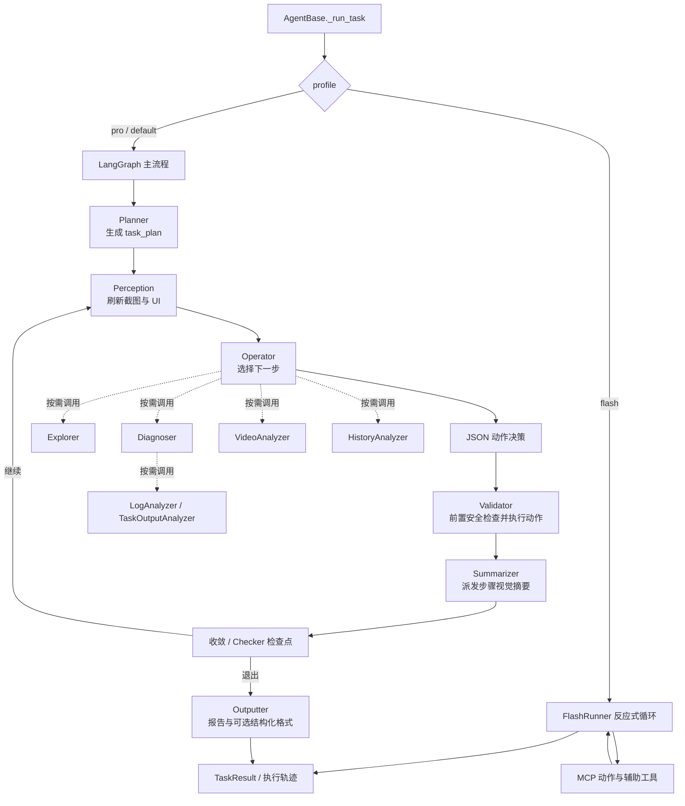

# ARTEMIS Agents 源码分析

本文从 `artemis/agents/` 出发，说明各 Agent 的职责、协作方式、Prompt 组织、结构化输出与执行 harness。重点是 Pro 主链与 task plan；Flash 和辅助 Agent 单独说明，避免把“Agent”误解成同一种循环或同一个执行器。

## 1. Agents 在系统中的位置

Agent 是面向某一职责的模型调用、工具循环或确定性处理器。它们共享任务的 `ArtemisContext`，通过工具、图 State、task plan、DataEngine 轨迹及显式返回值协作。它们不是都在一个对话中运行，也不是每个 Agent 都会启动模型。



Pro 的主要注册与边定义见 [graph.py](../artemis/graph/graph.py)，Agent 生命周期和 Flash/Graph 分流见 [agent.py](../third_party/mobile_use/sdk/agent.py)。完整图路由另见 [ARTEMIS_GRAPH_GUIDE_CN.md](./ARTEMIS_GRAPH_GUIDE_CN.md)。

## 2. Agent 职责总览

| Agent / 模块 | 做什么、如何做 | 主要输入与输出 | 实现 / Prompt |
| --- | --- | --- | --- |
| **Planner** | 首轮根据用户目标和设备初始截图制定宏观里程碑；之后 Operator 可修改计划，Planner 异步审阅里程碑变更。通过 scratchpad 工具写入计划，而不是让模型返回一段自由格式 JSON。 | 读目标、截图、计划和执行历史；写 `task_plan`，异步审阅返回 `ValidationResult`。 | [planner.py](../artemis/agents/planner/planner.py)、[planner.json](../artemis/agents/planner/planner.json) |
| **Operator** | Pro 的主要决策 Agent。每轮读取观察、计划、历史、用户追加指令和工具结果，输出自然语言推理及工具调用；物理动作与辅助调查均通过已绑定工具发起。 | 接收图 State、截图/UI 树、计划与历史；工具调用和文本推理被记录到 State/trace。 | [operator.py](../artemis/agents/operator/operator.py)、[prompts.py](../artemis/agents/operator/prompts.py)、[operator.json](../artemis/agents/operator/operator.json) |
| **Validator** | 将 Operator 的动作决策解析为动作序列，执行前先验证目标是否仍匹配当前屏幕，再调用 `ActionSession` 执行；失败时记录证据并触发修复路径。它不是最终目标验收器。 | 输入 `structured_decisions`；动作结果、校验分类、截图和事故记录写回执行状态/轨迹。 | [validator.py](../artemis/agents/validator/validator.py)、[execution_loop.py](../artemis/agents/validator/execution_loop.py) |
| **Checker** | 只读地审计 `verify` / `assert` 检查项，结合锚点附近的截图、历史、笔记和限定设备探针形成判定。Checkpoint Checker 用于里程碑验收；Final Checker 在任务退出时审查。 | Pydantic `CheckReport`，每项为 `passed`、`failed` 或 `inconclusive`，并附证据。 | [checker.py](../artemis/agents/checker/checker.py)、[checker.json](../artemis/agents/checker/checker.json) |
| **FlashRunner** | Flash profile 独立于 Pro Graph 的快速反应式执行器：构造系统 Prompt，循环读取观察并调用动作/辅助工具，维护 Transcript，达到退出工具或回合上限后返回任务结果。 | 截图、UI 树、执行历史、工具调用；向统一执行器发动作，并输出最终状态/报告。 | [runner.py](../artemis/agents/flash/runner.py)、[flash_runner.md](../artemis/agents/flash/flash_runner.md) |
| **Explorer** | 定位屏幕上自然语言描述的元素。先尝试 UI/XML/OCR 结构化预识别，未解决部分再走 Flash/Pro/Ultra 分层模型；校验 `submit_answer` 后将候选坐标归一化并注册为可供动作使用的元素索引。 | `{"candidates": [...], "fallback_message": "..."}`，候选坐标为 0–1000 归一化坐标。 | [explorer.py](../artemis/agents/explorer/explorer.py)、[tiers.py](../artemis/agents/explorer/tiers.py)、[explorer_tool.py](../artemis/tools/explorer_tool.py) |
| **Summarizer** | Graph 节点不直接生成长文本，而是将当前步骤动作、前后截图、执行结果和 Operator focus 派发给步骤记忆服务，生成视觉转场摘要。 | 主要是 DataEngine/step-memory 的副作用，节点返回空 State 更新。 | [summarizer.py](../artemis/agents/summarizer/summarizer.py) |
| **Flash 视觉摘要器** | Flash 专用 `VisualStepSummarizer` 与 Pro 共用步骤记忆能力；将单步或历史片段压缩成可持续使用的第一人称客观转场描述。 | 视觉步骤摘要，供 Transcript 压缩和后续决策使用。 | [summarizer.py](../artemis/agents/flash/summarizer.py)、[flash_summarizer.md](../artemis/agents/flash/flash_summarizer.md) |
| **Outputter** | 任务结束时综合目标、计划、历史、检查结果和环境信息生成报告；必要时通过只读调查工具补证据，随后可按用户 schema 再调用一次模型格式化。 | 自然语言报告，或用户指定 JSON/Pydantic schema 对应的数据。 | [outputter.py](../artemis/agents/outputter/outputter.py)、[outputter.md](../artemis/agents/outputter/outputter.md) |
| **Diagnoser** | 结合当前屏幕、task plan、执行历史及 Checker 反馈调查运行中问题；按设备在线状态和视频开关裁剪工具，迭代后通过 `submit_answer` 返回诊断。 | 面向 Operator 的诊断文本/结论；最多 30 轮。 | [diagnoser.py](../artemis/agents/diagnoser/diagnoser.py)、[diagnoser.json](../artemis/agents/diagnoser/diagnoser.json) |
| **HistoryAnalyzer** | 回答“之前做过什么、在哪一步出现某现象”等历史问题。初始上下文先按计划和子目标构造；模型还可调用 `search_history`、`replay_steps`、截图和笔记工具查证。 | 自然语言回答；无 DataEngine 或无历史时明确返回不可用/无记录。 | [history_analyzer.py](../artemis/agents/history_analyzer/history_analyzer.py)、[history_analyzer.md](../artemis/agents/history_analyzer/history_analyzer.md) |
| **LogAnalyzer** | 对 Logcat 和设备日志做工具驱动调查；通过缓存避免重复读取原始日志，并支持在同一批已取日志上多次搜索。 | 日志分析文本；日志读取/搜索工具返回原始或过滤片段。 | [log_analyzer.py](../artemis/agents/log_analyzer/log_analyzer.py)、[log_analyzer.md](../artemis/agents/log_analyzer/log_analyzer.md) |
| **TaskOutputAnalyzer** | 面向超长命令/任务输出的问题回答器。大文本只先提供首尾预览，模型通过闭包工具按行读取或搜索上下文。 | 对用户查询的文本回答；最多 5 轮工具循环。 | [output_analyzer.py](../artemis/agents/log_analyzer/output_analyzer.py)、[output_analyzer.md](../artemis/agents/log_analyzer/output_analyzer.md) |
| **VideoAnalyzer** | 根据时间范围和问题分析屏幕录制/音频。支持静态抽帧与 agentic 子 Agent、分块与失败拆分、原生/Universal 引擎、模型 fallback、断路器及可持久化观察 ledger。 | 面向调用方的文字分析；子 Agent 使用 `submit_answer` 固定响应信封。 | [video_analyzer.py](../artemis/agents/video_analyzer/video_analyzer.py)、[video_analyzer.md](../artemis/agents/video_analyzer/video_analyzer.md)、[video_sub_agent.md](../artemis/agents/video_analyzer/video_sub_agent.md) |
| **ImageProcessor** | 让模型根据图像处理指令生成并运行 Python 图像变换代码；维护中间图像池、变换/标注元数据，并要求调用 `submit_result` 结束。 | `{"outputs": [...], "summary": "..."}`，可追踪输出图来自哪张中间图及其变换。 | [image_processor.py](../artemis/agents/image_processor/image_processor.py)、[image_processor.md](../artemis/agents/image_processor/image_processor.md) |
| **ObjectDetector** | 对多个文本标签并发执行视觉定位，解析模型的 JSON 列表，统一坐标顺序并返回未命中的标签。 | `{"detected": [...], "failed": [...], "message": ...}`；通过 `parse_structured` 解析模型响应。 | [object_detector.py](../artemis/agents/object_detector/object_detector.py)、[object_detector.json](../artemis/agents/object_detector/object_detector.json) |

上表按仓库实现范围列举主要 Agent 与子 Agent。模块中还有各自的引擎、工具声明、Prompt 片段和兼容 seam；入口文件通常是稳定 facade，不意味着所有实现都在一个文件内。

## 3. Pro Harness 与 Agent 协作

### 3.1 Harness 分层

一次任务的 harness 把“生命周期、编排、决策、动作、证据”拆成不同层：

1. **生命周期 / 资源层**：`AgentBase._run_task()` 建立 `ArtemisContext`、设备锁、DataEngine 与初始 `State`，按 profile 选择 Flash 或 Pro；最后提取结果并清理资源。
2. **编排层**：`get_graph(ctx)` 将 Planner、Perception、Operator、execution check、Validator、Summarizer 和 exit settlement 连接成图。节点是否运行及何时退出由 State 和路由决定。
3. **决策层**：Planner 维护宏观计划；Operator 在每个执行回合决定下一步并调用工具。Explorer、Diagnoser、历史/视频分析等是按需能力，不是每轮固定串行执行。
4. **动作层**：Operator 不直接控制设备。其动作结构交给 Validator；Validator 通过 `ActionSession`/执行器调用 MCP action tools 和 Controller/Driver。
5. **证据与报告层**：DataEngine 保存步骤、截图和 trace；Checker 审核声明的检查项；Summarizer 压缩步骤；Outputter 汇总最终回答。

Validator 中的前置安全网是“执行前验证”，Checker 则是“基于已记录证据的事后审核”，二者不可互换。XML 元素信息可用时优先 XML 校验；必要时回退到像素/VLM 判断；纯坐标目标直接使用像素验证。执行器被设备接受不等价于目标效果已实现，后者需由 Operator 观察或 Checker 按声明条件审查。

### 3.2 Flash 与 Pro 不是同一个 harness

| 维度 | Pro | Flash |
| --- | --- | --- |
| 控制流 | `StateGraph` 节点编排，含 Planner、Validator、Checker 等门控 | `FlashRunner` 内部的观察—思考—工具循环 |
| 计划 | task plan 是系统执行账本；顶层目标参与退出判定 | 不经过 Graph Planner；Prompt 鼓励模型在首轮提取宏观里程碑 |
| 动作执行 | Operator 输出动作决策，由 Validator 校验并执行 | 模型直接调用 Flash 可用工具，工具底层仍汇入统一动作执行路径 |
| 状态/记忆 | 图 State + task plan + DataEngine 轨迹 | TranscriptLedger、历史摘要/压缩和步骤记忆 |
| 结束 | 收敛路由、退出结算、可选 final check 与 Outputter | 最终状态工具/循环条件、最终报告与 TaskResult |

Flash 的 Prompt 明确要求模型在每轮按观察、计划、动作组织，并限制目标工具集；Transcript 会将截图、UI 树、时间戳和用户追加指令按块追加，对只在当前轮有效的提醒标记为 ephemeral，以便历史压缩时移除。相关实现见 [context_compressor.py](../artemis/agents/flash/context_compressor.py)。

## 4. Prompt 如何组织

Prompt 的目标不是把所有运行时信息拼成一个不可控的大字符串，而是区分**稳定规则**与**动态上下文**，并让工具能力与 Prompt 描述一致。

### Planner

- 稳定规则集中在 [planner.json](../artemis/agents/planner/planner.json) 的 `blocks` 与 `modes`：初始计划、校验/修订等模式复用角色、思考原则和任务计划语法。
- [planner.py](../artemis/agents/planner/planner.py) 根据模式选择 blocks；只有检查开关启用时才挂载检查项生成/审查指令。
- Prompt 通过 `render_plan_grammar_spec()` 注入与 harness 同源的语法说明，因此状态符号、层级和检查项语义并非只依赖自然语言提醒。
- 当前目标、计划前后版本、历史、设备截图等动态内容作为人类消息/多模态内容加入。

### Operator

- [operator.json](../artemis/agents/operator/operator.json) 保存长期角色规则和模板；[prompts.py](../artemis/agents/operator/prompts.py) 中的 `PromptBuilder` 按组件构造系统提示及本轮观察。
- 组件可分别加入目标/计划/历史、屏幕观察、截图、事件反馈、用户追加指令、后台任务和推理提醒；转录模式将本轮 tail 与历史账本分离。
- `prompt_assembly.py` 和 Prompt contract 会按实际可用工具重绘工具清单并整段裁剪缺失工具的教学内容，避免 Prompt 声称可用但运行时没有的工具。
- 工具循环预算在代码中执行（Operator 每轮最多 20 次工具迭代），Prompt 中的说明不能取代此运行时边界。

### Checker、Flash 和按需分析 Agent

- Checker 的 [checker.json](../artemis/agents/checker/checker.json) 按职责定义只读审计、证据标准、verify/assert 语义及 checkpoint/final 时点；具体检查项通过消息动态注入。
- Flash 的 [flash_runner.md](../artemis/agents/flash/flash_runner.md) 是 Jinja 模板，`available_tools` 条件控制对应工具操作说明；目标只在稳定系统指令中提供，逐轮 observation 追加到历史。
- Explorer、Diagnoser、VideoAnalyzer、HistoryAnalyzer、LogAnalyzer、ImageProcessor 等也有各自独立的 Prompt 文件/配置；不同模式或角色的内容不会无条件塞进 Operator Prompt。

## 5. Task plan：结构、格式和可靠性

### 5.1 双通道格式

task plan 存在 scratchpad 的 `task_plan` note 中（DataEngine 工作目录下的 `notes/task_plan.md`）。它同时面向模型和 harness：

- **机器通道**：符合 checkbox 语法的行、缩进层级、状态字符、Loop 标签和检查项；解析器用于状态判断、路由、验收及安全保护。
- **自然语言通道**：目标、策略、备注、解释和其他非 checkbox 内容；由 Planner/Operator 理解，不被当作机器状态解析。

语法的单一事实来源是 [plan_grammar.py](../artemis/utils/plan_grammar.py)，既实现 `parse_plan()`，也生成 Planner/Operator Prompt 注入的 grammar spec。避免模型提示与运行时解析各自维护一套不一致规则。

```text
- [ ] 搜索并筛选符合条件的记录
  - [ ] 搜索候选项并记录到 candidates_list
  - [ ] 逐个检查候选项的详情
  - verify: 最终记录包含请求的关键信息
- [/] 汇总已确认的信息
  - [ ] 将已核实内容写入 summary
- [ ] assert@end: 记录中显示的状态与用户预期一致
```

| 机器语法 | 作用 |
| --- | --- |
| `- [ ]` | 顶层里程碑或嵌套子目标待办。 |
| `- [/]` | 正在进行。 |
| `- [x]` | 已完成。只有零缩进的顶层项决定任务完成/退出；嵌套项作为执行账本。 |
| `- [!]` | 阻塞。 |
| 缩进 | 零缩进是战略里程碑；2 空格及更深缩进表示子目标/执行明细。 |
| `[Loop]` | 有明确退出边界的有限循环。 |
| `[Loop:continuous]` | 用户停止信号控制的持续监控；没有显式停止信号时必须保持活动，不能由 Agent 擅自完成、删除或去标签。 |
| `verify:` | 验收条件。中途检查失败可重新打开里程碑进入修复流程。 |
| `assert:` | 测试断言。失败是有效测试结果，不应该通过修改设备状态“修好”。 |
| `@end` | 将该项延迟到任务退出时判定；非 `@end` 条件在所属里程碑完成时锚定检查。 |
| `finding:` | 系统为未解决的 verify 失败投影的摘要行；模型不负责创建或维护，完整诊断和修复记录保存在保留的 checker note 中。 |

检查项是对已记录证据的事后审计，不是动作执行前的硬约束；例如“B 不得先于 A”只能根据历史证据追溯判断，不能阻止动作发生。Checker 对缺失证据使用 `inconclusive`，不能把“没观察到”冒充失败。

### 5.2 Planner 如何保证计划格式

格式可靠性来自“Prompt 合同 + 工具写入 + 解析器校验 + 写后护栏”，不是单靠模型遵守指令：

1. **工具写入而非自由文本解析**：Planner 绑定 `save_note` / `update_note` 等工具，把计划直接保存到 `task_plan` note。
2. **有限修正循环**：单次 Planner 流程最多 3 轮格式修正；每轮最多 10 次模型/工具迭代。若没有调用写入工具、计划不存在或格式不合法，错误会作为反馈加入后续轮次。
3. **校验复用解析语法**：`validate_plan_format()` 用 `CHECKBOX_LINE_RE` 检查 checkbox 行，并用 `parse_plan()` 确认至少存在一个有效计划项；它与其他读取方共享语法来源。
4. **Operator 写入有统一后处理**：Graph 为 Operator 包装 `save_note` / `update_note`，task plan 修改经过 `_process_plan_write()`。机器规则违规会回滚；检查项会被确定性保护/合并；未解决 finding 会从 Checker 状态重新投影；顶层里程碑变更触发异步 Planner 审阅；新完成的顶层项排队触发 checkpoint。Planner 使用原始 note 工具保留计划修订权，随后由 Planner 自己的写入检查校验其产物。
5. **防止静默计划漂移**：未声明意图的整文件重写若改写了状态未变化的顶层里程碑会被拒绝，提示用显式 `update_note` 修改。Planner 的计划写入保留修订权，Operator 的写入受到额外保护。
6. **Continuous loop 由 harness 保证**：缺少用户停止信号时，系统拒绝将持续监控项标完成、删除或去掉标记；所有顶层项完成但仍有未完成的嵌套子目标时也拒绝结束。

注意：异步 Planner validation 是**建议而非事务拒绝**。它评估 Operator 对顶层里程碑的修改是否仍服务原始目标；审查意见进入 Operator feedback，已应用修改不会自动回滚。确定性机器规则和 Planner 的语义审阅是不同的防线。

## 6. 输出是如何结构化的

ARTEMIS 不是统一让每个 Agent 都返回同一种 JSON。结构化程度取决于调用者和任务边界：

| 阶段 | 结构 | 作用 |
| --- | --- | --- |
| Operator → Validator | `structured_decisions` 中的 JSON 动作列表 | 把模型决策和可执行动作协议分开；Validator 解析后才调用动作执行层。 |
| Planner → harness | `task_plan` 文本中的机器语法 | 保留可供 Agent 阅读的自然语言，同时让程序解析层级、状态、检查项。 |
| Checker → gate | Pydantic `CheckReport` / `CheckVerdict` | 固定 verdict 状态、检查类型、原文、证据和可选建议；Node 侧补齐缺项并将无证据的 failed 降级。 |
| Explorer → action caller | JSON `candidates` 与 fallback 信息 | 提供归一化坐标、描述/边界；注册器再映射到当前设备像素和可引用 index。 |
| Video 子 Agent → VideoAnalyzer | `submit_answer` 工具参数 | 用显式工具调用标记“结果已经提交”，将 summary 与验证时间等从普通对话中分离。 |
| ImageProcessor → 调用方 | `submit_result`，再整理为 outputs/summary | 中间图、坐标变换和输出图像作为可追踪的工件返回。 |
| Outputter → TaskResult | 自然语言或用户配置 schema | 默认回答可为文本；schema 模式先生成报告，再用结构化模型调用格式化。 |

共享的 [structured.py](../artemis/llm/structured.py) 提供统一 JSON 候选提取、thinking 标签剥离、宽容修复及可选 Pydantic schema 校验。解析失败是带原文与错误原因的 `ParseFailure`，而不是把未解析文本伪装成结构化结果。并非所有调用路径都使用该工具；Checker 与 Planner validation 还可通过模型的 `with_structured_output()` 约束输出。

### Outputter 的最终回答路径

1. [outputter.py](../artemis/agents/outputter/outputter.py) 组织目标、计划/历史、检查结果和环境信息，调用报告合成 ReAct loop。
2. 如有需要，报告 Agent 使用受限调查工具读取历史和证据，并可把报告存入 `output` note；工具受调查范围及迭代上限控制。
3. 若用户配置了 schema，Outputter 使用绑定结构化输出的模型做第二阶段格式化，并让 fallback 模型接替。
4. 结构化模型调用失败时，尝试本地 JSON/schema 解析；仍无法解析时回退原始文本。未配置 schema 时，只对看起来像 JSON 的文本尝试解析，否则按文本返回。
5. Agent 生命周期将返回值放入 `TaskResult`；轨迹、step、trace 与报告的持久化由 Agent/DataEngine 的最终化路径负责。

## 7. 值得借鉴的设计

1. **让程序能读的格式与模型可读的文本并存**：task plan 保留自然语言规划空间，同时只把少量关键约定提升为严格语法。
2. **规则单一事实来源**：Parser 生成 Prompt grammar，避免提示与执行器的状态符号或层级规则漂移。
3. **工具调用是显式协议**：`submit_answer` / `submit_result` 等区分“模型还在思考”和“交付结果”，Validator 再将动作 JSON 映射到真实执行。
4. **能力列表与 Prompt 同步**：Prompt 仅教授本次真实存在的工具；新增/缺失执行能力不必靠模型自行猜测。
5. **让语义检查与硬约束分层**：Planner 异步建议负责目标一致性；计划写入 guard、schema 和状态机负责确定性不变量。
6. **失败时保留证据和类型**：检查项需引用证据；解析器返回显式失败类型；Validator 分类失败、保存截图和 trace，降低“空结果看起来像成功”的风险。
7. **按问题选择上下文，不把所有历史塞入 Prompt**：历史按子目标、步骤与摘要筛选；长输出通过行读取/搜索工具渐进调查；多模态视频按时间范围和 chunk 控制成本。
8. **辅助 Agent 按需调用**：把视频分析、目标定位、日志调查等做成工具式子 Agent，扩展 Operator 能力而不把主循环堆成固定流水线。

这些模式也有权衡：异步审阅不能替代硬约束；宽容格式回退便于交付但可能降低输出 schema 严格性；checkpoint 是基于已记录证据的判定而非执行前约束。设计集成时应明确失败边界及回退策略。

## 8. 修改时从哪里读

| 目标 | 建议阅读顺序 |
| --- | --- |
| 修改计划格式或退出规则 | [plan_grammar.py](../artemis/utils/plan_grammar.py) → [planner.py](../artemis/agents/planner/planner.py) → [graph.py](../artemis/graph/graph.py) 的写后护栏和路由 |
| 修改 Operator 的决策提示 | [operator.json](../artemis/agents/operator/operator.json) → [prompts.py](../artemis/agents/operator/prompts.py) → [prompt_assembly.py](../artemis/agents/prompt_assembly.py) |
| 修改动作校验/执行 | [validator.py](../artemis/agents/validator/validator.py) → [execution_loop.py](../artemis/agents/validator/execution_loop.py) → XML/Pixel 前置验证模块 → [action_session.py](../artemis/mcp/action_session.py) |
| 修改 Checker 判定 | [checker.json](../artemis/agents/checker/checker.json) → [checker.py](../artemis/agents/checker/checker.py) → [checkpoints.py](../artemis/graph/checkpoints.py) |
| 修改最终报告格式 | [outputter.md](../artemis/agents/outputter/outputter.md) → [outputter.py](../artemis/agents/outputter/outputter.py) → [OutputConfig](../third_party/mobile_use/config/output.py) 与 [structured.py](../artemis/llm/structured.py) |
| 修改视频分析可靠性 | [video_analyzer.py](../artemis/agents/video_analyzer/video_analyzer.py) → `native_coordinator.py` / `universal_engine.py` → [reliability.py](../artemis/agents/video_analyzer/reliability.py) |
