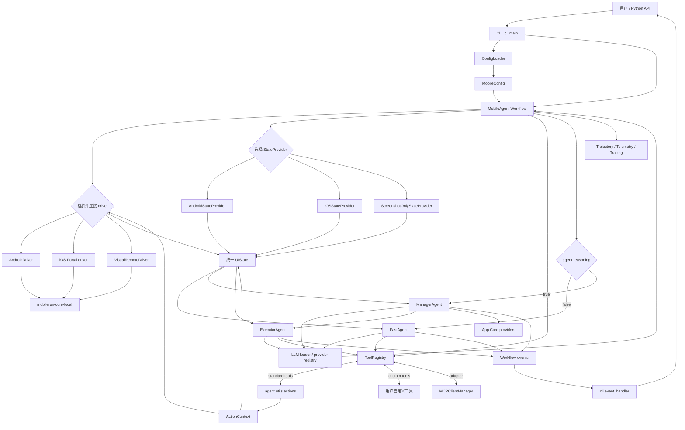
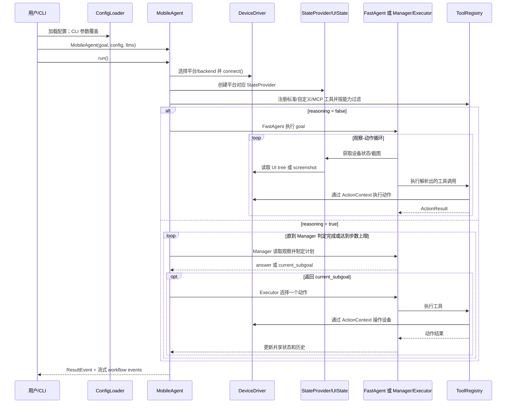

# Mobilerun 源码分析

本文以仓库当前源码为准，解释运行时的目录边界、核心文件职责和一次任务的真实调用链。项目主要使用 Python；`mobilerun/` 是产品运行时包，`docs/` 是 Mintlify 文档站点。

## 1. 仓库目录

| 目录 | 职责 |
| --- | --- |
| `mobilerun/` | 框架主包：CLI、Agent 工作流、配置、工具适配、宏、MCP、遥测等。 |
| `mobilerun/agent/` | Agent 工作流和模型交互，是任务编排核心。 |
| `mobilerun/tools/` | UI 状态建模、无障碍树处理、坐标与截图适配；设备驱动主体来自 `mobilerun-core-local`。 |
| `mobilerun/cli/` | `mobilerun` 命令行入口、设备命令、配置向导和事件输出。 |
| `mobilerun/config_manager/` | 配置 schema、加载/迁移、路径、提示词和凭据来源解析。 |
| `mobilerun/credential_manager/` | Agent 可使用的秘密凭据读取接口及文件实现。 |
| `mobilerun/app_cards/` | 按当前应用加载应用专属提示内容。 |
| `mobilerun/macro/` | 交互轨迹录制、匹配、交接和回放。 |
| `mobilerun/mcp/` | MCP server 配置、工具发现、连接管理和工具格式转换。 |
| `mobilerun/telemetry/` | 产品事件遥测及 Phoenix/Langfuse 追踪集成。 |
| `mobilerun/config/` | 随包分发的 Agent 提示词模板、应用卡片和凭据示例等资源，不是 Python 配置加载逻辑。 |
| `compat/droidrun/` | 旧 `droidrun` 包名的兼容层，供旧导入路径平滑迁移。 |
| `tests/` | 自动化测试，按 Agent、设备、配置、提供商和集成功能覆盖源码行为。 |
| `agent-test-flows/` | 面向编码 Agent 的测试流程说明/材料，不属于运行时导入包。 |
| `docs/` | Mintlify 文档源文件和站点资源。 |
| `static/` | README、文档或项目展示使用的图片、动图等静态资源。 |
| `compat/` | 兼容包及其独立打包配置。 |

入口关系：`pyproject.toml` 将 `mobilerun` 命令绑定到 `mobilerun.cli.main:cli`；`python -m mobilerun` 则由 `mobilerun/__main__.py` 转交给同一个 CLI。

## 2. 核心目录文件索引

下表中的“核心目录”按参与运行时控制流或扩展接口定义。每个列出的 Python 文件均在当前仓库中；资源文件另列于 [提示词和静态配置](#提示词和静态配置)。

### 2.1 包入口和 Agent

| 文件 | 职责 |
| --- | --- |
| `mobilerun/__init__.py` | 设置包级日志、版本和公共 API；导出 `MobileAgent`、配置、驱动、宏等对象，并保留旧名称别名。 |
| `mobilerun/__main__.py` | `python -m mobilerun` 入口，调用 CLI。 |
| `mobilerun/log_handlers.py` | Mobilerun logger 的 handler、格式和统一配置。 |
| `mobilerun/agent/__init__.py` | Agent 公共导出，包含可流式返回的 `ResultEvent`。 |
| `mobilerun/agent/action_context.py` | 将 driver、当前 UI、共享 Agent 状态和 state provider 封装为动作函数上下文。 |
| `mobilerun/agent/action_result.py` | 工具动作统一结果结构。 |
| `mobilerun/agent/common/__init__.py` | common 事件和常量包的导出入口。 |
| `mobilerun/agent/common/constants.py` | Agent prompt/history 使用的公共限制常量。 |
| `mobilerun/agent/common/events.py` | 多工作流共用的 UI 状态、截图、工具执行等事件定义。 |
| `mobilerun/agent/droid/__init__.py` | 导出 `MobileAgent`、共享状态及结果事件。 |
| [`droid_agent.py`](https://github.com/droidrun/mobilerun/blob/main/mobilerun/agent/droid/droid_agent.py) | 顶层 LlamaIndex Workflow：解析运行模式，选择/连接 driver，装配 provider、工具和子 Agent，推进工作流并负责收尾。 |
| `mobilerun/agent/droid/events.py` | MobileAgent 与 FastAgent、Manager、Executor 之间的事件载荷。 |
| [`state.py`](https://github.com/droidrun/mobilerun/blob/main/mobilerun/agent/droid/state.py) | `MobileAgentState`：跨步骤共享设备观察、计划、历史、记忆、完成状态和外部消息队列。 |
| `mobilerun/agent/fast_agent/__init__.py` | FastAgent 公开导出。 |
| [`fast_agent.py`](https://github.com/droidrun/mobilerun/blob/main/mobilerun/agent/fast_agent/fast_agent.py) | 直接执行工作流：LLM 生成 XML 工具调用，解析、调度工具、收集观察并循环到任务完成。 |
| `mobilerun/agent/fast_agent/events.py` | FastAgent 内部输入、LLM 响应、执行结果和结束事件。 |
| [`xml_parser.py`](https://github.com/droidrun/mobilerun/blob/main/mobilerun/agent/fast_agent/xml_parser.py) | 解析模型输出中的 XML 工具调用、类型转换及解析状态。 |
| `mobilerun/agent/manager/__init__.py` | 导出有状态和无状态 Manager 实现。 |
| [`manager_agent.py`](https://github.com/droidrun/mobilerun/blob/main/mobilerun/agent/manager/manager_agent.py) | 推理模式的规划器：读取状态与历史，生成计划/子目标，判断是否完成并处理响应校验。 |
| `mobilerun/agent/manager/stateless_manager_agent.py` | 无状态 Manager 变体，按配置选择不同的上下文/历史策略。 |
| `mobilerun/agent/manager/events.py` | Manager 工作流的上下文、响应和计划事件。 |
| `mobilerun/agent/manager/prompts.py` | Manager 响应解析、结构校验及校验错误类型。 |
| `mobilerun/agent/executor/__init__.py` | Executor 公开导出。 |
| [`executor_agent.py`](https://github.com/droidrun/mobilerun/blob/main/mobilerun/agent/executor/executor_agent.py) | 推理模式的动作执行器：接收 Manager 子目标，选择单个动作、通过 registry 调用并返回结果。 |
| `mobilerun/agent/executor/events.py` | Executor 上下文、动作选择和执行结果事件。 |
| `mobilerun/agent/executor/prompts.py` | Executor prompt 组装辅助逻辑。 |
| `mobilerun/agent/tool_registry.py` | 标准工具、用户自定义工具和 MCP 工具共用的注册、能力过滤、签名生成和执行分发层。 |
| `mobilerun/agent/external/README.md` | 外部 Agent 扩展的使用说明。 |
| `mobilerun/agent/external/__init__.py` | 发现和动态加载外部 Agent，并提供其可用列表。 |
| `mobilerun/agent/oneflows/__init__.py` | 一次性子工作流的导出入口。 |
| `mobilerun/agent/oneflows/app_starter_workflow.py` | 为打开/启动应用提供专用工作流。 |
| `mobilerun/agent/oneflows/structured_output_agent.py` | 在主任务之后将观察/结果提取为用户指定的结构化输出。 |
| `mobilerun/agent/trajectory/__init__.py` | 轨迹写入器导出。 |
| `mobilerun/agent/trajectory/writer.py` | 异步写入执行轨迹、阶段快照等记录。 |
| `mobilerun/agent/usage.py` | LLM token 用量数据的提取与汇总。 |

#### Agent 提供商与工具辅助模块

| 文件 | 职责 |
| --- | --- |
| `mobilerun/agent/providers/__init__.py` | 提供商元数据模块导出。 |
| `mobilerun/agent/providers/types.py` | 提供商族和具体变体的类型定义。 |
| `mobilerun/agent/providers/registry.py` | Provider、认证模式、模型变体和展示名称的中心注册表。 |
| `mobilerun/agent/providers/setup_service.py` | 将配置向导选择转换成 profile，并应用到 Agent 角色。 |
| `mobilerun/agent/providers/anthropic.py` | Anthropic 模型上下文窗口及采样参数能力元数据/兼容处理。 |
| `mobilerun/agent/providers/grok.py` | Grok/xAI 模型 ID 和 Responses API 参数兼容处理。 |
| `mobilerun/agent/providers/minimax.py` | MiniMax endpoint、模型上下文和默认参数兼容处理。 |
| `mobilerun/agent/utils/__init__.py` | Agent 通用工具函数包入口。 |
| `mobilerun/agent/utils/actions.py` | 点击、滑动、输入、启动应用、等待和完成等标准动作函数。 |
| `mobilerun/agent/utils/android_device.py` | ADB 设备序列号选择和冲突/缺失诊断。 |
| `mobilerun/agent/utils/chat_utils.py` | LLM 对话消息和多模态内容处理辅助函数。 |
| `mobilerun/agent/utils/errors.py` | 将底层/provider 错误转换为简洁、可展示的描述。 |
| `mobilerun/agent/utils/inference.py` | 模型推理调用的重试及异常处理辅助逻辑。 |
| `mobilerun/agent/utils/llm_loader.py` | 按配置加载各 Agent 角色 LLM，并合并显式传入的模型。 |
| `mobilerun/agent/utils/llm_picker.py` | 根据 provider 和模型名实例化 LLM。 |
| `mobilerun/agent/utils/oauth/anthropic_oauth_llm.py` | Anthropic OAuth 凭据到 LLM 请求的适配。 |
| `mobilerun/agent/utils/oauth/gemini_oauth_code_assist_llm.py` | Gemini Code Assist OAuth 的 LLM 适配。 |
| `mobilerun/agent/utils/oauth/grok_oauth_llm.py` | xAI 订阅 OAuth 到 Responses API 的传输适配。 |
| `mobilerun/agent/utils/oauth/login_timeout.py` | OAuth 交互登录的超时策略辅助。 |
| `mobilerun/agent/utils/oauth/openai_oauth_llm.py` | OpenAI OAuth 凭据到 LlamaIndex LLM 的适配。 |
| `mobilerun/agent/utils/portal_setup.py` | Portal 安装/版本检查调用的兼容参数构建。 |
| `mobilerun/agent/utils/prompt_resolver.py` | 解析默认 prompt 与调用者覆盖的 prompt 内容。 |
| `mobilerun/agent/utils/signatures.py` | 注册标准动作及参数 schema，构建 `ToolRegistry`。 |
| `mobilerun/agent/utils/tracing_setup.py` | 初始化追踪并关联 session、截图等上下文。 |
| `mobilerun/agent/utils/trajectory.py` | 执行轨迹数据结构与序列化辅助。 |
| `mobilerun/agent/utils/vision_sizing.py` | 按模型能力确定截图尺寸及视觉坐标模式。 |

### 2.2 CLI、配置与凭据

| 文件 | 职责 |
| --- | --- |
| `mobilerun/cli/__init__.py` | CLI 包入口。 |
| [`mobilerun/cli/main.py`](https://github.com/droidrun/mobilerun/blob/main/mobilerun/cli/main.py) | Click 命令定义；加载配置、应用命令行覆盖、创建 `MobileAgent`、消费事件流并返回任务结果。 |
| `mobilerun/cli/event_handler.py` | 将 Agent workflow 事件翻译成 CLI 进度、动作、输出和错误展示。 |
| `mobilerun/cli/configure_wizard.py` | 交互式配置 provider、模型、角色和配置文件。 |
| `mobilerun/cli/configure_prompts.py` | 配置向导中选择项和提示文本的数据结构/构建辅助。 |
| `mobilerun/cli/device_commands.py` | 设备列表、截图、UI 状态和直接设备动作命令；处理本地/云设备连接。 |
| `mobilerun/cli/deviceauth.py` | OAuth 2.0 Device Authorization Grant 客户端流程。 |
| `mobilerun/cli/doctor.py` | 环境、设备、配置和依赖健康检查。 |
| `mobilerun/cli/logs.py` | CLI 日志查看/格式化命令。 |
| `mobilerun/cli/oauth_actions.py` | 将各 provider 的 OAuth 登录操作封装为 CLI 可调用流程。 |
| `mobilerun/config_manager/__init__.py` | 配置 schema、loader 和管理 API 的公共导出。 |
| [`config_manager.py`](https://github.com/droidrun/mobilerun/blob/main/mobilerun/config_manager/config_manager.py) | `MobileConfig` 及 Agent、设备、LLM profile、日志、遥测、工具等配置 schema 与字典转换。 |
| [`loader.py`](https://github.com/droidrun/mobilerun/blob/main/mobilerun/config_manager/loader.py) | 配置文件搜索优先级、首次初始化、版本迁移和安全保存。 |
| `mobilerun/config_manager/path_resolver.py` | 包资源、项目目录和用户路径的统一解析。 |
| `mobilerun/config_manager/prompt_loader.py` | 加载并渲染配置中的 Jinja2 prompt 模板。 |
| `mobilerun/config_manager/credential_paths.py` | OAuth/provider 凭据文件路径常量和解析。 |
| `mobilerun/config_manager/env_keys.py` | provider API key 的环境变量发现、来源优先级与持久化辅助。 |
| `mobilerun/config_manager/auth_profile_store.py` | 安全保存和读取认证/profile 信息。 |
| `mobilerun/config_manager/migrations/__init__.py` | 迁移版本注册与顺序执行入口。 |
| `mobilerun/config_manager/migrations/v002_add_code_exec.py` | 旧配置迁移：补充 code-exec 配置。 |
| `mobilerun/config_manager/migrations/v003_add_auto_setup.py` | 旧配置迁移：补充设备自动设置字段。 |
| `mobilerun/config_manager/migrations/v004_remove_deprecated_agents.py` | 旧配置迁移：清理弃用的 Agent 配置。 |
| `mobilerun/config_manager/migrations/v005_remove_external_agents.py` | 旧配置迁移：清理旧 external-agent 配置格式。 |
| `mobilerun/config_manager/migrations/v006_disabled_tools_default_sentinel.py` | 迁移禁用工具默认值语义。 |
| `mobilerun/config_manager/migrations/v007_manager_prompt_auto.py` | 迁移 Manager prompt 到自动选择默认模板的语义。 |
| `mobilerun/credential_manager/__init__.py` | CredentialManager 接口及默认实现的公共导出。 |
| `mobilerun/credential_manager/credential_manager.py` | Agent 可调用的凭据管理抽象接口。 |
| `mobilerun/credential_manager/file_credential_manager.py` | 从凭据文件加载秘密并提供按 ID 查询。 |

### 2.3 工具、设备观察与适配

| 文件 | 职责 |
| --- | --- |
| `mobilerun/tools/__init__.py` | 对外导出 driver、`UIState` 和 state provider；driver 类由 `mobilerun-core-local` 提供。 |
| `mobilerun/tools/driver/__init__.py` | 旧工具层 driver 导入路径的兼容导出。 |
| `mobilerun/tools/filters/__init__.py` | 无障碍树过滤器导出。 |
| `mobilerun/tools/filters/base.py` | 树过滤器接口。 |
| `mobilerun/tools/filters/concise_filter.py` | 生成适合紧凑 LLM 上下文的无障碍树。 |
| `mobilerun/tools/filters/detailed_filter.py` | 保留更完整元素细节的无障碍树过滤器。 |
| `mobilerun/tools/formatters/__init__.py` | 树格式化器导出。 |
| `mobilerun/tools/formatters/base.py` | UI 树格式化接口。 |
| `mobilerun/tools/formatters/indexed_formatter.py` | 将 UI 元素格式化为带索引、可供动作工具引用的文本。 |
| `mobilerun/tools/helpers/__init__.py` | 坐标、几何、元素和图像辅助函数导出。 |
| `mobilerun/tools/helpers/coordinate.py` | 常规与 0–1000 归一化坐标转换。 |
| `mobilerun/tools/helpers/element_search.py` | 在 UI 元素集合中查找目标元素。 |
| `mobilerun/tools/helpers/geometry.py` | 元素 bounds 解析及点击点几何计算。 |
| `mobilerun/tools/helpers/images.py` | 截图尺寸读取、缩放和带坐标网格的图像处理。 |
| `mobilerun/tools/ui/__init__.py` | `UIState` 与各平台 state provider 的公共导出。 |
| [`provider.py`](https://github.com/droidrun/mobilerun/blob/main/mobilerun/tools/ui/provider.py) | `StateProvider` 抽象、Android provider、状态读取重试/恢复和模型截图尺寸处理。 |
| [`ios_provider.py`](https://github.com/droidrun/mobilerun/blob/main/mobilerun/tools/ui/ios_provider.py) | 将 iOS Portal 无障碍树解析为统一 `UIState`，并协调截图像素与触控点坐标。 |
| [`screenshot_provider.py`](https://github.com/droidrun/mobilerun/blob/main/mobilerun/tools/ui/screenshot_provider.py) | 仅依靠截图生成观察状态，供 screenshot-only/visual-remote 后端使用。 |
| [`state.py`](https://github.com/droidrun/mobilerun/blob/main/mobilerun/tools/ui/state.py) | 统一 UI 快照模型：元素、格式化文本、屏幕尺寸、坐标换算和元素索引。 |
| `mobilerun/tools/ui/stealth_state.py` | 具有随机化点击点解析的 `UIState` 变体。 |
| `mobilerun/tools/ios/__init__.py` | iOS 工具命名空间入口。 |

### 2.4 应用卡片、宏、MCP 和遥测

| 文件 | 职责 |
| --- | --- |
| `mobilerun/app_cards/__init__.py` | App Card provider 公共导出。 |
| `mobilerun/app_cards/app_card_provider.py` | 应用卡片加载器抽象接口。 |
| `mobilerun/app_cards/providers/__init__.py` | Local、Server、Composite provider 导出。 |
| `mobilerun/app_cards/providers/local_provider.py` | 按平台和应用标识从本地目录加载卡片。 |
| `mobilerun/app_cards/providers/server_provider.py` | 从远端服务请求应用专属上下文。 |
| `mobilerun/app_cards/providers/composite_provider.py` | 组合多个来源的卡片 provider。 |
| `mobilerun/macro/__init__.py` | 宏录制和回放 API 导出。 |
| `mobilerun/macro/__main__.py` | `python -m mobilerun.macro` 命令行入口。 |
| `mobilerun/macro/cli.py` | 宏相关 Click 命令定义。 |
| `mobilerun/macro/recorder.py` | 将设备动作和观察记录成宏。 |
| `mobilerun/macro/replay.py` | 读取并按步骤重放宏。 |
| `mobilerun/macro/matcher.py` | 比较当前 UI 状态与宏步骤的匹配逻辑。 |
| `mobilerun/macro/state.py` | 宏步骤的状态快照与模式数据结构。 |
| `mobilerun/macro/handoff.py` | 宏回放与 Agent 执行之间的交接逻辑。 |
| `mobilerun/mcp/__init__.py` | MCP 集成公共导出。 |
| [`mcp/client.py`](https://github.com/droidrun/mobilerun/blob/main/mobilerun/mcp/client.py) | 发现 MCP server 工具、按需建立持久会话、调用工具和统一断开连接。 |
| [`mcp/adapter.py`](https://github.com/droidrun/mobilerun/blob/main/mobilerun/mcp/adapter.py) | 将 MCP JSON Schema 和调用包装为 Mobilerun `ToolRegistry` 可接受的工具格式。 |
| `mobilerun/mcp/config.py` | MCP server、过滤规则和连接参数 schema。 |
| `mobilerun/telemetry/__init__.py` | 遥测事件、capture/flush 和追踪集成的统一 API。 |
| `mobilerun/telemetry/events.py` | 产品遥测事件模型。 |
| `mobilerun/telemetry/tracker.py` | 事件发送、隐私/配置开关和客户端生命周期管理。 |
| `mobilerun/telemetry/phoenix.py` | Phoenix span 处理及 span 数据清理辅助。 |
| `mobilerun/telemetry/langfuse_processor.py` | Langfuse/OpenTelemetry span 导出处理。 |

### 2.5 提示词和静态配置

`mobilerun/config/prompts/` 是随包提供的模板，模板选择逻辑在 `config_manager` 和 `agent/utils/prompt_resolver.py` 中：

| 文件 | 用途 |
| --- | --- |
| `mobilerun/config/prompts/fast_agent/system.jinja2` | FastAgent 系统提示模板。 |
| `mobilerun/config/prompts/fast_agent/user.jinja2` | FastAgent 用户消息模板。 |
| `mobilerun/config/prompts/manager/system.jinja2` | 有状态 Manager 默认系统模板。 |
| `mobilerun/config/prompts/manager/stateless.jinja2` | 无状态 Manager 默认系统模板。 |
| `mobilerun/config/prompts/manager/rev1.jinja2` | Manager 的旧版/显式可选模板。 |
| `mobilerun/config/prompts/manager/trained.jinja2` | Manager 的训练版本模板。 |
| `mobilerun/config/prompts/executor/system.jinja2` | Executor 系统提示模板。 |
| `mobilerun/config/prompts/executor/rev1.jinja2` | Executor 的旧版/显式可选模板。 |

`mobilerun/config/app_cards/` 包含 Android/iOS 卡片索引和示例卡片；`credentials_example.yaml` 是凭据格式示例。`mobilerun/config_example.yaml` 是完整运行配置样例，不负责加载逻辑。

## 3. 结合源码的运行时架构

### 系统总览：模块、连接与数据流

可以把 Mobilerun 运行时分成七类模块。它们不是彼此独立的服务，而是在一次 `MobileAgent` Workflow 中通过 Python 对象依赖、共享状态和 Workflow events 协作。

| 模块 | 主要职责 | 关键实现 |
| --- | --- | --- |
| 入口与配置 | 接收目标、加载配置和模型，创建运行实例。 | `cli/main.py`、`config_manager/loader.py`、`MobileConfig`、`MobileAgent` |
| 流程编排 | 初始化设备和依赖，按配置选择 Agent 模式，控制循环和结束。 | `MobileAgent`、`MobileAgentState`、`droid/events.py` |
| 决策与推理 | 观察上下文、请求 LLM、解释响应并决定下一步。 | `FastAgent`，或 `ManagerAgent` + `ExecutorAgent`；`agent/utils/inference.py`、prompt 模板 |
| 设备观察 | 从当前设备取得无障碍树/截图，整理成统一 UI 状态。 | `StateProvider`、`AndroidStateProvider`、`IOSStateProvider`、`ScreenshotOnlyStateProvider`、`UIState` |
| 工具与动作 | 向模型提供工具 schema，将工具调用分发到对应函数。 | `ToolRegistry`、`build_tool_registry`、`agent/utils/actions.py`、`ActionContext` |
| 设备驱动 | 建立设备连接并执行点击、输入、滑动、截图等底层操作。 | `AndroidDriver`、iOS/Visual Remote drivers；实现来自 `mobilerun-core-local` |
| 扩展与观测 | 接入用户/MCP 工具、凭据、应用卡片，并记录事件、轨迹和遥测。 | `mcp/`、`credential_manager/`、`app_cards/`、`TrajectoryWriter`、`telemetry/` |

#### 模块之间怎么连接

主要连接可以概括为：

```text
CLI / SDK
  └─> Config + LLMs
       └─> MobileAgent (Workflow)
            ├─> MobileAgentState ───────────────┐
            ├─> DeviceDriver <─> StateProvider ─┤─> Agent prompt / 当前观察
            ├─> ToolRegistry ─> ActionContext ─┴─> action function ─> DeviceDriver
            └─> FastAgent 或 Manager ─> Executor
                      └─> LLM
```

其中，`MobileAgent` 负责创建和注入依赖；`MobileAgentState` 让父/子 Workflow 共享任务进度和历史；`ActionContext` 把已连接的 driver、当前 UI 和状态依赖传给工具函数；`ToolRegistry` 只负责工具名到函数的映射、过滤和调用，不直接连接设备。MCP/custom tools 可以扩展工具注册表；它们仍由 Agent 经同一注册表调用。Driver 和 StateProvider 是两条互补路径：前者执行设备操作，后者读取并规范化设备状态。

#### 数据怎么流动

一次循环包含两个方向：

1. **观察进入模型**：`StateProvider.get_state()` 从 driver 获取设备信息，构造 `UIState`；Agent 更新 `MobileAgentState` 中的当前/上一轮 UI、截图、焦点和应用信息；prompt builder 把任务、状态、计划/历史、记忆和可选图像组装成 LLM 输入。
2. **动作返回设备**：LLM 输出工具调用；Agent 解析为工具名和参数；`ToolRegistry` 找到函数并传入 `ActionContext`；动作函数调用 `ctx.driver`；执行结果被规范化为 `ActionResult`，再写入 Workflow event 和共享状态/对话历史。
3. **循环控制**：FastAgent 把工具结果追加到对话后重新观察；Manager/Executor 模式把 Executor 结果交还 Manager，由 Manager 根据新观察和历史生成下一子目标或最终答案。

可将数据通路简写为：

```text
设备 ─> Driver ─> StateProvider ─> UIState ─> MobileAgentState ─> Prompt ─> LLM
设备 <─ Driver <─ ActionContext <─ Action function <─ ToolRegistry <─ Tool Call <─ LLM
                                      └─ ActionResult / Workflow Event ─> Agent 状态更新
```

截图、UI 状态和工具执行等 Workflow events 也会沿父/子 Workflow 的事件流向外转发，供 CLI 展示或 trajectory 记录；它们是观测/通知路径，不替代 `MobileAgentState` 中用于下一轮推理的状态。

### 3.1 组件与依赖关系



图中的 `AndroidDriver`、iOS/Visual Remote driver 的核心实现通过 `mobilerun-core-local` 依赖提供；本仓库在 `MobileAgent.start_handler` 中负责实例化/连接、包装、选择对应状态 provider，并将动作与观察接入 Agent 工作流。`mobilerun/tools/driver/` 是兼容导出路径，不是驱动实现所在目录。

### 3.2 一次任务的控制流



具体源码锚点：[`cli.main.run_command`](https://github.com/droidrun/mobilerun/blob/main/mobilerun/cli/main.py) 加载配置并创建 Agent；[`MobileAgent.start_handler`](https://github.com/droidrun/mobilerun/blob/main/mobilerun/agent/droid/droid_agent.py) 装配运行时依赖并按 `agent.reasoning` 分流；[`ToolRegistry.execute`](https://github.com/droidrun/mobilerun/blob/main/mobilerun/agent/tool_registry.py) 统一执行动作并返回 `ActionResult`；[AndroidStateProvider](https://github.com/droidrun/mobilerun/blob/main/mobilerun/tools/ui/provider.py)、[IOSStateProvider](https://github.com/droidrun/mobilerun/blob/main/mobilerun/tools/ui/ios_provider.py) 和 [ScreenshotOnlyStateProvider](https://github.com/droidrun/mobilerun/blob/main/mobilerun/tools/ui/screenshot_provider.py) 将平台观察统一成 `UIState`。

### 3.3 Agent 如何规划和执行

运行入口 [`MobileAgent`](https://github.com/droidrun/mobilerun/blob/main/mobilerun/agent/droid/droid_agent.py) 是顶层 Workflow。它根据 `AgentConfig.reasoning` 选择执行策略；两种模式都会使用共享状态、设备观察、工具注册表和 `ActionContext`，但决策循环不同。

#### 直接执行：FastAgent

当 `reasoning=False` 时，`MobileAgent.start_handler` 将原始目标交给 [`FastAgent`](https://github.com/droidrun/mobilerun/blob/main/mobilerun/agent/fast_agent/fast_agent.py)。FastAgent 自己完成观察、推理和动作循环：

1. `prepare_chat` 创建初始目标消息并准备 prompt。
2. `handle_llm_input` 读取最新 `UIState` 和可选截图，构建本次 LLM 请求。
3. LLM 在文本中输出 `<function_calls>`；[`xml_parser.py`](https://github.com/droidrun/mobilerun/blob/main/mobilerun/agent/fast_agent/xml_parser.py) 解析工具名和参数。
4. `handle_llm_output` 决定重试、执行工具，或在模型未输出工具调用时要求其补充。
5. `execute_code` 经 `ToolRegistry` 执行调用；工具结果被格式化为 `<function_results>`。
6. `handle_execution_result` 将工具结果加入消息历史，下一轮重新读取设备状态。
7. 调用 `complete` 后结束循环；`finalize` 返回成功状态和结果。

可顺着 [`FastAgent.prepare_chat`、`handle_llm_input`、`handle_llm_output`、`execute_code`、`handle_execution_result`](https://github.com/droidrun/mobilerun/blob/main/mobilerun/agent/fast_agent/fast_agent.py) 阅读完整闭环。FastAgent 的工具协议是解析 XML 文本，而不是直接执行任意生成代码。

#### 分层规划：Manager + Executor

当 `reasoning=True` 时，`MobileAgent` 选择 [`ManagerAgent`](https://github.com/droidrun/mobilerun/blob/main/mobilerun/agent/manager/manager_agent.py)（或配置启用的 `StatelessManagerAgent`）与 [`ExecutorAgent`](https://github.com/droidrun/mobilerun/blob/main/mobilerun/agent/executor/executor_agent.py)，由父 Workflow 逐轮调度：

1. `MobileAgent.run_manager` 启动 Manager。Manager 获取当前 UI/截图，结合指令、历史、计划和记忆构造 prompt。
2. Manager 输出一个 `<plan>` 或最终答案。[`manager/prompts.py`](https://github.com/droidrun/mobilerun/blob/main/mobilerun/agent/manager/prompts.py) 负责解析与校验；无效格式最多触发 3 次重试。
3. `MobileAgent.handle_manager_plan` 发现计划时，将第一条子目标交给 Executor；发现最终答案时则结束主流程。
4. `ExecutorAgent.prepare_context` 把计划、当前子目标、设备状态、近期动作和工具签名放入 prompt；LLM 输出一个动作。
5. Executor 解析 JSON 动作，通过 `ToolRegistry.execute` 执行，并将结果作为 `ExecutorActionResultEvent` 返回。
6. `MobileAgent.run_executor` 将动作、摘要、成功与错误写入 `MobileAgentState`；`handle_executor_result` 再将控制权交回 Manager。

因此，Manager 决定“接下来要完成什么”，Executor 决定“本步调用哪个动作以及参数”，而实际设备操作由动作函数和 driver 完成。相关控制流集中在 [`droid_agent.py`](https://github.com/droidrun/mobilerun/blob/main/mobilerun/agent/droid/droid_agent.py) 的 `run_manager`、`handle_manager_plan`、`run_executor` 和 `handle_executor_result`。

### 3.4 上下文、记忆与上下文长度

上下文不是单一的聊天记录。核心状态模型是 [`MobileAgentState`](https://github.com/droidrun/mobilerun/blob/main/mobilerun/agent/droid/state.py)，通过 [`ActionContext`](https://github.com/droidrun/mobilerun/blob/main/mobilerun/agent/action_context.py) 向工具提供当前 driver、UI、state provider、凭据管理器等依赖。

| 数据 | 保存位置和用途 |
| --- | --- |
| 当前/前一轮设备状态、截图、无障碍树 | `MobileAgentState.formatted_device_state`、`previous_formatted_device_state`、`screenshot`、`a11y_tree` 等字段。Manager/FastAgent 每轮从 StateProvider 刷新；Executor 使用共享状态中 Manager 最近一次采集的状态和截图。 |
| 计划和进度 | `plan`、`previous_plan`、`current_subgoal`、`progress_summary` 等字段，由 Manager 更新、Executor 消费。 |
| 动作历史 | `action_history`、`summary_history`、`action_outcomes`、`error_descriptions`。Executor 和 Stateless Manager 在 prompt 中只使用最近最多 5 条。 |
| 对话消息 | `message_history: List[ChatMessage]`。普通 Manager 追加每轮 user/assistant 消息；FastAgent 追加 assistant 响应与工具结果消息。FastAgent 开始任务时会清空这份对话历史并创建新的目标消息。 |
| Agent 记忆 | `agent_memory` 是共享状态中的字符串，由 `append_memory` 追加。FastAgent 从 `<add_memory>` 提取，Manager 从响应的 `<add_memory>` 标签提取；两者在 prompt 构造时都可将其提供给模型。它是当前共享状态中的工作记忆，不是跨任务的持久记忆库。 |
| Workflow 临时数据 | LlamaIndex `Context.store` 存放单次 Workflow 内传递的数据，例如 Executor prompt 消息和待执行的 FastAgent 工具调用；它不等同于对话历史。 |
| 运行轨迹 | [`Trajectory`](https://github.com/droidrun/mobilerun/blob/main/mobilerun/agent/utils/trajectory.py) 与 [`TrajectoryWriter`](https://github.com/droidrun/mobilerun/blob/main/mobilerun/agent/trajectory/writer.py) 可选保存事件、UI 状态、截图和宏操作，主要用于诊断/回放，不会自动成为后续推理记忆。 |

上下文长度方面，当前代码提供的是**有限的消息数量裁剪，而非通用的 token 预算或记忆压缩**：

- FastAgent 在发送请求前通过 [`limit_history`](https://github.com/droidrun/mobilerun/blob/main/mobilerun/agent/utils/chat_utils.py) 限制对话消息数。[`LLM_HISTORY_LIMIT`](https://github.com/droidrun/mobilerun/blob/main/mobilerun/agent/common/constants.py) 为 100，调用处乘以 2，即最多保留 200 条消息，并尽可能保留首条消息和近期消息。当前设备状态、记忆、截图和前一状态是在请求副本上追加，不写回原始历史。
- 普通 Manager 会将完整 `message_history` 复制到请求中；代码没有像 FastAgent 那样按消息数截断这份历史。
- Stateless Manager 不累计完整消息对话，而是每轮从共享状态重新构造 prompt；其中动作历史取最近最多 5 条，但 `agent_memory`、计划、当前状态等仍按 prompt 内容传入。
- Executor 每次是一个子目标对应的一次动作决策；prompt 中含当前状态、计划和最多 5 条动作记录，不使用 FastAgent 的对话历史裁剪逻辑。
- `agent_memory` 本身没有长度上限或摘要压缩；消息数限制也不等于 token 数限制。长任务、超长设备树/截图、持续增长的记忆或普通 Manager 历史仍可能触及模型上下文窗口。最终模型上下文窗口受具体 LLM/provider 配置影响。

后续排查上下文问题时，建议一起看 [`state.py`](https://github.com/droidrun/mobilerun/blob/main/mobilerun/agent/droid/state.py)、[`fast_agent.py`](https://github.com/droidrun/mobilerun/blob/main/mobilerun/agent/fast_agent/fast_agent.py) 的 `handle_llm_input`、[`manager_agent.py`](https://github.com/droidrun/mobilerun/blob/main/mobilerun/agent/manager/manager_agent.py) 的 `_build_messages_with_context`、[`stateless_manager_agent.py`](https://github.com/droidrun/mobilerun/blob/main/mobilerun/agent/manager/stateless_manager_agent.py) 的 `_build_prompt`，以及 [`chat_utils.py`](https://github.com/droidrun/mobilerun/blob/main/mobilerun/agent/utils/chat_utils.py) 的 `limit_history`。

### 3.5 Executor 的工具列表

Executor 的“可用工具”不是在 `ExecutorAgent` 中硬编码的一份独立清单。工具由 [`build_tool_registry`](https://github.com/droidrun/mobilerun/blob/main/mobilerun/agent/utils/signatures.py) 注册到 [`ToolRegistry`](https://github.com/droidrun/mobilerun/blob/main/mobilerun/agent/tool_registry.py)，再由 `ExecutorAgent.prepare_context` 调用 `registry.get_signatures(exclude={"complete"})` 放进 prompt。调用时 `ExecutorAgent.execute` 再以工具名和参数调用 `registry.execute`。

内置工具大致分为：

| 类别 | 工具 | 用途 |
| --- | --- | --- |
| 元素/坐标交互 | `click`、`long_press`、`click_at`、`click_area`、`long_press_at` | 按 UI 元素索引或屏幕坐标点击、长按。坐标描述会根据普通 UI 树、截图模式及归一化坐标配置变化。 |
| 输入 | `type`、`type_text` | 输入文本；前者可选定并聚焦元素，后者对当前已聚焦输入框直接输入。 |
| 手势/系统 | `swipe`、`system_button` | 滑动，或按设备支持情况触发 `back`、`home`、`enter` 等系统按键。 |
| 等待/应用 | `wait`、`open_app` | 等待动画/页面加载；启动应用。`open_app` 的参数和实现因平台或精确应用启动模式不同。 |
| 凭据 | `type_secret`（条件注册） | 通过凭据管理器输入秘密值；仅在配置了可用凭据时注册。 |
| 用户扩展 | custom tools、MCP tools | 用户注册或 MCP server 发现的扩展工具，也可进入同一 registry。 |

`complete` 虽然由标准工具注册器注册，但 [`ExecutorAgent._EXCLUDE_TOOLS`](https://github.com/droidrun/mobilerun/blob/main/mobilerun/agent/executor/executor_agent.py) 会将它从 Executor 的模型工具签名中排除；推理模式下由 Manager 的最终答案控制完成。FastAgent 则可以使用 `complete` 工具结束任务。

以上是注册器定义的候选工具，并不保证每次运行全部可用：`ToolRegistry.disable_unsupported` 会按 driver 与 StateProvider 的能力过滤；配置中的禁用工具列表也会继续过滤。自定义/MCP 工具是否可见，还取决于是否成功注册以及后续过滤。动作实现见 [`actions.py`](https://github.com/droidrun/mobilerun/blob/main/mobilerun/agent/utils/actions.py)。

### 3.6 一次 Tool Call 从用户到 Android 的完整链路

下面按“谁接收 → 哪个 Agent 决策 → LLM 看到什么 → 如何判断下一步 → 生成什么 Tool Call → Tool 如何定位设备 → Android 如何执行 → 结果如何返回 → 如何继续/结束”串起源码调用链。`reasoning=False` 和 `reasoning=True` 共用设备、工具和动作层，但模型输出格式、决策层级和结束条件不同。

| 环节 | 源码中的实现 |
| --- | --- |
| **谁接收用户目标？** | CLI 路径由 [`cli/main.py`](https://github.com/droidrun/mobilerun/blob/main/mobilerun/cli/main.py) 读取目标并创建 `MobileAgent`；Python SDK 路径由调用方直接创建 `MobileAgent(goal=...)`。目标进入 `MobileAgentState.instruction`。运行后，LlamaIndex Workflow 的 `start_handler` 开始装配本次运行。 |
| **哪个 Agent 决策？** | `MobileAgent.start_handler` 根据 `AgentConfig.reasoning` 分流。`False` 时由 [`FastAgent`](https://github.com/droidrun/mobilerun/blob/main/mobilerun/agent/fast_agent/fast_agent.py) 同时负责观察、决策和工具循环；`True` 时由 [`ManagerAgent`](https://github.com/droidrun/mobilerun/blob/main/mobilerun/agent/manager/manager_agent.py) 规划目标，[`ExecutorAgent`](https://github.com/droidrun/mobilerun/blob/main/mobilerun/agent/executor/executor_agent.py) 为当前子目标选择一个动作。 |
| **LLM 看到什么？** | FastAgent prompt 由 system/user prompt、有限的对话历史、当前设备状态、累计记忆和可选截图组成；Manager prompt 加入任务、计划、最近动作、状态/截图、错误上下文和记忆；Executor prompt 加入当前计划和子目标、设备状态、最多 5 条动作历史、工具签名及可选截图。数据由 `MobileAgentState` 提供，UI 由 StateProvider 获取；各 Agent 的 `prepare_context`/`handle_llm_input` 负责组装请求。 |
| **如何判断下一步？** | FastAgent 解析当前 LLM 输出：有合法工具调用就执行；没有调用时要求模型补充；格式错误时重试，达到连续错误上限则失败结束；工具结果进入下一轮后再次观察。Manager/Executor 模式下，Manager 的 `<plan>` 产生当前 subgoal 并交给 Executor，最终答案则结束任务；Executor 每次只执行一个动作，父流程收集结果后回到 Manager 重新判断。主流程还受 `max_steps` 限制。 |
| **生成什么 Tool Call？** | FastAgent 的 LLM 输出 `<function_calls><invoke name="...">...</invoke></function_calls>`，由 [`fast_agent/xml_parser.py`](https://github.com/droidrun/mobilerun/blob/main/mobilerun/agent/fast_agent/xml_parser.py) 解析。Executor 输出包含 `action` 字段的 JSON，由 [`executor/prompts.py`](https://github.com/droidrun/mobilerun/blob/main/mobilerun/agent/executor/prompts.py) 解析，例如 `{"action":"click","index":3}`。两种格式最后都变成工具名和参数，再进入 `ToolRegistry`。 |
| **Tool 怎么找到手机？** | Tool 不会根据工具名自行搜索手机。`MobileAgent.start_handler` 先选择并连接设备 driver；Android 未显式指定 serial 时会调用 `resolve_android_serial()`，随后建立 `AndroidDriver`。根据配置，driver 还可能被 StealthDriver 或 RecordingDriver 包装。构造好的 driver 放入 [`ActionContext`](https://github.com/droidrun/mobilerun/blob/main/mobilerun/agent/action_context.py)，注册表执行工具时把这个 context 作为 `ctx` 参数传给动作函数。 |
| **Android 怎么执行？** | [`ToolRegistry.execute`](https://github.com/droidrun/mobilerun/blob/main/mobilerun/agent/tool_registry.py) 依据名称找到注册的函数并传入参数和 `ActionContext`。例如 `click(index)` 从 `ctx.ui` 查出元素坐标，再调用 `ctx.driver.tap(x, y)`；`type` 调用 driver 的输入接口。具体 Android 设备通信由 `mobilerun-core-local` 中的 driver 实现负责；本仓库的 `agent/utils/actions.py` 负责把 Agent 动作转成 driver 调用。 |
| **执行结果如何返回？** | 动作函数返回 [`ActionResult`](https://github.com/droidrun/mobilerun/blob/main/mobilerun/agent/action_result.py)（`success`、`summary`）；`ToolRegistry` 归一化结果，并可发送 `ToolExecutionEvent`。FastAgent 将摘要格式化成 `<function_results>` 并追加到对话，Executor 将结果放入 `ExecutorActionResultEvent`，父级 `MobileAgent.run_executor` 再将动作、成功状态、摘要和错误写入共享状态。 |
| **Agent 如何决定继续或结束？** | FastAgent 在工具结果之后回到下一轮观察与推理；只有 `complete` 设置完成状态后，或达到步数/错误上限时结束。推理模式下，Executor 的结果会经 `handle_executor_result` 返回 Manager；Manager 看到更新后的 UI 和动作历史后，可继续给出下一计划或返回最终答案。父级遇到最终答案、最大步数或不可恢复错误时进入 finalize，并产生最终 `ResultEvent`。 |

关键阅读入口：[`MobileAgent.start_handler`、`run_manager`、`handle_manager_plan`、`run_executor`、`handle_executor_result`](https://github.com/droidrun/mobilerun/blob/main/mobilerun/agent/droid/droid_agent.py)、[`FastAgent.handle_llm_input` 与 `execute_code`](https://github.com/droidrun/mobilerun/blob/main/mobilerun/agent/fast_agent/fast_agent.py)、[`ExecutorAgent.execute`](https://github.com/droidrun/mobilerun/blob/main/mobilerun/agent/executor/executor_agent.py)、[`ToolRegistry.execute`](https://github.com/droidrun/mobilerun/blob/main/mobilerun/agent/tool_registry.py)、[`actions.py`](https://github.com/droidrun/mobilerun/blob/main/mobilerun/agent/utils/actions.py)。注意区分：工具注册表负责按名称分发；`ActionContext.driver` 指向本次运行已连接的设备；driver 实现负责具体平台通信。

## 4. 关键边界与阅读路径

- **任务编排边界：** `MobileAgent` 拥有整次运行和共享 `MobileAgentState`；Manager/Executor/FastAgent 是被编排的子 workflow。
- **动作扩展边界：** 所有模型可见动作都经过 `ToolRegistry`。标准动作、用户工具和 MCP 工具在注册后共用能力过滤和执行分发。
- **观察抽象边界：** Agent 消费统一 `UIState`，不应直接依赖 Android/iOS 原始无障碍树格式；平台差异由 provider 适配。
- **设备实现边界：** 连接、截图、触控等具体驱动实现属于 `mobilerun-core-local`；Mobilerun 主仓库负责选择、配置及与 Agent 接口的组合。
- **外部副作用边界：** 轨迹、遥测和 tracing 在主流程之外记录运行过程；关闭对应配置时不参与动作选择。

推荐阅读顺序：

1. `mobilerun/cli/main.py`：理解入口如何创建运行。
2. `mobilerun/agent/droid/droid_agent.py`：理解设备装配、分支和生命周期。
3. `mobilerun/agent/droid/state.py` 与 `mobilerun/agent/action_context.py`：理解共享状态和动作依赖。
4. `mobilerun/agent/fast_agent/fast_agent.py`、`manager/manager_agent.py`、`executor/executor_agent.py`：理解两种执行策略和决策循环。
5. `mobilerun/agent/droid/state.py`、`agent/utils/chat_utils.py`、Manager/FastAgent 的 prompt 构造方法：理解共享状态、消息裁剪、记忆注入及上下文长度边界。
6. `mobilerun/agent/tool_registry.py`、`agent/utils/signatures.py`、`agent/utils/actions.py`：理解 Executor 可见工具、过滤规则及从工具签名到设备动作的调用链。
7. `mobilerun/tools/ui/`：理解观察如何归一化为模型上下文。
8. `mobilerun/config_manager/`、`mcp/`、`app_cards/`、`telemetry/`：理解配置和可选集成。

### 专题：研究 Agent Loop 的阅读路线

**从哪个入口开始？** 如果想从用户命令一路追踪，先从 [`cli/main.py`](https://github.com/droidrun/mobilerun/blob/main/mobilerun/cli/main.py) 找到 CLI 创建并运行 `MobileAgent` 的位置；如果只关心 Agent Loop 本身，直接从 [`MobileAgent.start_handler`](https://github.com/droidrun/mobilerun/blob/main/mobilerun/agent/droid/droid_agent.py) 开始。它完成运行时组装，并按 `agent.reasoning` 选择 FastAgent 或 Manager/Executor。

以下 10 个关键文件按建议阅读顺序排列。无需一开始通读全文件，先定位表中方法/职责，再沿调用关系追踪：

| 顺序 | 文件 | 阅读重点 |
| --- | --- | --- |
| 1 | [`mobilerun/cli/main.py`](https://github.com/droidrun/mobilerun/blob/main/mobilerun/cli/main.py) | 从命令入口确认 goal、配置和 LLM 如何传给 `MobileAgent`。如果你从 Python SDK 启动，可略读此项。 |
| 2 | [`mobilerun/agent/droid/droid_agent.py`](https://github.com/droidrun/mobilerun/blob/main/mobilerun/agent/droid/droid_agent.py) | 先读 `start_handler` 的依赖装配与模式分流；再读 `run_manager`、`handle_manager_plan`、`run_executor`、`handle_executor_result`，理解父 Workflow 的循环与终止条件。 |
| 3 | [`mobilerun/agent/droid/state.py`](https://github.com/droidrun/mobilerun/blob/main/mobilerun/agent/droid/state.py) | 查看 `MobileAgentState` 字段，理解目标、设备观察、消息/动作历史、记忆和完成状态如何跨子 Agent 共享。 |
| 4 | [`mobilerun/agent/fast_agent/fast_agent.py`](https://github.com/droidrun/mobilerun/blob/main/mobilerun/agent/fast_agent/fast_agent.py) | 阅读 `prepare_chat`、`handle_llm_input`、`handle_llm_output`、`execute_code`、`handle_execution_result`；串起直接执行模式的 observe → LLM → tool → result 循环。 |
| 5 | [`mobilerun/agent/fast_agent/xml_parser.py`](https://github.com/droidrun/mobilerun/blob/main/mobilerun/agent/fast_agent/xml_parser.py) | 了解 FastAgent 如何将模型的 XML 文本调用解析成工具名、参数和解析错误。 |
| 6 | [`mobilerun/agent/manager/manager_agent.py`](https://github.com/droidrun/mobilerun/blob/main/mobilerun/agent/manager/manager_agent.py) | 阅读 `prepare_context`、`get_response`、`process_response`；理解规划模式下 Manager 怎样观察、生成计划/最终答案并更新共享状态。 |
| 7 | [`mobilerun/agent/manager/prompts.py`](https://github.com/droidrun/mobilerun/blob/main/mobilerun/agent/manager/prompts.py) | 跟进 `parse_manager_response` 和 `validate_manager_response`，看 Manager 的输出如何变成 subgoal 或最终结果。 |
| 8 | [`mobilerun/agent/executor/executor_agent.py`](https://github.com/droidrun/mobilerun/blob/main/mobilerun/agent/executor/executor_agent.py) | 阅读 `prepare_context`、`process_response`、`execute`；看 Executor 如何从 subgoal 选择一个 JSON 动作并返回执行结果。JSON 响应解析器在同目录的 `prompts.py`。 |
| 9 | [`mobilerun/agent/tool_registry.py`](https://github.com/droidrun/mobilerun/blob/main/mobilerun/agent/tool_registry.py) | 重点看 `get_signatures` 和 `execute`：模型可见的工具签名如何生成，以及名称如何分发到实际函数。 |
| 10 | [`mobilerun/agent/utils/actions.py`](https://github.com/droidrun/mobilerun/blob/main/mobilerun/agent/utils/actions.py) | 选一个具体动作（如 `click`）：跟踪它如何使用 `ActionContext.ui` 找坐标、调用 `ctx.driver`，并返回 `ActionResult`。 |

FastAgent 与 Manager/Executor 是两条不同的循环，不是前后串联的两个阶段；初次阅读建议先跟完其中一条。若从零理解推荐先读 Manager/Executor 路径（第 6–10 项），再读 FastAgent 路径（第 4–5 项）比较差异。需要继续追设备观察链路时，再补读 [`tools/ui/provider.py`](https://github.com/droidrun/mobilerun/blob/main/mobilerun/tools/ui/provider.py) 和 [`tools/ui/state.py`](https://github.com/droidrun/mobilerun/blob/main/mobilerun/tools/ui/state.py)；需要追 Android 底层操作时，注意 driver 实现在 `mobilerun-core-local` 依赖中，不在本仓库的 `mobilerun/tools/driver/` 兼容导出目录。
