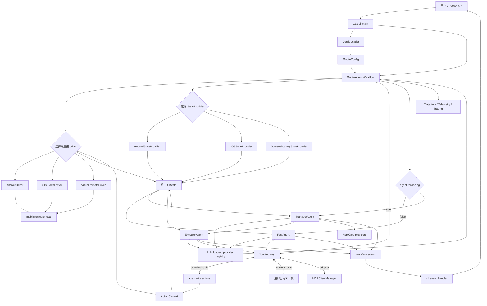
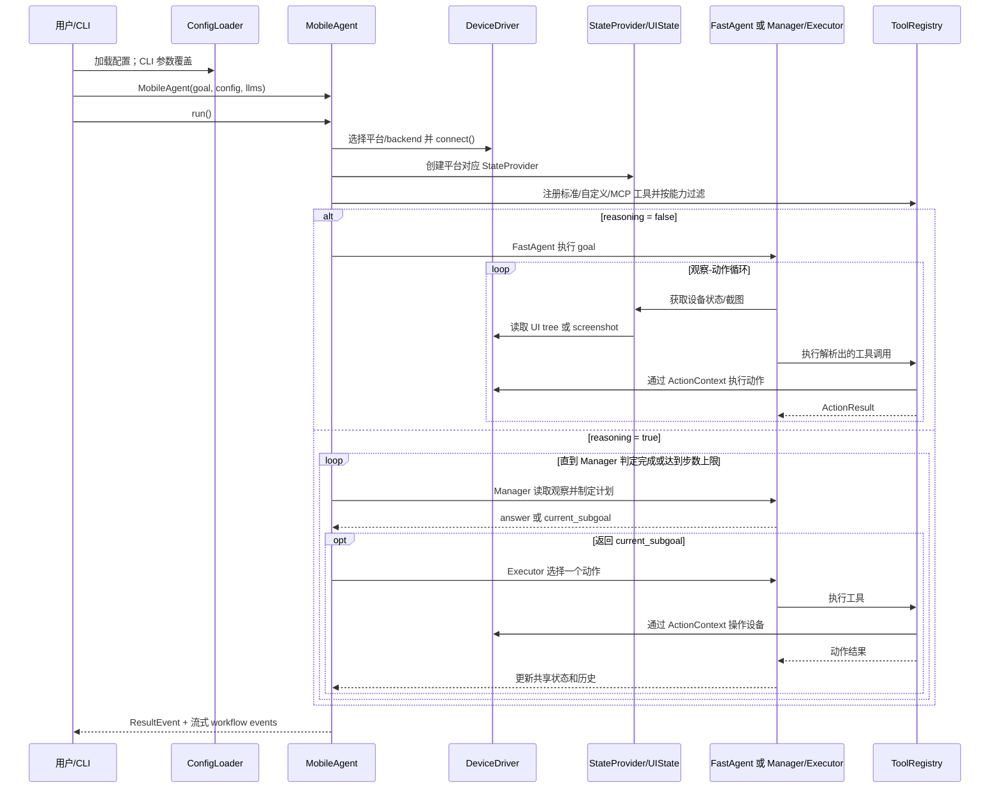

# Mobilerun 源码分析

本文以仓库当前源码为准，解释运行时的目录边界、核心文件职责和一次任务的真实调用链。项目主要使用 Python；`mobilerun/` 是产品运行时包，`docs/` 是 Mintlify 文档站点。

## 1. 仓库目录

| 目录 | 职责 |
| --- | --- |
| `mobilerun/` | 框架主包：CLI、Agent 工作流、配置、工具适配、宏、MCP、遥测等。 |
| `mobilerun/agent/` | Agent 工作流和模型交互，是任务编排核心。 |
| `mobilerun/tools/` | UI 状态建模、无障碍树处理、坐标与截图适配；设备驱动主体来自 `mobilerun-core-local`。 |
| `mobilerun/cli/` | `mobilerun` 命令行入口、设备命令、配置向导和事件输出。 |
| `mobilerun/config_manager/` | 配置 schema、加载/迁移、路径、提示词和凭据来源解析。 |
| `mobilerun/credential_manager/` | Agent 可使用的秘密凭据读取接口及文件实现。 |
| `mobilerun/app_cards/` | 按当前应用加载应用专属提示内容。 |
| `mobilerun/macro/` | 交互轨迹录制、匹配、交接和回放。 |
| `mobilerun/mcp/` | MCP server 配置、工具发现、连接管理和工具格式转换。 |
| `mobilerun/telemetry/` | 产品事件遥测及 Phoenix/Langfuse 追踪集成。 |
| `mobilerun/config/` | 随包分发的 Agent 提示词模板、应用卡片和凭据示例等资源，不是 Python 配置加载逻辑。 |
| `compat/droidrun/` | 旧 `droidrun` 包名的兼容层，供旧导入路径平滑迁移。 |
| `tests/` | 自动化测试，按 Agent、设备、配置、提供商和集成功能覆盖源码行为。 |
| `agent-test-flows/` | 面向编码 Agent 的测试流程说明/材料，不属于运行时导入包。 |
| `docs/` | Mintlify 文档源文件和站点资源。 |
| `static/` | README、文档或项目展示使用的图片、动图等静态资源。 |
| `compat/` | 兼容包及其独立打包配置。 |

入口关系：`pyproject.toml` 将 `mobilerun` 命令绑定到 `mobilerun.cli.main:cli`；`python -m mobilerun` 则由 `mobilerun/__main__.py` 转交给同一个 CLI。

## 2. 核心目录文件索引

下表中的“核心目录”按参与运行时控制流或扩展接口定义。每个列出的 Python 文件均在当前仓库中；资源文件另列于 [提示词和静态配置](#提示词和静态配置)。

### 2.1 包入口和 Agent

| 文件 | 职责 |
| --- | --- |
| `mobilerun/__init__.py` | 设置包级日志、版本和公共 API；导出 `MobileAgent`、配置、驱动、宏等对象，并保留旧名称别名。 |
| `mobilerun/__main__.py` | `python -m mobilerun` 入口，调用 CLI。 |
| `mobilerun/log_handlers.py` | Mobilerun logger 的 handler、格式和统一配置。 |
| `mobilerun/agent/__init__.py` | Agent 公共导出，包含可流式返回的 `ResultEvent`。 |
| `mobilerun/agent/action_context.py` | 将 driver、当前 UI、共享 Agent 状态和 state provider 封装为动作函数上下文。 |
| `mobilerun/agent/action_result.py` | 工具动作统一结果结构。 |
| `mobilerun/agent/common/__init__.py` | common 事件和常量包的导出入口。 |
| `mobilerun/agent/common/constants.py` | Agent prompt/history 使用的公共限制常量。 |
| `mobilerun/agent/common/events.py` | 多工作流共用的 UI 状态、截图、工具执行等事件定义。 |
| `mobilerun/agent/droid/__init__.py` | 导出 `MobileAgent`、共享状态及结果事件。 |
| [`droid_agent.py`](https://github.com/droidrun/mobilerun/blob/main/mobilerun/agent/droid/droid_agent.py) | 顶层 LlamaIndex Workflow：解析运行模式，选择/连接 driver，装配 provider、工具和子 Agent，推进工作流并负责收尾。 |
| `mobilerun/agent/droid/events.py` | MobileAgent 与 FastAgent、Manager、Executor 之间的事件载荷。 |
| [`state.py`](https://github.com/droidrun/mobilerun/blob/main/mobilerun/agent/droid/state.py) | `MobileAgentState`：跨步骤共享设备观察、计划、历史、记忆、完成状态和外部消息队列。 |
| `mobilerun/agent/fast_agent/__init__.py` | FastAgent 公开导出。 |
| [`fast_agent.py`](https://github.com/droidrun/mobilerun/blob/main/mobilerun/agent/fast_agent/fast_agent.py) | 直接执行工作流：LLM 生成 XML 工具调用，解析、调度工具、收集观察并循环到任务完成。 |
| `mobilerun/agent/fast_agent/events.py` | FastAgent 内部输入、LLM 响应、执行结果和结束事件。 |
| [`xml_parser.py`](https://github.com/droidrun/mobilerun/blob/main/mobilerun/agent/fast_agent/xml_parser.py) | 解析模型输出中的 XML 工具调用、类型转换及解析状态。 |
| `mobilerun/agent/manager/__init__.py` | 导出有状态和无状态 Manager 实现。 |
| [`manager_agent.py`](https://github.com/droidrun/mobilerun/blob/main/mobilerun/agent/manager/manager_agent.py) | 推理模式的规划器：读取状态与历史，生成计划/子目标，判断是否完成并处理响应校验。 |
| `mobilerun/agent/manager/stateless_manager_agent.py` | 无状态 Manager 变体，按配置选择不同的上下文/历史策略。 |
| `mobilerun/agent/manager/events.py` | Manager 工作流的上下文、响应和计划事件。 |
| `mobilerun/agent/manager/prompts.py` | Manager 响应解析、结构校验及校验错误类型。 |
| `mobilerun/agent/executor/__init__.py` | Executor 公开导出。 |
| [`executor_agent.py`](https://github.com/droidrun/mobilerun/blob/main/mobilerun/agent/executor/executor_agent.py) | 推理模式的动作执行器：接收 Manager 子目标，选择单个动作、通过 registry 调用并返回结果。 |
| `mobilerun/agent/executor/events.py` | Executor 上下文、动作选择和执行结果事件。 |
| `mobilerun/agent/executor/prompts.py` | Executor prompt 组装辅助逻辑。 |
| `mobilerun/agent/tool_registry.py` | 标准工具、用户自定义工具和 MCP 工具共用的注册、能力过滤、签名生成和执行分发层。 |
| `mobilerun/agent/external/README.md` | 外部 Agent 扩展的使用说明。 |
| `mobilerun/agent/external/__init__.py` | 发现和动态加载外部 Agent，并提供其可用列表。 |
| `mobilerun/agent/oneflows/__init__.py` | 一次性子工作流的导出入口。 |
| `mobilerun/agent/oneflows/app_starter_workflow.py` | 为打开/启动应用提供专用工作流。 |
| `mobilerun/agent/oneflows/structured_output_agent.py` | 在主任务之后将观察/结果提取为用户指定的结构化输出。 |
| `mobilerun/agent/trajectory/__init__.py` | 轨迹写入器导出。 |
| `mobilerun/agent/trajectory/writer.py` | 异步写入执行轨迹、阶段快照等记录。 |
| `mobilerun/agent/usage.py` | LLM token 用量数据的提取与汇总。 |

#### Agent 提供商与工具辅助模块

| 文件 | 职责 |
| --- | --- |
| `mobilerun/agent/providers/__init__.py` | 提供商元数据模块导出。 |
| `mobilerun/agent/providers/types.py` | 提供商族和具体变体的类型定义。 |
| `mobilerun/agent/providers/registry.py` | Provider、认证模式、模型变体和展示名称的中心注册表。 |
| `mobilerun/agent/providers/setup_service.py` | 将配置向导选择转换成 profile，并应用到 Agent 角色。 |
| `mobilerun/agent/providers/anthropic.py` | Anthropic 模型上下文窗口及采样参数能力元数据/兼容处理。 |
| `mobilerun/agent/providers/grok.py` | Grok/xAI 模型 ID 和 Responses API 参数兼容处理。 |
| `mobilerun/agent/providers/minimax.py` | MiniMax endpoint、模型上下文和默认参数兼容处理。 |
| `mobilerun/agent/utils/__init__.py` | Agent 通用工具函数包入口。 |
| `mobilerun/agent/utils/actions.py` | 点击、滑动、输入、启动应用、等待和完成等标准动作函数。 |
| `mobilerun/agent/utils/android_device.py` | ADB 设备序列号选择和冲突/缺失诊断。 |
| `mobilerun/agent/utils/chat_utils.py` | LLM 对话消息和多模态内容处理辅助函数。 |
| `mobilerun/agent/utils/errors.py` | 将底层/provider 错误转换为简洁、可展示的描述。 |
| `mobilerun/agent/utils/inference.py` | 模型推理调用的重试及异常处理辅助逻辑。 |
| `mobilerun/agent/utils/llm_loader.py` | 按配置加载各 Agent 角色 LLM，并合并显式传入的模型。 |
| `mobilerun/agent/utils/llm_picker.py` | 根据 provider 和模型名实例化 LLM。 |
| `mobilerun/agent/utils/oauth/anthropic_oauth_llm.py` | Anthropic OAuth 凭据到 LLM 请求的适配。 |
| `mobilerun/agent/utils/oauth/gemini_oauth_code_assist_llm.py` | Gemini Code Assist OAuth 的 LLM 适配。 |
| `mobilerun/agent/utils/oauth/grok_oauth_llm.py` | xAI 订阅 OAuth 到 Responses API 的传输适配。 |
| `mobilerun/agent/utils/oauth/login_timeout.py` | OAuth 交互登录的超时策略辅助。 |
| `mobilerun/agent/utils/oauth/openai_oauth_llm.py` | OpenAI OAuth 凭据到 LlamaIndex LLM 的适配。 |
| `mobilerun/agent/utils/portal_setup.py` | Portal 安装/版本检查调用的兼容参数构建。 |
| `mobilerun/agent/utils/prompt_resolver.py` | 解析默认 prompt 与调用者覆盖的 prompt 内容。 |
| `mobilerun/agent/utils/signatures.py` | 注册标准动作及参数 schema，构建 `ToolRegistry`。 |
| `mobilerun/agent/utils/tracing_setup.py` | 初始化追踪并关联 session、截图等上下文。 |
| `mobilerun/agent/utils/trajectory.py` | 执行轨迹数据结构与序列化辅助。 |
| `mobilerun/agent/utils/vision_sizing.py` | 按模型能力确定截图尺寸及视觉坐标模式。 |

### 2.2 CLI、配置与凭据

| 文件 | 职责 |
| --- | --- |
| `mobilerun/cli/__init__.py` | CLI 包入口。 |
| [`mobilerun/cli/main.py`](https://github.com/droidrun/mobilerun/blob/main/mobilerun/cli/main.py) | Click 命令定义；加载配置、应用命令行覆盖、创建 `MobileAgent`、消费事件流并返回任务结果。 |
| `mobilerun/cli/event_handler.py` | 将 Agent workflow 事件翻译成 CLI 进度、动作、输出和错误展示。 |
| `mobilerun/cli/configure_wizard.py` | 交互式配置 provider、模型、角色和配置文件。 |
| `mobilerun/cli/configure_prompts.py` | 配置向导中选择项和提示文本的数据结构/构建辅助。 |
| `mobilerun/cli/device_commands.py` | 设备列表、截图、UI 状态和直接设备动作命令；处理本地/云设备连接。 |
| `mobilerun/cli/deviceauth.py` | OAuth 2.0 Device Authorization Grant 客户端流程。 |
| `mobilerun/cli/doctor.py` | 环境、设备、配置和依赖健康检查。 |
| `mobilerun/cli/logs.py` | CLI 日志查看/格式化命令。 |
| `mobilerun/cli/oauth_actions.py` | 将各 provider 的 OAuth 登录操作封装为 CLI 可调用流程。 |
| `mobilerun/config_manager/__init__.py` | 配置 schema、loader 和管理 API 的公共导出。 |
| [`config_manager.py`](https://github.com/droidrun/mobilerun/blob/main/mobilerun/config_manager/config_manager.py) | `MobileConfig` 及 Agent、设备、LLM profile、日志、遥测、工具等配置 schema 与字典转换。 |
| [`loader.py`](https://github.com/droidrun/mobilerun/blob/main/mobilerun/config_manager/loader.py) | 配置文件搜索优先级、首次初始化、版本迁移和安全保存。 |
| `mobilerun/config_manager/path_resolver.py` | 包资源、项目目录和用户路径的统一解析。 |
| `mobilerun/config_manager/prompt_loader.py` | 加载并渲染配置中的 Jinja2 prompt 模板。 |
| `mobilerun/config_manager/credential_paths.py` | OAuth/provider 凭据文件路径常量和解析。 |
| `mobilerun/config_manager/env_keys.py` | provider API key 的环境变量发现、来源优先级与持久化辅助。 |
| `mobilerun/config_manager/auth_profile_store.py` | 安全保存和读取认证/profile 信息。 |
| `mobilerun/config_manager/migrations/__init__.py` | 迁移版本注册与顺序执行入口。 |
| `mobilerun/config_manager/migrations/v002_add_code_exec.py` | 旧配置迁移：补充 code-exec 配置。 |
| `mobilerun/config_manager/migrations/v003_add_auto_setup.py` | 旧配置迁移：补充设备自动设置字段。 |
| `mobilerun/config_manager/migrations/v004_remove_deprecated_agents.py` | 旧配置迁移：清理弃用的 Agent 配置。 |
| `mobilerun/config_manager/migrations/v005_remove_external_agents.py` | 旧配置迁移：清理旧 external-agent 配置格式。 |
| `mobilerun/config_manager/migrations/v006_disabled_tools_default_sentinel.py` | 迁移禁用工具默认值语义。 |
| `mobilerun/config_manager/migrations/v007_manager_prompt_auto.py` | 迁移 Manager prompt 到自动选择默认模板的语义。 |
| `mobilerun/credential_manager/__init__.py` | CredentialManager 接口及默认实现的公共导出。 |
| `mobilerun/credential_manager/credential_manager.py` | Agent 可调用的凭据管理抽象接口。 |
| `mobilerun/credential_manager/file_credential_manager.py` | 从凭据文件加载秘密并提供按 ID 查询。 |

### 2.3 工具、设备观察与适配

| 文件 | 职责 |
| --- | --- |
| `mobilerun/tools/__init__.py` | 对外导出 driver、`UIState` 和 state provider；driver 类由 `mobilerun-core-local` 提供。 |
| `mobilerun/tools/driver/__init__.py` | 旧工具层 driver 导入路径的兼容导出。 |
| `mobilerun/tools/filters/__init__.py` | 无障碍树过滤器导出。 |
| `mobilerun/tools/filters/base.py` | 树过滤器接口。 |
| `mobilerun/tools/filters/concise_filter.py` | 生成适合紧凑 LLM 上下文的无障碍树。 |
| `mobilerun/tools/filters/detailed_filter.py` | 保留更完整元素细节的无障碍树过滤器。 |
| `mobilerun/tools/formatters/__init__.py` | 树格式化器导出。 |
| `mobilerun/tools/formatters/base.py` | UI 树格式化接口。 |
| `mobilerun/tools/formatters/indexed_formatter.py` | 将 UI 元素格式化为带索引、可供动作工具引用的文本。 |
| `mobilerun/tools/helpers/__init__.py` | 坐标、几何、元素和图像辅助函数导出。 |
| `mobilerun/tools/helpers/coordinate.py` | 常规与 0–1000 归一化坐标转换。 |
| `mobilerun/tools/helpers/element_search.py` | 在 UI 元素集合中查找目标元素。 |
| `mobilerun/tools/helpers/geometry.py` | 元素 bounds 解析及点击点几何计算。 |
| `mobilerun/tools/helpers/images.py` | 截图尺寸读取、缩放和带坐标网格的图像处理。 |
| `mobilerun/tools/ui/__init__.py` | `UIState` 与各平台 state provider 的公共导出。 |
| [`provider.py`](https://github.com/droidrun/mobilerun/blob/main/mobilerun/tools/ui/provider.py) | `StateProvider` 抽象、Android provider、状态读取重试/恢复和模型截图尺寸处理。 |
| [`ios_provider.py`](https://github.com/droidrun/mobilerun/blob/main/mobilerun/tools/ui/ios_provider.py) | 将 iOS Portal 无障碍树解析为统一 `UIState`，并协调截图像素与触控点坐标。 |
| [`screenshot_provider.py`](https://github.com/droidrun/mobilerun/blob/main/mobilerun/tools/ui/screenshot_provider.py) | 仅依靠截图生成观察状态，供 screenshot-only/visual-remote 后端使用。 |
| [`state.py`](https://github.com/droidrun/mobilerun/blob/main/mobilerun/tools/ui/state.py) | 统一 UI 快照模型：元素、格式化文本、屏幕尺寸、坐标换算和元素索引。 |
| `mobilerun/tools/ui/stealth_state.py` | 具有随机化点击点解析的 `UIState` 变体。 |
| `mobilerun/tools/ios/__init__.py` | iOS 工具命名空间入口。 |

### 2.4 应用卡片、宏、MCP 和遥测

| 文件 | 职责 |
| --- | --- |
| `mobilerun/app_cards/__init__.py` | App Card provider 公共导出。 |
| `mobilerun/app_cards/app_card_provider.py` | 应用卡片加载器抽象接口。 |
| `mobilerun/app_cards/providers/__init__.py` | Local、Server、Composite provider 导出。 |
| `mobilerun/app_cards/providers/local_provider.py` | 按平台和应用标识从本地目录加载卡片。 |
| `mobilerun/app_cards/providers/server_provider.py` | 从远端服务请求应用专属上下文。 |
| `mobilerun/app_cards/providers/composite_provider.py` | 组合多个来源的卡片 provider。 |
| `mobilerun/macro/__init__.py` | 宏录制和回放 API 导出。 |
| `mobilerun/macro/__main__.py` | `python -m mobilerun.macro` 命令行入口。 |
| `mobilerun/macro/cli.py` | 宏相关 Click 命令定义。 |
| `mobilerun/macro/recorder.py` | 将设备动作和观察记录成宏。 |
| `mobilerun/macro/replay.py` | 读取并按步骤重放宏。 |
| `mobilerun/macro/matcher.py` | 比较当前 UI 状态与宏步骤的匹配逻辑。 |
| `mobilerun/macro/state.py` | 宏步骤的状态快照与模式数据结构。 |
| `mobilerun/macro/handoff.py` | 宏回放与 Agent 执行之间的交接逻辑。 |
| `mobilerun/mcp/__init__.py` | MCP 集成公共导出。 |
| [`mcp/client.py`](https://github.com/droidrun/mobilerun/blob/main/mobilerun/mcp/client.py) | 发现 MCP server 工具、按需建立持久会话、调用工具和统一断开连接。 |
| [`mcp/adapter.py`](https://github.com/droidrun/mobilerun/blob/main/mobilerun/mcp/adapter.py) | 将 MCP JSON Schema 和调用包装为 Mobilerun `ToolRegistry` 可接受的工具格式。 |
| `mobilerun/mcp/config.py` | MCP server、过滤规则和连接参数 schema。 |
| `mobilerun/telemetry/__init__.py` | 遥测事件、capture/flush 和追踪集成的统一 API。 |
| `mobilerun/telemetry/events.py` | 产品遥测事件模型。 |
| `mobilerun/telemetry/tracker.py` | 事件发送、隐私/配置开关和客户端生命周期管理。 |
| `mobilerun/telemetry/phoenix.py` | Phoenix span 处理及 span 数据清理辅助。 |
| `mobilerun/telemetry/langfuse_processor.py` | Langfuse/OpenTelemetry span 导出处理。 |

### 2.5 提示词和静态配置

`mobilerun/config/prompts/` 是随包提供的模板，模板选择逻辑在 `config_manager` 和 `agent/utils/prompt_resolver.py` 中：

| 文件 | 用途 |
| --- | --- |
| `mobilerun/config/prompts/fast_agent/system.jinja2` | FastAgent 系统提示模板。 |
| `mobilerun/config/prompts/fast_agent/user.jinja2` | FastAgent 用户消息模板。 |
| `mobilerun/config/prompts/manager/system.jinja2` | 有状态 Manager 默认系统模板。 |
| `mobilerun/config/prompts/manager/stateless.jinja2` | 无状态 Manager 默认系统模板。 |
| `mobilerun/config/prompts/manager/rev1.jinja2` | Manager 的旧版/显式可选模板。 |
| `mobilerun/config/prompts/manager/trained.jinja2` | Manager 的训练版本模板。 |
| `mobilerun/config/prompts/executor/system.jinja2` | Executor 系统提示模板。 |
| `mobilerun/config/prompts/executor/rev1.jinja2` | Executor 的旧版/显式可选模板。 |

`mobilerun/config/app_cards/` 包含 Android/iOS 卡片索引和示例卡片；`credentials_example.yaml` 是凭据格式示例。`mobilerun/config_example.yaml` 是完整运行配置样例，不负责加载逻辑。

## 3. 结合源码的运行时架构

### 3.1 组件与依赖关系

图中的 `AndroidDriver`、iOS/Visual Remote driver 的核心实现通过 `mobilerun-core-local` 依赖提供；本仓库在 `MobileAgent.start_handler` 中负责实例化/连接、包装、选择对应状态 provider，并将动作与观察接入 Agent 工作流。`mobilerun/tools/driver/` 是兼容导出路径，不是驱动实现所在目录。

### 3.2 一次任务的控制流

具体源码锚点：[`cli.main.run_command`](https://github.com/droidrun/mobilerun/blob/main/mobilerun/cli/main.py) 加载配置并创建 Agent；[`MobileAgent.start_handler`](https://github.com/droidrun/mobilerun/blob/main/mobilerun/agent/droid/droid_agent.py) 装配运行时依赖并按 `agent.reasoning` 分流；[`ToolRegistry.execute`](https://github.com/droidrun/mobilerun/blob/main/mobilerun/agent/tool_registry.py) 统一执行动作并返回 `ActionResult`；[AndroidStateProvider](https://github.com/droidrun/mobilerun/blob/main/mobilerun/tools/ui/provider.py)、[IOSStateProvider](https://github.com/droidrun/mobilerun/blob/main/mobilerun/tools/ui/ios_provider.py) 和 [ScreenshotOnlyStateProvider](https://github.com/droidrun/mobilerun/blob/main/mobilerun/tools/ui/screenshot_provider.py) 将平台观察统一成 `UIState`。

## 4. 关键边界与阅读路径

- **任务编排边界：** `MobileAgent` 拥有整次运行和共享 `MobileAgentState`；Manager/Executor/FastAgent 是被编排的子 workflow。
- **动作扩展边界：** 所有模型可见动作都经过 `ToolRegistry`。标准动作、用户工具和 MCP 工具在注册后共用能力过滤和执行分发。
- **观察抽象边界：** Agent 消费统一 `UIState`，不应直接依赖 Android/iOS 原始无障碍树格式；平台差异由 provider 适配。
- **设备实现边界：** 连接、截图、触控等具体驱动实现属于 `mobilerun-core-local`；Mobilerun 主仓库负责选择、配置及与 Agent 接口的组合。
- **外部副作用边界：** 轨迹、遥测和 tracing 在主流程之外记录运行过程；关闭对应配置时不参与动作选择。

推荐阅读顺序：

1. `mobilerun/cli/main.py`：理解入口如何创建运行。
2. `mobilerun/agent/droid/droid_agent.py`：理解设备装配、分支和生命周期。
3. `mobilerun/agent/droid/state.py` 与 `mobilerun/agent/action_context.py`：理解共享状态和动作依赖。
4. `mobilerun/agent/fast_agent/fast_agent.py`、`manager/manager_agent.py`、`executor/executor_agent.py`：理解两种执行策略。
5. `mobilerun/agent/tool_registry.py`、`agent/utils/signatures.py`、`agent/utils/actions.py`：理解从模型工具签名到设备动作的调用链。
6. `mobilerun/tools/ui/`：理解观察如何归一化为模型上下文。
7. `mobilerun/config_manager/`、`mcp/`、`app_cards/`、`telemetry/`：理解配置和可选集成。
