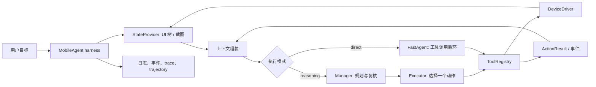

# 从 Mobilerun 学 Agent 工程设计

## 结论先行

Mobilerun 最值得借鉴的不是某一个 prompt 或模型，而是把 Agent 放进一个可观测、可约束、可替换的执行系统：模型负责选择下一步，确定性代码负责状态采集、工具校验与分发、预算控制、结果归档和失败收尾。

这能解释它为什么具备成为实用框架的工程基础，但要谨慎使用“成功”一词：源码可以证明架构选择和测试覆盖，不能单独证明用户增长、商业成功或某个设计的因果贡献。本文因此把“优秀设计”理解为从代码中可观察到、值得迁移的工程特征。

## 一次运行的全景

源码入口是 [`MobileAgent`](../../mobilerun/agent/droid/droid_agent.py)：它初始化设备 driver 和 UI state provider，依据设备能力构建工具注册表，再把共享状态、provider 和工具注入子 Agent。Agent 负责决策，harness 负责让决策安全且可运行。

## 1. Agent loop：按任务复杂度选择控制粒度

项目提供两种核心路径，而不是强迫所有任务走同一个循环。

| 模式 | 控制流 | 适合场景 | 主要代价 |
|---|---|---|---|
| Reasoning | Manager 规划/复核 → Executor 选择一个动作 → 重新观察 | 多步骤、需适应中间状态的任务 | 更多模型调用与编排开销 |
| Direct | FastAgent 生成工具调用 → 执行 → 将结果回送模型 → 重复 | 短任务、明确操作 | 规划显式性较弱，长任务更依赖模型自我管理 |

Reasoning 模式的关键设计是让 Executor 每次只执行一个动作。动作之后由 Manager 基于新的设备状态和执行历史决定继续、调整计划还是结束。这缩小了每次决策的影响范围，也让失败可以在下一轮被重新评估。实现可见 [`droid_agent.py`](../../mobilerun/agent/droid/droid_agent.py) 与 [`executor_agent.py`](../../mobilerun/agent/executor/executor_agent.py)。

Direct 模式不是把“工具列表”交给模型后就放任执行。[`FastAgent`](../../mobilerun/agent/fast_agent/fast_agent.py) 将解析、执行、结果回传、完成判定组织成 loop；每轮重新读取 UI 状态，并在达到最大步数或连续格式错误时停止。

**可迁移做法**

- 先定义 loop 的状态转移和终止条件，再写 prompt。明确每轮输入、模型输出、工具副作用、观察反馈以及 done / failed / retry 状态。
- 让每次模型动作尽量小且可核验。需要长任务时，在动作之后重新观察，不要假设动作必然产生预期页面。
- 按任务风险和复杂度提供不同策略，但让它们共享相同的工具和结果契约；否则每种模式都会演化成独立系统。
- 预算必须属于 loop 的硬约束，例如最大步数、总 deadline、单次工具超时和重试上限。模型不能自行放宽这些限制。

## 2. Context：维护“当前有用的信息”，而非堆积对话

Mobilerun 的上下文分为几类：原始任务、当前 UI 状态、上一状态、最近动作及结果、计划/进度、可选记忆、应用专属说明、截图和结构化输出约束。它们由 [`MobileAgentState`](../../mobilerun/agent/droid/state.py) 保存，并按 Manager、Executor、FastAgent 的职责分别注入。

值得借鉴的是“共享事实，按角色组装上下文”，而不是让每个 Agent 持有一份彼此矛盾的状态副本。例如 Executor 构造 prompt 时只取最近五个动作；Manager 用错误标记决定是否带入最近失败记录；FastAgent 限制历史长度，并把当前设备状态和记忆注入发送给模型的消息副本，不污染持久对话历史。视觉输入也受配置控制，截图会按 provider / 模型的坐标契约缩放。

Manager 还可以选择有状态或 stateless 变体。前者保留多模态消息历史；后者每轮基于共享状态重建上下文。它体现的是上下文策略的显式选择，而不是“一种记忆方案适合所有任务”。

**可迁移做法**

- 把状态拆成事实类别：用户目标、当前观察、动作结果、长期记忆和运行元数据。定义每类数据的来源、更新者、保留期和可信度。
- 让上下文组装发生在边界层，按 Agent 的职责筛选；不要把完整状态对象或无限历史直接拼给模型。
- 优先保留最近观察、失败证据和未完成目标。历史压缩要能丢弃冗余，同时不能丢失关键约束与执行结果。
- 对图片、索引、坐标等模态数据定义明确契约：模型看到的图像尺寸、文本中的坐标空间和工具使用的原生坐标必须一致。
- 对外部消息、记忆和用户输入标注来源，并在涉及工具调用时按不可信输入处理。

## 3. Tool：模型提议，程序执行并给出可判定结果

[`ToolRegistry`](../../mobilerun/agent/tool_registry.py) 是工具注册、能力过滤、prompt 描述和执行分发的单一入口。工具 schema 同时用于向模型说明可用操作及解析参数；执行时统一注入 [`ActionContext`](../../mobilerun/agent/action_context.py)，并将返回值规整成 [`ActionResult`](../../mobilerun/agent/action_result.py)。未知工具、参数错误和工具异常会变成失败结果；工作流还可收到 `ToolExecutionEvent`。

该边界让设备操作、用户自定义工具和 MCP 工具能共用一套调用路径。启动时，harness 根据 driver 与 provider 的 capabilities 移除不支持的工具；模型不会被告知一项实际无法执行的能力。凭据也只有在 `type_secret` 工具确实注册时才进入可用密钥上下文。

**可迁移做法**

- 为每个工具定义机器可读参数 schema、用途描述、权限/副作用、超时策略和结构化结果。描述应告诉模型何时用、成功意味着什么、失败如何表现。
- 给工具加输入校验、权限检查、幂等策略、超时和可审计结果。工具函数不应把“没有抛异常”等同于业务成功。
- 在调用前做 capability / policy 过滤；调用后返回结构化结果，并将调用参数、耗时、结果和失败类别送入事件/日志。
- 按副作用风险限制并行：查询可并发，依赖前序结果或写操作应串行，失败时明确取消后续依赖动作。
- 保持安全秘密与普通上下文分离，只暴露模型完成当前操作所需的秘密标识或受限能力，不把 secret 原文放进 prompt 或日志。

## 4. Harness：把模型接入一个有边界的运行时

在这个项目里，harness 不是“多包一层 prompt”。它是连接 Agent 决策和真实设备的运行时：

- **设备与观察适配**：选择 Android/iOS/远程 driver，并配对对应 `StateProvider`。UI tree 和截图被转换成统一状态。
- **能力与工具装配**：根据 driver/provider 能力、配置和凭据构建工具集合，再注入 Agent。
- **运行控制**：统一处理异步 workflow、最大步骤、deadline、取消、外部消息、失败返回和 finalize。
- **进度与复盘**：通过 workflow event stream 暴露执行进度；日志、OpenTelemetry trace 和本地 trajectory 分别记录运行诊断、调用链和设备级过程。
- **扩展入口**：允许注入 driver、state provider、LLM、prompt、自定义工具和 MCP 工具，让测试与真实部署共享主体执行路径。

其中尤其值得学的是职责分离：provider 负责“观察和解释 UI”，driver 负责“执行设备 I/O”，registry 负责“调用工具”，Agent 负责“决定下一步”，MobileAgent 负责“组装并控制一次运行”。这让平台适配不必渗入每个 prompt 和 agent loop。

**新项目的最小 harness 清单**

1. 运行 ID、任务输入、取消信号、全局 deadline 和最大迭代数。
2. 明确的 Observe → Decide → Act → Verify 生命周期，每个阶段有结构化输入输出。
3. 一个可替换的环境 adapter，以及一个集中、可过滤、可审计的工具注册表。
4. 统一错误分类：模型/网络、协议解析、工具执行、环境状态、预算耗尽和用户取消。
5. 可消费的事件流及可脱敏的轨迹记录；明确日志/trace 中可能包含的 prompt、UI、截图和参数。
6. 最终结果对象同时表达成功与否、原因、步骤/用量和可选结构化输出；不得只靠模型口头宣布完成。

## 5. 可靠性：失败恢复需要状态机和停止条件

项目里的可靠性不是单一“让模型再想想”。Manager 输出有解析和 schema 校验，非法结果会有限重试；FastAgent 对格式错误的工具调用给出针对性修正提示，连续三次错误后停止，避免无限重试或错误执行。Reasoning loop 在连续动作失败达到阈值时把错误历史升级给 Manager。两种路径都有最大步数；顶层工作流有 deadline 和独立的 finalize 预算。

工具执行失败也会作为观察回到 loop。Direct 模式发现同一批中某个动作失败后，会跳过依赖该动作成功的后续调用，避免盲目继续。完成状态由明确的 `complete` 工具或 Manager 的结构化回答触发，再由顶层 finalize 形成结果。

**新项目的恢复策略**

| 失败类别 | 建议处理 |
|---|---|
| 可重试的网络/模型错误 | 有上限的退避重试，并记录实际尝试次数 |
| 模型协议/参数错误 | 返回精确校验信息；有限纠正；超限后停止 |
| 工具业务失败 | 将结构化失败结果反馈给 Agent；检查是否可安全重试 |
| 环境状态不确定 | 重新观察，再决定；不要基于过时 UI 继续写操作 |
| 预算耗尽/取消 | 确定性终止并保留部分结果，不让 Agent 覆盖运行策略 |
| 高风险副作用 | 默认要求确认、幂等键或明确授权，并验证最终状态 |

## 6. 可观测性与评测：知道发生了什么，且知道是否真的完成

项目同时提供 workflow events、logging、LLM tracing 和本地 trajectory。它们回答的问题不同：事件流用于实时集成，日志用于运行诊断，trace 用于查看模型/工具调用层级，trajectory 用于复盘具体 UI 与动作。异步轨迹写入也降低了磁盘记录对执行主路径的阻塞。

需要保留一个重要边界：动作成功不等于任务成功，模型说“完成”也不等于外部系统状态正确。项目现有评测文档区分 mock 驱动的回归测试和真实模型/设备能力评测，并指出缺少统一、固定数据集驱动的端到端 benchmark。因此，设计新 Agent 时应为任务定义独立 oracle，例如读取真实设置值、页面状态或业务记录，而不是让 Agent 自评。

建议按风险分层评测：解析器与工具协议单测 → 状态机和错误路径集成测试 → 关键能力专项评测 → 固定初始状态的端到端任务集。记录成功率、样本数、步骤数、耗时、模型成本、恢复率和失败分类，并保留可复核证据。可参阅 [`agent-evaluation.mdx`](./agent-evaluation.mdx) 与 [`observability.mdx`](./observability.mdx)。

## 7. 面试表达：一段可直接改写的回答

> 我研究 Mobilerun 时，最有启发的不是它用了哪个模型，而是它把 Agent 做成一个可控制的运行时。复杂任务里，Manager 负责规划和复核，Executor 每次只执行一个动作；简单任务走直接工具调用循环。两种 loop 共享状态、工具注册表和环境适配层，因此策略可以变化，执行契约不必重复实现。
>
> 我尤其关注三处工程边界：第一，上下文不是无限对话，而是把当前 UI、最近动作、失败证据和任务进度按角色筛选；第二，模型调用工具必须经过集中 registry，做能力过滤、参数校验和统一结果回传；第三，harness 管理 deadline、最大步数、重试上限、事件流和轨迹记录。这样模型负责不确定的决策，程序负责确定的约束与执行。
>
> 如果把这些经验用于新项目，我会先定义任务状态机、工具副作用和独立成功判据，再实现 observe-decide-act-verify loop；之后补齐预算、错误分类和事件追踪，最后用固定任务集评测真实成功率，而不是把单测通过或模型自报完成当成 Agent 能力。

面试追问时可以用具体实现展开：[`droid_agent.py`](../../mobilerun/agent/droid/droid_agent.py) 展示 harness 和两种 loop 的路由；[`state.py`](../../mobilerun/agent/droid/state.py) 展示共享状态；[`tool_registry.py`](../../mobilerun/agent/tool_registry.py) 展示工具契约；[`test_fast_agent_malformed_tool_guard.py`](../../tests/test_fast_agent_malformed_tool_guard.py) 展示协议失败的停止边界；[`test_android_vision_coordinate_contract.py`](../../tests/test_android_vision_coordinate_contract.py) 展示视觉坐标契约测试。

## 8. 带走的设计原则

- **用环境反馈闭环，而不是让模型猜动作是否成功。** 每次有副作用的动作后都观察并验证。
- **用代码承载硬约束，用 prompt 承载软策略。** 权限、预算、解析、能力过滤和终止条件不能只写在提示词里。
- **共享状态，但按职责组装上下文。** 避免多个 Agent 对事实各自维护副本，也避免把所有数据都塞进每次调用。
- **让工具成为稳定 API。** schema、错误、成功语义和副作用要比自然语言描述更明确。
- **优先构建可调试的最小系统。** 先有事件、失败分类、轨迹和独立评测，再扩展 agent 数量或记忆复杂度。
- **把风险放在 loop 设计里。** 可逆读取和不可逆写入不应共享同一套权限、重试和确认策略。
