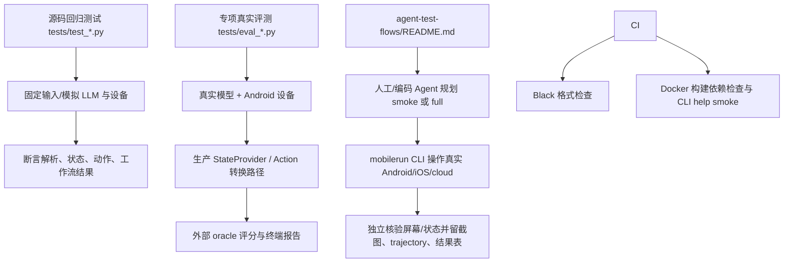

# Mobilerun Agent 评测：现状与方法论

本文说明 Mobilerun 当前如何验证 Agent，并给出一套可重复、可比较、可定位问题的评测流程。

先区分两种常被混称为“Agent 评测”的工作：

- **软件回归测试**：检验解析器、工作流、工具和设备适配代码是否符合预期，通常由固定输入和 mock 驱动。
- **Agent 能力评测**：让真实 LLM 在真实或仿真的设备上完成任务，再独立验证任务是否真的完成。

项目目前有大量前者，也有面向特定视觉坐标问题的真实设备/模型评测脚本；但没有发现统一的、固定数据集驱动的端到端 Agent benchmark。`agent-test-flows/` 是供测试执行者参考的覆盖指南，不是自动化评测程序。评测结论应明确自己属于哪一类，不能把单元测试全绿等价为 Agent 任务成功率有保证。

## 当前评测架构



### 1. pytest 回归测试

- 测试放在 [`tests/`](../../tests/) 下，主要以 `test_*.py` 命名，可由 pytest 收集。
- 常见策略是用 fake LLM、`AsyncMock` driver、构造出来的 UI 树和 mock workflow 来隔离外部依赖，然后针对返回值、状态变化、调用参数、异常路径做断言。
- 这些测试适合快速覆盖边界条件和回归缺陷，不需要 API 密钥或连接设备；但它们不测模型在开放任务上的成功率。

有代表性的测试：

| 评测层面 | 示例 | 检验内容 |
|---|---|---|
| 单步 UI 动作 | [`test_android_tap_obstructions.py`](../../tests/test_android_tap_obstructions.py) | 由真实 formatter/provider/action 组合测试点击坐标、遮挡规避和不应点击时的行为；driver 用 mock |
| 视觉坐标契约 | [`test_android_vision_coordinate_contract.py`](../../tests/test_android_vision_coordinate_contract.py) | provider 声明的模型坐标空间、截图尺寸和坐标还原是否匹配 |
| Agent 输出/工具流 | [`test_fast_agent_multi_block.py`](../../tests/test_fast_agent_multi_block.py) | 多个模型响应 block、工具调用及完成标记的处理 |
| Manager 输出协议 | [`test_manager_response_validation.py`](../../tests/test_manager_response_validation.py) | Manager 结构化结果解析、接受/拒绝边界 |
| 工作流终结 | [`test_finalization_workflow.py`](../../tests/test_finalization_workflow.py) | workflow timeout、用户取消、epilog 和最终事件 |
| Provider/平台适配 | [`test_ios_provider.py`](../../tests/test_ios_provider.py)、[`test_provider_registry.py`](../../tests/test_provider_registry.py) | 状态 provider 和模型 provider 的配置、适配行为 |

测试数据通常直接写在测试函数或 fixture/helper 中，而不是集中在独立 benchmark 数据集。要理解某项能力的回归覆盖，可从目标 `test_*.py` 入手，再追到其调用的生产模块。

### 2. 专项模型/设备评测

当前明确的人工专项评测入口是 [`tests/eval_coordinate_grounding.py`](../../tests/eval_coordinate_grounding.py)。它不是 pytest 测试（文件名不以 `test_` 开头），需要连接 Android 设备并配置模型凭据。

它采用一条较有代表性的“真实关键链路 + 外部 oracle”方法：

1. 用 `AndroidDriver` 连接设备并读取屏幕状态。
2. 通过生产环境的 `AndroidStateProvider(vision_enabled=True)` 获取 UI 快照。
3. 从真实 accessibility tree 中选择带文字和 bounds 的屏幕元素作为目标。
4. 按生产路径生成带坐标网格、调整到模型有效尺寸的截图，并将设备状态和目标文字发给模型。
5. 解析模型给出的 `click_at` 点，调用生产 `_convert_action_point()` 还原为设备原生坐标。
6. 用 accessibility bounds 作为外部 oracle，报告点是否命中目标及距目标中心的像素距离。

这个评测检验的是“模型图像 grounding + 截图尺寸契约 + 坐标转换”的组合行为，不是完整任务完成率。当前脚本逐目标打印结果，未自动汇总置信区间或整体 pass/fail 阈值；需要评测者按场景解释和比较数据。

运行方式见脚本说明：

```sh
.venv/bin/python tests/eval_coordinate_grounding.py [serial]
```

### 3. 面向真实设备的 smoke/full 测试流程

[`agent-test-flows/README.md`](../../agent-test-flows/README.md) 提供人工/编码 Agent 执行测试时的覆盖建议：

- 模式：vision/non-vision、reasoning/non-reasoning。
- 平台：Android、iOS 及 cloud backend。
- 交互：打开应用、点击、输入、滚动、滑动、多步导航、返回/主页。
- 模型与认证：代表性模型/provider、API key/OAuth、登录和 token refresh。
- 功能：macro 录制/回放等。

执行者自行选择任务、模型和深度。要求通过截图、`mobilerun device ui` 或其他设备读回方式独立确认结果，并保存截图/trajectory 和结果表。Smoke 目标约 10–15 分钟；full 可能需要数小时。由于没有固定 task 集合和统一打分器，这个流程适合发布/PR 人工回归，但不同执行者的结果天然可能不完全可比。

### 4. CI 当前覆盖范围

- [`.github/workflows/black.yml`](../../.github/workflows/black.yml) 执行 Black 格式检查。
- [`.github/workflows/docker.yml`](../../.github/workflows/docker.yml) 在相关 PR 上构建 Docker 镜像、执行 `pip check` 并运行 CLI `--help` smoke test。
- [`pyproject.toml`](../../pyproject.toml) 配置 pytest 搜索路径；Contributing 文档说明开发依赖，但当前可见 GitHub Actions workflow 中没有自动运行 pytest 的 job，也没有设备级 Agent benchmark job。

所以本地开发时不能只依赖 PR CI 判断行为测试是否通过；需要自行执行 pytest 或相关专项评测。

## 评测涉及的目录与代码

| 路径 | 评测中的职责 |
|---|---|
| [`tests/`](../../tests/) | pytest 回归用例、mock/fake、少量专项评测脚本 |
| [`agent-test-flows/`](../../agent-test-flows/) | 人工 smoke/full 覆盖建议，强调真实设备、独立核验和证据留存 |
| [`mobilerun/agent/fast_agent/`](../../mobilerun/agent/fast_agent/) | FastAgent 推理/工具调用流程与事件 |
| [`mobilerun/agent/manager/`](../../mobilerun/agent/manager/) | Manager 规划、响应解析及验证 |
| [`mobilerun/agent/executor/`](../../mobilerun/agent/executor/) | 子目标执行和工具 dispatch |
| [`mobilerun/agent/droid/`](../../mobilerun/agent/droid/) | 顶层工作流、Agent 状态、设备初始化、执行循环和完成结果 |
| [`mobilerun/agent/utils/actions.py`](../../mobilerun/agent/utils/actions.py) | action 的坐标转换与设备操作逻辑 |
| [`mobilerun/tools/ui/`](../../mobilerun/tools/ui/) | 状态 provider、UI 快照、树处理及平台 UI 状态实现 |
| [`mobilerun/agent/trajectory/`](../../mobilerun/agent/trajectory/) | 异步保存事件、状态、截图及轨迹文件 |
| [`.github/workflows/`](../../.github/workflows/) | 当前自动化 CI 检查入口 |

真实 Agent 跑任务时，主要可观测数据通过 workflow events、logging、tracing 和 trajectory 记录。有关这些观测通道和隐私边界，参见 [可观测性架构](./observability.mdx)。

## 推荐的方法论：从局部正确性到真实任务成功

### 第 1 层：单元/组件级回归

**目的：** 验证确定性代码和边界条件，而非模型智能。

1. 针对解析器、provider、action、状态机、错误恢复分别写小测试。
2. 用固定输入和 mock 隔离 LLM、网络、设备等不确定依赖。
3. 断言可观察行为，而非内部实现细节：例如点击是否发出、传入的坐标是否正确、工作流最终事件是否符合预期。
4. 对关键失败路径也写用例：格式错误、无 bounds、空 UI、设备断连、超时、工具失败、重复或非法完成信号。

建议命令：

```sh
pytest -q tests/test_android_vision_coordinate_contract.py tests/test_android_tap_obstructions.py
pytest -q
```

### 第 2 层：Agent/LLM 协议回归

**目的：** 验证模型输入输出和 agent 编排边界稳健，不把每次模型内容变化都当成业务回归。

1. 用 fake LLM 回放已知响应，覆盖 Manager 计划解析、FastAgent tool blocks、工具参数及完成协议。
2. 断言调用序列、工具参数、共享状态变化和最终结果。
3. 尽可能用 schema/不变量断言，避免仅对整段自然语言做易碎的字符串匹配。
4. 对真实模型引入的变化，优先保留最小复现输入作为 fixture，再决定是否需要 prompt 或 parser 调整。

相关代码通常在 `tests/test_*agent*.py` 与 `tests/test_*response*.py`；生产调用链主要是 `agent/manager/`、`agent/executor/`、`agent/fast_agent/`。

### 第 3 层：专项能力评测

**目的：** 针对不确定、依赖模型或真实 UI 的单项能力，设计测量量和独立 oracle。

以坐标 grounding 为例，可复用 [`eval_coordinate_grounding.py`](../../tests/eval_coordinate_grounding.py) 的结构：

1. 明确测量对象（点击点/目标元素）和失败定义。
2. 使用真实模型的实际图像输入路径，包括截图 resize、grid、状态文本和坐标映射。
3. 由独立来源（accessibility bounds、已知控件、应用存储值）判断结果，而不是相信 agent 自报成功。
4. 记录原始模型输出、转换后的动作、命中与误差，支持失败复核。
5. 对模型/provider、屏幕分辨率、UI 状态做分层结果，避免平均值掩盖特定分组失效。

同样的模式可用于 OCR/目标定位、元素索引、输入文本准确度、页面导航和 macro replay。

### 第 4 层：端到端任务评测

**目的：** 测试用户目标是否真的达成，以及过程是否可靠、可复现、代价合理。

建议建立一个固定的小型任务集，每个任务都带有：

- 唯一 ID、自然语言目标、前置状态和适用平台。
- 明确的成功条件（例如设备当前 Activity、页面中的目标文本、设置值、应用状态）。
- 独立校验方法；优先读取设备状态或应用数据，避免 LLM 自我评价。
- 风险等级、是否允许写入/联网/购买，以及失败后的清理策略。
- 期望运行模式和关键配置。

执行时按任务固定设备镜像/初始页面、Mobilerun 版本、模型/provider、prompt/config 和超时。需要比较模型时，一次只改一个因素；每个任务重复运行多次，以估计随机波动。真实物理设备仅运行只读、可恢复且明确授权的操作。

### 第 5 层：分析失败和做发布决策

将每次失败按可行动根因分类，而不只记“失败”：

- 观察失败：UI tree/screenshot 缺失或过时。
- Grounding 失败：选错元素、坐标越界/偏移。
- 规划失败：子目标不正确或循环。
- 执行失败：工具参数、driver 或设备动作失败。
- 验证失败：动作执行了但没有检查目标状态。
- 基础设施失败：模型/API、OAuth、Portal、网络、超时或配额。
- 评测失败：oracle 不可靠、初始状态漂移、证据缺失。

保留错误类别及原始证据，区分产品回归、模型波动和环境故障；对于已知配额/基础设施问题，应标记 skip/blocked，而不是混入模型准确率的分母。

## 建议统一报告的指标

| 指标 | 定义/用途 |
|---|---|
| 任务成功率 | 由独立 oracle 确认成功的任务数 / 有效运行数；提供样本数，不把 skip/blocked 隐藏在分母中 |
| 首次成功率 | 每项任务第一次运行即成功的比例，体现真实体验 |
| 动作成功率 | 工具执行成功数 / 工具调用数；不能替代任务成功率 |
| 步数与耗时 | 成功任务完成步数、端到端时间；建议报告中位数及分位数 |
| 模型用量/成本 | token、请求次数、估算费用；用于质量与成本权衡 |
| 恢复率 | 遇到可恢复错误后最终完成的任务比例 |
| Grounding 指标 | 目标命中率、像素距离分布、越界/拒绝率 |
| 稳定性 | 多次重复成功率与方差；小样本时明确样本量 |
| 安全性 | 未授权写操作、错误目标操作、意外外部副作用；应作为独立门槛 |

不要只报告平均成功率。至少同时列任务级成功/失败、样本数、模型/平台/模式、失败分类和可复核证据。视觉、reasoning、平台等配置切片应分别报告。

## 一个可执行的评测节奏

### PR 快速回归

1. 对改动相关的 `test_*.py` 跑定向 pytest。
2. 对 parser/action/provider/工作流的核心改动跑完整 pytest。
3. 运行格式检查；当前 CI 的 Black 也会检查格式。
4. 如改动涉及模型请求/设备坐标/视觉处理，至少运行对应专项合约测试。

### 发布前 smoke

1. 从 [`agent-test-flows/README.md`](../../agent-test-flows/README.md) 选择少量核心任务。
2. 覆盖本次发布涉及的 Agent 模式、平台和视觉配置。
3. 在真实设备上执行，外部检查目标状态，保存截图或 trajectory。
4. 汇报运行版本、模型/provider、设备、结果和阻塞原因。

### 发布前 full

1. 扩展到主要平台、vision/reasoning 组合、工具类别、认证和模型/provider。
2. 固定任务集和初始状态；各任务重复运行。
3. 计算任务成功率、首次成功率、耗时、动作数、费用和安全指标。
4. 将失败归类并与已知良好 release 比较。
5. 检查未经授权的副作用为零；有高风险回归时阻止发布。

## 结果记录模板

建议每次评测都保存一张机器可读或 Markdown 表格，至少包含：

| 字段 | 示例 |
|---|---|
| Run / commit | commit SHA、发行版本、日期 |
| Task ID / 初始状态 | 固定任务标识及设备/应用准备条件 |
| Device / platform | emulator 型号、Android/iOS 版本或 cloud backend |
| Agent config | Fast/Reasoning、vision、坐标模式、关键限制 |
| Model/provider | 精确模型 ID、认证类型、相关参数 |
| Repetitions | 运行次数、成功数 |
| Outcome | oracle 结论、失败阶段、失败分类 |
| Metrics | 步数、时长、token/成本、动作结果、专项误差 |
| Evidence | trajectory、截图、trace 链接或日志位置 |
| Notes | quota、网络、设备漂移、已知限制 |

证据文件可能包含任务文本、截图、UI 内容和工具参数。设置访问权限与保留时间；不要把凭据、个人信息或未经清理的生产数据放入公开报告。

## 当前体系的局限与改进优先级

1. **缺少统一 Agent benchmark harness。** 任务、重复次数、oracle、指标和报告格式尚未由公共 runner 统一管理。
2. **人工评测较依赖执行者判断。** `agent-test-flows/` 指明覆盖面和证据原则，但没有固定任务/自动打分脚本。
3. **专项模型评测范围窄。** coordinate grounding 评测覆盖特定 Android UI、模型和坐标契约，不能代表 iOS、复杂多步任务或总体成功率。
4. **CI 与测试套件未自动联通。** 当前可见 CI workflow 检查格式和 Docker/CLI smoke，但没有 pytest job 或设备评测 job；建议在 CI 加入可稳定运行的 pytest 分层任务，并将设备/模型评测保留为显式、可控的发布门禁。
5. **结果比较需要更强实验控制。** 未来可添加固定任务定义、可复位模拟器快照、oracle 插件、重复执行 runner、结构化结果 JSON 和基线比较。

最务实的演进顺序是：先给人工 smoke/full 建立固定任务与结果 schema；然后从最稳定、无真实模型密钥依赖的测试开始接入 CI；最后再为有价值的真实设备/模型 benchmark 加独立 runner 与明确发布阈值。

## 相关文档

- [可观测性架构](./observability.mdx)
- [工作流事件](./events-and-workflows.mdx)
- [Agent 架构](./architecture.mdx)
- [Tracing 与 trajectory 配置](/features/tracing)
