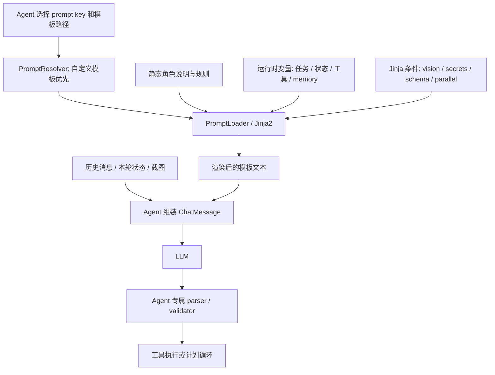
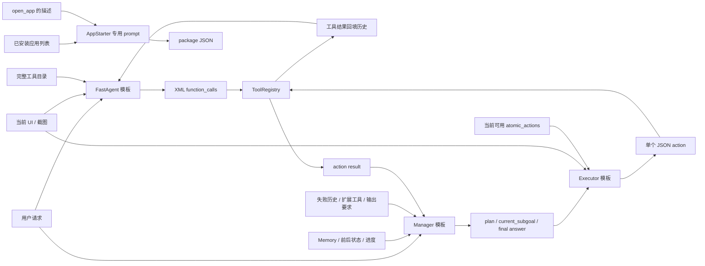

# Agent Prompt 设计与流程

本文说明 Mobilerun Agent 流程中各个 LLM 调用的 prompt 属于哪个 Agent、何时构造、传入哪些字段、字段的用途，以及不同执行模式之间的差异。

## 先看流程：一次任务有多次、不同职责的 LLM 调用

主 Agent 有两种运行方式，由 `agent.reasoning` 配置决定：

```text
reasoning = false
  FastAgent（单 Agent、工具调用循环）
    prompt -> LLM 生成工具调用 XML -> ToolRegistry 执行
    -> 工具结果进入对话 -> 下一轮 prompt -> complete 结束

reasoning = true
  Manager（规划） -> Executor（单步执行） -> Manager（重新规划/判断完成）
    Manager prompt -> 输出 plan / current_subgoal / answer
    Executor prompt -> 输出单个 JSON action
    ToolRegistry 执行 -> 执行结果进入共享状态 -> 下一轮 Manager prompt
```

推理模式下，`manager.stateless=true` 会将普通 Manager 替换为 Stateless Manager。Stateless Manager 仍负责规划，但不向 LLM 发送累积对话历史，而是每次用当前共享状态重新构造一份 prompt。

此外，Android 的 `open_app` 按名称或描述启动时可能触发辅助的 AppStarter LLM 调用，用来把用户说的应用名称匹配到已安装应用包名。它不是每轮主 Agent prompt 的一部分。

## Prompt 从哪里来

默认模板是 Jinja2 文件，Agent 根据配置路径载入并渲染：

| Agent 调用 | 默认模板 |
|---|---|
| FastAgent system | [`fast_agent/system.jinja2`](../../mobilerun/config/prompts/fast_agent/system.jinja2) |
| FastAgent 初始 user | [`fast_agent/user.jinja2`](../../mobilerun/config/prompts/fast_agent/user.jinja2) |
| 有状态 Manager system | [`manager/system.jinja2`](../../mobilerun/config/prompts/manager/system.jinja2) |
| Stateless Manager 单轮 prompt | [`manager/stateless.jinja2`](../../mobilerun/config/prompts/manager/stateless.jinja2) |
| Executor 单动作 prompt | [`executor/system.jinja2`](../../mobilerun/config/prompts/executor/system.jinja2) |

模板路径及默认选择由 [`config_manager.py`](../../mobilerun/config_manager/config_manager.py) 中的 `FastAgentConfig`、`ManagerConfig`、`ExecutorConfig` 和 `AgentConfig.get_*_prompt_path()` 管理。Manager 未指定 `system_prompt` 时，会按 `manager.stateless` 自动选择 `manager/system.jinja2` 或 `manager/stateless.jinja2`；明确配置了路径则使用用户指定的模板。

`PromptResolver` 会先按 key 查找运行时自定义模板，例如 `fast_agent_system`、`fast_agent_user`、`manager_system`、`executor_system`；如果没有自定义模板，才加载 AgentConfig 指定的模板文件。两种来源都由 [`PromptLoader`](../../mobilerun/config_manager/prompt_loader.py) 用 Jinja2 渲染。缺失字段默认为空字符串；额外传入但模板没有引用的字段不会出现在最终文本里。

相关实现：

- [`prompt_resolver.py`](../../mobilerun/agent/utils/prompt_resolver.py)：自定义 prompt key 与覆盖规则。
- [`prompt_loader.py`](../../mobilerun/config_manager/prompt_loader.py)：文件读取和 Jinja2 渲染。
- [`droid_agent.py`](../../mobilerun/agent/droid/droid_agent.py)：创建 `PromptResolver` 并向子 Agent 传递。

`manager/rev1.jinja2`、`manager/trained.jinja2` 和 `executor/rev1.jinja2` 是可由配置路径显式选用的模板；它们不是当前默认自动选择的路径。

## 模板的共同设计方法

这些模板不是“把任务描述写长一点”，而是将 LLM 的工作拆成几类边界清晰的信息：

1. **角色边界**：说明模型是直接操作工具的 FastAgent、负责计划的 Manager，还是只执行当前子目标的 Executor。
2. **上下文槽位**：使用带标签的区块放入任务、设备状态、记忆、计划、动作历史等动态数据，尽量避免把不同来源的信息混成一段文字。
3. **行为策略**：用规则说明模型如何推进任务、使用记忆、验证进度、处理失败或遵守用户的范围。
4. **动作/输出契约**：规定模型回复的标签和格式，供后续解析器稳定提取。
5. **条件段落**：用 Jinja `` 按视觉模式、工具能力、凭据、输出 schema 等上下文选择是否加入相关说明。

概念上的“模板骨架”和运行时组装关系如下：



理解时要区分两件事：**模板结构**决定模型被要求如何工作；**Agent 的消息组装代码**决定本轮实际带给模型哪些历史、UI 状态和图片。模板文件并不总是完整请求的全部内容。

## 默认模板逐段拆解

### FastAgent system：自包含的工具使用手册

默认模板 [`fast_agent/system.jinja2`](../../mobilerun/config/prompts/fast_agent/system.jinja2) 面向一个直接操作设备并负责结束任务的 Agent。它把协议、工具目录、运行策略和示例都放在 system message 中；初始 user message 则由 [`fast_agent/user.jinja2`](../../mobilerun/config/prompts/fast_agent/user.jinja2) 独立承载用户目标。

```text
SYSTEM fast_agent/system.jinja2
┌───────────────────────────────────────────────┐
│ 1. Persona / 任务职责                           │
│ 2. XML tool-call 语法与批次约定                 │
│ 3. Context 解释: UI / screenshot / phone / memory│
│ 4. Available tools + conditional secret IDs     │
│ 5. Response format + conditional examples       │
│ 6. Important rules: 记忆、验证、外部指令、批量动作│
│ 7. Conditional output_schema                    │
└───────────────────────────────────────────────┘
                        +
USER fast_agent/user.jinja2: goal
                        +
每轮动态注入: memory / UI state / history / image / tool result
```

各段的设计意图：

- **Persona 与 1-6 步工作流程**：先要求模型检查状态、说明下一步、调用工具，并检查任务前置条件；未满足时以失败完成，而不是继续盲目操作。
- **工具调用格式**：文本协议采用 `<function_calls><invoke>...`，不是直接让模型生成 Python 或代码。一个 block 可以包含多个 invoke，解析器之后再执行。
- **Context 说明**：明确解释 UI 树、截图、phone state、memory、历史和工具结果分别是什么；`screenshot_only` 条件会告诉模型此运行没有索引化 UI，必须基于截图与坐标工具。
- **工具签名**：将过滤后 Registry 中的动作和参数描述放进 prompt，使模型的选项与运行时可调用工具保持同步。
- **示例按能力切换**：只有 Registry 中存在 `click` 时才展示完整操作示例；是否允许批量动作又由 `parallel_tools` 决定。例子不是仅供阅读，还在演示“先存记忆，再导航，再根据工具结果继续”的循环。
- **批量动作有条件**：同一画面上、相互不影响的操作可组合；会改变页面的动作应拆开，并等待观察结果。这是对吞吐和基于新状态决策之间的折中。
- **记忆与实时用户更正**：`<add_memory>` 约定只追加新事实；`<external_user_message>` 被定义为高优先级的新指令，避免旧计划压过用户刚发来的纠正。
- **输出 schema**：仅配置输出模型时插入额外信息收集要求，并映射到 `complete` 结果，不改变普通交互的基础协议。

FastAgent user 模板刻意很短，只放 `goal` 并提出“下一步是什么”。角色规则和工具协议固定放在 system；逐轮状态则通过历史与运行时注入不断更新。这种拆分避免每轮重复发送完整静态说明。

### Manager system：任务级规划与终止判断

默认模板 [`manager/system.jinja2`](../../mobilerun/config/prompts/manager/system.jinja2) 的重点不是工具调用语法，而是告诉规划器如何遵守用户范围、维护可持续的计划、利用已注册扩展能力，并明确什么时候可以结束。

```text
SYSTEM manager/system.jinja2
┌────────────────────────────────────────────────┐
│ 1. Planner persona + 用户请求                    │
│ 2. Context: date / app card / notes / errors     │
│ 3. 可选 custom actions / secret IDs / output schema│
│ 4. 规划、精确性和 memory guidelines               │
│ 5. 外部用户消息的优先级规则                       │
│ 6. 完成判断 + <plan> / <request_accomplished> 输出│
└────────────────────────────────────────────────┘
                         +
有状态 Manager 对话历史中的 user 消息:
    last thought/action + memory + current/previous UI + 可选截图
```

- **任务与设备事实分区**：日期、app card、失败尝试等用独立标签包裹，仅在有值时渲染，模型更容易区分系统事实、应用说明和错误反馈。
- **规划约束**：例如优先使用 `open_app`、精确匹配文件名和日期、只执行用户要求。这类规则约束计划质量，而不是动作参数。
- **memory 是跨步骤信息接口**：要求保存观察到的事实本身，并带来源/步骤上下文；Manager 写出的 memory 会进入共享状态，再传给后续 Manager 与 Executor。
- **扩展工具只提供给 Manager 作为规划知识**：自定义工具说明告诉 Manager Executor 能做什么；标准动作通常已在其他规划规则和 Executor 的 action signatures 中体现。
- **完成是显式终止协议**：`<plan>` 表示继续，`<request_accomplished success="...">` 表示停止且带成功状态。解析器校验终止标签和 success 属性，不把普通文本当成成功完成。
- **外部消息覆盖旧假设**：运行中用户可以补充或纠正要求；模板要求优先应用最新指导，同时保留已完成的进度。
- **Schema 作为最终信息要求**：输出模型存在时将必需字段和说明渲染为自然语言，Manager 负责确保这些信息被收集并写入最终答复。

与 FastAgent 相比，这个 system 模板不会把全部标准工具签名作为可执行调用协议交给 Manager。Manager 输出的是“做什么/下一步是什么”，由 Executor 再将子目标落成具体动作。

### Stateless Manager：显式状态包，不依赖对话记忆

默认模板 [`manager/stateless.jinja2`](../../mobilerun/config/prompts/manager/stateless.jinja2) 将用户任务、前后状态、计划、memory、最近动作和当前状态合成一份可独立理解的输入：

```text
USER manager/stateless.jinja2
┌───────────────────────────────────────────────┐
│ Request + date                                 │
│ previous_plan / previous_state                 │
│ memory / last_thought / progress_summary        │
│ 最近 action_history                            │
│ current_state                                  │
│ Guidelines + memory 规则                       │
│ 当前状态评估 + plan/answer 输出协议             │
└───────────────────────────────────────────────┘
                      + 可选 screenshot image
```

- **上下文以字段重建而不是消息回放**：每轮 prompt 自带本轮决策需要的状态，因此不依赖之前的 user/assistant 对话消息。
- **字段名称兼作数据契约**：`previous_plan`、`progress_summary` 和 `action_history` 明确区分计划延续、累计完成情况和工具执行证据。
- **只输入最近动作证据**：Agent 代码传入最近最多 5 条动作历史，控制 prompt 体积，也把错误反馈给规划器。
- **要求累计进度摘要**：模板声明没有对话历史，因此 `<progress_summary>` 被要求作为跨轮进度记录；这是其状态重建策略的核心。
- **终止协议更短**：使用 `<answer success="...">`，与有状态 Manager 的 `<request_accomplished>` 不同，但由共享 Manager parser 兼容处理。
- **有意缩小模板能力范围**：默认 stateless 模板没有 app-card、custom actions、secrets 和 output-schema 等区块，避免将 Manager system 模板直接等同于它。

截图不是模板文本字段，而是运行时代码在同一个 user message 中追加的 image block。这样文本状态与视觉状态可以同时送入模型。

### Executor system：把“规划的自由度”收窄成一个动作

默认模板 [`executor/system.jinja2`](../../mobilerun/config/prompts/executor/system.jinja2) 将 Executor 定义为低层动作执行者。结构上它先给出必须完成的子目标，再给严格的解析步骤和当前可执行动作列表：

```text
USER executor/system.jinja2
┌────────────────────────────────────────────────┐
│ 1. Executor persona: 不回答原始问题               │
│ 2. User request / app card / device state        │
│ 3. Overall plan + 当前 subgoal                   │
│ 4. 按 subgoal 提取动作、目标、参数                 │
│ 5. progress_status + 坐标/输入/弹窗等指导          │
│ 6. atomic_actions 工具签名 + 可选 secret IDs       │
│ 7. 最近 5 个 action history                      │
│ 8. literal execution 规则                         │
│ 9. Thought / Action(JSON) / Description 输出协议   │
└────────────────────────────────────────────────┘
                        + 可选 screenshot image
```

- **角色隔离**：Executor 被明确禁止回答用户问题、改写总任务或自行决定后续计划；规划责任留给 Manager。
- **同一目标的多层上下文**：总请求和整体计划用于避免局部动作脱离目标；当前 subgoal 被明确标记为本轮真正执行对象，避免 Executor 自己扩大任务范围。
- **机械映射规则**：将 tap/click、swipe、type、system button、open 等自然语言动作映射到原子动作；同时注入 `atomic_actions` 精确签名，给出实际名称和参数。
- **Literal rule 与异常处理**：要求按子目标执行，避免“觉得有更好办法就替换动作”；最近失败历史则提示不要原样重复失败动作。
- **安全/敏感输入规则**：默认模板包括关闭初始弹窗、避免登录/添加账号、根据焦点状态输入；有密钥时指导使用 `type_secret`，使明文密钥不进入普通文本参数。
- **结构化三段输出**：Thought 给可观测的动作简述，Action 是可解析 JSON，Description 是摘要。`parse_executor_response()` 依靠这些段落定位动作。
- **截图按视觉配置追加**：模板有 `device_state` 和坐标动作说明；图片由 Agent 在 `vision=true` 时附加。无视觉时仍可用结构化 UI state 与元素索引。

此模板刻意不把执行失败升级成自主重规划：失败摘要返回 Manager，由 Manager 决定重试、改计划还是结束。

有一个值得注意的模板内部张力：它要求模型“不要阅读下文，先执行 subgoal”，但后面的下文才包含 subgoal 解析规则、实际可用工具签名和输出格式；同时又要求“不要检查屏幕”却提供 device state，并包含需要结合屏幕判断的弹窗和输入焦点规则。整体意图是降低 Executor 自主规划权，但这几条指令的字面顺序/范围并不完全一致。修改该模板时，应统一“忠实执行 Manager 子目标”和“遵守当前屏幕、安全/工具契约”之间的优先级，避免只加强 literal wording。

## 可选模板版本：设计侧重点差异

除默认模板外，仓库还保留可通过配置显式指定的替代版本。它们共享相同 Agent 调用路径，但文本结构、规则强度和可利用上下文不完全相同。

| 模板 | 相对默认模板的结构 / 意图 | 设计亮点与权衡 |
|---|---|---|
| [`manager/rev1.jinja2`](../../mobilerun/config/prompts/manager/rev1.jinja2) | 内容与默认 Manager 相似，但显式拆为 `User Request`、`Current Context`、`Guidelines`、`Your Task`、`Output Format`。强调先检查 screenshot/progress、按完成/失败/未完成分支输出。 | 章节层次清楚，终止判断步骤更显式；带 output schema、custom actions、secrets 等条件区块。相较当前 system 模板，其表述更像操作说明书，且有更强“遇到不确定就做合理假设”的指导。 |
| [`manager/trained.jinja2`](../../mobilerun/config/prompts/manager/trained.jinja2) | 面向 Android 的紧凑版本；输入是 request、previous plan/state、memory、last thought、progress、action history 和 current state，后接简短 guidelines 与 `<think>/<plan>/<answer>` 协议。 | 上下文标签短、模板紧凑，适合每轮重建式规划；相较默认 Manager 模板，不含 app card、错误历史、custom tools、secrets、output schema 区块，指导也更简洁。不要误认为它是 `stateless.jinja2` 的路径别名：它是显式可选模板。 |
| [`executor/rev1.jinja2`](../../mobilerun/config/prompts/executor/rev1.jinja2) | 章节化成 Context、Your Task、Action Reference、Key Rules、Output Format；列出当前 Registry 原子动作。 | 同样限制 Executor 只做当前 subgoal，并提供三段输出；相比当前默认版，没有同等详细的 subgoal literal parsing、弹窗/键盘/坐标操作细则和 secrets 专门区块，指令更短、执行自由度更大。 |

模板名含 `rev1` 或 `trained` 只说明文件版本/用途；运行时最终采用哪个模板，取决于配置的 prompt path 或运行时自定义 prompt，不能只根据文件名推断。

## 模板结构总览图

这张图强调各 Agent prompt 中信息的“职责流向”，而不是完整运行时消息列表：



Stateless Manager 对应图中的 Manager 节点，但“Memory / 前后状态 / 进度 / 最近动作”全部以本轮显式字段提供；它没有有状态 Manager 的历史消息回放。AppStarter 只在按描述匹配应用时出现，不属于每一轮 Manager/Executor 循环。

## FastAgent：系统规则 + 初始请求 + 累积工具对话

### 调用与消息结构

FastAgent 在 `reasoning=false` 路径使用。入口是 [`FastAgent.prepare_chat()`](../../mobilerun/agent/fast_agent/fast_agent.py)，每个执行步骤在 `handle_llm_input()` 中获取当前设备状态并调用 LLM。

第一次请求的消息大致如下：

```text
SYSTEM: fast_agent/system.jinja2 渲染结果
USER:   fast_agent/user.jinja2 渲染结果（原始 goal）
```

后续请求会将 LLM 回复、工具结果、必要的纠正消息累加到共享 `message_history`。调用模型前构造一份临时消息副本，并把最新状态信息和截图附到最新的 user 消息中；原始历史本身不会被这一步的状态注入修改。

### 字段和用途

#### system prompt 渲染字段

[`FastAgent._build_system_prompt()`](../../mobilerun/agent/fast_agent/fast_agent.py) 提供以下上下文：

| 字段 | 用途 |
|---|---|
| `tool_descriptions` | Registry 生成的工具 XML 签名与说明；告诉模型可调用哪些工具及参数。 |
| `available_tools` | 当前过滤后 Registry 中的工具名集合；模板用它判断示例是否适用。 |
| `available_secrets` | 可用凭据 ID，仅在 `type_secret` 已注册且凭据管理器可用时读取；不包含秘密值。 |
| `parallel_tools` | 是否允许/建议一个 XML block 中并行输出多个工具调用；模板据此调整规则与示例。 |
| `vision` | 是否向模型附上截图；模板说明截图信息是否可用。 |
| `screenshot_only` | 当前是否没有索引化无障碍树、需要只根据截图使用坐标工具。 |
| `platform` | 当前设备平台，填入角色说明。 |
| `output_schema` | 可选的结构化输出约束；模板要求 `complete` 的最终消息包含指定字段。 |
| `variables` | 用户自定义变量；默认 FastAgent system 模板当前不引用它，定制模板可选择使用。 |

#### 初始 user prompt 字段

[`FastAgent._build_user_prompt()`](../../mobilerun/agent/fast_agent/fast_agent.py) 传入：

| 字段 | 用途 |
|---|---|
| `goal` | 当前用户任务，默认模板以 “Current Request” 呈现。 |
| `variables` | 自定义变量；默认 user 模板只显示 `goal`，自定义模板可以引用变量。 |

#### 每轮追加的动态上下文

[`FastAgent.handle_llm_input()`](../../mobilerun/agent/fast_agent/fast_agent.py) 每轮读取状态，并向发送给模型的副本追加：

| 内容 | 注入位置 / 用途 |
|---|---|
| `<memory>` | 最新 user 消息；累积 Agent 记忆，提示模板要求离开含重要信息的页面前保存。 |
| `<device_state>` | 最新 user 消息；当前格式化 UI 状态，通常含可交互元素索引、文本和 phone state。 |
| `<previous_device_state>` | 第二新的 user 消息（如存在）；帮助对比页面/状态变化。 |
| Screenshot image | 最新 user 消息；仅 `vision=true` 且本轮取得截图时添加。 |
| Tool results | 以 user 消息追加到对话历史；让模型观察操作成功与否后再决定下一步。 |
| `<external_user_message>` | 新的用户纠正或追加指令；按最新指令更新动作。 |

FastAgent 的系统模板还直接定义 XML 工具调用协议、记忆协议 `<add_memory>`、完成协议 `complete`，以及批量工具调用规则。模型回复由 `parse_tool_calls_detailed()` 解析；工具调用 XML 与执行结果形成一个来回循环。

## 有状态 Manager：长期对话中的高层规划器

### 调用与消息结构

Manager 用于 `reasoning=true` 且 `manager.stateless=false` 的情况。`prepare_context()` 每轮读取设备状态、可选截图，并把用户任务、上轮动作摘要、外部用户消息写入共享 `message_history`。随后 `get_response()` 生成 system prompt 并组装消息：

```text
SYSTEM: manager/system.jinja2 渲染结果
...   : 共享的累积 message_history（先前的 user / assistant 消息）
USER:   本轮上层上下文（上一轮 thought、action、description 等）
        + memory
        + current device_state
        + 可选 screenshot
```

当前状态和记忆附加到最新 user 消息；上一设备状态会附加到前一条 user 消息（如有）。Manager 不直接选择/执行某个工具，而是返回高层计划、下一子目标或最终答案。`parse_manager_response()` 和响应验证逻辑负责解析/校验输出；格式无效时会将错误反馈给模型并重试。

### 字段和用途

[`ManagerAgent._build_system_prompt()`](../../mobilerun/agent/manager/manager_agent.py) 传入：

| 字段 | 用途 |
|---|---|
| `instruction` | 原始用户任务，作为 `<user_request>`。 |
| `platform` | 设备平台，说明规划目标环境。 |
| `device_date` | 设备日期/时间；帮助理解相对日期和日历任务。 |
| `app_card` | 当前应用的操作说明；提供应用专属帮助。 |
| `important_notes` | 预留字段；目前构造为 `""`，默认模板条件块不会呈现。 |
| `error_history` | 仅进入错误规划状态时提供最近失败动作摘要，提示模型重新评估是否卡住。 |
| `custom_tools_descriptions` | 已注册的非标准扩展工具描述；Manager 可在计划中要求 Executor 使用。 |
| `available_secrets` | 凭据 ID 列表，只有 `type_secret` 可用时填充；模型只获得 ID，不获得值。 |
| `output_schema` | 可选输出模型的 JSON Schema；默认模板将字段约束转成自然语言要求 Manager 最终答复包含的数据。 |
| `variables` | 自定义变量；默认 Manager 模板当前没有引用该字段，定制模板可使用。 |

当前轮的 user 消息由 `_build_user_message_content()` 和 `prepare_context()` 构造，主要含：

| 内容 | 用途 |
|---|---|
| `<thought>` | 上一轮规划的思考摘要，供下一轮接续。 |
| `<last_action>` | 上一轮 Executor 执行的动作对象。 |
| `<last_action_description>` | 上一轮动作摘要或错误文本。 |
| `<external_user_message>` | 执行期间到达的新用户指令，明确优先于旧假设。 |
| `<memory>` | 跨步骤累积的任务事实。 |
| `<device_state>` | 最新 UI 文本/设备状态。 |
| `<previous_device_state>` | 较前一轮状态，用于比较变化。 |
| Screenshot image | 仅启用 Manager 视觉且成功取图时加入最新 user 消息。 |

默认 Manager 模板也直接包含安全/任务边界类的任务规则、记忆规范、规划输出格式和终止格式。结构输出中，`<plan>` 表示继续执行并提供子目标；`<request_accomplished success="...">` 表示任务终止。

## Stateless Manager：每轮重建的一次性规划上下文

Stateless Manager 仍然是规划器，不是另一个动作执行器。它使用 `manager/stateless.jinja2`，但每轮不复用 Manager 的对话 message history。

### 调用与消息结构

[`StatelessManagerAgent._build_prompt()`](../../mobilerun/agent/manager/stateless_manager_agent.py) 渲染出一条完整 prompt；`get_response()` 将它作为单条 user 消息发送：

```text
USER: manager/stateless.jinja2 渲染结果
      + 可选 screenshot image
```

它以共享状态字段模拟“跨轮记忆”：之前计划、之前设备状态、累积 memory、上轮 thought、progress summary、最近动作历史、当前设备状态都会按需重新塞入本轮 prompt。动作历史最多取最近 5 条。

### 字段和用途

| 字段 | 用途 |
|---|---|
| `instruction` | 原始任务目标。 |
| `platform` | 设备平台；当前 stateless 默认模板正文未引用。 |
| `device_date` | 设备日期/时间。 |
| `previous_plan` | 上一轮计划，避免无历史对话时丢失规划方向。 |
| `previous_state` | 上轮设备状态，供当前状态比较。 |
| `memory` | 累积事实记忆。 |
| `last_thought` | 上轮规划的简短思考。 |
| `progress_summary` | 累积已完成内容和当前状态。 |
| `action_history` | 最近最多 5 条 Executor 动作、摘要、结果和错误。 |
| `current_state` | 当前设备状态，是本轮决策的主要 UI 依据。 |

如 Manager 开启视觉且截图获取成功，图片附在同一 user 消息中。stateless 默认模板**没有**有状态 Manager system 模板中的 `app_card`、`error_history`、`custom_tools_descriptions`、`available_secrets` 和 `output_schema` 区块；其运行时 prompt 字段集合也没有传入这些变量。输出则使用 `<think>`、`<add_memory>`、`<progress_summary>`、`<plan>` 或 `<answer success="...">`。Stateless 响应同样通过 Manager 的解析/验证代码校验。

## Executor：单个子目标对应一个原子动作

### 调用与消息结构

Manager 产生 `current_subgoal` 后，DroidAgent 调用 `ExecutorAgent.run(subgoal=...)`。Executor 每次构造一条新的 prompt 并请求模型，不携带 FastAgent/Manager 的累积 chat history：

```text
USER: executor/system.jinja2 渲染结果
      + vision 开启且有截图时附 screenshot image
```

注意默认模板文件名虽然是 `system.jinja2`，Executor 当前仍把渲染后的全文放在 `ChatMessage(role="user")` 中，而不是 `system` role。

### 字段和用途

[`ExecutorAgent.prepare_context()`](../../mobilerun/agent/executor/executor_agent.py) 传入：

| 字段 | 用途 |
|---|---|
| `instruction` | 原始用户目标，为子目标提供总任务背景。 |
| `platform` | 当前设备平台。 |
| `app_card` | 当前应用的操作提示。 |
| `device_state` | 当前可见 UI 状态/元素索引。 |
| `plan` | Manager 生成的整体计划，让 Executor 的单步操作与总目标一致。 |
| `subgoal` | 本次必须完成的当前子目标。 |
| `progress_status` | 累积进度摘要。 |
| `atomic_actions` | 当前 Registry 可用工具签名、参数和描述；`complete` 被排除。 |
| `action_history` | 最近最多 5 条已执行动作、结果及错误，避免重复失败动作。 |
| `available_secrets` | `type_secret` 可用时提供凭据 ID；不提供实际值。 |
| `variables` | 用户自定义变量；默认 Executor 模板当前不引用它，定制模板可使用。 |

Executor 模板的核心要求是按子目标执行**一个**原子动作，输出以下协议：

```text
### Thought
...
### Action
{"action": "click", "index": 3}
### Description
...
```

`parse_executor_response()` 从三个段落中抽取 thought、动作 JSON 和描述；`ExecutorAgent.execute()` 解析动作名称/参数后调用 `ToolRegistry.execute()`。因此 Executor 的 prompt 是离动作执行最近的 LLM prompt。

## 辅助调用：AppStarter 的应用匹配 prompt

Android 默认的 `open_app(text=...)` 工具可能调用 [`AppStarter`](../../mobilerun/agent/oneflows/app_starter_workflow.py)。它先调用 `driver.get_apps(include_system=True)`，再将已安装应用列表和用户描述拼成一段普通文本 prompt，通过 `acomplete_with_retries()` 请求 LLM：

| 输入 | 用途 |
|---|---|
| `apps_list` | 已安装应用 label 和 package name 列表，限定可选结果范围。 |
| `app_description` | 工具 `open_app` 收到的用户目标应用名称/描述。 |
| 输出格式要求 | 只返回 `{"package": "..."}` 或 `{"package": null}`。 |

解析包名后，AppStarter 直接调用 `driver.start_app(package_name)`。这是**专用应用匹配调用**，没有使用 FastAgent/Manager/Executor 的模板，也没有以 ToolRegistry 再分派一次。

如果运行配置走 `open_bundle_id` 精确应用 ID 分支，则不需要这个匹配 LLM 调用。

## 流程对比

| 对比项 | FastAgent | 有状态 Manager | Stateless Manager | Executor |
|---|---|---|---|---|
| 启用条件 / 位置 | `reasoning=false` 主流程 | `reasoning=true` 的规划阶段 | `reasoning=true` 且 stateless | Manager 给出子目标后 |
| 职责 | 自主循环：看状态、直接选工具、判断完成 | 高层规划、更新计划、给出下一子目标或最终答复 | 与 Manager 相同，但每轮重建上下文 | 将一个子目标落成一个原子动作 |
| 默认 prompt 模板 | system + user 两份 | manager system | manager stateless 单份 | executor system 单份 |
| 消息角色 | system + user + 历史往返 | system + 累积历史 | 单条 user 消息 | 单条 user 消息 |
| 主要状态历史 | 对话历史、memory、当前/上一 UI state、tool result | 对话历史、memory、当前/上一 UI state、last action | previous plan/state、memory、最多 5 条 action history、current state | plan/subgoal、当前状态、最多 5 条 action history |
| 工具信息 | 所有 Registry 工具的 XML 描述 | 标准动作由规划规则描述；自定义/MCP 扩展工具单独放入 `custom_actions` | 默认模板没有传工具签名或自定义工具说明 | Registry 实际可用动作签名，排除 `complete` |
| 输出协议 | XML `<function_calls>`；`complete` 终止 | `<plan>` 或 `<request_accomplished>` | `<plan>` 或 `<answer>` | `### Thought / Action / Description`，Action 是 JSON |
| 截图 | vision 开启时附到当前 user 消息 | vision 开启时附到当前 user 消息 | vision 开启时附到单条 user 消息 | vision 开启时附到本轮单条 user 消息 |
| 对话 token 形态 | 随轮次累积；有 `limit_history()` 限制历史消息 | 累积 `message_history`，无此处的裁剪步骤 | 不传累积对话，每轮重建 | 不传累积对话，每个子目标一次新 prompt |

## 关键设计差异与理解建议

1. **Prompt 的职责边界映射 Agent 职责**：FastAgent 获得完整工具说明并直接调用工具；Manager 提供任务级上下文并输出子目标；Executor 获取当前工具签名并执行单步。不要把 Manager 的 `<plan>` 当成工具调用，也不要把 Executor 当成任务最终回答者。
2. **字段有静态与动态两部分**：模板变量形成系统规则/说明；每轮动态注入的状态、记忆、动作结果和截图构成“当前任务现场”。同一个 Agent 的完整 prompt 不只等于 `.jinja2` 文件内容。
3. **Manager 两种模式的上下文策略不同**：有状态模式靠完整对话历史承接上下文；Stateless 模式把必要上下文显式复制到每轮 prompt。两者不应只按模板文字差异理解。
4. **默认 prompt 里的可选字段依条件出现**：例如无可用凭据时没有秘密 ID 区块；无截图时没有图片；未配置 output model 时没有输出字段要求。
5. **传入字段不代表最终 prompt 一定显示**：Jinja 模板必须引用变量才会渲染它。当前有些默认模板不使用 `variables` 或 `platform`，但运行时仍传了这些值；自定义模板可以引用它们。
6. **响应协议是解析器契约**：FastAgent 期待 XML 工具调用；Manager 期待规定的 XML 风格标签；Executor 期待 Markdown 标题段落和 JSON action。改模板时应同步考虑对应解析和验证代码。

## 关键代码入口

| 组件 | 关键代码 |
|---|---|
| 主流程选择、有状态/无状态 Manager 装配 | [`droid_agent.py`](../../mobilerun/agent/droid/droid_agent.py) |
| FastAgent prompt 构造、消息历史与状态注入 | [`fast_agent.py`](../../mobilerun/agent/fast_agent/fast_agent.py) |
| Manager prompt 构造、历史消息与 UI 注入 | [`manager_agent.py`](../../mobilerun/agent/manager/manager_agent.py) |
| Stateless Manager 字段和单消息构造 | [`stateless_manager_agent.py`](../../mobilerun/agent/manager/stateless_manager_agent.py) |
| Manager 输出标签解析与校验 | [`prompts.py`](../../mobilerun/agent/manager/prompts.py) |
| Executor 字段、截图和动作解析调用 | [`executor_agent.py`](../../mobilerun/agent/executor/executor_agent.py)、[`prompts.py`](../../mobilerun/agent/executor/prompts.py) |
| AppStarter 应用匹配 prompt | [`app_starter_workflow.py`](../../mobilerun/agent/oneflows/app_starter_workflow.py) |
| 默认模板目录 | [`config/prompts/`](../../mobilerun/config/prompts/) |
