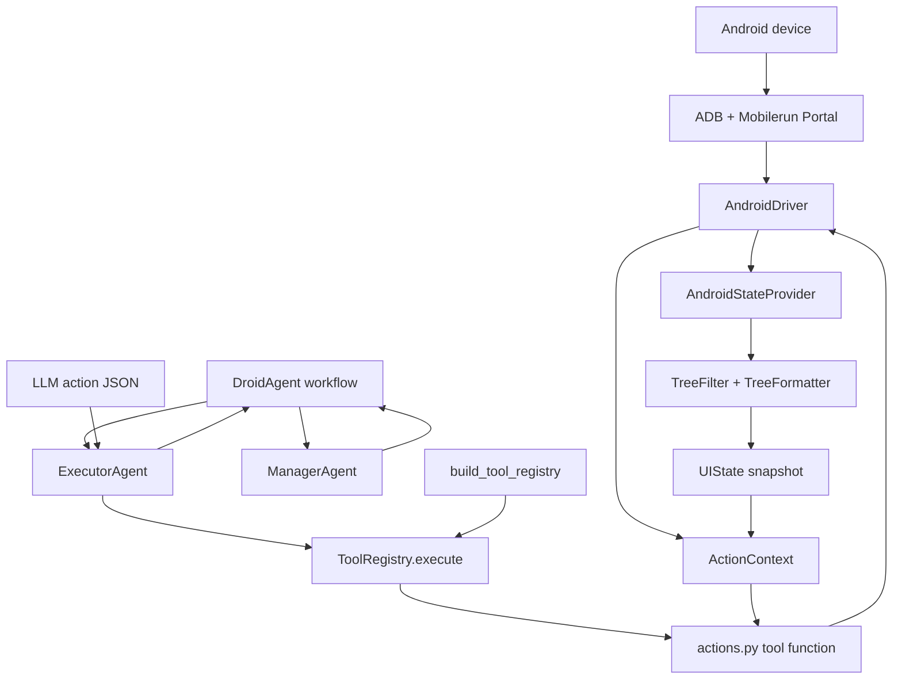

# Android 工具执行架构

本文从 Android 设备 I/O 向上梳理 Mobilerun 的工具执行链：Driver 如何与设备交互，UI 状态如何变成可供 Agent 使用的元素与坐标，工具如何注册、过滤、分派，以及执行结果如何回到 Manager。

## 总览



一次典型点击的运行时调用链：

```text
ManagerAgent 决定当前子目标
  -> DroidAgent.run_executor()
  -> ExecutorAgent.prepare_context() 把状态和工具签名放入提示词
  -> ExecutorAgent.get_response() 请求 LLM
  -> ExecutorAgent.process_response() 解析模型响应
  -> ExecutorAgent.execute() 拆出 action 名和参数
  -> ToolRegistry.execute("click", {"index": 3}, action_ctx)
  -> actions.click(index=3, ctx=action_ctx)
  -> UIState.get_element_coords(3)
  -> AndroidDriver.tap(x, y)
  -> ActionResult -> Executor -> DroidAgent -> Manager
```

## 从设备到 Driver

### AndroidDriver

Agent 初始化时在 [`droid_agent.py`](../../mobilerun/agent/droid/droid_agent.py) 创建并连接 `AndroidDriver`。正常本地 Android 路径大致是：

```python
driver = AndroidDriver(
    serial=device_serial,
    use_tcp=resolved_device_config.use_tcp,
    portal_mode=resolved_device_config.portal_mode,
)
await driver.connect()
```

`AndroidDriver` 实现位于独立依赖 `mobilerun-core-local`，不是本仓库中的 Python 源文件。本仓库通过 `DeviceDriver` 接口使用它；其 Android 设备通信路径是 ADB 加 Mobilerun Portal。接口和能力列表可参见 [`adb-tools.mdx`](../sdk/adb-tools.mdx) 与 [`base-tools.mdx`](../sdk/base-tools.mdx)。

对工具执行最重要的底层方法包括：

| Driver 方法 | 谁会使用 | 意义 |
|---|---|---|
| `tap(x, y)` | `click`、`click_at`、`type`、`type_secret` | 在设备坐标上点击 |
| `swipe(x1, y1, x2, y2, duration_ms)` | `swipe`、`long_press`、`long_press_at` | 滑动或按住不动以实现长按 |
| `input_text(text, clear)` | `type`、`type_text`、`type_secret` | 在当前焦点输入框输入文本 |
| `press_button(button)` | `system_button` | 按下 Android 系统按键 |
| `start_app(package)` | `open_app` 的精确 ID 分支 | 通过包名启动应用 |
| `get_ui_tree()` | `AndroidStateProvider` | 获取无障碍树、设备上下文等原始状态 |
| `screenshot()` | Manager / Executor 视觉上下文 | 获取屏幕截图 |

`DeviceDriver.supported` 是运行时能力集合。Driver 负责设备 I/O，不负责理解 UI 元素索引，也不负责 Agent 工具名。

### Driver 包装层

根据配置，创建底层 Driver 后还可能套一层或多层包装：

```text
RecordingDriver(
  StealthDriver(
    AndroidDriver
  )
)
```

上面是两种包装都启用时的嵌套关系；任一配置关闭时，对应包装层不存在。

这些包装在 [`droid_agent.py`](../../mobilerun/agent/droid/droid_agent.py) 初始化。工具仍面向 `DeviceDriver` 接口调用 `tap`、`swipe` 等方法，不需要知道包装器内部实现。

## 从原始 UI 到可操作状态

Android 工具既可以用元素索引操作，也可以用坐标操作。元素索引不是 Driver 提供的，而是在上层将原始 UI 树处理后得到。

### AndroidStateProvider

[`AndroidStateProvider`](../../mobilerun/mobilerun/tools/ui/provider.py) 通过 `driver.get_ui_tree()` 获取数据，`fetch_state_with_retry()` 提供重试，并在适当情况下尝试恢复 Portal 无障碍服务：

```python
async def get_state(self) -> UIState:
    combined_data = await fetch_state_with_retry(
        fetch=self.driver.get_ui_tree,
        recovery=self._recover_portal,
    )
    return self._state_from_data(combined_data)
```

状态转换 `_state_from_data()` 的主要工作：

1. 读取原始 `a11y_tree`、`phone_state`、`device_context`。
2. 由 `TreeFilter` 过滤树节点。
3. 由 `TreeFormatter` 生成模型可读文本，并给节点分配索引。
4. 生成 [`UIState`](../../mobilerun/mobilerun/tools/ui/state.py)，保存索引化元素、格式化文本、屏幕尺寸和坐标转换信息。

Manager 在每轮获取状态后更新 `ActionContext.ui`，随后 Executor 和工具函数复用这一快照。关键赋值位置见 [`manager_agent.py`](../../mobilerun/mobilerun/agent/manager/manager_agent.py)。

`UIState` 在动作执行中提供两类核心能力：

```python
x, y = ui_state.get_element_coords(index)  # 元素索引 -> 元素可点击坐标
device_x, device_y = ui_state.convert_point(x, y)  # 模型坐标 -> Driver 坐标
```

索引点击通常直接从 UI 元素 bounds 取点；坐标工具则会验证坐标契约，并在归一化坐标或缩放截图模式下转换到 Driver 所需坐标。实际验证与转换逻辑在 [`actions.py`](../../mobilerun/mobilerun/agent/utils/actions.py) 和 [`state.py`](../../mobilerun/mobilerun/tools/ui/state.py)。

## 工具注册：工具名如何映射到函数

### 注册入口

[`droid_agent.py`](../../mobilerun/mobilerun/agent/droid/droid_agent.py) 初始化 Driver 和 StateProvider 后调用 `build_tool_registry()`。标准工具的集中注册定义位于 [`signatures.py`](../../mobilerun/mobilerun/agent/utils/signatures.py)：

```python
registry, standard_tool_names = await build_tool_registry(
    supported_buttons=driver.supported_buttons,
    credential_manager=self.credential_manager,
    platform="android",
    ...
)
```

标准工具注册大致如下，省略各工具的参数说明：

```python
registry.register("click", fn=click, ...)
registry.register("long_press", fn=long_press, ...)
registry.register("click_at", fn=click_at, ...)
registry.register("click_area", fn=click_area, ...)
registry.register("long_press_at", fn=long_press_at, ...)
registry.register("type", fn=type_text, ...)
registry.register("type_text", fn=type_text_direct, ...)
registry.register("system_button", fn=system_button, ...)
registry.register("swipe", fn=swipe, ...)
registry.register("wait", fn=wait, ...)
registry.register("open_app", fn=open_app, ...)  # Android 名称/描述启动分支
registry.register("complete", fn=complete, ...)
```

当凭据管理器中存在密钥时，还会注册 `type_secret`。此外，初始化时可以将用户自定义工具和 MCP 工具注册到同一 Registry。

### Android 标准工具清单

| 工具名 | 绑定函数 | 主要底层能力 | 说明 |
|---|---|---|---|
| `click` | `actions.click` | `tap` + UI 元素索引 | 按索引找到 UI 元素后点击 |
| `long_press` | `actions.long_press` | `swipe` + UI 元素索引 | 在元素坐标上执行定点长滑动 |
| `click_at` | `actions.click_at` | `tap` + 坐标转换 | 按坐标点击 |
| `click_area` | `actions.click_area` | `tap` + 坐标转换 | 点击矩形区域中心 |
| `long_press_at` | `actions.long_press_at` | `swipe` + 坐标转换 | 在坐标上执行定点长滑动 |
| `type` | `actions.type_text` | `input_text`，可选 `tap` + 索引 | 可先点击指定输入框，再输入 |
| `type_text` | `actions.type_text_direct` | `input_text` | 输入到当前已聚焦输入框 |
| `system_button` | `actions.system_button` | `press_button` | Android 支持的按键由 Driver 提供 |
| `swipe` | `actions.swipe` | `swipe` + 坐标转换 | 按起点、终点和持续时间滑动 |
| `wait` | `actions.wait` | 无 Driver 能力要求 | 在 Agent 进程中异步等待 |
| `open_app` | `actions.open_app` | `start_app` + `get_apps` | Android 默认按应用名称/描述查找并启动 |
| `complete` | `actions.complete` | 无设备 I/O | 更新共享任务完成状态；Executor 会隐藏该流程控制工具 |
| `type_secret` | `actions.type_secret` | `tap` + `input_text` + UI 索引 | 仅在凭据管理器存在可用密钥时注册 |

`open_app` 还有精确包名启动分支（`open_bundle_id`），由 visual remote 等配置决定；通常 Android 本地模式注册的是上表中的名称/描述分支。

### ToolEntry 与 ToolRegistry

[`ToolEntry`](../../mobilerun/mobilerun/agent/tool_registry.py) 保存每个工具的函数、提示词参数描述、说明和能力依赖：

```python
@dataclass
class ToolEntry:
    fn: Callable
    params: Dict[str, Any]
    description: str
    deps: Optional[Set[str]] = None
```

[`ToolRegistry`](../../mobilerun/mobilerun/agent/tool_registry.py) 是名称到 `ToolEntry` 的映射，关键 API：

- `register(...)`：注册单个工具。
- `register_from_dict(...)`：批量接入用户/MCP 工具。
- `get_signatures(...)`：提供名称、参数和描述，供提示词生成。
- `disable_unsupported(capabilities)`：按 Driver 与 StateProvider 能力过滤工具。
- `disable(names)`：按配置移除工具。
- `execute(name, args, ctx, workflow_ctx)`：按工具名调用函数，归一化结果并发出事件。

### 注册不等于最终可用

初始化阶段会过滤 Registry：

```python
capabilities = driver.supported | state_provider.supported
registry.disable_unsupported(capabilities)
registry.disable(disabled_tools)
```

例如，Android 的 `click` 依赖 `tap` 和 `element_index`：前者来自 Android Driver，后者来自 AndroidStateProvider。只有能力集合满足依赖，工具才会保留。

配置也会过滤工具。框架默认禁用 `click_at`、`click_area`、`long_press_at`；在特定视觉/坐标模式下，这些工具可能按坐标契约策略启用。因而“源码中注册了”不等于“当前运行中一定对模型开放”。

另一个可见性边界是：Executor 在生成工具签名时排除 `complete`，即 `get_signatures(exclude={"complete"})`。`complete` 是供其他 Agent 流程（如 FastAgent）使用的控制工具，并不是 Executor 可选的普通设备动作。

## 工具函数如何操作设备

工具函数实现位于 [`actions.py`](../../mobilerun/mobilerun/agent/utils/actions.py)。它们接收 `ctx` 关键字参数，并通过 [`ActionContext`](../../mobilerun/mobilerun/agent/action_context.py) 取得 Driver 和当前 UI 快照。

典型的 `click` 过程：

```python
async def click(index: int, *, ctx: ActionContext) -> ActionResult:
    x, y = ctx.ui.get_element_coords(index)
    await ctx.driver.tap(x, y)
    return ActionResult(success=True, summary=f"Clicked ...")
```

典型坐标点击会多一步坐标检查/转换：

```python
async def click_at(x: int, y: int, *, ctx: ActionContext) -> ActionResult:
    abs_x, abs_y = _convert_action_point(x, y, ctx=ctx)
    await ctx.driver.tap(abs_x, abs_y)
    return ActionResult(success=True, summary=f"Tapped ...")
```

注意：`long_press` 和 `long_press_at` 当前通过起点、终点相同的 `driver.swipe(..., 1000)` 实现长按，而不是调用一个单独的 `driver.long_press()`。

## Executor 到 Registry：一次工具调用的完整代码路径

在推理模式下，Manager 给出子目标，外层 `DroidAgent` 启动 Executor，并把动作结果写入共享历史：

```python
handler = self.executor_agent.run(subgoal=ev.current_subgoal)
result = await handler
self.shared_state.action_history.append(result["action"])
```

代码见 [`droid_agent.py`](../../mobilerun/mobilerun/agent/droid/droid_agent.py)。

Executor 把模型生成的 JSON 拆成工具名和参数，再调用 Registry：

```python
action_dict = json.loads(ev.action_json)
action_type = action_dict.get("action", "unknown")
action_args = {k: v for k, v in action_dict.items() if k != "action"}

result = await self.registry.execute(
    action_type, action_args, self.action_ctx, workflow_ctx=ctx
)
```

见 [`ExecutorAgent.execute`](../../mobilerun/mobilerun/agent/executor/executor_agent.py)。Registry 的核心分派逻辑是：

```python
entry = self.tools[name]
if inspect.iscoroutinefunction(entry.fn):
    result = await entry.fn(**args, ctx=ctx)
else:
    result = entry.fn(**args, ctx=ctx)
```

因此，模型动作：

```json
{"action": "click", "index": 3}
```

会被转换为近似的 Python 调用：

```python
await click(index=3, ctx=action_ctx)
```

Registry 会把返回值规范化为 [`ActionResult`](../../mobilerun/mobilerun/agent/action_result.py)。未知工具名、参数 `TypeError` 和执行异常会产生失败结果；如果提供了 Workflow Context，还会发出 `ToolExecutionEvent`，包含工具名、参数、成功标记和摘要。

Executor 最后把动作、成功状态、错误和摘要组成结果；`DroidAgent` 将它们放进 `action_history` 等共享状态。Manager 接着观察新状态和执行结果，决定下一步子目标或结束任务。

## 关键类与代码位置

| 层 | 类 / 函数 | 文件 | 职责 |
|---|---|---|---|
| 设备抽象 | `DeviceDriver` | 外部 `mobilerun-core-local`；接口说明见 [`base-tools.mdx`](../sdk/base-tools.mdx) | 设备 I/O 的统一契约和能力集合 |
| Android 设备 | `AndroidDriver` | 外部 `mobilerun-core-local`；接口说明见 [`adb-tools.mdx`](../sdk/adb-tools.mdx) | 通过 ADB / Portal 连接设备并执行输入、状态读取 |
| Driver 生命周期与装配 | `DroidAgent` | [`droid_agent.py`](../../mobilerun/agent/droid/droid_agent.py) | 建 Driver、包装 Driver、建 Provider 和 Registry |
| 状态采集 | `AndroidStateProvider` | [`provider.py`](../../mobilerun/tools/ui/provider.py) | 获取原始 UI 树、重试恢复、生成 UIState |
| UI 快照 | `UIState` | [`state.py`](../../mobilerun/tools/ui/state.py) | 索引查询、坐标转换、bounds 处理 |
| 工具上下文 | `ActionContext` | [`action_context.py`](../../mobilerun/agent/action_context.py) | 将 Driver、UI、共享状态等注入工具函数 |
| 工具实现 | `click`、`type_text`、`swipe` 等 | [`actions.py`](../../mobilerun/agent/utils/actions.py) | 校验参数/坐标并调用 Driver |
| 注册入口 | `build_tool_registry` | [`signatures.py`](../../mobilerun/agent/utils/signatures.py) | 把标准动作函数注册成可调用工具 |
| 注册表 | `ToolEntry`、`ToolRegistry` | [`tool_registry.py`](../../mobilerun/agent/tool_registry.py) | 保存映射、筛能力、分派工具、归一化结果 |
| 动作结果 | `ActionResult` | [`action_result.py`](../../mobilerun/agent/action_result.py) | `success` 与 `summary` 的统一返回类型 |
| LLM 动作编排 | `ExecutorAgent` | [`executor_agent.py`](../../mobilerun/agent/executor/executor_agent.py) | 生成/解析一个动作、调用 Registry、整理返回值 |
| 子目标与循环 | `ManagerAgent` / `DroidAgent` | [`manager_agent.py`](../../mobilerun/agent/manager/manager_agent.py)、[`droid_agent.py`](../../mobilerun/agent/droid/droid_agent.py) | 规划子目标、运行 Executor、根据结果继续规划 |

## 设计要点

1. **Driver 与工具解耦**：Driver 只提供设备能力；`click(index=...)` 这样的 Agent 语义由 actions 层实现。
2. **UI 状态是独立观察层**：索引和坐标变换由 StateProvider / UIState 负责，不塞进 Driver。
3. **Registry 是单一分派入口**：标准工具、自定义工具和 MCP 工具使用同一个 `name -> ToolEntry` 映射。
4. **能力驱动可用性**：工具用 `deps` 描述依赖，Driver 与 Provider 能力共同决定工具是否可执行。
5. **执行结果结构化**：工具返回 `ActionResult`，Executor 再把结果送回 Manager，而非依赖解析工具函数的日志文本。
6. **源码边界清晰**：本仓库可完整阅读上层编排；Android Driver 的具体 ADB / Portal 传输实现属于 `mobilerun-core-local` 依赖。
