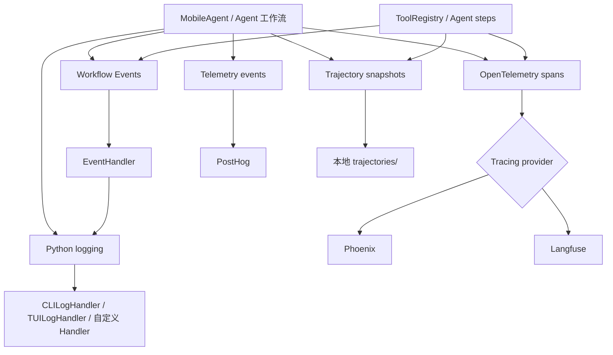

# Mobilerun 可观测性架构

Mobilerun 的可观测性不是单一的监控 SDK，而是由多个用途不同的通道组成：

| 通道 | 主要问题 | 默认去向 |
|---|---|---|
| 日志 | 运行时发生了什么？错误和进度是什么？ | CLI/TUI 或宿主应用的 logging handler |
| 工作流事件 | Agent 当前处于哪个步骤、产生了什么结果？ | LlamaIndex Workflow event stream |
| LLM tracing | 一次 Agent/LLM 调用的输入、输出、耗时和嵌套关系是什么？ | Phoenix 或 Langfuse |
| 产品遥测 | 哪些功能被使用、一次运行的基本结果是什么？ | PostHog |
| 本地 trajectory | 设备每一步的 UI、截图和动作是什么？ | 本地 `trajectories/` 文件夹 |

这几类数据的粒度、生命周期和隐私影响不同。特别是，**日志、trace 和 trajectory 并不等同于匿名产品遥测**；启用 tracing 或 trajectory 可能会保留提示词、设备 UI 或截图，使用前应按部署环境的隐私要求配置。

## 架构概览



粗略理解：

1. Agent 工作流产生步骤事件和诊断日志。
2. 事件流可以被 CLI/SDK 消费；CLI 的 `EventHandler` 将工作流事件转换为 logger 消息。
3. Python logger 的 handler 决定日志如何呈现或收集。
4. OpenTelemetry spans 包含调用层级和 LLM 相关数据，经 Phoenix 或 Langfuse 导出。
5. PostHog 接收少量结构化产品事件。
6. trajectory writer 异步地将运行快照写到本地。

不同通道是**并行的观测面**：例如，写入 `MobileAgentInitEvent` 到 PostHog，不会自动创建 trace span；将 `ScreenshotEvent` 写入工作流，也不等同于把图片上传到 Langfuse。

## 1. 运行日志

### 第三方库及原理

- **Python `logging`（标准库）**：业务代码创建 logger 并发出带等级的 `LogRecord`；handler 决定记录的输出位置和呈现方式。日志级别通常由 debug 配置控制。
- **Rich**：`CLILogHandler` 使用 Rich 的 `Console` 为 CLI/SDK 输出日志，支持颜色和流式文本。项目还提供 `TUILogHandler`，将记录收集成 TUI 可消费的结构。

### 在源码中的实现

- [`log_handlers.py`](../../mobilerun/log_handlers.py) 定义 `configure_logging()`、`CLILogHandler` 和 `TUILogHandler`。`configure_logging()` 配置名为 `mobilerun` 的 logger；额外参数 `color`、`stream` 和 `stream_end` 控制 CLI 输出样式。
- [`cli/event_handler.py`](../../mobilerun/cli/event_handler.py) 将 workflow event 翻译为 logger 调用。它不负责保存 workflow 状态，也不直接渲染；最终输出由已安装的 handler 决定。
- [`droid_agent.py`](../../mobilerun/agent/droid/droid_agent.py) 初始化 MobileAgent 的日志设置；[`__init__.py`](../../mobilerun/__init__.py) 为包消费者安装默认 CLI handler。

因此，库代码可以发出统一的 Mobilerun 日志，CLI、TUI 或 SDK 调用方可以替换 handler 来选择展示方式。

## 2. 工作流事件流

### 第三方库及原理

- **LlamaIndex Workflows**：项目使用其 `Event`、`@step` 和异步 workflow handler 来表达异步工作流。一个步骤可将事件写入 stream，调用方通过 `stream_events()` 消费事件；事件既可表示内部控制流，也可供上层观察。

### 在源码中的实现

- 事件模型分布在 [`common/events.py`](../../mobilerun/agent/common/events.py)、[`manager/events.py`](../../mobilerun/agent/manager/events.py)、[`executor/events.py`](../../mobilerun/agent/executor/events.py)、[`fast_agent/events.py`](../../mobilerun/agent/fast_agent/events.py) 和 [`droid/events.py`](../../mobilerun/agent/droid/events.py)。
- 通用观察事件包括 `ScreenshotEvent`、`RecordUIStateEvent` 和 `ToolExecutionEvent`。其他事件记录 Manager 计划、Executor 动作结果、FastAgent 输出以及任务结束等。
- 工作流步骤通过 `ctx.write_event_to_stream(...)` 发出事件；顶层工作流通过 `handler.stream_events()` 逐个接收子工作流事件，再交给 `EventHandler` 或 trajectory 处理。
- [`tool_registry.py`](../../mobilerun/agent/tool_registry.py) 在 dispatch action 后可发出 `ToolExecutionEvent`，包含工具名称、参数、成功标记和摘要。

**事件流既是控制流也是观测接口**：部分事件推动 workflow 前进，部分事件主要表达执行情况。CLI 的 `EventHandler` 会把事件转为日志；SDK 消费者也可以直接遍历事件流。

## 3. LLM tracing：OpenTelemetry、Phoenix 和 Langfuse

### OpenTelemetry 与 OpenInference 的作用

- **OpenTelemetry (OTel)** 提供 tracing 的通用模型：`TracerProvider` 创建 tracer，span 表示一次操作；parent/child 关系把 MobileAgent、子 agent、LLM 请求和工具调用关联成 trace。OTel 本身主要定义采集与导出机制，不是 trace 浏览器。
- **OpenInference** 为 LLM/Agent 调用约定语义属性，并提供 LlamaIndex instrumentation，让模型输入输出等信息可转换为 spans。
- **OTLP HTTP exporter** 将 spans 用 OTLP 协议发送给兼容端点。项目的 Phoenix 集成通过此方式导出。

### Phoenix

**Arize Phoenix** 是可视化 trace 的后端。Mobilerun 使用 `llama-index-callbacks-arize-phoenix` 提供的 LlamaIndex callback/instrumentation，并在 [`telemetry/phoenix.py`](../../mobilerun/telemetry/phoenix.py) 配置 OTel `TracerProvider`、OTLP HTTP exporter 和 OpenInference `TraceConfig`。端点默认是 `http://0.0.0.0:6006/v1/traces`，可通过 `PHOENIX_URL` 配置；`phoenix_project_name` 用于项目标识。

**源码配置注意**：tracing 初始化阶段的可达性检查读取 `PHOENIX_URL`，而 callback 内的 exporter 从小写 `phoenix_url` 读取发送端点。由于当前初始化没有把显式 endpoint 传给 callback，使用自定义 Phoenix URL 时应核实两处配置一致；默认地址下不存在这个差异。

启用流程由 [`tracing_setup.py`](../../mobilerun/agent/utils/tracing_setup.py) 负责：检查 endpoint 可达后，创建 Phoenix callback handler 并设置为 `llama_index.core.global_handler`。因此 LlamaIndex 调用能进入 Phoenix trace。

### Langfuse

**Langfuse** 是 LLM tracing 与分析后端。Mobilerun 使用 Langfuse Python SDK 创建客户端，并让它管理 exporter、批处理和上传；`openinference-instrumentation-llama-index` 负责把 LlamaIndex 执行转为 OTel spans。

- 初始化也由 [`tracing_setup.py`](../../mobilerun/agent/utils/tracing_setup.py) 完成：解析密钥和 endpoint，准备或复用 OTel provider，启用 LlamaIndex instrumentation，再创建 Langfuse client。
- [`langfuse_processor.py`](../../mobilerun/telemetry/langfuse_processor.py) 在 spans 导出前补充 agent 元信息，格式化 OpenInference 的 LLM 输入/输出，并处理截图 span。其处理器包装 Langfuse 的处理器，不自行创建导出队列或上传器。
- [`record_langfuse_screenshot()`](../../mobilerun/agent/utils/tracing_setup.py) 可把截图作为关联到 Agent/步骤 span 的附件数据发送；仅在 Langfuse tracing 开启、截图 tracing 配置开启且截图没有因 vision 图片已在 LLM span 中而重复时执行。
- Agent 运行入口调用 `setup_tracing()`，见 [`droid_agent.py`](../../mobilerun/agent/droid/droid_agent.py)。`clean_span()` 等 instrumentation helper 用于产生名称清晰且保持父子关系的 span。

Phoenix 和 Langfuse 是**可选的 trace 后端**，不是 PostHog 的替代品。tracing 配置在 [`config_manager.py`](../../mobilerun/config_manager/config_manager.py) 的 `TracingConfig` 中；默认 provider 是 Phoenix。启用 Langfuse 需安装 `mobilerun[langfuse]` 并提供密钥。

## 4. 产品遥测：PostHog

### 第三方库及原理

- **PostHog Python SDK**：通过 `capture(event_name, distinct_id, properties)` 上报离散的产品分析事件。项目使用唯一的 run ID 将同一次运行事件关联，并使用持久化 UUID 作为默认 distinct ID。

### 在源码中的实现

- [`telemetry/events.py`](../../mobilerun/telemetry/events.py) 定义 Pydantic 事件模型，目前包括初始化、访问应用包和任务结束事件。
- [`telemetry/tracker.py`](../../mobilerun/telemetry/tracker.py) 检查配置和环境开关，懒加载 PostHog client，并负责 capture/flush。
- 初始化和结束事件在 [`droid_agent.py`](../../mobilerun/agent/droid/droid_agent.py) 发送；应用包/Activity 访问事件由 [`MobileAgentState.update_current_app()`](../../mobilerun/agent/droid/state.py) 调用。
- `telemetry.enabled` 配置和 `MOBILERUN_TELEMETRY_ENABLED` 环境变量共同决定是否发送；环境变量未设置时，代码默认允许 telemetry，显式关闭任一开关则不发送。旧变量 `DROIDRUN_TELEMETRY_ENABLED` 是兼容回退。
- 进程退出前通过 `flush()` 尝试提交排队事件。

### 数据范围与隐私注意

不要只根据“匿名 telemetry”的产品描述假设上报字段不含任务内容：当前 `MobileAgentInitEvent` 包含 `goal`（任务指令），应用访问事件包含 `package_name` 和 `activity_name`；SDK 还会上报模型/工具配置、成功与步骤等元数据。默认 distinct ID 是保存在 `~/.droidrun/user_id` 的 UUID，也可由调用方提供 `user_id`。若不希望这些事件离开运行环境，请使用 `telemetry.enabled: false` 或 `MOBILERUN_TELEMETRY_ENABLED=false`。

Telemetry 默认的 PostHog host/API key 在 [`tracker.py`](../../mobilerun/telemetry/tracker.py) 中配置。与 tracing 相比，这条通道是针对产品事件模型的分析，不采集完整的每步 LLM trace；不过任务 goal 等字段仍需纳入数据治理评估。

## 5. 本地 trajectory 记录

### 第三方库及原理

- **`aiofiles`** 提供异步文件 I/O，使 Agent 可将待写任务入队，由后台 worker 按 FIFO 顺序写入磁盘。
- **Pillow** 用于从截图文件构造 GIF。
- trajectory 还依赖项目自身的数据模型与序列化逻辑；它不是远程 observability 服务。

### 在源码中的实现

- [`trajectory/writer.py`](../../mobilerun/agent/trajectory/writer.py) 中的 `TrajectoryWriter` 将事件、macro、截图和 UI 状态快照转成写入 job 并提交到有界异步队列。`WriterWorker` 顺序执行写入；队列满或写入超时会记录 warning。
- [`droid_agent.py`](../../mobilerun/agent/droid/droid_agent.py) 按 `logging.save_trajectory` 生命周期启动 writer，在初始化、每步/每动作及结束阶段写快照。
- 配置值为 `none`（默认）、`step` 或 `action`。文件保存在当前工作目录下 `trajectories/` 的运行目录中；`action` 通常比 `step` 产生更多数据。
- 轨迹可包含 `trajectory.json`、UI state JSON、截图以及可选 GIF；结构化轨迹可能保留 action 参数、Agent reasoning/事件内容和设备 UI。

trajectory 适合离线复盘，也意味着数据会留在本地磁盘。需要关注文件访问权限、保留周期及是否应在生产设备上启用。

## 6. 配置与选择建议

| 目标 | 配置入口 | 适用场景 |
|---|---|---|
| 日常查看进度/错误 | `logging.debug` | CLI 与 SDK 运行诊断 |
| 在调用端实时消费 Agent 步骤 | workflow `stream_events()` | 自定义 UI、服务端进度通知、事件集成 |
| 调查模型输入输出及调用链 | `tracing.enabled` + `tracing.provider` | Phoenix 或 Langfuse |
| 排查真实设备 UI 和动作问题 | `logging.save_trajectory: step/action` | 本地重放和细节分析 |
| 统计总体功能使用情况 | `telemetry.enabled` | PostHog 产品分析 |

CLI 示例：

```sh
# 打开 debug 日志
mobilerun run "Open settings" --debug

# 启用 tracing（provider 从 tracing 配置读取）
mobilerun run "Open settings" --tracing

# 本地保存每步 trajectory
mobilerun run "Open settings" --save-trajectory step
```

若希望观测数据最小化，优先保留必要的运行日志和 workflow 状态事件；仅在有诊断需要时启用远程 tracing 或本地 trajectory，并在开启前确认 prompt、UI、截图和工具参数的保存/传输策略。

## 7. 依赖速查

以下依赖和 extras 可在 [`pyproject.toml`](../../pyproject.toml) 中核对。

| 库 | 用途 | 项目中的落点 |
|---|---|---|
| Python `logging` | 日志记录抽象与 handler 分发 | `log_handlers.py`、`cli/event_handler.py` |
| Rich | 美化 CLI 日志输出 | `log_handlers.py` 的 `CLILogHandler` |
| LlamaIndex Workflows | Agent 工作流步骤、事件及异步 event stream | `agent/**/events.py`、`droid_agent.py` |
| OpenTelemetry SDK | 创建和处理 spans、父子调用关系 | `agent/utils/tracing_setup.py`、`telemetry/langfuse_processor.py` |
| OTLP HTTP exporter | 将 spans 发送到 Phoenix OTLP endpoint | `telemetry/phoenix.py` |
| OpenInference instrumentation | LlamaIndex LLM 调用的 trace 语义及采集 | `telemetry/phoenix.py`；Langfuse extra |
| Arize Phoenix callback integration | LlamaIndex 到 Phoenix 的 callback 适配 | `telemetry/phoenix.py` |
| Langfuse SDK（可选 extra） | span 导出、批处理、媒体上传及后端客户端 | `agent/utils/tracing_setup.py` |
| PostHog | 产品事件 capture 与 flush | `telemetry/tracker.py` |
| `aiofiles` | trajectory 后台异步文件写入 | `agent/trajectory/writer.py` |
| Pillow | trajectory 截图 GIF 生成 | `agent/trajectory/writer.py` |

## 相关文档

- [Tracing 与 trajectory 配置](/features/tracing)
- [Telemetry 配置](/features/telemetry)
- [Events and workflows](/concepts/events-and-workflows)
- [SDK 配置参考](/sdk/configuration)
